# Architecture — Serba 99ribu

This file records the application **as implemented on disk** on 2026-10-23 (migrations `0000`–`0034`, 219 `app` tables, 192 `/api/v1` route files). It is read from `src/`, `scripts/`, `migrations/` and `tests/`, not from the selected design. Selected design stays in [docs/spec/04-SYSTEM-ARCHITECTURE.md](docs/spec/04-SYSTEM-ARCHITECTURE.md) and the [ADRs](docs/adr/); owner decisions live in [DECISIONS.md](DECISIONS.md); workflow state lives only in [STATUS.md](STATUS.md); delivery gates live in [RELEASE.md](RELEASE.md). Where this file and the spec differ, this file describes the code, and [Known differences](#known-differences-between-code-and-decisions) lists the gap.

Contents: [Runtime topology](#runtime-topology) · [System map](#system-map) · [Folder structure](#folder-structure) · [Module map](#module-map) · [Worker and jobs](#worker-and-job-registry) · [Request flows](#request-flows) · [Catalog pipeline](#catalog-pipeline) · [Identity and roles](#identity-roles-and-access) · [Storefront](#storefront-architecture) · [Data domains](#data-domains) · [State machines and money flow](#state-machines-and-money-flow) · [Known differences](#known-differences-between-code-and-decisions) · [Slice notes (historical)](#appendix-slice-implementation-notes-historical)

## Runtime topology

One Next.js 16 / TypeScript codebase runs as two processes that share the domain modules in `src/modules/` and one PostgreSQL database (ADR-0001, ADR-0004). Every external effect goes through a simulated adapter in the local profile.

| Part | Entry point | What it does |
| --- | --- | --- |
| Web | `scripts/run-local.ts` (`npm run dev` / `build` / `start`) | Spawns `next` on the fixed loopback listener `127.0.0.1:3099`. Serves storefront pages, the admin console, `/api/auth/*` (Better Auth), `/api/v1/*` (versioned API), `/api/health` and `/media/catalog/*`. Optional second browser origin: `LOCAL_TAILNET_ORIGIN` (Tailscale IPv4, same port). |
| Worker | `scripts/worker.ts local` (`npm run worker`) | Polls `app.outbox_job` (500 ms idle sleep), runs database jobs inside a transaction and leased adapter jobs outside it. The same script exposes host-only simulator commands (`--confirm-payment`, `--autolaris-paid`, `--collect-cod`, `--track-parcel`, `--observe-settlement`, …). |
| Database | `compose.yaml` service `database` (`npm run db:up`) | PostgreSQL 18.6 container with `network_mode: none`, read-only root, TCP disabled (`listen_addresses=`); reachable only through the owner-only Unix socket `.local/pgsocket/.s.PGSQL.5432`. Two databases, `99ribu_local` and `99ribu_test`, each with an `app` role (runtime) and an `owner` role (migrations), created by `src/db/bootstrap.sql`. |
| Connection | `src/db/client.ts:connectDatabase(target, access)` | `postgres` driver + Drizzle over the socket, pool 5, `statement_timeout` 10 s. Database writes are raw SQL tagged templates; `src/db/schema.ts` mirrors the migrations for typing and `drizzle-kit generate`. |
| Migrations | `scripts/migrate.ts` (`npm run db:migrate -- local\|test\|production`) | Applies the immutable `migrations/0000`–`0035` journal as the owner role under a PostgreSQL advisory lock (concurrent runs serialise). |
| Operator CLIs | `scripts/catalog.ts`, `scripts/seed.ts`, `scripts/check-health.ts`, `scripts/database.ts` | Catalog dataset/import/stock/rehome/withdraw, local fixtures and dummy logins, readiness probe, database container control. |
| Test runner | `scripts/check-tests.ts` | Registered `--case=` selectors over `tests/integration/` and `tests/browser/`; refuses empty, skipped or unknown selections. |
| Container image (S84; CODE, CMD on the S82/S83 production profile) | `Dockerfile`, `compose.production.yaml`, `scripts/healthcheck.ts`, `scripts/image-audit.ts` | One digest-pinned image (PID 1 `tini`) for a one-shot migrate service (the only holder of the owner password), web (`next start` on `0.0.0.0:$PORT`, after migrate succeeds) and worker (`scripts/worker.ts production`, heartbeat file); non-root uid `10001`; `/app/.local` is the persistent volume. Storefront pages render per request (`Shell` calls `connection()`; the cart readers rethrow Next's internal errors with `unstable_rethrow`), so the build needs no database. The default command needs the S82/S83 production `migrate.ts`/listener. Not deployed; topology in `RELEASE.md`. |
| Backups (S85) | `scripts/backup.ts`, `src/ops/backup.ts` | Backup sets (database dump + role globals + `catalog-media`/`artifacts` archive + RSA-escrowed auth secret, SHA-256 manifest) to a `file://` or S3-compatible store, retention, verified extract, and a restore drill into a disposable `99ribu_restore_<uuid>` database (refuses servers holding `99ribu_production` or sharing the live cluster's system identifier; checks photo and artifact references and staff TOTP). |

Production profile (S82/S83, code only; nothing deployed): `src/config/runtime.ts:readRuntimeConfig` is the switch on serving paths (web, auth, health, job worker, migrations). `APP_ENV=production` selects `readProductionConfig` (exact https `APP_ORIGIN`, env-only `BETTER_AUTH_SECRET`, every adapter `disabled`, `CLIENT_IP_HEADER` from the one trusted proxy, `0.0.0.0:$PORT`), and `connectDatabase("production")` reaches `99ribu_production` over TCP with SCRAM role passwords (pool 5, `statement_timeout` 10 s, `lock_timeout` 5 s, `idle_in_transaction_session_timeout` 30 s); roles come from `src/db/bootstrap-production.sql`. Migration `0035` allows `environment='production'` only on the 8 real-flow money tables; the 11 `local_*` simulator stores stay `local`/`test` at the database level. Simulators, fixtures and `src/modules/local/*` keep calling `readLocalConfig` and refuse; order placement (`CHECKOUT_CLOSED`), money postings (`PRODUCTION_MONEY_PATH_GATED`) and notification flows stay closed. Details: README "Production profile (S82/S83)".

`src/config/local.ts:readLocalConfig` guards every local process: it requires `APP_ENV=local`, `APP_ORIGIN=http://127.0.0.1:3099`, `PAYMENT_/SHIPPING_/ADS_/NOTIFICATION_/PAYOUT_ADAPTER=simulated` and `EXTERNAL_DISPATCH=disabled`, and refuses provider-prefixed variables (`VIRGO_`, `MENGANTAR_`, `META_`, `FACEBOOK_`, `GOOGLE_ADS_`, `TIKTOK_`, `SMTP_`, `RESEND_`, `SENDGRID_`, `TWILIO_`), auth secret overrides and `DATABASE_URL`/`PG*` overrides.

Private storage (`src/config/local.ts:privateDirectory`) lives under `.local/`, each directory `0700`, owner-only, no symlinks:

| Directory | Owner | Contents |
| --- | --- | --- |
| `.local/postgres` | `compose.yaml` | PostgreSQL data files |
| `.local/pgsocket` | `compose.yaml`, `src/db/client.ts` | Unix socket |
| `.local/auth` | `src/modules/access/local-key.ts` | Per-target signing key `<target>.key` (`0600`) |
| `.local/artifacts` | `src/storage/private.ts` | Private files: label PDFs, payout/return evidence, support attachments, checkout drafts (`checkout-drafts/`) |
| `.local/catalog-media` | `src/storage/catalog-media.ts` | Public catalog photos, content-addressed `<sha256>.webp`, served only through `/media/catalog/` |

## System map

Container-level view. Solid arrows are local paths that run today. Every external system is behind a simulated adapter; the dashed boundary shows what stays gated until its `RELEASE.md` provider gate (S94–S98) or production gate (S82–S89) closes.

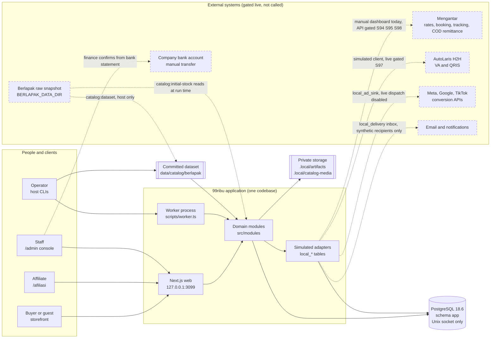

| External | Local stand-in today | Live gate (RELEASE.md) |
| --- | --- | --- |
| Mengantar rates | `src/modules/shipping/rates.ts:localRateAdapter`, `source: 'TEST-ONLY'` | S95; no live adapter code exists yet |
| Mengantar booking | Operator books in the Mengantar dashboard and types courier + resi (`fulfillment/manual.ts:shipManually`); the older `shipping.create` simulator still serves suites | S94; `MENGANTAR_API_BOOKING_ENABLED=false` in `fulfillment/manual.ts` |
| Mengantar tracking | `fulfillment/manual.ts:simulatedTrackingAdapter` reading `local_tracking_observation`; operator fallback `recordTrackingStatus` | S98 |
| Mengantar COD remittance | Finance types the statement (`finance/cod-remittance.ts:recordCodRemittance`) | Manual by design (DEC-007) |
| AutoLaris VA/QRIS | `payments/autolaris.ts:simulatedAutolaris` (DB-backed `local_autolaris_transaction`); `autolarisClientFor` throws `AUTOLARIS_LIVE_GATED` for any non-local target | S97 plus static egress IP whitelist |
| Manual bank transfer | Real flow; confirmation is a finance action with evidence | None beyond configured accounts in the `payment` policy |
| Ads (Meta CAPI, Google Data Manager, TikTok Events API) | `advertising/worker.ts:advertisingAdapter` writing `local_ad_sink` | Consent/destination activation; `EXTERNAL_DISPATCH=disabled` |
| Email / notifications | `integrations/local.ts:dispatchLocal` writing `local_delivery`; Better Auth only accepts `*.test` / `*.invalid` | OD-8 email provider gate |
| Berlapak data | Committed sanitized dataset; raw snapshot read only by host commands | DEC-005; raw snapshot never served or committed |

## Folder structure

```text
99ribu/
├── src/                     application code (shared by web and worker)
│   ├── app/                 Next.js App Router: pages, route handlers, metadata routes
│   │   ├── (storefront)/    public Indonesian routes (DEC-010), server components + Server Actions
│   │   ├── admin/           (console)/ shadcn staff console, including the support/ CS inbox
│   │   ├── api/             auth/[...all] (Better Auth), health, v1/** (versioned business API)
│   │   ├── media/catalog/   public catalog photo route (SEO names → content-addressed files)
│   │   └── layout.tsx, not-found.tsx, robots.ts, sitemap.ts, globals.css, icons
│   ├── components/          storefront/ (shell + client islands), admin/ (console clients), support/, ui/ (shadcn)
│   ├── config/              local.ts (profile guard, private dirs), site.ts (origin, SITE_INDEXING)
│   ├── db/                  client.ts (socket connection), schema.ts (Drizzle mirror), bootstrap SQL for roles
│   ├── jobs/                outbox.ts (enqueue), leases.ts (claim/fence), worker.ts (job registry), probes.ts
│   ├── modules/             24 domain modules, see Module map
│   └── storage/             private.ts (artifacts), catalog-media.ts (photos), media-sniff.ts (magic bytes)
├── migrations/              0000–0034 SQL + drizzle meta journal/snapshots (immutable once applied)
├── scripts/                 run-local, worker, migrate, database, seed, catalog, check-tests, check-health
├── data/catalog/berlapak/   committed catalog dataset: catalog.json, manifest.json, photos/<sha256>.webp
├── tests/                   integration/ (177 files + fixtures), browser/ (15), contract/, historical/, top-level unit tests
├── public/                  brand/, fonts/ (self-hosted Inter), catalog-local/ (S69 fixture copies), fixtures/, prototypes/
├── docs/                    spec/ (canonical design), adr/ (ADR-0001..0007), history/ (archived narrative)
├── design/                  design working files
├── .delivery/               tool-written execution evidence (not hand-edited)
└── .local/                  private runtime state, never committed (see Runtime topology)
```

## Module map

One row per `src/modules/<name>`. "Tables" are the main tables the module writes; "Routes" are the `/api/v1` groups and pages that call it; "Jobs" are outbox kinds it enqueues (E), handles in the database registry (H) or serves as a leased adapter (L). Route handlers are thin: each `route.ts` calls the module's `handleX(request, getLocalAuth())`.

| Module | Owns | Main tables | Routes / pages | Jobs |
| --- | --- | --- | --- | --- |
| `access` | Better Auth wiring, principal/roles/permissions, Origin and body checks, rate limits, staff grants, reauthentication proofs | `role_grant`, `warehouse_membership`, `mfa_session`, `access_proof`, `access_operation`, `audit_event`, `auth_rate_limit` | `/api/auth/*`, `me`, `me/reauthentication-proofs`, `admin/role-grants`, `admin/warehouses`, `admin/policy-versions` | E `local.notification` |
| `accounts` | Buyer profile, address book, notification preferences, contact-change and guest-order-link challenges, return evidence | `buyer_profile`, `buyer_address`, `buyer_identity_challenge`, `buyer_notification_preference`, `return_evidence` | `me/*`, `guest-order-access/*`; page `/akun` | — |
| `advertising` | Commerce events, funnel intake, Meta/Google/TikTok payload mapping to the local sink, destinations, diagnostics/replay | `commerce_event`, `ad_event_outbox`, `ad_delivery_attempt`, `ad_destination_config`, `order_ad_attribution`, `local_ad_sink` | `admin/advertising/**`, `consent/receipt`, `funnel/events`, `visitor-sessions` | E/L `advertising.dispatch` |
| `affiliates` | Affiliate enrollment and profile, beneficiary changes, referral touches, order attribution, rate versions | `affiliate_account`, `affiliate_profile`, `referral_touch`, `order_attribution`, `affiliate_rate_version` | `me/affiliate`, `referral-touches`, `admin/affiliates/*/rates`; page `/afiliasi` | E `affiliate.payout.queue` |
| `catalog` | Categories, stock items, products/offers and revisions, publication and withdrawal, dataset import, feed builder; `validation.ts` is shared | `category`, `stock_item`, `product`, `product_revision`, `offer`, `offer_component`, `publication_head`, `publication_version`, `publication_withdrawal` | `admin/categories`, `admin/products/**`, `admin/stock-items`; admin page `/admin/catalog` | — |
| `checkout` | Guest/cart/order access cookies, carts, quotes, order submission and expiry; `exceptions/` holds commerce exceptions and recovery refunds | `commerce_guest_context`, `cart`, `cart_line`, `checkout_quote`, `commerce_order`, `order_item`, `order_shipment`, `fulfillment_item`, `order_event`, `order_access`, `commerce_exception` | `carts/**`, `checkout/quotes/**`, `orders`, `orders/{id}`, `destinations`, `admin/commerce-exceptions/**` | E/H `checkout.order.expire`, E/H `recovery.refund.callback`, E/L `recovery.refund.create` |
| `commissions` | Commission accrual, receipt-anchored H+10 maturity, holds, voids, affiliate balances | `commission_entry`, `commission_adjustment` | `me/affiliate/{balance,commissions}` | E/H `commission.accrue`, `.receipt`, `.claim`, `.void`, `.mature`, `affiliate.payout.queue` |
| `consent` | Visitor session bootstrap and consent receipts | `visitor_session`, `visitor_bootstrap_request`, `consent_receipt` | reached through `advertising` | — |
| `documents` | Label templates, label jobs and private TEST PDFs, print batches and attempts | `shipping_label_template(_version)`, `shipping_label_job`, `shipping_label_artifact`, `shipping_print_batch`, `shipping_print_attempt` | `admin/label-*`, `admin/shipments/*/label*`, `admin/shipping-label-templates`; page `/admin/print-center` | — |
| `finance` | Ledger and economic receipts, costs and contribution, order history; `settlements/` (statement, match, recovery); manual bank confirmation; AutoLaris queue and callback intake; COD remittance | `finance_transaction`, `finance_posting`, `economic_receipt`, `provider_settlement`, `settlement_match`, `manual_bank_confirmation`, `manual_bank_reference`, `autolaris_observation`, `autolaris_callback`, `cod_remittance`, `cod_remittance_line`, `component_cost_version` | `admin/reconciliation/**`, `admin/settlements`, `admin/finance`, `admin/orders`, `admin/manual-transfers/**`, `admin/autolaris-payments/**`, `admin/cod-remittances/**`, `admin/cod-collectible-parcels`, `payments/autolaris/callbacks`; pages `/admin/payments`, `/admin/cod-settlements` | E/H `settlement.callback`, E/H `cod.remittance.match` |
| `fulfillment` | Fulfillment lifecycle, calendar deadlines and notices, booking/handover, waybill cancellation; `manual.ts`: warehouse mode, pickup profile, manual resi, Berlapak reference, tracking adapter and poll | `fulfillment`, `fulfillment_event`, `fulfillment_deadline`, `shipment_booking`, `shipment_cancellation`, `warehouse_pickup_profile`, `manual_tracking`, `fulfillment_purchase_reference`, `shipment_tracking_event` | `admin/fulfillments/**`, `admin/manual-shipments`, `admin/shipments`, `admin/warehouses/*/pickup-profile`; page `/admin/fulfillment` | E/L `shipping.create`, `shipping.cancel.create`; E/H `shipping.callback`, `shipping.cancel.callback`, `fulfillment.deadline`, `fulfillment.notice`, `fulfillment.tracking.poll` |
| `integrations` | Local notification dispatcher (no network sender) | `local_delivery` | — | H `local.notification` |
| `inventory` | Positions, lots, movements, reservations and expiry, warehouse transfers | `inventory_balance`, `inventory_lot`, `stock_movement`, `stock_reservation(_item/_component)`, `warehouse_transfer`, `transfer_receipt` | `admin/inventory/**` | E/H `inventory.reservation.expire` |
| `local` | Local fixtures, fixture clock, dummy logins, Berlapak dataset generator, initial stock, origin rehome | `local_fixture_namespace`, `local_fixture_principal`, `local_fixture_warehouse` (plus seed writes through other modules) | scripts and tests only | — |
| `orders` | Buyer order receipt/continuity projection and receipt cookies | — (reads) | `orders/{id}/receipt`; page `/pesanan/[orderId]` | — |
| `payments` | Payment channels and terms, attempts, local prepaid simulator, COD confirmation and collection, AutoLaris client/simulator and advice polling | `payment_attempt`, `payment_attempt_event`, `payment_provider_event`, `payment_event_result`, `local_payment_operation`, `cod_confirmation`, `cod_event_result`, `autolaris_payment`, `local_autolaris_transaction` | `orders/{id}/payment-attempts/**`, `orders/{id}/cod-collections` | E/L `payment.create`, `payment.autolaris.advice`; E/H `payment.callback`, `cod.callback` |
| `payouts` | Affiliate payout queue, manual transfer claim/verify, evidence upload | `affiliate_payout`, `affiliate_payout_entry`, `affiliate_payout_event`, `affiliate_payout_evidence` | `admin/payouts/**`, `me/affiliate/payouts` | — |
| `promotions` | Shipping promotion configuration, reservations, allocation, expiry | `promotion`, `promotion_version`, `promotion_reservation`, `promotion_movement`, `promotion_allocation` | `admin/shipping-promotions/**` | E/H `promotion.reservation.expire` |
| `reporting` | Dashboard snapshot, work queues, CSV exports, operation status | `admin_export_selection` | `admin/dashboard`, `admin/work-queues`, `admin/export-selections`, `admin/exports`, `operations/{id}` | — |
| `returns` | Return cases and inspection, parcel receipts, refunds, replacements and their recovery | `return_case`, `return_item`, `buyer_receipt`, `refund`, `refund_allocation`, `replacement_shipment`, `replacement_booking` | `admin/returns/**`, `admin/refunds/**`, `admin/replacements/**`, `orders/{id}/returns/**`, `orders/{id}/refunds/**` | E/L `refund.create`, `replacement.shipping.create`; E/H `parcel.receipt.callback`, `refund.callback`, `replacement.shipping.callback`, `replacement.receipt.callback` |
| `settings` | Versioned company/warehouse policies (`commercial`, `payment`, `warehouse_calendar`) | `policy_head`, `policy_version` | served through `access` at `admin/policy-versions` | — |
| `shipping` | Address normalisation, destinations, parcel allocation, simulated rates, shipping-benefit check (pure) | — | used by checkout, accounts, storefront | — |
| `storefront` | Server-side storefront reads, cart/checkout BFF, draft files, SEO, navigation | — (reads; drafts in `.local/artifacts`) | `products`, `products/{id}`, `categories`; every `(storefront)` page, `layout.tsx`, `robots.ts`, `sitemap.ts` | — |
| `support` | Buyer/guest/staff conversations, challenges, attachments, notes, tags, saved replies, SSE stream | `support_conversation`, `support_message`, `support_attachment`, `support_challenge`, `guest_support_identity`, `support_assignment_event` | `support/**`, `admin/support/**`, `guest-support-sessions`; page `/admin/support` | — |

Shared infrastructure outside `src/modules/`: `src/jobs/` (outbox, leases, registry, probes), `src/storage/`, `src/config/`, `src/db/`.

## Worker and job registry

Every job is an `app.outbox_job` row written in the caller's domain transaction (`src/jobs/outbox.ts:enqueueJob`). Two lanes exist:

- **Database jobs** (`src/jobs/worker.ts:DATABASE_JOBS`, the sole registry): run inside one transaction with a savepoint; effect and job completion commit together. Seal kinds: `complete`, `defer` (handler may reschedule) and `expiry` (order ownership resolved first). Retryable errors (`40P01`, `55P03`, `57014`, `PAYMENT_RECONCILIATION_PENDING`, `TRACKING_ADAPTER_UNAVAILABLE`, `COD_COLLECTION_PENDING`) back off up to 60 s; others dead-letter.
- **Leased adapter jobs** (`scripts/worker.ts` adapter map, `src/jobs/leases.ts`): claim with a fencing token and 30 s lease, dispatch outside database locks, settle by token; uncertain outcomes are reconciled by looking up the original identity, never by blind retry.

| Lane | Kinds |
| --- | --- |
| Database | `local.notification`, `inventory.reservation.expire`, `promotion.reservation.expire`, `checkout.order.expire`, `payment.callback`, `cod.callback`, `settlement.callback`, `parcel.receipt.callback`, `refund.callback`, `recovery.refund.callback`, `replacement.shipping.callback`, `replacement.receipt.callback`, `shipping.callback`, `shipping.cancel.callback`, `fulfillment.deadline`, `fulfillment.notice`, `fulfillment.tracking.poll`, `cod.remittance.match`, `commission.accrue`, `commission.receipt`, `commission.claim`, `commission.void`, `commission.mature`, `affiliate.payout.queue` |
| Leased adapter | `payment.create`, `payment.autolaris.advice`, `advertising.dispatch`, `shipping.create`, `shipping.cancel.create`, `refund.create`, `recovery.refund.create`, `replacement.shipping.create` |
| Housekeeping (throttled, once per minute per process) | `deleteExpiredGuestContexts` (DEC-002), `redactAutolarisCallbacks` (raw callback bodies emptied after 30 days) |

## Request flows

Storefront Server Actions do not make HTTP calls: `src/modules/storefront/*` builds a `Request` and calls the same route handler (`handleCheckout`, `handlePayments`) in process, so `/api/v1/...` paths below are logical routes. Cookie names carry the prefix `99ribu-local.` or `99ribu-test.`.

### Guest checkout to order

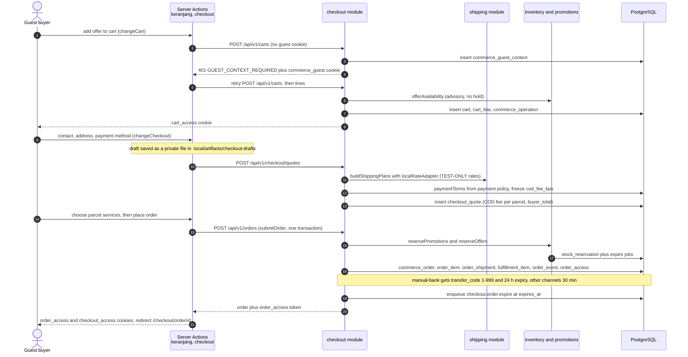

Order expiry (`checkout/expiry.ts:expireOwnedOrderJob`) releases stock and promotion holds and sets `status=cancelled, payment_status=expired`, unless the order is paid or COD-confirmed. It defers while a manual transfer can still be confirmed (12 h grace after the 24 h window) or while a final AutoLaris advice read is pending (30 min).

### Payment: manual bank, COD, AutoLaris

The channel is chosen at checkout and frozen on the order (`commerce_order.payment_channel`: `local-prepaid`, `manual-bank`, `autolaris`, `cod`; `payments/methods.ts:PAYMENT_CHANNELS`). All prepaid channels end in the same `payment.callback` processing that posts the economic receipt.

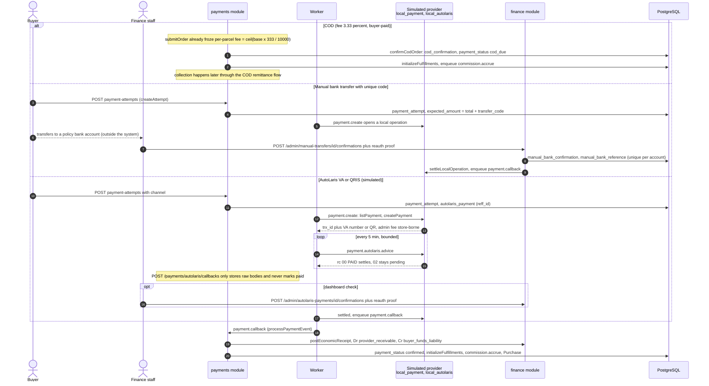

A mismatched or late amount is not dropped: it posts a recovery adjustment, sets the attempt to `unknown` and opens a `commerce_exception` for finance. The legacy `local-prepaid` channel is settled by `scripts/worker.ts --confirm-payment`; `--autolaris-paid` makes the simulated AutoLaris account report paid.

### Consignment fulfillment (manual Mengantar booking)

Every warehouse is in `manual_dashboard` mode today: `fulfillment/manual.ts:fulfillmentMode` returns `mengantar_api` only for a complete pickup profile with `MENGANTAR_API_BOOKING_ENABLED`, which is hard-coded `false`.

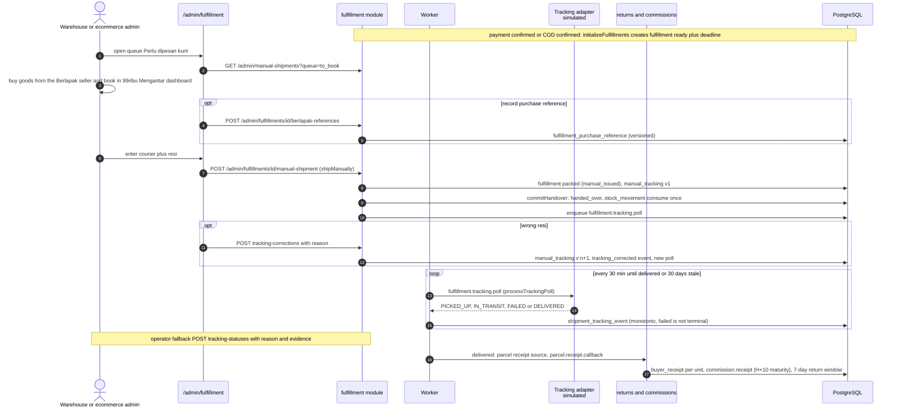

### COD remittance and settlement

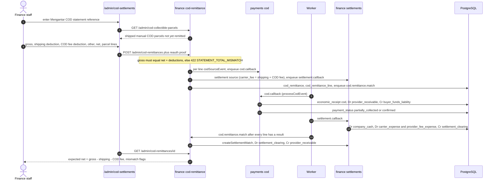

## Catalog pipeline

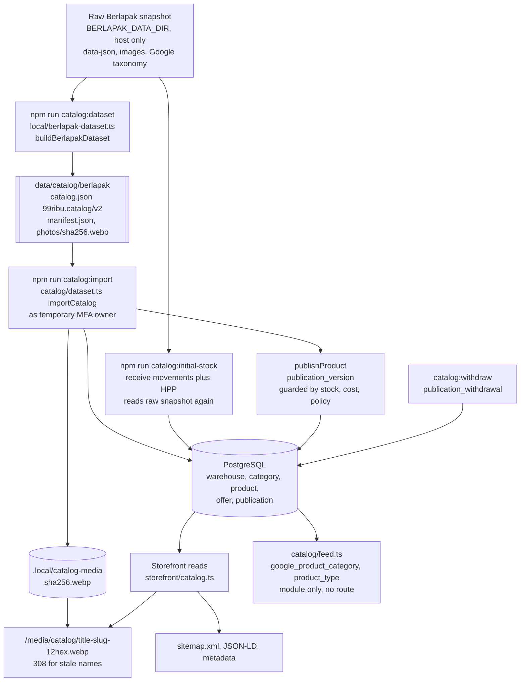

- **Generator** (`src/modules/local/berlapak-dataset.ts`): classifies every product into the 14 DEC-011 departments (`DEPARTMENTS`, ordered `DEPARTMENT_RULES`, `CATEGORY_OVERRIDES`; refuses unclassified products, stale overrides and departments under 8 products), pins Google product categories (taxonomy `2021-09-21`), cleans descriptions (`cleanDetails`, claim terms kept and reported per DEC-013), writes alt text (clean title, `, foto N` after the first) and derives warehouse origin keys (first 32 hex of SHA-256 of `99ribu:berlapak-warehouse:<id>`). Output carries no supplier names, HPP or stock.
- **Import** (`src/modules/catalog/dataset.ts:importCatalog`): creates missing origin warehouses (`warehouse.origin_key`, audited `catalog.warehouse.create`), categories, stock items, products/offers bound to their origin warehouse and bundle contents; stores each photo with `src/storage/catalog-media.ts:saveCatalogMedia` (WebP only, ≤ 512 KB, content-addressed, atomic hard link) and records image URLs as `<origin>/media/catalog/<title-slug>-<12 hex>.webp`; then publishes ready products through `publishProduct`. Rerunning is idempotent.
- **Operator commands** (`scripts/catalog.ts`): `initial-stock` (one `receive` and one cost version per never-stocked item, into its origin warehouse), `rehome` (dry run, or `--apply` moves stock to origin warehouses through audited transfers), `withdraw` (dry run, or `--apply` withdraws current publications outside the committed dataset).
- **Public reads** honour only current, non-withdrawn publications (`not exists publication_withdrawal`). The photo route (`src/app/media/catalog/[file]/route.ts`) resolves the 12-hex prefix to exactly one file, 308-redirects stale or bare-hash names to the canonical name and serves the canonical file with a one-year immutable cache, `nosniff` and `sandbox` CSP.
- **Feed**: `catalogFeed`/`feedXml` build a Google Merchant RSS item list with `google_product_category` (per SKU, else department default from the dataset) and `product_type` (Indonesian category path). It is called only by tests today; no route serves it.

## Identity, roles and access

Better Auth (`src/modules/access/auth.ts:createLocalAuth`) runs email/password with mandatory email verification and the `twoFactor` plugin (TOTP plus backup codes), cookie sessions of 7 days, mounted at `/api/auth/[...all]` behind `access/handler.ts:handleAuth`, which allowlists twelve endpoints, enforces JSON ≤ 16 KB, strips session tokens from bodies and applies per-account limits (sign-in and TOTP 5/min). Roles live in `app.role_grant.roles` (checked list); warehouse scope lives in `app.warehouse_membership`.

| Role | Scope | Console pages | MFA |
| --- | --- | --- | --- |
| `owner` | Company, all warehouses | All, plus `/admin/support`; only role that grants roles and appends policies | Required; fresh MFA (≤ 5 min) plus reauthentication proof for owner writes |
| `ecommerce_admin` | Assigned warehouses | Catalog (edit), fulfillment (incl. pickup profiles), print center (sidebar entry since the 2026-10-24 owner decision) | Required |
| `warehouse` | Assigned origin warehouses (at least one) | Catalog (stock view), fulfillment, print center | Required |
| `customer_service` | Not warehouse-scoped; replies only on claimed conversations | `/admin/support` | Required |
| `finance` | Company-wide finance; order history needs warehouse scope | Payments, COD settlements (with `finance.reconciliation.read`; confirm/record controls need `finance.reconciliation.write`, otherwise disabled with a reason), catalog costs (with `finance.costs.read`) | Required; reauthentication proof for reconcile/refund/confirm actions |
| `buyer` | Own resources (default when no grant row) | — | No |
| `affiliate` | Own profile, balances, payouts | — (`/afiliasi`) | No; beneficiary change needs a reauthentication proof |

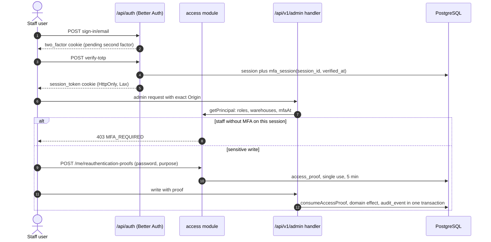

Guest commerce authority (ADR-0007) uses HttpOnly capability cookies, never URL tokens: `commerce_guest` (7 days), `cart_access`, `order_access` (path `/api/v1/orders/<id>`), and the alias `checkout_access` (path `/checkout/order/<id>`); verified guest-order access goes through `guest-order-access/challenges`. Sign-in and sign-out revoke the guest context. The console navigation (`src/app/admin/(console)/staff-roles.ts`) is only a convenience gate; `src/components/admin/console-access.ts:consoleAccess` derives the sidebar entries, finance write controls, CSV export (`exports.download`) and KPI shortcuts from the same roles and grants, and the signed-out preview offers no actions. Every API handler rechecks role, warehouse scope and MFA.

## Storefront architecture

- **Routes** (`src/app/(storefront)/`, DEC-010): `/`, `/kategori`, `/kategori/[slug]`, `/produk/[slug]`, `/cari`, `/keranjang`, `/checkout`, `/checkout/order/[orderId]`, `/pesanan/[orderId]`, `/akun`, `/afiliasi`, `/promo`, `/bantuan`, `/tentang`, `/kontak`, `/privasi`, `/syarat`, `/masuk`. All pages are async server components wrapped in `components/storefront/shell.tsx:Shell` (the group has no `layout.tsx`); most declare `dynamic = 'force-dynamic'`. `/produk/<title>-<uuid>` resolves by id and `permanentRedirect`s (308) a stale title.
- **Data access**: pages call `src/modules/storefront/*` directly with the app database role; cart and checkout mutations are Server Actions (`keranjang/actions.ts`, `checkout/actions.ts`) that call the API handlers in process. Forms use `useActionState` and keep working without JavaScript.
- **Client islands** (`"use client"`, small and optional): `search-box` (combobox over a GET form), `category-switcher`, `shelf-arrows`, `hero-video`, `navigation` (`ProductLink`, `TaskBack`), `cart-forms`, `checkout-forms`, `checkout-exit`, `order-receipt`, `sign-in-form`, `sign-out-button`, `buyer-account-client` (the only islands that `fetch` `/api/auth/*` or `/api/v1/me/*`), plus `(storefront)/error.tsx`.
- **Caching**: the header data (departments, pill photos, search suggestions, promo flag) is a module-level in-process promise cache refreshed after 30 s (`shell.tsx:chrome`); the PDP deduplicates its load between `generateMetadata` and the page with React `cache()`. No `unstable_cache`, `"use cache"` or tag revalidation is used; Server Actions call `revalidatePath`.
- **Images**: `next.config.ts` limits the optimizer to `localPatterns` `/media/catalog/**`, quality 60, `imageSizes` 64–384, `deviceSizes` 640–1920; `components/storefront/media.ts:responsiveImage` emits plain `` pointing at `/_next/image` (no `next/image`).
- **Fonts and SEO**: Inter 4.1 self-hosted from `public/fonts` via `@font-face` (Latin subset preloaded); `modules/storefront/seo.ts` owns route indexability, canonical/OpenGraph metadata, JSON-LD (Organization, WebSite, BreadcrumbList, Product/ProductGroup), `robots.txt` and `sitemap.xml`, switched by `SITE_INDEXING` (`src/config/site.ts`).
- **Not found**: `src/app/not-found.tsx`; PDP and category pages redirect to `/404` instead of calling `notFound()` (Next 16.4 empty-body issue, see appendix S21 note).
- **Admin console isolation** (DEC-004): `src/app/admin/(console)/layout.tsx` alone imports `admin.css` (Tailwind v4 + shadcn `radix-vega`); the storefront never loads it. `/admin/support` lives in the console group (`(console)/support/page.tsx`) so the CS inbox keeps the sidebar and session bar. Console pages render client components that call `/api/v1/admin/*`; only print center and support read modules server-side.

## Data domains

Core tables only (30 of 219), names from `src/db/schema.ts`. Event, operation, simulator (`local_*`), returns/replacement, exception, affiliate, support and advertising tables are omitted.

```mermaid
erDiagram
  auth_user ||--o| role_grant : "has roles"
  auth_user ||--o{ warehouse_membership : "scoped to"
  warehouse ||--o{ warehouse_membership : "staffed by"
  warehouse ||--o{ inventory_balance : "holds"
  stock_item ||--o{ inventory_balance : "counted in"
  category ||--o{ category : "parent of"
  product ||--o{ offer : "sells"
  offer ||--o{ offer_component : "contains"
  stock_item ||--o{ offer_component : "used in"
  product ||--o{ publication_version : "published as"
  publication_version ||--o| publication_withdrawal : "withdrawn by"
  cart ||--o{ cart_line : "lines"
  publication_version ||--o{ cart_line : "frozen offer"
  cart ||--o{ checkout_quote : "quotes"
  checkout_quote ||--o| commerce_order : "submitted as"
  commerce_order ||--o{ order_item : "items"
  commerce_order ||--o{ order_shipment : "parcels"
  warehouse ||--o{ order_shipment : "ships from"
  order_item ||--o{ fulfillment_item : "units"
  order_shipment ||--o{ fulfillment_item : "packs"
  commerce_order ||--o{ payment_attempt : "paid by"
  payment_attempt ||--o| manual_bank_confirmation : "confirmed by"
  payment_attempt ||--o| autolaris_payment : "AutoLaris identity"
  order_shipment ||--o{ fulfillment : "fulfilled by"
  fulfillment ||--o{ manual_tracking : "resi versions"
  fulfillment ||--o{ shipment_tracking_event : "tracking"
  order_shipment ||--o{ cod_remittance_line : "remitted in"
  cod_remittance ||--o{ cod_remittance_line : "lines"
  commerce_order ||--o{ finance_transaction : "journals"
  finance_transaction ||--|{ finance_posting : "balanced postings"
  finance_transaction ||--o| economic_receipt : "receipt"
  order_shipment ||--o{ economic_receipt : "per parcel"

  auth_user {
    text id PK
    text email
    boolean two_factor_enabled
  }
  role_grant {
    uuid id PK
    text user_id FK
    text_array roles
    text_array permissions
  }
  warehouse_membership {
    text user_id FK
    uuid warehouse_id FK
  }
  warehouse {
    uuid id PK
    text name
    text city
    text district
    text origin_key
  }
  stock_item {
    uuid id PK
    text sku
  }
  inventory_balance {
    uuid id PK
    uuid warehouse_id FK
    uuid stock_item_id FK
    bigint on_hand
    bigint reserved
  }
  category {
    uuid id PK
    text slug
    uuid parent_id FK
  }
  product {
    uuid id PK
    text slug
    int revision
  }
  offer {
    uuid id PK
    uuid product_id FK
    text sku
  }
  offer_component {
    uuid offer_id FK
    uuid stock_item_id FK
    int quantity
  }
  publication_version {
    uuid id PK
    uuid product_id FK
  }
  publication_withdrawal {
    uuid publication_id FK
    text reason
  }
  cart {
    uuid id PK
    text owner_user_id FK
    uuid owner_guest_id FK
    text state
  }
  cart_line {
    uuid id PK
    uuid cart_id FK
    uuid publication_id FK
    int quantity
  }
  checkout_quote {
    uuid id PK
    uuid cart_id FK
    text payment_channel
    int cod_fee_bps
  }
  commerce_order {
    uuid id PK
    uuid quote_id FK
    text status
    text payment_status
    text payment_channel
    int transfer_code
  }
  order_item {
    uuid id PK
    uuid order_id FK
    uuid publication_id FK
  }
  order_shipment {
    uuid id PK
    uuid order_id FK
    uuid warehouse_id FK
    bigint cod_due
  }
  fulfillment_item {
    uuid id PK
    uuid order_item_id FK
    uuid shipment_id FK
    bigint payment_charge
  }
  payment_attempt {
    uuid id PK
    uuid order_id FK
    text method_id
    text status
  }
  manual_bank_confirmation {
    uuid attempt_id FK
    text bank_reference
  }
  autolaris_payment {
    uuid attempt_id FK
    text reff_id
    text channel_code
  }
  fulfillment {
    uuid id PK
    uuid shipment_id FK
    text status
  }
  manual_tracking {
    uuid id PK
    uuid fulfillment_id FK
    int version
    text tracking_number
  }
  shipment_tracking_event {
    uuid id PK
    uuid fulfillment_id FK
    text status
  }
  cod_remittance {
    uuid id PK
    text reference
    bigint net_amount
  }
  cod_remittance_line {
    uuid remittance_id FK
    uuid shipment_id FK
    bigint amount
  }
  finance_transaction {
    uuid id PK
    text kind
    uuid order_id FK
  }
  finance_posting {
    uuid transaction_id FK
    text account
    text side
    bigint amount
  }
  economic_receipt {
    uuid id PK
    uuid transaction_id FK
    uuid shipment_id FK
    text kind
  }
```

## State machines and money flow

### Order lifecycle state machines

Carried forward from the 2026-10-21 review and rechecked against migrations `0026`–`0034`: those migrations add tables and event kinds (`manual_issued`, `tracking_corrected`) but no new `commerce_order`, `payment_attempt` or `fulfillment` status values. Manual-bank and AutoLaris attempts use the same prepaid attempt states; the manual path goes `ready → picking → packed → handed_over` in one `shipManually` command. Delivery after handover is tracked separately in `shipment_tracking_event` (`picked_up`, `in_transit`, `failed`, `delivered`).

Payment, COD collection, delivery and printing are separate columns and tables; no single order status combines them. `commerce_order.status` itself only moves `preparing → pending → processing | partially_completed | cancelled` (latest `commerce_order_state_check`, `migrations/0023_commerce_exceptions.sql`); `partially_completed` is set when every surviving original unit has a buyer receipt (`src/modules/returns/receipts.ts`).

Prepaid payment: `payment_attempt.status` and the order's `payment_status`.

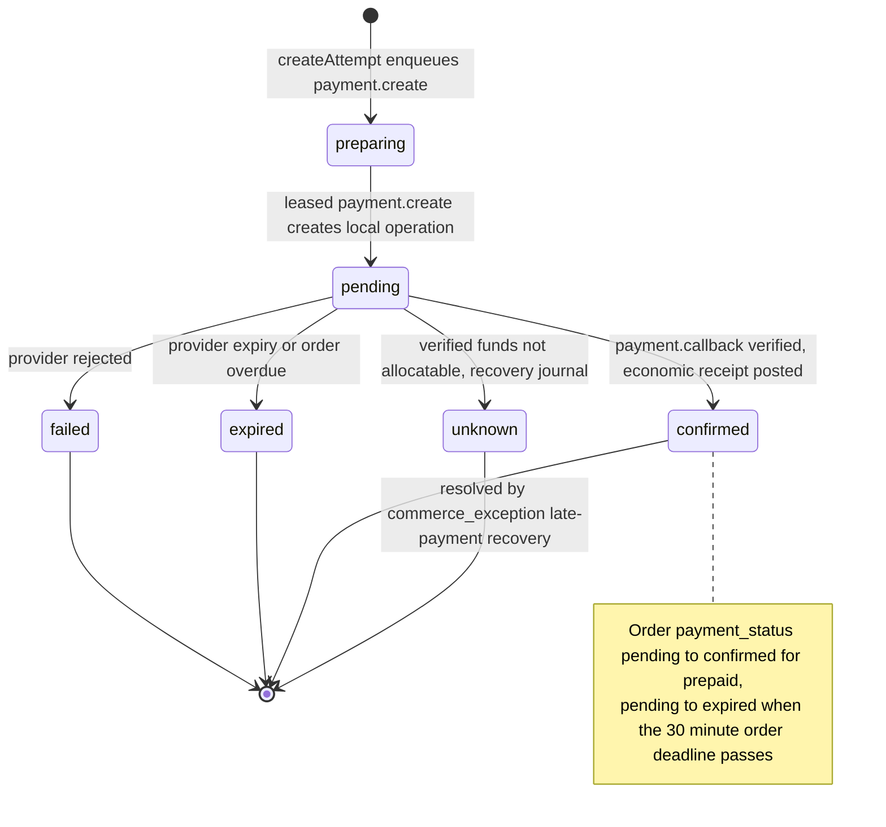

Source: `migrations/0016_prepaid_payments.sql` (`payment_attempt.status`, guard triggers), `migrations/0023_commerce_exceptions.sql` (`commerce_order_state_check`), `src/modules/payments/{attempts,events,worker}.ts`.

COD collection: the order's `payment_status` for `payment_method='cod'`, advanced per parcel by `cod_event_result`.

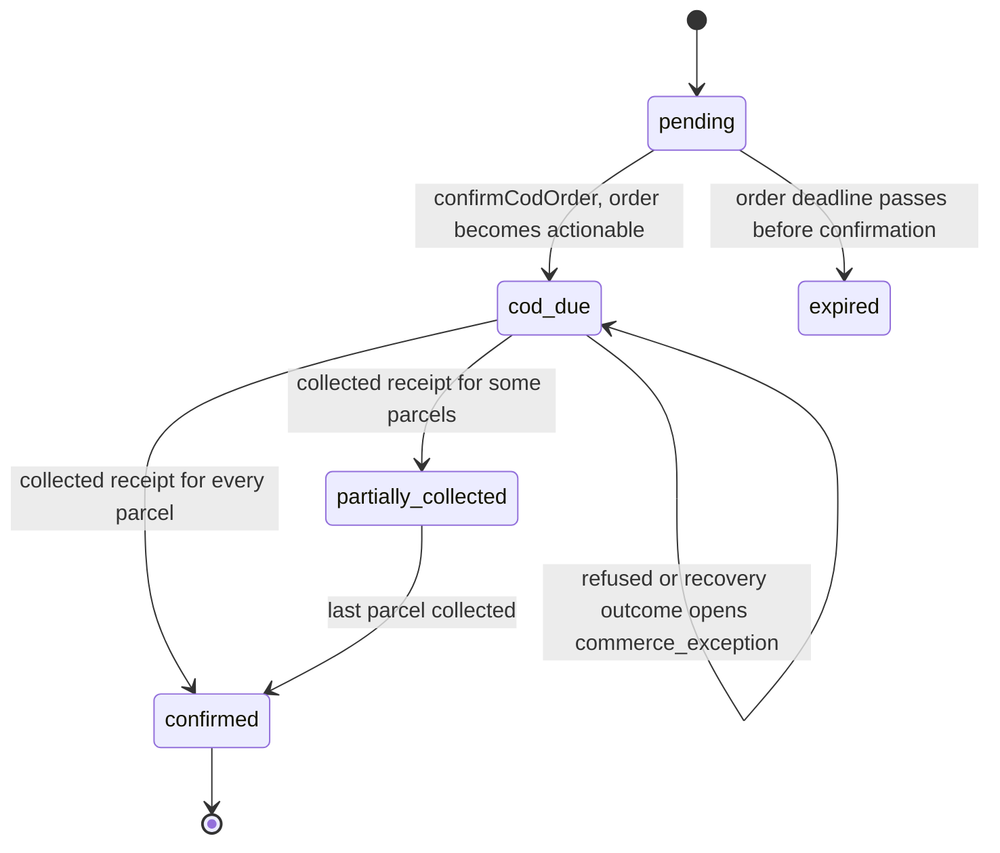

Source: `migrations/0018_cod_collections.sql` (`cod_event_result.outcome`), `migrations/0023_commerce_exceptions.sql` (`commerce_order_state_check`, `cod_collection_payment_status`), `src/modules/payments/cod.ts`.

Delivery: `fulfillment.status` per shipment, with `shipment_booking.status` (`queued → acknowledged → issued | failed`, `issued → cancelled`) carried underneath.

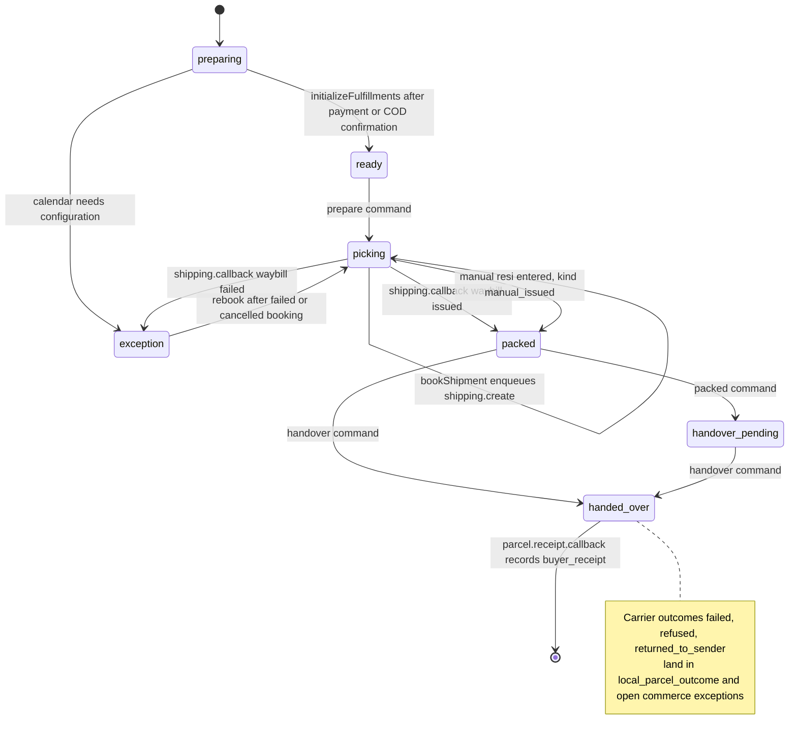

Source: `migrations/0019_fulfillment_deadlines.sql` (`fulfillment_state_check`, `shipment_booking_state_check`, transition triggers), `migrations/0023_commerce_exceptions.sql` (`shipment_booking`, `local_parcel_outcome`), `src/modules/fulfillment/{core,commands,worker}.ts`, `src/modules/returns/receipts.ts`.

Printing: `shipping_label_artifact.status`; print attempts are append-only rows, not a state.

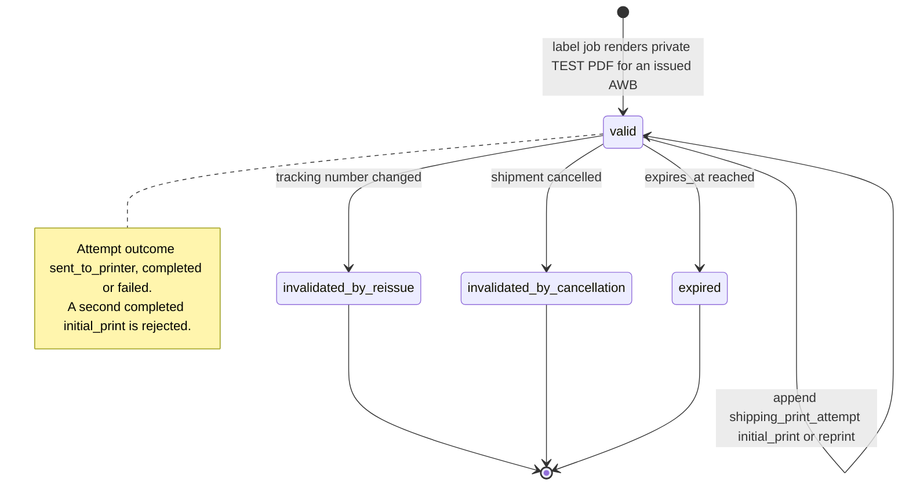

Source: `migrations/0024_remaining_domains.sql` (`shipping_label_*`, `shipping_print_*` tables, no status CHECK), `src/modules/documents/labels.ts` (`ShippingLabelArtifactResponse`, `revalidateShipmentArtifacts`, print attempt types).

### Money flow

Each arrow is one posting pair: it points from the credited account to the debited account. The nine accounts are the full `finance_posting_value_check` list. There is no revenue account; buyer money stays in `buyer_funds_liability`, and realized contribution is computed in reporting. Debit-direction settlement statements flip the settlement sides; dashed arrows are reversals.

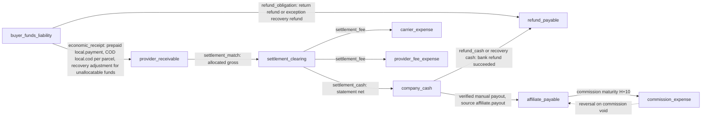

Source: `migrations/0014_immutable_finance.sql`, `migrations/0025_affiliate_ledger.sql` (`finance_posting_value_check`), `src/modules/finance/{ledger,receipts}.ts`, `src/modules/finance/settlements/core.ts`, `src/modules/payments/{events,cod}.ts`, `src/modules/returns/{refunds,worker}.ts`, `src/modules/checkout/exceptions/{refunds,refund-callback}.ts`, `src/modules/commissions/service.ts`, `src/modules/payouts/service.ts`.

## Known differences between code and decisions

Recorded 2026-10-23 from the code on disk. The decision text is not changed here; each item needs an owner or coordinator call (fix the code, or amend the decision).

| # | Decision says | Code does |
| --- | --- | --- |
| 1 | DEC-011 and slice S56: the feed emits `google_product_category` / `product_type`, served at `/api/v1/catalog/feeds/{channel}` | `src/modules/catalog/feed.ts` builds the feed, but no route, script or page calls it (tests only), and neither `src/app/api/v1` nor `docs/spec/openapi.yaml` has a feeds path. |
| 2 | DEC-007 (2): live Mengantar estimate adapter is gated (S95) | No Mengantar rate adapter, flag or gate exists; `shipping/rates.ts:estimateRates` accepts only `source: 'TEST-ONLY'` rates. The gate is "not implemented" rather than "implemented and off". |
| 3 | DEC-008 (5): one payment adapter seam (`manual_bank`, `autolaris`, local) | `PAYMENT_CHANNELS[*].adapter` is never read; `payments/worker.ts:paymentAdapter` branches only on `autolaris`, and manual bank reuses the local simulator operation (`createLocalOperation`/`settleLocalOperation`) as its settlement carrier. |
| 4 | DEC-008 (4): unique code 1–999 per transfer | Codes are unique only among open manual-bank orders (unique index in `0032`), 99 codes are held in reserve (`MANUAL_BANK_BUSY`), and each actor may hold at most 2 open manual-bank orders (`MANUAL_BANK_OPEN_LIMIT`). These limits are not in the decision text. |
| 5 | DEC-008 (2): AutoLaris API key as a server secret; live gated | Live use is blocked only in code (`autolarisClientFor` → `AUTOLARIS_LIVE_GATED`); `src/config/local.ts` does not reject `AUTOLARIS_*` variables the way it rejects `MENGANTAR_*` and the others. |
| 6 | DEC-008 (1): AutoLaris methods rendered from runtime `list_payment` | Rendered from `listPayment`, but filtered by a fixed allowlist `AUTOLARIS_CHANNELS` (five VA banks and QRIS). Consistent with the decision's method list; noted because a new channel needs a code change. |
| 7 | DEC-008 (3): store-borne AutoLaris admin fee recorded as a payment cost when deducted from settlement | Only the host-only simulator `simulateAutolarisSettlement` produces such a settlement; no job creates it from AutoLaris data. |
| 8 | DEC-007 (7): a statement whose gross ≠ net + deductions is flagged `SETTLEMENT_TOTAL_MISMATCH` | `recordCodRemittance` refuses it with 422 `STATEMENT_TOTAL_MISMATCH` and stores nothing, so the projection flag of the same name cannot fire. |
| 9 | DEC-009 (2): COD fee base is merchandise after merchandise reductions | The base is gross parcel merchandise plus net shipping. Equal today because promotions only subsidise shipping. |
| 10 | Access contract: `finance.recovery_refund` proof purpose | Handlers in `checkout/exceptions/refunds.ts` consume that purpose, but `access/grants.ts:issueAccessProof` cannot issue it; only tests insert such proofs directly. |
| 11 | Affiliate enrollment (`/api/v1/me/affiliate`) | Enrollment requires the `affiliate` role to exist already; no API grants it (only local seed code does). |
| 12 | RELEASE.md production runbook step 10: "12 categories" | DEC-011 and the generator define 14 departments. |

## Appendix: slice implementation notes (historical)

Kept from earlier revisions of this file. Each note describes what a slice added when it was accepted; later slices may have changed it (for example S80–S93 replaced the English storefront paths, Virgo and the single import warehouse). The sections above win where they disagree. Narrative checkpoints that were already archived live in [docs/history/](docs/history/).

### Acceptance boundary

Current acceptance targets a production-mode localhost web/worker with real disposable PostgreSQL and synthetic fixtures. Required proof includes public API behavior, durable stock/money effects, authorization negatives, restart/restore and rendered UI journeys. Provider sandbox/live acceptance, physical carrier-label approval and remote operations remain separate. A successful build alone proves none of those behaviors.


### Versioned API contract boundary

The S10 access boundary validates local cookie transport, exact mutation Origin, JSON media/size, input/query limits, retry identity and safe private Problems before exposing domain results. OpenAPI is the canonical schema and operation-ownership registry; implemented-local entries map exactly to current /api/v1 Route Handlers. Planned transports/operations carry no runtime authority. Test probes validate in-memory synthetic exchanges against the same OAS, while real PostgreSQL and Chromium prove persistence/session behavior. No separate schema framework or runtime dependency was introduced.


### Local fixture ownership and time

Additive migration 0006 defines local_fixture_namespace, local_fixture_principal and local_fixture_warehouse. Unique mapped IDs and restrictive foreign keys prevent a namespace from adopting another fixture's identities; first creation serializes on its namespace row. The explicit seed command uses the fixed isolated database profile and installed Better Auth password hashing, without minting sessions or MFA proofs. The local harness reads delivered inbox messages only after namespace/principal matching. Namespace clock version updates are atomic and separate from real authentication time. No new HTTP route or external sender is introduced.


### Durable job lease and reconciliation boundary

S12 extends the existing PostgreSQL OutboxJob rather than adding another queue. Auth notification effects stay inside their completion transaction. Registered outside-transaction adapters use claim/dispatch-marker/settlement with token fencing,30-second leases, a25-second abortable deadline and finite backoff. Expired unstarted claims retry; started/uncertain claims require a lookup of their original identity. Unresolved lookups are delayed 30 seconds. Dead letters retain failed job facts, and unknown economic effects never become failed solely through an attempt cap. Adapter handlers register through the existing worker function; current non-notification adapters are controlled test fixtures only. Business/vendor validation and public operation-recovery authorization remain owned by their consuming slices.


### Versioned policy implementation

S13 adds policy_head and append-only policy_version. A unique company/warehouse scope plus locked head revision serializes concurrent owners. Version insertion, revision advancement, proof consumption, immutable audit and retry outcome commit together. Database triggers reject version update/delete, scope relabeling and revision advancement without its appended version. GET history uses one repeatable-read snapshot; latest stream revision and effective version remain distinct. Trusted server consumers resolve immutable versions at the business event time and freeze their IDs/values in actual domain records when implemented.

The existing cookie/Origin/body/error boundary mounts two owner-only policy handlers. Shared reauthentication gains explicit company/calendar purposes, preserving staff-grant semantics and per-session issuance retry identity. Wall-clock consumption rejects a proof that expires while waiting on a row lock. Native role, schema and foundation regressions cover the shared boundary. Python contract probes use active hash-pinned format packages; absent format support fails, with impossible-date/URI canaries. No new application runtime dependency or visible UI is added.

S13 scheduling bound: prospective activation uses database wall time and rejects dates more than 366 days ahead with 400 POLICY_SCHEDULE_TOO_DISTANT. Earlier-than-last scheduled appends return 409 SCHEDULE_CONFLICT; failures roll back proof consumption. This bounded append-only schedule has no cancellation endpoint. Shipping consumers must independently verify calendar-year coverage for every calculated business day; S13 does not calculate shipping deadlines. Scenario setup must append its own explicit policy inputs rather than relying on policies left by earlier tests.

### S14 inactive catalog

Seven catalog tables add company taxonomy, physical SKU identities, product and offer identities, immutable product/offer revisions and physical components. Product catalog IDs use a disjoint p_ prefix and offers v_; each namespace is unique, so IDs cannot collide across entity kinds. IDs, SKUs and slugs do not change. No product is published by S14, and every projected offer remains unavailable at exactly integer IDR 99000.

A product edit locks its head and appends one complete revision. Omitted active offers survive; explicit retirement excludes an offer from future editing projections while retaining its identity, SKU and old component definitions. Already retired definitions need not be recopied indefinitely. A sealed revision rejects late inserts and UPDATE/DELETE. Composite foreign keys bind each definition to its product, revision, offer and physical SKU. The head seals only a complete unit, multipack or bundle composition with at least one active offer. Fixed price/currency and positive component quantities are database constraints. Future reservations/orders must reference and freeze a specific revision rather than reload current catalog facts.

Catalog APIs recheck the current cookie session, MFA and role under the same actor lock used by grant writers. Owner has company scope; ecommerce product operations require every active offer warehouse in the current assigned active scope. Company category/SKU dictionaries are shared nonfinancial facts. Mutations share actor-scoped catalog.mutate retry identity across operations; version, audit and committed retry response are atomic. Projections copy explicit fields, sort stable offer IDs and expose no costs, stock balances or customer data. Product options may lack media in draft (image null); S16 must enforce complete publication facts, media, inventory and contribution review. Taxonomy creation supports three immutable levels and typed attribute definitions; publication validates required/value-type facts in S16. No taxonomy rename or stock movement endpoint is claimed here.

Catalog retry recovery authorizes both the current product and every warehouse in the original saved response against current scope. A later warehouse move and reassignment cannot expose an older response for a warehouse the actor no longer holds. The regression uses actual role replacement/session revocation and fresh sign-in/MFA.

S14 direct-SQL limitation: product creation at revision 0 and explicit carry/retirement of active offers are enforced by the application writer. Database constraints preserve existing identities/history and valid next definitions, but do not prove every prospective business transition from arbitrary direct SQL. S16 and checkout must reuse the reviewed domain boundary. Private same-actor catalog reads serialize with grant changes.

S15 implementation adds nine inventory/reservation/transfer tables in applied immutable migration 0010. Zero-initialized positions advance with immutable exact-delta movements; deferred constraints reject unapplied movements, unsealed holds and receipt/head/destination mismatches. Complete-offer reservations aggregate shared components and lock balances by ID before allocating FIFO batches. Release and whole-transfer dispatch conserve source stock; per-shipment checkout consumption remains a later extension.

The database-local expiry worker commits stock release with outbox completion, uses savepoints for recoverable database errors and respects finite retry backoff even when an explicit scenario clock makes the deadline due. Crash before commit rolls back both effect and completion. The leased external adapter path remains separate and retains its S12 fencing/unknown-outcome behavior.

Twelve private inventory operations use current cookie/session MFA and actor locking shared with role replacement. Transfer creation requires both warehouses, dispatch/cancel the source, receipt the destination, and reads either. Explicit receipt allocations preserve lots and reject over-receiving; expired incoming lots are fully quarantined. Head share locks keep read DTOs consistent with their allocation totals. Normal clocks use database wall time; namespace time is immutable explicit trusted scenario context, never client input. Native 14/browser 1 pass and the final 39-path surface has independent R3 approval/ledger PASS. STATUS now owns S16 costs/publication work.

S16 adds six applied immutable 0011 tables. Cost streams append under existing StockItem/Offer identity locks; source/reason, prospective effective times and independent current-versus-latest histories preserve unknown versus explicit-zero values. Financial capabilities are rechecked under actor/session/MFA/grant locks. Native BigInt calculations use actual immutable cost/assumption/policy versions; JSON financial amounts are bounded to safe integers.

Publication has its own head/version, exact active-offer and component-cost source references, null completeness and optional owner exception reason. Deferred SQL sealing independently checks source effectivity, immutable complete composition, half-up commission/contribution arithmetic and complete sellable stock. Application checks inherited category facts/media/physical dimensions and current catalog scope. Exception consumption is bound to fresh owner/session/product/purpose and does not waive catalog facts. A bounded safe preview hides all financial amounts. Draft edits preserve published content; salePublication locks the current product/head and compares effective financial source identities before new quotes. Native 9/browser 1 and final 37-path independent R3 approval/ledger PASS complete S16. STATUS owns S17.


S17 adds nine applied 0012 tables (51 total), separating lifetime campaign identity/counters from immutable configuration versions, per-customer usage, frozen offer/shipment intent, allocations and exact movements. Promotion/usage revisions advance only with matching immutable effects. Configuration edits preserve encumbered budget and earlier quota; deferred guards forbid unapplied movements, empty configuration and preparing reservation commits. Independent SQL numeric allocation verifies the application's native BigInt result, including stable shipment ties and remaining-fee stacking.

Trusted reservation flow locks explicit scenario clock first, sorted promotion identities, sorted customer counters and the reservation. New claims use current configuration; issued holds keep frozen terms. Release/expiry reverses its own held amount/use; consume moves it once to committed. No refund/cash posting is inferred. Five company admin operations reuse current actor/session/MFA authorization and actor-scoped committed retry. Public cart/quote/order authority and actual promotional contribution checks remain S19/S20.

The existing actual database-local worker now selects promotion.reservation.expire as well as inventory expiry and notification jobs. A shared recoverable savepoint validates deferred domain effects before job completion. Not-yet-due jobs defer without attempts, temporary SQL lock/deadlock/timeout failures back off finitely, invalid payload/state or exhausted attempts deadletter. Scenario due selection requires last_error IS NULL, preserving retry backoff. Worker SIGKILL proof observes neither effect nor completion before commit; restart converges. S63 owns failed expiry plus active-hold recovery probes.


S18 adds no database schema or public endpoint. Host-only seedCommerce validates the local profile/database target, actual cookie owner/session/MFA and canonical synthetic recipe. A dedicated PostgreSQL transaction connection, outside the shared domain pool, holds a namespace advisory lock across the existing writers' real separate transactions. Actual statement_timeout bounds lock waits 10s; transaction/disconnect releases the lock automatically. Stable unique fixture-prefixed StockItem/Offer SKU and category slug recover interrupted bootstrap without changing identities. Existing state is reused rather than reset.

Catalog/cost/publication use their actual guarded writers; initial stock calls actual zero-position/movement/reservation primitives under current owner checks. No stock counter, publication snapshot, financial approval or effective timestamp is fabricated. Initial reserved stock is a real fixture-clock hold, preserving its terminal state/deadline on rerun. Explicitly synthetic local SVG resources satisfy real media existence; known valid products may publish under current policy, unknown cost remains a blocker. Developer CLI reuses native BrowserSession/enroll helpers for a temporary real verified/MFA operator, without clearing shared rate limits; SIGINT/SIGTERM abort/cleanup; its sessions retain normal refreshable Better Auth 7-day expiry. Uncatchable host failure can leave a scoped synthetic account for S63 recovery; it preserves existing accounts and emits no credentials. Historical order/provider scenarios remain downstream.


S19 introduces shipping address/reference validation, a TEST-ONLY read-only rate adapter and trusted quote/benefit primitives without a migration/public route. Published product/head/source locks precede a post-lock real database pricing instant. Actual eligible balances are share-locked with explicit fixture-clock mapping when requested. Pure bounded complete-unit/parcel search conserves all components and quantities, using declared upright stacking/chargeable dimensions. Supported gross shipping cost leads deterministic recommendation; uncertain search exhaustion fails for review.

Rate results have closed bounded fields, safe integer IDR, expiry/source checks,2s request timeout and 3s transport phase deadline. Invalid responses are dependency failures. Last current publication/source and business-deadline rechecks prevent rate waits from accepting stale financial input. Quote preview makes no stock, budget, shipment or ledger mutation. S20 binds/persists the result with real cart authority and revalidates before order/reservations.

Promotional-contribution checks reuse current sale/evaluation source guards after source locks. Largest remainder allocates actual S17 benefit to each shipment line; worst per-unit integer share prevents a profitable/different parcel from extending an owner allowance. Unknown/below-floor work needs the same current-source publication exception and known sufficient per-unit subsidy estimate; excess requires review. Private source metadata is separate from the future public quote projection.

S19 origin refinement: after locking explicit fixture clock, lock candidate warehouse rows in ID order and re-read current active/city/mapping state after any row wait. A committed deactivation cannot remain a selected origin. A real waiting quote versus deactivation test selects only the remaining active supported warehouse.


S20 adds 12 applied 0013 tables,63 total: current guest contexts, actor-key operations, owned carts/lines, immutable bounded private quote documents, orders/items/original parcels, per-unit fulfillment and exact physical lot allocations, immutable order events and scoped guest order access. Quote JSON preserves alternatives/rates/contact/financial sources without a competing fake database; normalized final order/physical/money rows have relational FKs and independent SQL quantity/source/allocation/seal checks. Preparing orders and unapplied events cannot commit. Existing immutable catalog/publication/cost references resolve purchased contents; current mutable cart lines are not historical quote FKs.

Default browser transport uses real HttpOnly guest/cart cookies and order-specific API-path order cookies. A first anonymous 401 acknowledges only a random guest context, never an orphan cart; retry is actor scoped. Explicit header transport is separate. Purpose-separated MACs derive from the existing server secret, while only digests/issuance/expiry persist; no account bearer token exists. Account sessions and guest contexts are rechecked under current actor locks, including committed recovery. Real credential clocks remain independent of trusted scenario business clocks. Password sign-in success (including MFA challenge) and sign-out revoke prior guest authority; no typed-contact identity linking occurs.

Checkout quotes combine the S19 actual physical planner and S17 read-only campaign preview with source-bound financial guard. New immutable selection preserves the original deadline. Submit locks selected promotion roots before stock balance writes, reserves both effects atomically and rechecks wall-clock financial sources after waits/snapshot writes. Original unit IDs also identify exact inventory hold items; lot quantities partition to complete own-warehouse units. SQL independently verifies purchased names/contents, exact quote/parcel/quantity/fee/subsidy/hold lineage and line/unit largest-remainder distribution. Order/event/cart/operation/access snapshots seal together. Private address/contact stay in the owned quote, not general Order DTOs.

Pending expiry is 30 business minutes; no verified payment or paid-retention transition is enabled yet. Stock/promotion legacy jobs resolve ownership before reservation locks and delegate to clock -> order -> promotion -> stock ordering. Each claimed job alone completes; concurrent claimed jobs later observe terminal state. Crash rollback preserves both effect and completion. S23/S24/S27/S28/S30 must extend/reverify receipt, retention and partial consumption before enabling those behaviors. Future verified-contact linking and anti-abuse controls remain S46/S63. Public screens remain S21/S22/S26; browser API transport evidence does not claim completed checkout UI.

S21 adds a shared public catalog projection and three anonymous versioned GET adapters,53 implemented operations total, with no schema changes. Next SSR pages call the same domain directly; native search/filter forms are the baseline. Explicit loading/Suspense fallback was removed after a JavaScript-disabled browser exposed hidden streamed content: these discovery pages await useful server HTML. Enhancements only expand desktop native filter details. Keyset pagination preserves timestamp microseconds and public filter context; response counts are page-local. Current financial-source validity is rechecked after lock/stock work; availability never substitutes for the quote hold.

Host storefront curation uses the existing real temporary owner/MFA bootstrap, a dedicated namespace lock connection and actual catalog/cost/publication writers. It creates separately identified sample products and preserves existing fixtures and operator state. Four curated local identities drive home merchandising; the ordinary public catalog has no fixture namespace visibility shortcut. Read-only product drill-down and explicit unavailable cart/account screens retain their S22/later owners.


S23 implements internal finance primitives and two dynamic cookie-only admin order-history GET adapters. Applied 0014 adds finance_transaction/finance_posting/economic_receipt; applied 0015 adds nullable legacy/server-set new order_event.recorded_at plus order/event keyset indexes. Both isolated databases have 66 app tables. Positive safe-integer postings balance through deferred header/part constraints, and only the creating SQL transaction may append parts. Immutable originals and unique mirrored full reversals preserve history. Receipt uniqueness covers event/economic identity and original order/parcel allocation; exact frozen merchandise/net shipping flows into provider receivable and buyer-funds liability. No payment adapter, paid retention, settlement, recognized revenue/cost, Purchase or public money-write endpoint is inferred. History rechecks current session/MFA/grant scope, excludes contacts/costs/proofs, audits reads and binds bounded cursors to actor/scope/filters. Native 7/browser 1/build evidence exists; independent combined R3 acceptance is recorded in STATUS/the ledger.


S24 source candidate adds payment attempts, separate signed simulator operation/events, verified delivery identities and callback results. Creation is a leased external-boundary job; callback money/result/order/attempt completion shares one PostgreSQL transaction. Simulator collection is serialized with expiry; provider and business commits remain distinct to exercise lost acknowledgements. Exact local host commands provide simulation and recovery without network access. Immutable 0016 is applied to test/local; native 16 and built-browser 1 pass. Final S24 review/ledger PASS is recorded in STATUS; no remote deployment or live provider is claimed.


Accepted S25 extends the same modular application and SQL outbox. Visitor bootstrap and consent are purpose-bound first-party authority, independent of cart/order permissions. Server cart operations produce quantity-delta events through an optional savepoint; order placement records eligible purpose attribution. Confirmed prepaid callbacks must create their canonical economic Purchase, complete merchandise item allocations and three platform decisions in the existing funding transaction. SQL deferred seals forbid partial financial acceptance. Five versioned HTTP operations serve bootstrap, consent read/write, generic observed funnel and owned-order funnel; the nested path preserves the existing narrow HttpOnly order-cookie path. A leased canonical database-local advertising sink rechecks consent and original event identity and reconciles lost acknowledgements. Ten-table 0017 is applied to test/local after separate pre-application approval (82 tables/18 migrations). S25 is accepted with native 12, built Chromium 1, affected regressions and final whole-surface independent APPROVE at 9f2823ead3b1ea5df45a2915304d69379faa198f9989021d1c88b83cc4b2a991. COD source/allocation is S28.


S28 extends the accepted checkout/payment/signal domains through additive 0018: cod_confirmation, independent immutable local COD operations/deliveries, registered provider events and sealed callback results. Confirmation/actionability uses the original checkout time; each original parcel receipt owns its merchandise quantities and canonical Purchase. Original source registration and callback job identity persist across host reconciliation. Callback completion, balanced receivable/liability, receipt, order payment event/head and three platform decisions are one database transaction. Original narrow order authority also protects the private collection projection. Confirmed COD holds survive all checkout expiry jobs; unpaid prepaid expiry remains unchanged. No settlement or delivery is inferred from collection. S29 owns actionable stock/subsidy consumption and additive fulfillment lifecycle seals. Both isolated databases have 87 application tables and 19 source-matching migrations; no applied predecessor or 0018 bytes changed after application. Final S28 acceptance remains in STATUS/the ledger.


S29 now implements fulfillment per original actionable parcel with immutable covered calendar snapshots, physical preparation, independently signed booking/issuance source and separate handover. Applied 0019 adds nine tables (96 app tables/20 migrations in each isolated database); all applied SQL/snapshots remain immutable. Preparation advances parent processing once. Exact original components/lots are consumed per handover; parent stock closes after all original parcels and the parent promotion benefit commits once. Later COD cash preserves original payment/Purchase allocations while processing.

Eight scoped cookie/MFA-only admin adapters reuse current inventory authority and original parcel identity. Current and historical booking operations remain distinct: at most one non-failed booking exists; authenticated terminal failure allows a reasoned audited new operation, retaining every failed source. Unknown/active effects reconcile their original identity. The real host worker registers shipping.create; host issue/fail/reconcile/initialize commands use only signed local sources. Independent commits, lost acknowledgement/exhaustion recovery, contention, reschedule privacy and physical/payment conservation pass 12 native cases; actual built Chromium wire/MFA/host proof passes 1. Latest production-mode localhost build OKibCFYTyt6e-KhnWguMp has readiness PASS. Affected native/built regression refresh and final independent combined 52-path review pass; S29 is accepted in STATUS/the ledger. No UI composition, live provider, label approval or deployment is inferred.


S30 extends the same PostgreSQL ledger/outbox with nine tables in reviewed applied 0020 (105 tables/21 migrations). Original immutable bank cash, authenticated statement fees and matching classification have separate journal kinds. Current owner or explicitly granted finance authority and a bound fresh proof protect version/source/match CAS decisions; original bank identity never changes. Linked complete reversal/new matching and immutable stored allocations preserve attribution. Native result/head/operation/audit/outbox seals reject partial financial acceptance. Five dynamic cookie-only reconciliation/source resources and bounded host observe/revise/reconcile commands expose protected evidence without signatures/contact/HPP. Canonical Purchase remains bound to original qualified collection, including when authentic extra recovery money is later settled. Current native/built proof is in STATUS; final S30 combined review is pending.


S31 adds 19 relations through reviewed applied 0021, bringing both isolated databases to 124 tables/22 exact source-matching migrations. All 44 applied SQL/snapshot files and the 22-entry journal prefix are immutable. Earlier failed compilation, superseding review, owner-role rollback proof and separately approved application are retained as history in BUILD-LOG/the ledger; they do not substitute for current app-role proof.

Current returns bind each claim to the original received complete-offer quantity and signed receipt. Current buyer/staff authority, source authenticity, elapsed seven-day window, exclusive active unit claim, immutable intent responses and versioned history are enforced at the domain/database boundary. Physical inspection identifies original components and records quarantine separately from financial classification. Parent shared locks keep case/refund and order/child projections coherent.

Refund obligations debit buyer_funds_liability/credit refund_payable; only authenticated original-rail bank success debits refund_payable/credits company_cash. Original receipt/Purchase/order totals remain immutable. Unknown external effects retain the original attempt/job/source identity. A new attempt requires processed zero-money failure or established terminal known-unsent failure, current finance grants and a fresh bound proof. Missing original Purchase retains a receipt-linked adjustment intent without creating a conversion. Actual isolated 0000–0016 to 0017–0021 upgrade and original-buyer cash refund passes 1/1.

Thirteen cookie-only operations expose private buyer returns/refunds/destination and scoped staff decisions/inspection/refund/recovery. Current native 33/13, production-mode Chromium/host 1 and affected built 9/8 pass on build lqdvVaUI0ULANm_WiMvK_. Genuine committed recovery 4, PostgreSQL contention 4, native seals 1 and projections 1 preserve monetary/physical separation. Actual final combined original/C1/C2 review approved the full 73-object source and matching boundary; RUN-20261018T190944Z-520bc988 finished PASS and the chain verified. S32 owns replacement occurrences/stock/receipt anchors and effective affiliate override costing; S47/S50/S51 own the later buyer/staff/finance UI.

The S31 C2 host iteration accepts an optional validated job UUID and reuses the existing dispatcher/lease filters. This is an operator/test selector over the same persisted outbox, with no separate worker implementation or changed due/effect rules. Scoped fixtures retain real database contention and killed-process rollback while unrelated ready timers remain intact.


S32 extends the same application/SQL outbox through reviewed applied 0022 (140 tables/23 migrations). ReplacementCore/ReplacementLink retain separate physical head/event/booking/receipt identities while preserving original OrderShipment/FulfillmentItem, monetary entitlements, immutable Purchase and economic receipts. A complete purchased component set is reserved from eligible replacement-origin stock; stock-wait has no partial holds and authenticated intake recovers the same intent. Only physical handover consumes components. No replacement creates a new buyer charge or Purchase.

Replacement source signatures, registered callbacks, exact job completion and first per-unit receipt seals participate in real app-role transactions. Recovery fences the original job/source and preserves unknown outcomes; pristine pending receipt callbacks remain eligible for normal dispatch rather than receiving unaudited timestamp edits. Native proof rejects receipt/unit/case/result effects without exact callback completion and verifies rollback before a normal worker commits once.

Occurrence reads preserve the original fulfillment unit as economic entitlement and use ReplacementLink/ReplacementBuyerReceipt for physical origin, quarantine intake and the fresh claim window. Buyer order projections append zero-charge physical parcels without inserting financial parcels. Whole-order history authorizes every original/replacement warehouse after acquiring the original order lock, then projects replacement event IDs under the existing fulfillment kind. Refund allocation retains the existing original-unit capacity guard across all occurrences; the received replacement refunds from the original collection and frozen per-unit price/shipping.

Effective affiliate override versions are owner-only, proof-bound, prospective and immutable. Their current rate participates in attributed quote creation/initial order contribution and owner exception bounds. Existing unattributed shape and prior frozen order money remain unchanged.

Seven cookie-only private adapters expose replacement creation/read/reserve/prepare/book/handover and owner rate versioning in production-mode build _QrrV_3pA-ni2qWWgJoVa. Native/closed wire and actual Chromium/host evidence include stock recovery, separate usable-waybill/handover status, partial/duplicate/final receipt, current authorization and complete buyer/staff response schemas. Registered PR-7 native 67/29 and built 2/2 pass; this establishes API/persistence behavior rather than public visual acceptance.

The separately approved isolated legacy executor applies exact immutable prefixes 17->22->23 to a fresh owned socket cluster. Its passing scenario preserves genuine pre-signal cash, original buyer authority and an approved pre0022 replacement, then dispatches/receives/refunds that occurrence without Purchase or advertising backfill. Source 46/prefix 23 and both installed targets remain unchanged; the owned project is stopped with data retained. S32 has actual full combined review and bound PASS closure; S33 exception recovery is active under STATUS/the ledger. Full localhost acceptance remains pending, with no additional schema/provider/live permission implied.


Historical pre-application `S32`/`S33` candidate and definition-only checkpoints are archived in [`docs/history/S32-S33-CHECKPOINTS-20261021-pre-audit.md`](docs/history/S32-S33-CHECKPOINTS-20261021-pre-audit.md).


S21 SSR missing-resource recovery (2026-10-19): the native root src/app/not-found.tsx renders the shared public fallback for unmatched routes. On pinned Next 16.4.1, a dynamic page throwing notFound() returned 404 with an empty server body and content only in the client payload; moving the fallback to root fixes unmatched paths but does not fix those dynamic throws. Local raw/no-JS diagnostics retain both outcomes; upstream report https://github.com/vercel/next.js/issues/99793 describes the same failure. Category/product/category-index validation therefore temporarily redirects with 307 to the reserved unmatched /404 URL, whose final response is real 404 HTML with recovery/help and no selected tab. The browser address becomes /404; this tradeoff is explicit, not a direct 404 claim for the original dynamic URL. Known REST API handlers keep their direct JSON 404 contracts. No proxy, copied renderer, framework patch, package upgrade or experimental flag is added. tests/browser/storefront.test.ts checks manual initial statuses, final URL/status and no-JS help navigation.


S22 purchase path (implemented; acceptance remains in STATUS): storefront Server Actions call existing handleCheckout/domain transactions directly, preserving origin, unsupported-auth, publication, version and exact operation replay. A native acknowledged guest bootstrap precedes the first commit. Actor-scoped deterministic empty-cart initialization recovers first-cart acknowledgement before the original line-add intent. Native useActionState forms remain usable without JavaScript; rejected/unknown actions retain exact intents in memory for explicit replay. Cart capabilities remain HttpOnly; SSR reads the current Next cookie store after checking duplicate raw authority cookies, while mutation requests forward the original incoming headers. No GET creates a cart/context. One canonical stock reader checks complete-offer quantity across eligible warehouses inside the existing writer; cart stock is advisory and creates no hold. PDP owns focused in-flow task chrome; shopping tabs return to flow on short layouts and reserve intrinsic space otherwise. Private clock/authority data never enters form URLs/storage or the public product DTO. No proxy or additional dependency is selected.


S22 current form recovery uses native useFormStatus below each parent form, so queued/pending state belongs to that form. Stable target/quantity input keys preserve unrelated unsaved drafts through Server Action revalidation; each form retains only its unresolved intent/message, never a second cart total or line truth. Known failures take fresh authoritative base version/key/publication for a deliberate retry, while unknown results retain the exact submitted intent. Read-only SSR denies a remaining cart capability when its guest identity is missing. PDP validates the public offer selector and ignores unrelated landing metadata; query quantity/cart IDs never supply mutation authority. Full consent-aware attribution persistence/channel delivery remains with its existing advertising and journey owners.


S22 task Back now carries only sanitized public home/category/search/cart source state and a product anchor in product links. The native Link onNavigate records an actual same-tab product entry; TaskBack retains its public path/source and restores only its own history marker after Server Action revalidation, preserving Next history state and native router.back scroll behavior. Copied/direct/no-JS links use the real local parent href/anchor; native option GET and mutation permalink retain that source. Unknown/private query keys and foreign/protocol/private-resource return targets cannot become navigation authority. No cart/auth capability or Web Storage is involved. Implemented against pinned 16.4.1 native source; primary API references inspected 2026-10-19: https://nextjs.org/docs/app/api-reference/components/link and https://nextjs.org/docs/app/api-reference/functions/use-router .


S26 checkout source (2026-10-19; acceptance in STATUS): focused progressive Server Action forms call the existing native checkout/payment handlers in-process. Form input is closed, money/principal fields remain server-owned, and unknown results retain the exact request body/key/version until explicit recovery. The private /checkout/order/{id} view owns checkout payment resume only; S27 retains full private receipt/status. A separately named checkout_access HttpOnly/Lax cookie aliases the original native order grant on that exact frontend path, retaining its expiry; no independent grant, URL token or root cookie exists. The BFF rejects duplicate/unsupported/conflicting transports and still invokes canonical order authorization. Lost-ack access recovery requires the current original submitted cart and replays its original native operation. GETs read only. Shared type tokens are reused; rem-based columns stack on narrow/enlarged-text layouts and money review remains outside the summary disclosure. Native core/payment tests pass at the pre-loader checkpoint; built browser/visual/final review remain pending. The first built SSR fixture transport failure and proposed static JSON loader correction remain in STATUS/ledger until independently verified.


S26 pre-draft engineering checkpoint (historical): actual current native 8/4 and built browser 12/1 bind 269 source/config/fixture inputs/build Kzc23RfzGr6BqOsXRrkoE. A checkout-only consumer uses existing consent/funnel transactions, current native quote-operation wall time and opaque durable dedupe; neither frontend GET nor UI order/payment success emits Purchase. Native no-JS forms retain returned action-state drafts and redirect successful payment preparation to a GET document. Unknown payment retries retain their original key even when an auth/source preread fails. The initial run closes incomplete FAIL for missing initial dirty-overlap acceptances on five expanded dependencies; C1 declares 31 patterns/191 reviewed overlaps and must review the entire original 85-object/21-source plus continuation union. That checkpoint predates the draft correction below; full native support and source/visual/final acceptance remain pending, not waived.

S26 C1 draft correction: necessary raw contact/address/note/query and issued selection IDs are a derivative file under private artifacts/checkout-drafts, keyed by a server HMAC over cookie prefix/current actor/current user session/exact cart. Native current actor/cart authority is checked under the existing actor/cart locks on every read/write, plus an advisory lock for atomic revision/writer/sequence fencing. Files are bounded 32KiB,0600/current UID, immutable temporary writes followed by atomic rename/fsync inside a checked 0700 directory, with no symlink leaf. Logical expiry is bounded by remaining native cart time and 24 wall-clock hours; expired owned reads and known native order commits remove their file. Background physical purge remains an operational/privacy parent gate. There is no schema change, public REST endpoint, browser draft/capability storage, quote/price/paid authority or advertising capture. Progressive nonfinancial autosave returns typed acknowledgements; explicit task-exit forms persist without JavaScript. Fresh hydration requalifies native quote/version/contact before restoring shipping/review. Invalid review input resets to quote; private submitted-cart navigation opens the original order. Current functional evidence and remaining review/visual/acceptance gates live in STATUS.

Current scoped denial correction removes the private form when autosave receives authoritative access denial; it does not wait for a later order submit. Actual built regression first failed with the private field still visible, then current-functional-r7 passes native 9/browser 15 and affected-cart-r5 passes 16 on build-Q6Et1PoeCj7Fow1A4di5. The cart test fixture now uses its owned namespace/exact native product IDs instead of selecting a retained public first match; no production cart rule or stock was changed. Current 34 renders and remaining independent source/visual/final gates are in STATUS.

Source-r2 corrections: draft files now use the native cookie prefix before their opaque scope MAC, so local/test cleanup acquires per-file advisory locks in the matching database. An authorized read/write atomically migrates a valid prior flat record; flat paths are never written again. Every open-cart draft write streams metadata and removes at most 32 recognized draft/temporary files older than 24h+5minutes, with 0600/current UID/regular file/one link/size checks and try-only per-file locks plus a second metadata age check. Fresh or active writers and the other environment's prefixed files are skipped. Legacy expired paths are immutable; missing files are handled normally. This is a physical cleanup trigger on activity, not a fixed idle timer or a statutory retention claim. S65 retains scheduling/supervision and measured volume work. Necessary transient progress inherits docs13 buyer contact/address classification; scopes and technical retention are explicit in docs17.

The checkout's rendered clipped default submit now precedes external header exit buttons and performs only lookup. Keyboard Enter stays in the task without creating quote/order; the primary action remains explicit. Denied pre-save also scrubs its returned intent, and whitespace-only notes show the empty-note hint. Current source-r2 correction proof is build GjEaFqwVzUEEkAUvGqffs/native 10/browser 17/cart 16; actual separate correction review, visual/gate and final current-union R3 remain required.


S26 current form correction: issued allocation choices and each parcel's service choices are native wrapping radio rows. An authorized ownedQuote read projects only buyer-facing per-parcel contents/origins/services/fees from the immutable document. Buyer-equivalent choice grouping is private presentation: preserve an actual selected/pending native allocation ID and the native plans, public quote wire and price/stock authority. Show the issued choice first and disclose alternatives natively; open the disclosure when a different native ID is pending. Preserve both issued and pending IDs as explained choices when buyer-equivalent, grouping other aliases. Always retain issued parcel controls and gate their display through checked state, so no-JavaScript reverting cannot produce an empty native selection. Non-issued pending aliases stay grouped unless they match the issued group, where explicit revert identity is required. The main shipping submit is the single apply action and adds no field/handler/authority. Display-only captions compare actual per-origin quantities and parcel counts with the issued allocation; chooser fees are gross Tarif before subsidy, while the cards expose the native subsidy and buyer-paid shipping. Disclosure initial open state follows restored pending choice and persists until quote identity changes. CSS reads actual radio checked state for JS/no-JS pending notices and charge visibility; native checked-state CSS also pairs the actual primary action with its warning text in JS/no-JS and hides only stale success step notices; validation/conflict/unknown feedback remains. Gross amounts use Tarif across cards/summary/payment, while buyer-paid net values retain Ongkir. Successful selection returns the previous native total for the same changed-total banner without a browser-history ref. Restoring the issued service clears pending feedback. Unique shipping_option:<parcel_id> form names prevent one parcel from unchecking another; the existing closed parser accepts one choice for each submitted parcel, rejects mixed/duplicate/orphaned encodings and produces the unchanged native packages request. Existing paired hidden fields remain for exact-intent recovery. The summary groups each parent price before its subordinate contents; expired calculations are labeled explicitly. The review note precedes parcels and charges, draft reload remains a real document link styled as a secondary action, and the compact payment column is centered. Browser fixtures advance only their newly owned namespace to current time and wait for autosave to settle before screenshots; analytics consent proof remains behavioral rather than a duplicate visual state. Current checks and independent acceptance remain in STATUS.


S26 implicit submit correction: the first form-associated non-exit control submits closed navigate=stay. The server maps it from the existing intent kind to contact lookup, shipping or review, requalifies current quote/contact/version, and saves only derivative progress. Explicit lookup/Back and exact financial requests keep their separate intents. Native/browser regressions prove no quote/order creation and retained issued radio choices after Enter with JS enabled and disabled. Multi-origin fixture cases establish their own approved-offer reservation through reserveOffers, release only their exact hold and remove only its ready expiry job. Capture output is keyed by actual .next/BUILD_ID so concurrent review can retain earlier PNG bytes. Acceptance remains in STATUS.

### S33–S68 completed local domain, UI, and assembled readiness slices

- **S33–S34 (Commerce exception recovery & realized contribution reporting):** Applied migrations `0023_commerce_exceptions.sql`, `0024_remaining_domains.sql`, and `0025_affiliate_ledger.sql` (205 application tables total across local and test databases). `S33` completes late-payment recovery, stock-discrepancy investigation, COD refusal, mixed delivery, and ambiguous external waybill/cancellation recovery across `/api/v1/admin/exceptions/**` and `/api/v1/orders/{orderId}/exceptions/**`. `S34` implements actual contribution margin calculation, explicit unknown-cost vs zero-cost separation, historical HPP/expense adjustment lineage, and period-close reconciliation reporting (`--case=PR-21`, `--case=PR-19`, `--case=PR-12` PASS).
- **S35–S40 (Affiliate referral, commission maturity & manual payouts):** Implements affiliate identity/profile enrollment, beneficiary verification and change controls, 7-day non-extending referral attribution (`S35`), production outbox-driven (`commission.accrue`, `commission.receipt`, `commission.claim`, `commission.void`, `commission.mature`) quantity-scoped commission accrual/claim/receipt/void with receipt-based H+10 maturity (`S36`), automatic inclusive IDR 99,000 eligibility queueing (`queueEligibleAffiliatePayouts`), double-entry ledger postings (`Dr commission_expense / Cr affiliate_payable` on maturity and `Dr affiliate_payable / Cr company_cash` on verified payout via `0025_affiliate_ledger.sql`), exclusive finance manual-transfer claim, real `PUT /api/v1/admin/payouts/{payoutId}/evidence-uploads/{evidenceId}` byte upload with magic-byte sniffing and server-computed SHA-256 over uploaded bytes (`S37`), plus the responsive `/affiliate` workspace and finance evidence visibility boundaries (`S38`–`S40`; `--case=PR-8`, `--case=PR-9`, `--case=PR-10` integration & browser PASS).
- **S41–S45 (Durable native website support chat & CS staff inbox):** Implements participant-scoped support conversations and idempotent messages, guest bootstrap/verified recovery with DB-backed rate limits and atomic 5-attempt challenge lockout, exclusive staff claim/handoff (`S41`), private image attachment quarantine/validation, staff-only internal notes, ordered history/read markers and SSE stream (`S42`), scoped message search, typed product/order context cards, saved replies, tags, and notification preferences (`S43`), plus the responsive `/support` buyer chat and `/admin/support` CS inbox UI (`S44`–`S45`; `--case=PR-22`, `--case=T-24`, `--case=T-25` PASS).
- **S46–S48 (Buyer Account, address book, order history & receipt continuity):** Implements buyer profile (including mononym and optional email), versioned address book and default address management, keyed-HMAC (`mac(identity, ...)`) contact verification and guest-order linking with zero plaintext OTP in `app.audit_event.details` and atomic `attempts < 5` lockout (`S46`), buyer order list/detail, per-parcel timeline, real `PUT /api/v1/orders/{orderId}/returns/{returnId}/evidence-uploads/{uploadId}` byte upload with magic-byte sniffing and claim UI (`S47`), and complete thank-you/receipt support actions, split-COD collection breakdown, and unknown/recovery views (`S48`; `--case=T-35`, `--case=PR-14`, `--case=T-32`, `--case=PR-24` PASS).
- **S49–S53 (Role-scoped admin workspaces, operational queues, KPIs & exports):** Implements `/admin` workspaces scoped by active role grants and warehouse assignments: catalog publication/cost and warehouse stock receive/adjust/transfer forms (`S49`), assigned fulfillment, return inspection/decision, and exception queues with whole-order money hidden from warehouse staff (`S50`), finance reconciliation/refund/manual-payout and owner order-history workspace (`S51`), owner-only access/settings controls and role-specific home dashboards (`S52`), and KPI definitions, token-bound drilldowns, bulk previews, responsive tables, and CSV-injection-safe bounded exports (`S53`; `--case=T-34`, `--case=PR-13` PASS).
- **S54–S55 (Scoped shipping-label jobs, private PDF artifacts & 99ribu print center):** Implements carrier template capability gates, idempotent label job/batch/artifact generation preserving active AWB without re-booking/re-charging, private `TEST` watermark PDF storage, scoped download/print audit (`S54`), and the `/admin/labels` print center supporting `100x150mm` thermal and `A4` local preview/reprint with explicit privacy/brand fallback disclosures (`S55`; `--case=T-36`, `--case=T-37`, `--case=PR-25` PASS).
- **S56–S60 (Catalog distribution feeds, Meta/Google/TikTok conversion adapters & diagnostics):** Implements published-only `/api/v1/catalog/feeds/{channel}` export feeds and storefront SEO metadata parity (`S56`), Meta Pixel/CAPI (`S57`), Google tag/Data Manager `UPLOAD_CLICKS` (`S58`), and TikTok Pixel/Events API (`S59`) server-authoritative conversion mappings into the local sink with live external dispatch disabled, plus `/admin/advertising` diagnostics, strict UUID `{destinationId}` pause/replay/settings controls, and money-vs-signal reconciliation (`S60`; `--case=PR-15`, `--case=T-27`, `--case=T-28`, `--case=T-29`, `--case=T-30`, `--case=PR-23` PASS).
- **S61–S64 (Mobile journey continuity, 14 canonical scenarios, operational probes & OpenAPI parity):** Completes the mobile navigation shell, URL/history/draft/scroll/referral continuity and button audit across the full public journey (`S61`), all 14 executable scenario contracts in `localhost-commerce.json` (`S62`), public DB-backed rate limits (`src/modules/access/rate-limit.ts`), upload/storage limits, redacted diagnostic logging, and operator recovery probes in `src/jobs/probes.ts` (`S63`), and bidirectional parity across all 175 OpenAPI paths / 209 operations in `docs/spec/openapi.yaml` and `src/app/api/v1/**/route.ts` (`S64`; `--case=T-33`, `--case=T-38`, `--case=PR-16`, `--case=PR-18` PASS).
- **S65–S68 (Assembled localhost production readiness & isolated backup/restore):** Produces the pinned production build (`NODE_ENV=production`, `APP_ENV=local`), verifies multi-viewport (`390x844`, `768x1024`, `1440x900`) buyer/affiliate/staff browser journeys and `design-gate.py` (exit 0), rehearses independent web/worker restart and real `pg_dump -Fc` / `pg_restore` into a disposable database (`99ribu_restore_<uuid>`) with table/row parity, `created_xid` resealing (`restored:...`), and trigger immutability verification (`23514`), and records complete handoff evidence (`--case=localhost-readiness` integration `2/2` PASS, browser `1/1` PASS).
