# Architecture — Serba 99ribu

This file records the application **as implemented on disk and deployed**, last regenerated 2026-11-10 at production `afcccc65` (migrations `0000`–`0059`; 225 `app` tables, 221 `/api/v1` route files, 78 pages). It is read from `src/`, `scripts/`, `migrations/` and `tests/`, not from the selected design. Selected design stays in [docs/spec/04-SYSTEM-ARCHITECTURE.md](docs/spec/04-SYSTEM-ARCHITECTURE.md) and the [ADRs](docs/adr/); owner decisions live in [DECISIONS.md](DECISIONS.md); workflow state lives only in [STATUS.md](STATUS.md); delivery and what is live live in [RELEASE.md](RELEASE.md). Where this file and the spec differ, this file describes the code, and [Known differences](#known-differences-between-code-and-decisions) lists the gap. Per-slice history moved to [docs/history/ARCHITECTURE-slice-notes-20261110.md](docs/history/ARCHITECTURE-slice-notes-20261110.md).

Contents: [Runtime topology](#runtime-topology) · [System map](#system-map) · [Folder structure](#folder-structure) · [Module map](#module-map) · [Worker and jobs](#worker-and-job-registry) · [Request flows](#request-flows) · [Catalog pipeline](#catalog-pipeline) · [Category map](#category-map) · [Identity and roles](#identity-roles-and-access) · [Storefront](#storefront-architecture) ([page map](#storefront-page-map)) · [Data domains](#data-domains) · [State machines and money flow](#state-machines-and-money-flow) · [Production money path](#production-money-path-adr-0008) · [Known differences](#known-differences-between-code-and-decisions)

## Runtime topology

One Next.js 16 / TypeScript codebase runs as two processes that share the domain modules in `src/modules/` and one PostgreSQL database (ADR-0001, ADR-0004). Every external effect goes through a simulated adapter in the local profile.

| Part | Entry point | What it does |
| --- | --- | --- |
| Web | `scripts/run-local.ts` (`npm run dev` / `build` / `start`) | Spawns `next` on the fixed loopback listener `127.0.0.1:3099`. Serves storefront pages, the admin console, `/api/auth/*` (Better Auth), `/api/v1/*` (versioned API), `/api/health` and `/media/catalog/*`. Optional second browser origin: `LOCAL_TAILNET_ORIGIN` (Tailscale IPv4, same port). Optional outbound stand-in origin: `LOCAL_PROVIDER_ORIGIN` (local provider mode, below). |
| Worker | `scripts/worker.ts local` (`npm run worker`) | Polls `app.outbox_job` (500 ms idle sleep), runs database jobs inside a transaction and leased adapter jobs outside it, and once per minute the retention registry (`src/jobs/retention.ts`, S105). The same script exposes host-only simulator commands (`--confirm-payment`, `--autolaris-paid`, `--collect-cod`, `--track-parcel`, `--observe-settlement`, …). |
| Database | `compose.yaml` service `database` (`npm run db:up`) | PostgreSQL 18.6 container with `network_mode: none`, read-only root, TCP disabled (`listen_addresses=`); reachable only through the owner-only Unix socket `.local/pgsocket/.s.PGSQL.5432`. Two databases, `99ribu_local` and `99ribu_test`, each with an `app` role (runtime) and an `owner` role (migrations), created by `src/db/bootstrap.sql`. |
| Connection | `src/db/client.ts:connectDatabase(target, access)` | `postgres` driver + Drizzle over the socket, pool 5, `statement_timeout` 10 s. Database writes are raw SQL tagged templates; `src/db/schema.ts` mirrors the migrations for typing and `drizzle-kit generate`. |
| Migrations | `scripts/migrate.ts` (`npm run db:migrate -- local\|test\|production`) | Applies the immutable `migrations/0000`–`0059` journal (it refuses any edit to an applied migration: corrections ship as new files) as the owner role under a PostgreSQL advisory lock (concurrent runs serialise). |
| Operator CLIs | `scripts/catalog.ts`, `scripts/seed.ts`, `scripts/check-health.ts`, `scripts/database.ts` | Catalog dataset/import/stock/rehome/withdraw, local fixtures and dummy logins, readiness probe, database container control. |
| Test runner | `scripts/check-tests.ts` | Registered `--case=` selectors over `tests/integration/` and `tests/browser/`; refuses empty, skipped or unknown selections. |
| Container image (S84; CODE, CMD on the S82/S83 production profile) | `Dockerfile`, `compose.production.yaml`, `scripts/healthcheck.ts`, `scripts/image-audit.ts` | One digest-pinned image (PID 1 `tini`) for a one-shot migrate service (the only holder of the owner password), web (`next start` on `0.0.0.0:$PORT`, after migrate succeeds) and worker (`scripts/worker.ts production`, heartbeat file); non-root uid `10001`; `/app/.local` is the persistent volume. Storefront pages render per request (`Shell` calls `connection()`; the cart readers rethrow Next's internal errors with `unstable_rethrow`), so the build needs no database. Deployed on the production host (Vultr, Coolify app `99ribu-app`); topology and every deploy in `RELEASE.md`. |
| Backups (S85) | `scripts/backup.ts`, `src/ops/backup.ts` | Backup sets (database dump + role globals + `catalog-media`/`artifacts` archive + RSA-escrowed auth secret, SHA-256 manifest) to a `file://` or S3-compatible store, retention, verified extract, and a restore drill into a disposable `99ribu_restore_<uuid>` database (refuses servers holding `99ribu_production` or sharing the live cluster's system identifier; checks photo and artifact references and staff TOTP). |

Production profile (S82/S83, deployed): `src/config/runtime.ts:readRuntimeConfig` is the switch on serving paths (web, auth, health, job worker, migrations). `APP_ENV=production` selects `readProductionConfig` (exact https `APP_ORIGIN`, env-only `BETTER_AUTH_SECRET`, `CLIENT_IP_HEADER` from the one trusted proxy, `0.0.0.0:$PORT`, `SHIPPING_ADAPTER=mengantar` for live rates, every other adapter `disabled`), and `connectDatabase("production")` reaches `99ribu_production` over TCP with SCRAM role passwords (pool 5, `statement_timeout` 10 s, `lock_timeout` 5 s, `idle_in_transaction_session_timeout` 30 s); roles come from `src/db/bootstrap-production.sql`. Migration `0035` allows `environment='production'` only on the real-flow money tables; the `local_*` simulator stores stay `local`/`test` at the database level. Money in production is opened per capability ([Production money path](#production-money-path-adr-0008)); simulators, fixtures and `src/modules/local/*` keep calling `readLocalConfig` and refuse. Details: README "Production profile (S82/S83)".

`src/config/local.ts:readLocalConfig` guards every local process: it requires `APP_ENV=local`, `APP_ORIGIN=http://127.0.0.1:3099`, `PAYMENT_/SHIPPING_/ADS_/NOTIFICATION_/PAYOUT_ADAPTER=simulated` and `EXTERNAL_DISPATCH=disabled`, and refuses provider-prefixed variables (`VIRGO_`, `MENGANTAR_`, `AUTOLARIS_`, `META_`, `FACEBOOK_`, `GOOGLE_ADS_`, `TIKTOK_`, `SMTP_`, `RESEND_`, `SENDGRID_`, `TWILIO_`), auth secret overrides and `DATABASE_URL`/`PG*` overrides.

**Local provider mode (DEC-028, S163–S169).** `LOCAL_PROVIDER_ORIGIN` (exactly `http://127.0.0.1:<1024-65535, not 3099>`, unset by default, refused by the production profile) becomes `providerOrigin`. When set, local and test use production's paths against a loopback stand-in (the AdsBookCMS `scripts/dev-providers.ts`, called as a separate process, never copied): destinations come from the real area catalogue `app.shipping_area` (`destinations.ts:shippingProvider`, `destinationSource()` = `mengantar`), rates from the S95 Mengantar adapter with key `local` and version `mengantar-estimate-v1+stand-in`, and AutoLaris from the real HTTP client (`autolaris-live.ts:readAutolarisStandInConfig`, bearer `local`, `originBoundFetch` refuses any other origin). Unset, every path is exactly the simulator/fixture one. `scripts/local-providers.ts check` probes the stand-in; `--case=local-providers` runs the acceptance. The stand-in has no `create_payment`, so the AutoLaris wire is proven against 99ribu's own in-test fakes.

Private storage (`src/config/local.ts:privateDirectory`) lives under `.local/`, each directory `0700`, owner-only, no symlinks:

| Directory | Owner | Contents |
| --- | --- | --- |
| `.local/postgres` | `compose.yaml` | PostgreSQL data files |
| `.local/pgsocket` | `compose.yaml`, `src/db/client.ts` | Unix socket |
| `.local/auth` | `src/modules/access/local-key.ts` | Per-target signing key `<target>.key` (`0600`) |
| `.local/artifacts` | `src/storage/private.ts` | Private files: label PDFs, payout/return evidence, support attachments, checkout drafts (`checkout-drafts/`) |
| `.local/catalog-media` | `src/storage/catalog-media.ts` | Public catalog photos, content-addressed `<sha256>.webp`, served only through `/media/catalog/` |

## System map

Container-level view. Solid arrows are local paths that run today. Every external system is behind a simulated adapter; the dashed boundary shows what stays gated until its `RELEASE.md` provider gate (S94–S98) or production gate (S82–S89) closes.

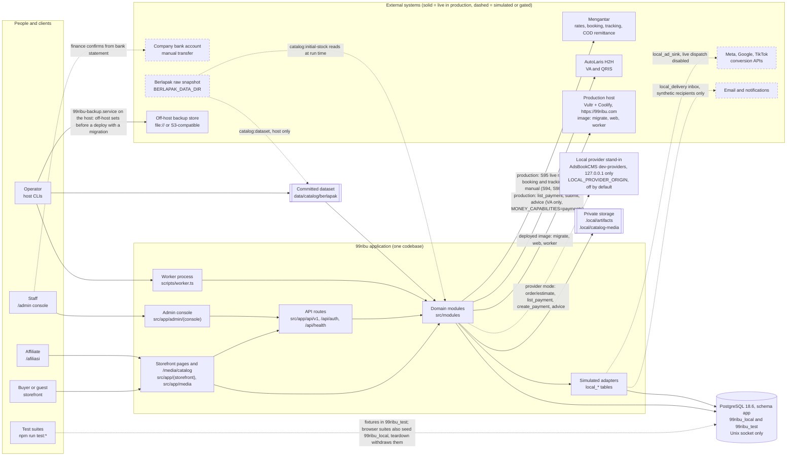

| External | Local stand-in today | Live gate (RELEASE.md) |
| --- | --- | --- |
| Mengantar rates | Local: `rates.ts:localRateAdapter` over the TEST-ONLY fixture; provider mode: `mengantar.ts:mengantarRateAdapter` against the stand-in with the real area catalogue | S95 live in production (`SHIPPING_ADAPTER=mengantar`, 82,374 (harvested 2026-11-04) areas, warehouse `provider_area_id`) |
| Mengantar booking | Operator books in the Mengantar dashboard and types courier + resi (`fulfillment/manual.ts:shipManually`); the older `shipping.create` simulator still serves suites | S94; `MENGANTAR_API_BOOKING_ENABLED=false` in `fulfillment/manual.ts` |
| Mengantar tracking | `fulfillment/manual.ts:simulatedTrackingAdapter` reading `local_tracking_observation`; operator fallback `recordTrackingStatus` | S98 |
| Mengantar COD remittance | Finance types the statement (`finance/cod-remittance.ts:recordCodRemittance`) | Manual by design (DEC-007) |
| AutoLaris VA/QRIS | Local: `payments/autolaris.ts:simulatedAutolaris` (DB-backed `local_autolaris_transaction`, owner rates QRIS 0,7%, VA BCA Rp6.500, other VA Rp3.000); provider mode: `liveAutolaris` against the stand-in | **Live in production since 2026-11-10 (VA only):** `autolarisClientFor('production')` returns `liveAutolarisSubmit` (`POST /api/h2h/submit`, payment-only, fee inside `grand_total`) only while `payments` is in `MONEY_CAPABILITIES`/`MONEY_DRAIN` with a valid `AUTOLARIS_*` set; QRIS refused until a QR image exists (`QRIS_IMAGE_READY`). Not yet proven live: the VA instruction field and the settled advice for a `submit` transaction (owner's first real payment). |
| Manual bank transfer | Real flow; confirmation is a finance action with evidence | Closed in production: needs `manual_bank` in `MONEY_CAPABILITIES` and accounts in the `payment` policy |
| Ads (Meta CAPI, Google Data Manager, TikTok Events API) | `advertising/worker.ts:advertisingAdapter` writing `local_ad_sink` | Consent/destination activation; `EXTERNAL_DISPATCH=disabled` |
| Email / notifications | `integrations/local.ts:dispatchLocal` writing `local_delivery`; Better Auth only accepts `*.test` / `*.invalid` | OD-8 email provider gate |
| Berlapak data | Committed sanitized dataset; raw snapshot read only by host commands | DEC-005; raw snapshot never served or committed |
| Backup store (S85) | `src/ops/backup.ts` + `scripts/backup.ts` (`file:///dir` locally; `s3://` against any S3-compatible endpoint; restore drill on disposable databases) | Live: `99ribu-backup.service` on the production host writes off-host sets to Vultr Object Storage (owner-run before a deploy with a migration; RELEASE.md records each set) |
| Production host | `Dockerfile` + `compose.production.yaml` (`migrate` one-shot, then `web` and `worker`); the production worker runs only payment adapters, and only for listed capabilities (`scripts/worker.ts:productionAdapters`) | Deployed (Vultr `99ribu-prod`, Coolify, Cloudflare in front); every deploy and its backup in `RELEASE.md` |

The web app is one Next.js process (`127.0.0.1:3099` locally, `0.0.0.0:$PORT` in production): storefront pages read modules server-side and mutate through Server Actions that call the API handlers in process; console pages are client components over `/api/v1/admin/*`. `src/proxy.ts` runs on `/admin/**` (legacy redirects; forwards the request path to the console layout for the signed-out redirect; no auth decision) and on RSC flight requests outside `/admin` (its matcher in `src/proxy.ts`). Browser suites seed namespaced fixture products and categories into `99ribu_local`; their teardown withdraws the publications, but the immutable category rows and product revisions stay (see [Category map](#category-map)).

## Folder structure

```text
99ribu/
├── src/                     application code (shared by web and worker)
│   ├── app/                 Next.js App Router: pages, route handlers, metadata routes
│   │   ├── (storefront)/    public Indonesian routes (DEC-010), server components + Server Actions
│   │   ├── admin/           (console)/ shadcn staff console, including the support/ CS inbox
│   │   ├── api/             auth/[...all] (Better Auth), health, v1/** (versioned business API)
│   │   ├── media/catalog/   public catalog photo route (SEO names → content-addressed files)
│   │   └── layout.tsx, not-found.tsx, robots.ts, sitemap.ts, icons, globals.css (only `@import`s) and styles/ (15 ordered storefront area stylesheets)
│   ├── components/          storefront/ (shell, flows; ui/ primitives, sections/), admin/ (console clients), support/, ui/ (shadcn)
│   ├── config/              local.ts (profile guard, private dirs), site.ts (origin, SITE_INDEXING)
│   ├── db/                  client.ts (socket connection), schema.ts (Drizzle mirror), bootstrap SQL for roles
│   ├── jobs/                outbox.ts (enqueue), leases.ts (claim/fence), worker.ts (job registry), retention.ts (retention registry), probes.ts
│   ├── modules/             26 domain modules, see Module map
│   ├── ops/                 backup.ts (S85 backup sets, retention, restore drill)
│   ├── proxy.ts             /admin: legacy 308s + forwards the request path (no auth decision); production RSC requests with a non-public Host (Next's internal action-redirect render) get 421 so the browser loads the redirect target itself
│   └── storage/             private.ts (artifacts), catalog-media.ts (photos), media-sniff.ts (magic bytes)
├── migrations/              SQL + drizzle meta journal/snapshots (immutable once applied; latest 0059)
├── scripts/                 run-local, worker, migrate, database, seed, catalog, backup, staff, mengantar-areas, local-providers, check-tests, check-docs, check-health, healthcheck, image-audit, heavy.sh
├── Dockerfile, compose.yaml, compose.production.yaml   production image (S84) and the local database container
├── data/catalog/berlapak/   committed catalog dataset: catalog.json, manifest.json, photos/<sha256>.webp
├── tests/                   integration/ (+ fixtures), browser/, contract/, historical/, top-level unit tests
├── public/                  brand/, fonts/ (self-hosted Inter), catalog-local/ (S69 fixture copies), fixtures/, prototypes/
├── docs/                    spec/ (canonical design), adr/ (ADR-0001..0008), history/ (archived narrative, incl. this file's old slice notes)
├── design/                  design working files
├── .delivery/               tool-written execution evidence (not hand-edited)
└── .local/                  private runtime state, never committed (see Runtime topology)
```

## Module map

One row per `src/modules/<name>`. "Tables" are the main tables the module writes; "Routes" are the `/api/v1` groups and pages that call it; "Jobs" are outbox kinds it enqueues (E), handles in the database registry (H) or serves as a leased adapter (L). Route handlers are thin: each `route.ts` calls the module's `handleX(request, getLocalAuth())`.

| Module | Owns | Main tables | Routes / pages | Jobs |
| --- | --- | --- | --- | --- |
| `access` | Better Auth wiring, principal/roles/permissions, Origin and body checks, rate limits, staff grants, reauthentication proofs; `account-security.ts` (S129): the caller's own profile, sessions and two-step state, plus password change and backup-code regeneration through the `handleAuth` allowlist (MFA disable, session list and `revoke-*` stay 404); `staff.ts` (S137): owner-only staff directory, exact-email account lookup and audited MFA reset (`staff_mfa.reset` proof); `routes.ts`: by-id warehouse read (S134) | `role_grant`, `warehouse_membership`, `mfa_session`, `access_proof`, `access_operation`, `audit_event`, `auth_rate_limit` | `/api/auth/*` (incl. `account-security`, `change-password`, `two-factor/generate-backup-codes`), `me`, `me/reauthentication-proofs`, `admin/role-grants`, `admin/staff`, `admin/staff/lookup`, `admin/staff-mfa-resets`, `admin/warehouses`, `admin/warehouses/{id}`, `admin/policy-versions`; pages `/admin/akun/profil`, `/admin/akun/keamanan`, `/admin/pengaturan/staf` | E `local.notification` |
| `accounts` | Buyer profile, address book, notification preferences, contact-change and guest-order-link challenges, return evidence (split 2026-10-28: `service.ts` keeps `handleAccounts` and return evidence and re-exports `profile.ts`, `addresses.ts`, `notifications.ts`, `contact-change.ts`, `guest-order-access.ts`, `guest-order-link.ts`, `workspace.ts`, `shared.ts`); `lookup.ts` (S138): exact-match buyer lookup by phone or email for CS/owner (masked contact, scoped order and ticket history, no address, rate-limited, audited) | `buyer_profile`, `buyer_address`, `buyer_identity_challenge`, `buyer_notification_preference`, `return_evidence` | `me/*`, `guest-order-access/*`, `admin/customers/lookup`; pages `/akun`, `/admin/pelanggan` | — |
| `advertising` | Commerce events, funnel intake, Meta/Google/TikTok payload mapping to the local sink, destinations, diagnostics/replay | `commerce_event`, `ad_event_outbox`, `ad_delivery_attempt`, `ad_destination_config`, `order_ad_attribution`, `local_ad_sink` | `admin/advertising/**`, `consent/receipt`, `funnel/events`, `visitor-sessions` | E/L `advertising.dispatch` |
| `affiliates` | Affiliate enrollment and profile, beneficiary changes, referral touches, order attribution, rate versions; `admin.ts` (S132): owner/finance keyset list and detail with rate-version history and commission summaries (no buyer PII, no bank account numbers; the effective rate is computed in SQL so suspended or unverified affiliates stay inspectable) | `affiliate_account`, `affiliate_profile`, `referral_touch`, `order_attribution`, `affiliate_rate_version` | `me/affiliate`, `referral-touches`, `admin/affiliates`, `admin/affiliates/{id}`, `admin/affiliates/*/rates`; pages `/afiliasi`, `/admin/afiliasi`, `/admin/afiliasi/[affiliateNo]` | E `affiliate.payout.queue` |
| `audit` | Read-only audit viewer (S135): `log.ts` keyset page over `audit_event` (owner: all actions; finance: only the money actions its grant opens, filtered in SQL), `redaction.ts` allowlist per action kind (`MONEY_ACTIONS`, `moneyActionsFor`). Writes only its own `audit.read` row | `audit_event` (read; insert `audit.read`) | `admin/audit-events`; admin page `/admin/pengaturan/audit` | — |
| `catalog` | Categories, stock items, products/offers and revisions, publication and withdrawal, dataset import, feed builder; `validation.ts` is shared | `category`, `stock_item`, `product`, `product_revision`, `offer`, `offer_component`, `publication_head`, `publication_version`, `publication_withdrawal` | `admin/categories`, `admin/products/**`, `admin/stock-items`; admin page `/admin/produk` | — |
| `checkout` | Guest/cart/order access cookies, carts, quotes, order submission and expiry; `exceptions/` holds commerce exceptions and recovery refunds | `commerce_guest_context`, `cart`, `cart_line`, `checkout_quote`, `commerce_order`, `order_item`, `order_shipment`, `fulfillment_item`, `order_event`, `order_access`, `commerce_exception` | `carts/**`, `checkout/quotes/**`, `orders`, `orders/{id}`, `destinations`, `admin/commerce-exceptions/**` | E/H `checkout.order.expire`, E/H `recovery.refund.callback`, E/L `recovery.refund.create` |
| `commissions` | Commission accrual, receipt-anchored H+10 maturity, holds, voids, affiliate balances | `commission_entry`, `commission_adjustment` | `me/affiliate/{balance,commissions}` | E/H `commission.accrue`, `.receipt`, `.claim`, `.void`, `.mature`, `affiliate.payout.queue` |
| `consent` | Visitor session bootstrap and consent receipts | `visitor_session`, `visitor_bootstrap_request`, `consent_receipt` | reached through `advertising` | — |
| `documents` | Label templates, label jobs and private TEST PDFs, print batches and attempts (split 2026-10-28: `labels.ts` is the facade over `label-handler.ts` (`handleShippingLabels`), `label-templates.ts`, `label-artifacts.ts` (PDF writer), `label-shipment.ts`, `print-queue.ts`, `label-shared.ts`) | `shipping_label_template(_version)`, `shipping_label_job`, `shipping_label_artifact`, `shipping_print_batch`, `shipping_print_attempt` | `admin/label-*`, `admin/shipments/*/label*`, `admin/shipping-label-templates`; page `/admin/pesanan/cetak-label` | — |
| `finance` | Ledger and economic receipts, costs and contribution, order history; `settlements/` (statement, match, recovery); manual bank confirmation; AutoLaris queue and callback intake; COD remittance | `finance_transaction`, `finance_posting`, `economic_receipt`, `provider_settlement`, `settlement_match`, `manual_bank_confirmation`, `manual_bank_reference`, `autolaris_observation`, `autolaris_callback`, `cod_remittance`, `cod_remittance_line`, `component_cost_version` | `admin/reconciliation/**`, `admin/settlements`, `admin/finance`, `admin/orders`, `admin/manual-transfers/**`, `admin/autolaris-payments/**`, `admin/cod-remittances/**`, `admin/cod-collectible-parcels`, `payments/autolaris/callbacks`; pages `/admin/keuangan/pembayaran`, `/admin/keuangan/cod` | E/H `settlement.callback`, E/H `cod.remittance.match` |
| `fulfillment` | Fulfillment lifecycle, calendar deadlines and notices, booking/handover, waybill cancellation; `manual.ts`: warehouse mode, pickup profile, manual resi, Berlapak reference, tracking adapter and poll | `fulfillment`, `fulfillment_event`, `fulfillment_deadline`, `shipment_booking`, `shipment_cancellation`, `warehouse_pickup_profile`, `manual_tracking`, `fulfillment_purchase_reference`, `shipment_tracking_event` | `admin/fulfillments/**`, `admin/manual-shipments`, `admin/shipments`, `admin/warehouses/*/pickup-profile`; page `/admin/pesanan/kirim` | E/L `shipping.create`, `shipping.cancel.create`; E/H `shipping.callback`, `shipping.cancel.callback`, `fulfillment.deadline`, `fulfillment.notice`, `fulfillment.tracking.poll` |
| `integrations` | Local notification dispatcher (no network sender) | `local_delivery` | — | H `local.notification` |
| `inventory` | Positions, lots, movements, reservations and expiry, warehouse transfers | `inventory_balance`, `inventory_lot`, `stock_movement`, `stock_reservation(_item/_component)`, `warehouse_transfer`, `transfer_receipt` | `admin/inventory/**` | E/H `inventory.reservation.expire` |
| `local` | Local fixtures, fixture clock, dummy logins (one shared dummy password; `cs@` scoped to origin warehouses; `marketing@` for S177 proposals), demo orders in every state (`fixture -- demo-orders local`, real flows, `local/demo-orders.ts`), Berlapak dataset generator, initial stock, origin rehome | `local_fixture_namespace`, `local_fixture_principal`, `local_fixture_warehouse` (plus seed writes through other modules) | scripts and tests only | — |
| `ops-health` | Read-only system health (S136): outbox job counts per kind and state (`due`, `scheduled`, `leased`, `lease_expired`, `unknown`, `failed`, `dead`, `completed`) and the retention registry; owner with MFA only. Retention last-run times are not recorded anywhere | `outbox_job` (read) | `admin/system-health`; admin page `/admin/pengaturan/sistem` | — |
| `orders` | Buyer order receipt/continuity projection and receipt cookies | — (reads) | `orders/{id}/receipt`; page `/pesanan/[orderId]` | — |
| `payments` | Payment channels and terms (incl. DEC-029 fee bearers and the AutoLaris fee table, `methods.ts:autolarisBuyerFee`; per-channel order deadlines `ORDER_DEADLINE_SECONDS`; production capability checks `productionChannelOpen`), attempts, local prepaid simulator, COD confirmation and collection, AutoLaris: simulator, live HTTP client (`autolaris-live.ts`), production `submit` builder/parser (`autolaris-submit.ts`), dispatch, advice polling and raw callbacks | `payment_attempt`, `payment_attempt_event`, `payment_provider_event`, `payment_event_result`, `local_payment_operation`, `cod_confirmation`, `cod_event_result`, `autolaris_payment`, `local_autolaris_transaction` | `orders/{id}/payment-attempts/**`, `orders/{id}/cod-collections` | E/L `payment.create`, `payment.autolaris.advice`; E/H `payment.callback`, `cod.callback` |
| `payouts` | Affiliate payout queue, manual transfer claim/verify, evidence upload | `affiliate_payout`, `affiliate_payout_entry`, `affiliate_payout_event`, `affiliate_payout_evidence` | `admin/payouts/**`, `me/affiliate/payouts` | — |
| `promotions` | Shipping promotion configuration, reservations, allocation, expiry; S177 vouchers (`promotion.code`, immutable) and marketing proposals (`promotion_version.proposed`) decided by owner/ecommerce_admin (`configuration.ts:promotionAuthority`, `decideProposal`) | `promotion`, `promotion_version`, `promotion_reservation`, `promotion_movement`, `promotion_allocation` | `admin/shipping-promotions/**` incl. `{id}/decisions` | E/H `promotion.reservation.expire` |
| `reporting` | Dashboard snapshot, work queues, CSV exports, operation status (split 2026-10-28: `service.ts` keeps `handleReporting` and re-exports `dashboard.ts`, `queue.ts`, `exports.ts`, `operations.ts`, `tokens.ts`; `sources.ts` holds the FROM/WHERE fragments shared by each KPI card and its drilldown) | `admin_export_selection` | `admin/dashboard`, `admin/work-queues`, `admin/export-selections`, `admin/exports`, `operations/{id}` | — |
| `returns` | Return cases and inspection, parcel receipts, refunds, replacements and their recovery; `reads.ts` `readAdminRefunds` (S131): keyset refund list for owner/finance (`finance.refunds.read`), contact-free and bank-free, audited as `refund.list` | `return_case`, `return_item`, `buyer_receipt`, `refund`, `refund_allocation`, `replacement_shipment`, `replacement_booking` | `admin/returns/**`, `admin/refunds` (GET list, POST queue), `admin/refunds/{id}/**`, `admin/replacements/**`, `orders/{id}/returns/**`, `orders/{id}/refunds/**` | E/L `refund.create`, `replacement.shipping.create`; E/H `parcel.receipt.callback`, `refund.callback`, `replacement.shipping.callback`, `replacement.receipt.callback` |
| `settings` | Versioned company/warehouse policies (`commercial`, `payment`, `warehouse_calendar`) | `policy_head`, `policy_version` | served through `access` at `admin/policy-versions` | — |
| `shipping` | Address normalisation, destinations (fixture or the `shipping_area` catalogue; `areaTitle`), parcel allocation, simulated and Mengantar rates (`mengantar.ts`, `COURIERS`), provider-mode config source (`shippingProvider`), shipping-benefit check (pure) | `shipping_area` | used by checkout, accounts, storefront | — |
| `storefront` | Server-side storefront reads, cart/checkout BFF, draft files, SEO, navigation; S110 home promo banners (`home-banners.ts` admin API: owner/ecommerce_admin with MFA, a fresh `home_banner.write` proof per write, immutable versions, audit; `banners.ts` public projection: current WIB window, rail order; the data-backed defaults while no banner is left unretired) | `home_banner`, `home_banner_version` (0038); drafts in `.local/artifacts`; banner images in `.local/catalog-media` | `products`, `products/{id}`, `categories`, `admin/home-banners/**`, `admin/home-banner-images`; every `(storefront)` page, `layout.tsx`, `robots.ts`, `sitemap.ts`; admin page `/admin/banner` | — |
| `support` | Buyer/guest/staff conversations, challenges, attachments, notes, tags, saved replies, SSE stream (split 2026-10-28: `service.ts` is the facade over `identity.ts`, `actors.ts`, `conversations.ts`, `messages.ts`, `attachments.ts`, `notifications.ts`, `events.ts`, `staff-inbox.ts`, `tools.ts`, `shared.ts`; `routes.ts` unchanged) | `support_conversation`, `support_message`, `support_attachment`, `support_challenge`, `guest_support_identity`, `support_assignment_event` | `support/**`, `admin/support/**`, `guest-support-sessions`; page `/admin/obrolan` | — |

Shared infrastructure outside `src/modules/`: `src/jobs/` (outbox, leases, registry, probes), `src/storage/`, `src/config/`, `src/db/`.

A module split into several files keeps its original entry file (`service.ts`, or `labels.ts` for documents) as the public facade with the same exports; routes, other modules and tests import from the facade, never from the internal files, and internal files never import the facade (no cycles). `scripts/backup.ts:ARTIFACT_KEY_COLUMNS` names the file that calls `savePrivateArtifact()` for each artifact column, so moving such a call means updating that list (`tests/backup.test.ts` fails otherwise).

### Admin screen map

**Admin URL scheme (S145).** Admin detail pages are addressed by a short numeric `admin_no`, never by a UUID: `/admin/pesanan/1042`, `/admin/produk/17`, `/admin/pesanan/retur/5`, `/admin/pesanan/kendala/9`, `/admin/produk/gudang/3`, `/admin/afiliasi/4`, `/admin/keuangan/{komisi,refund,rekonsiliasi}/<n>`. `admin_no` is `bigint GENERATED ALWAYS AS IDENTITY` (unique, immutable through the `app.guard_admin_no()` trigger, never reused) on `commerce_order`, `product`, `warehouse`, `return_case`, `refund`, `provider_settlement` (the reconciliation item), `affiliate_account`, `affiliate_payout` and `commerce_exception` (migration `0041`, existing rows numbered in creation order). It is admin-only and separate from the public order number (`99-…`) and from every UUID key; the API under `/api/v1/admin` keeps taking UUIDs and its list/detail read models add `admin_no` (plus `order_admin_no`, `return_admin_no` where a row links to another page) so every link is built by `adminPath()` in `modules/access/admin-paths.ts`. A page runs its own role gate first, then `resolveAdminId` (`admin-number-page.ts`, rules in `admin-number.ts`): a canonical number is one indexed read; an unknown number resolves to a well-formed id no row has, so the client's API read answers 404 as it does for a row outside the caller's scope; a UUID answers 308 to the numeric URL; anything else is not found. Users and staff are never addressed by UUID in an admin URL (they will be addressed by username when such pages exist; none does today).

**Sidebar navigation** (`components/admin/admin-nav.ts` holds the data, `admin-shell.tsx` renders it; redesign plan §4.1, tokophi pattern with 99ribu colours). There is one nav tree per role lens (`NAV_BY_LENS`); a principal with several roles gets one lens per role (`/admin?workspace=<role>`, remembered in the `admin_lens` cookie). `navFor` filters every item through `PAGE_RULES`, which repeats each page's own server guard, so a lens never widens access (the page and the API re-check). A row whose page is unbuilt (`UNBUILT_PAGES`) is not shown. A parent whose own page the principal cannot open links to its first visible child. Parent rows open their page; the chevron opens the children.

| Lens | Rows (children) |
| --- | --- |
| owner (Super Admin; monitor, approver, governor) | Beranda · Persetujuan (unbuilt) · Pantauan `/admin/pantauan` hub (Pesanan, Produk, Stok, Kendala Pengiriman, Retur as transition links until the S-O1 read-only pages land) · Keuangan (Laporan Keuangan, Rekonsiliasi, Komisi Afiliasi) · Analitik (unbuilt) · Pemasaran `/admin/pemasaran` hub (Voucher) · Pengaturan hub (Staf & Peran, Kebijakan Komersial, Pembayaran & COD, Tarif Afiliasi, Gudang, Integrasi Iklan, Log Audit, Kesehatan Sistem) |
| ecommerce_admin | Beranda · Pesanan (Semua Pesanan, Input Resi, Cetak Label, Retur) · Produk (Tambah Produk, SKU & HPP, Kategori, Inventori, Transfer Stok) · Promo (Promo Ongkir; Voucher, Banner, Segmen Pembeli) · Toko Online (Halaman; Media unbuilt) · Pengaturan |
| marketing (S177; proposes only) | Pemasaran `/admin/pemasaran` hub (Voucher, Promo Ongkir). No Beranda: `/admin` and `/admin/antrian` redirect a marketing-only account to the hub; the role chip opens the hub with `?workspace=marketing` |
| warehouse | Beranda · Pesanan (Input Resi, Cetak Label, Kendala Pengiriman, Retur) · Produk (Inventori, Transfer Stok) · Pengaturan |
| customer_service | Beranda · Obrolan (badge: unclaimed chats) · Pesanan (Kendala Pengiriman, Retur) · Pelanggan · Pengaturan (Balasan CS) |
| finance | Beranda · Keuangan (Laporan, Pembayaran Masuk, Setoran COD, Rekonsiliasi, Pengembalian Dana, Komisi Afiliasi, Tarif Afiliasi) · Pesanan · Pengaturan (read cards) |
| Account menu (footer) | Profil `/admin/akun/profil` · Keamanan akun `/admin/akun/keamanan` |

**Hub pages.** `/admin/pengaturan`, `/admin/pemasaran` and `/admin/pantauan` are card indexes built from `SETTINGS_CARDS`, `MARKETING_CARDS` and `MONITOR_CARDS` (`admin-nav.ts`) and rendered by `components/admin/hub-cards.tsx` (`pemasaran` is an owner and marketing row, `pantauan` owner-only; each card still follows its target page's guard). Page slugs are Indonesian since S-U1 (owner decision D10, 2026-10-29); `src/proxy.ts:LEGACY_ADMIN_ROUTES` answers 308 from every old English path, and `/api/v1/admin/**` keeps its English paths.


Entry point when changing a console screen: page → client component → API route → module → who sees it. Sidebar items live in `components/admin/admin-shell.tsx` (display gate only; the page guard and the API re-check). Pages are under `src/app/admin/(console)/`, API routes under `src/app/api/v1/admin/`.

| Screen (href) | Client component | API | Module | Visible to |
| --- | --- | --- | --- | --- |
| `/admin/pemasaran`, `/admin/pantauan` | page-only (`hub-cards.tsx`) | none (cards link to the pages below) | none | owner (`pemasaran`: also marketing) |
| `/admin/pemasaran/voucher` (S177) | `shipping-promotions-client.tsx` (`mode="voucher"`) | `shipping-promotions/**` incl. `{id}/decisions` | `promotions` (`configuration.ts`) | owner, ecommerce_admin (write, approve/reject proposals); marketing (inactive proposals only). Same screen as `/admin/promo/ongkir` (`mode="automatic"`), split by `code`. With the Mengantar catalogue the form adds a kecamatan picker (`GET /api/v1/destinations?group=district`) storing `dist-…` ids beside provinces in `region_ids` (max 100; `promotion-regions.ts` mirrors `districtRegion`, pinned by `tests/admin-promotion-regions.test.ts`) |
| `/admin`, `/admin/antrian` | `admin-workspaces-client.tsx` | `dashboard`, `work-queues`, `exports` | `reporting` | role lenses (Ruang Kerja) |
| `/admin/pesanan`, `/admin/pesanan/[orderNo]` | `orders-client.tsx` | `orders` | `finance` (`history-routes.ts`) | `orders.history.read` |
| `/admin/pesanan/kirim`, `/admin/pesanan/cetak-label` | `manual-fulfillment-client.tsx`, `print-center-client.tsx` | `manual-shipments`, `fulfillments`, `label-*` | `fulfillment`, `documents` | ship / print grants |
| `/admin/pesanan/kendala`, `/admin/pesanan/kendala/[exceptionNo]` (S133) | `exception-list-client.tsx`, `exception-detail-client.tsx`, `exception-refund-panel.tsx`, `exception-intent-core.ts` | `commerce-exceptions/**` (incl. `GET …/refunds`), `fulfillments`, `shipments`, `inventory`, `me/reauthentication-proofs` | `checkout` (`exceptions/`) | `returnAccess` |
| `/admin/pesanan/retur`, `/admin/pesanan/retur/[returnNo]` | `return-list-client.tsx`, `return-detail-client.tsx` | `returns`, `refunds`, `replacements` | `returns` | `returnAccess` |
| `/admin/obrolan` | `components/support/StaffInboxView` | `support/**` | `support` | customer_service, owner |
| `/admin/pelanggan` (S138) | `customer-lookup-client.tsx` | `customers/lookup` | `accounts` (`lookup.ts`) | customer_service, owner |
| `/admin/produk`, `/admin/produk/[productNo]`, `/admin/produk/baru` | `catalog-list-client.tsx`, `catalog-product-client.tsx`, `cost-versions.tsx` | `products`, `offers/**`, `categories`, `stock-items/**` | `catalog`, `finance` (`costs.ts`, `contribution.ts`) | `catalogAccess` (costs only with `finance.costs.read`/`write`) |
| `/admin/produk/sku`, `/admin/produk/kategori` (S134) | `stock-items-client.tsx`, `categories-client.tsx`, `cost-versions.tsx` | `stock-items`, `stock-items/*/cost-versions`, `categories` | `catalog`, `finance` (`costs.ts`) | owner, ecommerce_admin (HPP only with `finance.costs.read`/`write`) |
| `/admin/produk/inventori`, `/admin/produk/inventori/transfer` | `inventory-client.tsx`, `transfers-client.tsx` | `inventory/**`, `warehouses` | `inventory` | warehouse, owner |
| `/admin/produk/gudang`, `/admin/produk/gudang/[warehouseNo]` (S134) | `warehouses-client.tsx` | `warehouses`, `warehouses/{id}`, `warehouses/{id}/pickup-profile`, `policy-versions` | `access`, `fulfillment` (`manual.ts`), `settings` | owner, ecommerce_admin, warehouse (pickup profile: owner/ecommerce_admin; calendar: owner) |
| `/admin/promo/ongkir`, `/admin/banner`, `/admin/pelanggan/segmen` | `shipping-promotions-client.tsx`, `banners-client.tsx`, page-only | `shipping-promotions`, `home-banners`, `buyer-segments` |

S176: with the real area catalogue (production or local provider mode) the shipping-promotion form offers the Mengantar courier keys and the catalogue's provinces; every shipment carries a `prov-<slug>` region id beside its area id (`checkout/quotes.ts:promotionShipments`, same in the order reservation). The buyer address book (`/akun/profil`) then searches the catalogue (`GET /api/v1/destinations`) instead of listing fixture destinations. `promotions`, `storefront`, `accounts` (`profile-completion.ts`) | owner, ecommerce_admin; marketing proposes (S177) |
| `/admin/keuangan/pembayaran`, `/admin/keuangan/cod` | `payments-client.tsx`, `cod-settlements-client.tsx` | `manual-transfers`, `autolaris-payments`, `cod-remittances`, `reconciliation` | `finance` | `finance.reconciliation.read` (payment terms moved to `/admin/pengaturan/pembayaran`, S130) |
| `/admin/keuangan/rekonsiliasi`, `/admin/keuangan/rekonsiliasi/[itemNo]` (S131) | `finance-reconciliation-client.tsx` | `reconciliation/**`, `settlements/*`, `me/reauthentication-proofs` | `finance` (`settlements/`) | `finance.reconciliation.read` (decisions: `.write`) |
| `/admin/keuangan/komisi`, `/admin/keuangan/komisi/[payoutNo]` (S131) | `finance-payouts-client.tsx` | `payouts/**`, `me/reauthentication-proofs` | `payouts` | owner, finance (`payout.claim`, `payout.verify` proofs) |
| `/admin/keuangan/refund`, `/admin/keuangan/refund/[refundNo]` (S131) | `finance-refunds-client.tsx` | `refunds` (GET), `refunds/{id}/**`, `me/reauthentication-proofs` | `returns` | `finance.refunds.read` (reconcile/retry: `.write`, `finance.refund` proof) |
| `/admin/keuangan` (S131) | `finance-summary-client.tsx` | `finance/summary`, `dashboard` | `finance` (`realized-contribution.ts`), `reporting` | `finance.summary.read` (incomplete inputs show "Belum lengkap", never Rp 0) |
| `/admin/afiliasi`, `/admin/afiliasi/[affiliateNo]` (S132) | `affiliates-client.tsx`, `affiliates-model.ts` | `affiliates`, `affiliates/{id}`, `affiliates/{id}/rates`, `me/reauthentication-proofs` | `affiliates` (`admin.ts`, `rates.ts`) | owner (writes rate versions); finance (read-only) |
| `/admin/pengaturan/pembayaran`, `/admin/pengaturan/komersial` (S130) | `settings-payment-client.tsx`, `settings-commercial-client.tsx`, `settings-intent.ts` | `policy-versions?kind=payment\|commercial`, `me/reauthentication-proofs` | `settings`, `access` | owner (writes, `payment_policy.version` / `company_policy.version` proofs); finance (read) |
| `/admin/pengaturan/label` (S130) | `settings-label-templates-client.tsx` | `shipping-label-templates/**`, `me/reauthentication-proofs` | `documents` (`labels.ts`) | owner writes (required `shipping_label_template.version` proof); finance, ecommerce_admin, warehouse read |
| `/admin/pemasaran/iklan` (S130) | `settings-advertising-client.tsx` | `advertising/destinations/**`, `advertising/events/*/replays` | `advertising` (`diagnostics.ts`) | owner (reason, expected version, audit; no reauth proof, spec 17 B24) |
| `/admin/pengaturan/balasan-cs` (S130) | `settings-support-client.tsx` | `support/saved-replies/**`, `support/tags/**` | `support` | owner; customer_service with `support.tools.manage` (audit; no reauth proof, spec 17 B25) |
| `/admin/pengaturan/audit` (S135) | `audit-log-client.tsx` | `audit-events` | `audit` | owner; finance (money actions its grant opens) |
| `/admin/pengaturan/sistem` (S136) | `system-health-client.tsx` | `system-health` | `ops-health` | owner |
| `/admin/pengaturan/staf` (S137) | `staff-roles-client.tsx` | `staff`, `staff/lookup`, `role-grants`, `staff-mfa-resets`, `me/reauthentication-proofs` | `access` (`staff.ts`, `grants.ts`) | owner |
| `/admin/halaman` (S-C1) | `static-pages-client.tsx` | `static-pages`, `static-pages/{slug}` | `storefront` (`static-pages.ts`) | owner, ecommerce_admin (MFA) |
| `/admin/akun/profil`, `/admin/akun/keamanan` (S129) | `account-security-client.tsx` | `/api/auth/account-security`, `change-password`, `two-factor/generate-backup-codes`, `me/session-terminations` | `access`, `accounts` | every MFA-verified staff user (account menu in the sidebar footer) |

Built: every row above. Not built yet (`UNBUILT_PAGES`, redesign plan §6): `/admin/persetujuan` (S-A0, needs a migration), `/admin/analitik` (S-A1), `/admin/media` (S-C1, needs a migration) and the read-only `/admin/pantauan/{katalog,stok,kendala}` pages (S-O1). The plan lives in `docs/history/ADMIN-REDESIGN-PLAN-20261029.md`; open design reviews are in `STATUS.md` and `TASKS.md`.

## Worker and job registry

Every job is an `app.outbox_job` row written in the caller's domain transaction (`src/jobs/outbox.ts:enqueueJob`). Two lanes exist:

- **Database jobs** (`src/jobs/worker.ts:DATABASE_JOBS`, the sole registry): run inside one transaction with a savepoint; effect and job completion commit together. Seal kinds: `complete`, `defer` (handler may reschedule) and `expiry` (order ownership resolved first). Retryable errors (`40P01`, `55P03`, `57014`, `PAYMENT_RECONCILIATION_PENDING`, `TRACKING_ADAPTER_UNAVAILABLE`, `COD_COLLECTION_PENDING`) back off up to 60 s; others dead-letter.
- **Leased adapter jobs** (`scripts/worker.ts` adapter map, `src/jobs/leases.ts`): claim with a fencing token and 30 s lease, dispatch outside database locks, settle by token; uncertain outcomes are reconciled by looking up the original identity, never by blind retry.

| Lane | Kinds |
| --- | --- |
| Database | `local.notification`, `inventory.reservation.expire`, `promotion.reservation.expire`, `checkout.order.expire`, `payment.callback`, `cod.callback`, `settlement.callback`, `parcel.receipt.callback`, `refund.callback`, `recovery.refund.callback`, `replacement.shipping.callback`, `replacement.receipt.callback`, `shipping.callback`, `shipping.cancel.callback`, `fulfillment.deadline`, `fulfillment.notice`, `fulfillment.tracking.poll`, `cod.remittance.match`, `commission.accrue`, `commission.receipt`, `commission.claim`, `commission.void`, `commission.mature`, `affiliate.payout.queue` |
| Leased adapter | `payment.create`, `payment.autolaris.advice`, `advertising.dispatch`, `shipping.create`, `shipping.cancel.create`, `refund.create`, `recovery.refund.create`, `replacement.shipping.create` |
| Leased adapter, **production** | `payment.create` and `payment.autolaris.advice` only, and only while their capability is open or draining (`scripts/worker.ts:productionAdapters`); every other leased kind has no adapter in production |
| Housekeeping (throttled, once per minute per process) | every entry of `src/jobs/retention.ts:RETENTION_JOBS` (table below) |

### Retention registry (S105)

`src/jobs/retention.ts:RETENTION_JOBS` is the sole list; `sweepExpiredGuestContexts` in `src/jobs/worker.ts` runs each entry once per minute per worker process, each as one statement of at most `RETENTION_BATCH` = 500 rows in its own transaction (`for update skip locked`, so concurrent workers split the work and a rerun only sees the next batch). A failure is logged redacted (`jobs.retention_failed` with the entry name, or the two pre-S105 event names) and never stops jobs or the other entries. Windows are engineering defaults pending the PRIV-1 retention decision (`docs/spec/13-COMPLIANCE-PRIVACY.md`).

| Entry | Table | Removed | Never removed |
| --- | --- | --- | --- |
| `guest_context.expired` | `commerce_guest_context` | at expiry, unreferenced (DEC-002, unchanged) | contexts referenced by carts, orders, operations, support, referrals |
| `autolaris_callback.body` | `autolaris_callback` | body emptied after 30 days (row, digest, time kept) | — |
| `outbox.completed` | `outbox_job` | `completed` > 30 days, kinds `local.notification`, `inventory/promotion.reservation.expire`, `checkout.order.expire`, `fulfillment.deadline/notice/tracking.poll`, `advertising.dispatch` | pending/processing/unknown/failed jobs; money, carrier, refund, replacement, commission kinds (guards or recovery code read them); any job referenced by a foreign key (read from `pg_constraint` each run) |
| `access_operation.replay` | `access_operation` | `created_at` > 90 days, replay-only actions `buyer.*`, `guest_order_access.*`, `support.*`, `shipping.label.*`, `shipping.template.*`, `catalog.mutate`, `catalog.publication[.withdraw]`, `inventory.mutate`, `staff_roles.proof:*` | finance, payout, affiliate, fulfillment, policy, role-grant, promotion operations; any FK-referenced operation |
| `auth.session` | `auth_session` (+ `mfa_session`, `access_proof` by cascade) | 30 days after expiry | live sessions |
| `auth.verification` | `auth_verification` | 7 days after expiry | — |
| `auth.rate_limit` | `auth_rate_limit` | 1 day after the last request (windows are ≤ 15 min) | — |
| `support_challenge.guest_order_access` | `support_challenge` (kind `guest_order_access`) | 1 day after expiry | — |
| `visitor.history` | `visitor_session` graph: `consent_receipt`, `visitor_bootstrap_request`, `funnel_intake`, `commerce_event`, `ad_event_outbox`, `ad_delivery_attempt`, `local_ad_sink` | 90 days after visitor expiry, through `app.purge_expired_visitor_history` (SECURITY DEFINER, owner) | visitors with `order_ad_attribution`, an event naming an order or receipt, or an ad decision other than `suppressed`/`cancelled` (accepted, queued, quarantined) |

Ledger and audit history (`finance_transaction`, `finance_posting`, `economic_receipt`, every `*_event` history, `audit_event`, policy and catalog revisions, provider-event dedup rows) has no entry. The visitor/consent/funnel/ad tables stay append-only for the app role: 0037 routes their delete paths through `app.retention_purge_allowed(relid)`, which requires both the transaction-local `app.retention_purge=on` (set only inside the purge function) and the table owner as `current_user`; triggers were replaced in place (`CREATE OR REPLACE TRIGGER`), never disabled. `migrate.ts` grants the app role `EXECUTE` on the purge function only (0037 revokes it from `PUBLIC`).

## Request flows

Storefront Server Actions do not make HTTP calls: `src/modules/storefront/*` builds a `Request` and calls the same route handler (`handleCheckout`, `handlePayments`) in process, so `/api/v1/...` paths below are logical routes. Cookie names carry the prefix `99ribu-local.` or `99ribu-test.`.

### Guest checkout to order

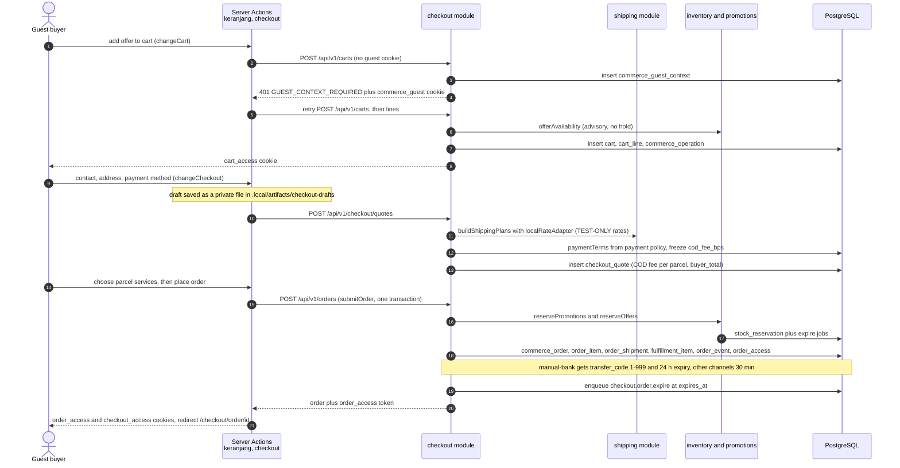

**Voucher code (S177, migration 0050).** The checkout summary's "Punya kode voucher?" field (`components/storefront/checkout-voucher.tsx`, `form="checkout-form"`, works without JavaScript) posts `voucher_apply`/`voucher_remove`; `storefront/checkout.ts:checkoutFormInput` turns that into a fresh quote with `voucher_code` (rate limit `voucherCodePerAddress`). `checkout/quotes.ts:previewPromotions` → `automaticPromotions` (code null) and `evaluateVoucher` (reason order: `NOT_FOUND` for unknown/inactive/proposal, `NOT_STARTED`, `EXPIRED`, `METHOD_NOT_ELIGIBLE`, `MIN_SUBTOTAL`, `PER_BUYER_LIMIT`, courier, area, `EXHAUSTED`); a voucher replaces the automatic promotions only when it saves more (`STACKING_CONFLICT` otherwise). The quote document keeps `voucher` and `selectQuote` re-evaluates it; order creation reserves it through the unchanged `reservePromotions` and refuses a version changed since the quote (`PROMOTION_REVIEW_REQUIRED`). Shipments carry `prov-…` and `dist-<province>--<city>--<district>` region ids. Public `/promo` lists automatic promotions only. The checkout preselects the first enabled non-COD payment method (`storefront/checkout.ts:defaultPaymentMethod`, applied in `initialCheckoutState`), so the courier auto-quote fires once the address and kelurahan are complete; every promotion projection carries `has_run`, which locks a voucher's terms in the admin form as on the server.

**Store voucher (S177 stage 2B, migrations 0051–0055; design `docs/spec/vouchers/S177-stage-2b-design.md`; deployed).** A promotion version has `target` `shipping` or `merchandise`; a merchandise one (store voucher) needs a code and stacks with the automatic shipping promotions (owner decision 11). Money model: `merchandise_amount` stays the gross Σ `order_item.unit_price` (DEC-025); the discount is `merchandise_discount` on `checkout_quote`, `commerce_order`, `order_shipment` and per unit on `fulfillment_item`, with `buyer_total = merchandise − merchandise_discount + shipping − subsidy`. Allocation: `allocateMerchandise` / `merchandiseBenefit` (`promotions/allocation.ts`, SQL twin `app.expected_merchandise_allocations`) — order → lines by weight q × (price − 1), largest remainder, every unit keeps ≥ Rp1; line → units by `unit_index` (`merchandiseShares` in `checkout/quotes.ts`, SQL twin `app.quote_unit_discounts`). The reservation stores `discount_amount` and `promotion_line_allocation`; `seal_commerce_order` checks the unit split. Downstream rows keep the column name `merchandise_amount` but hold the **net** (price − unit discount): receipts (`finance/receipts.ts`, `guard_finance_part`), COD/waybill bases (`receipt-units.ts`, `fulfillment/local.ts`, `cod_*_collection_basis`, `waybill_current_request_basis`), returns/refunds/recovery (`returns/occurrences.ts`, `financial-basis.ts`, `assert_unit_merchandise`, `guard_return_item`, `recovery_refund_eligible_units`, exception asserts), commission accrual (`commissions/service.ts`), ad Purchase (`advertising/events.ts`, `purchase_signal_payload`/`purchase_receipt_payload`/`assert_commerce_event`; one content per (line, unit net)). Unit cancellation releases the voucher share (`releaseCancelledPromotionUnits`, `exception_promotion_unit_shares`). Admin: "Voucher untuk" in the voucher form; the approval dialog shows `margin_preview` to cost readers (owner) and the audit keeps it; approved vouchers are the margin-floor exception (`floorBenefits`, `0054`). UI rows "Voucher KODE" (checkout, under Produk) and "Diskon voucher" (payment page, order page, admin order detail); receipt parcels use the net.

Order expiry (`checkout/expiry.ts:expireOwnedOrderJob`) releases stock and promotion holds and sets `status=cancelled, payment_status=expired`, unless the order is paid or COD-confirmed. It defers while a manual transfer can still be confirmed (12 h grace after the 24 h window) or while a final AutoLaris advice read is pending (30 min).

### Payment: manual bank, COD, AutoLaris

The channel is chosen at checkout and frozen on the order (`commerce_order.payment_channel`: `local-prepaid`, `manual-bank`, `autolaris`, `cod`; `payments/methods.ts:PAYMENT_CHANNELS`). All prepaid channels end in the same `payment.callback` processing that posts the economic receipt.

```mermaid
sequenceDiagram
  autonumber
  actor B as Buyer
  actor F as Finance staff
  participant PAY as payments module
  participant W as Worker
  participant SIM as Simulated provider<br/>local_payment, local_autolaris
  participant FIN as finance module
  participant DB as PostgreSQL
  alt COD (fee 3.33 percent, buyer-paid)
    Note over PAY: submitOrder already froze per-parcel fee = ceil(base x 333 / 10000)
    PAY->>DB: confirmCodOrder: cod_confirmation, payment_status cod_due
    PAY->>DB: initializeFulfillments, enqueue commission.accrue
    Note over PAY: collection happens later through the COD remittance flow
  else Manual bank transfer with unique code
    B->>PAY: POST payment-attempts (createAttempt)
    PAY->>DB: payment_attempt, expected_amount = total + transfer_code
    W->>SIM: payment.create opens a local operation
    B-->>F: transfers to a policy bank account (outside the system)
    F->>FIN: POST /admin/manual-transfers/id/confirmations plus reauth proof
    FIN->>DB: manual_bank_confirmation, manual_bank_reference (unique per account)
    FIN->>SIM: settleLocalOperation, enqueue payment.callback
  else AutoLaris VA or QRIS (local: simulator; production: live submit, VA only)
    B->>PAY: POST payment-attempts with channel
    PAY->>DB: payment_attempt, autolaris_payment (reff_id)
    W->>SIM: payment.create: listPayment (failure = retry, no provider effect), then createPayment / production submit (never replayed)
    SIM-->>W: trx_id plus VA number or QR; bill = order value + frozen buyer fee (0 when the platform bears it)
    loop every 5 min, bounded
      W->>SIM: payment.autolaris.advice
      SIM-->>W: rc 00 PAID settles, 02 stays pending
    end
    Note over PAY: POST /payments/autolaris/callbacks only stores raw bodies and never marks paid
    opt dashboard check
      F->>FIN: POST /admin/autolaris-payments/id/confirmations plus reauth proof
    end
    W->>SIM: settled, enqueue payment.callback
  end
  W->>PAY: payment.callback (processPaymentEvent)
  PAY->>FIN: postEconomicReceipt, Dr provider_receivable, Cr buyer_funds_liability
  PAY->>DB: payment_status confirmed, initializeFulfillments, commission.accrue, Purchase
```

**Who bears the fee (DEC-029, migrations 0046–0049; DEC-032 formula B, migration 0059).** Since DEC-032 the policy also holds `autolaris_turnover_bps` (AutoLaris's cut of the paid amount, taken at settlement); a buyer fee is grossed up so the store keeps the order total after the channel fee and that cut, and the provider check allows the turnover part above the transaction `biaya_admin`. The `payment` policy holds `payment_fee_bearer` (`store` = Platform, default, or `buyer`), `cod_fee_bearer` (`buyer`, default, or `store`) and `autolaris_fees` (owner rates: QRIS 0,7%, VA BCA Rp6.500, other VA Rp3.000), edited by Super Admin in Pengaturan → Pembayaran. A buyer-borne VA/QRIS fee is priced at attempt creation (fixed, or the largest bill with `bill − ceil(bill × rate) ≤ amount due`) and frozen in `payment_attempt.payment_fee_amount`; only the AutoLaris bill (`autolaris_payment.requested_amount`) adds it, while the attempt, the payment operation, the provider event, the receipt, refunds, Purchase and commissions stay the order value. Advice or finance confirmation records the bill minus the fee; settlement posts only the provider fee above the buyer fee as `provider_fee_expense`; a provider fee below the buyer fee is refused at dispatch (`AUTOLARIS_FEE_MISMATCH`). Guards: `app.autolaris_buyer_fee` (same rule in SQL), `guard_autolaris_payment`, `seal_autolaris_operation`. A store-borne COD fee freezes `cod_fee_bps = 0` on the quote.

A mismatched or late amount is not dropped: it posts a recovery adjustment, sets the attempt to `unknown` and opens a `commerce_exception` for finance. The legacy `local-prepaid` channel is settled by `scripts/worker.ts --confirm-payment`; `--autolaris-paid` makes the simulated AutoLaris account report paid.

### Production money path (ADR-0008)

What is open in production is decided per capability by two environment lists read at startup (`src/config/runtime.ts:readMoneyCapabilities`): `MONEY_CAPABILITIES` (open: offered and served) and `MONEY_DRAIN` (closing: not offered, but orders already placed on it are still served). Names: `payments` (AutoLaris), `manual_bank`, `cod`; `cod` is refused at startup (`GATED_MONEY_CAPABILITIES`) until its collection path is wired for production. A name in both lists, or an unknown name, fails startup. Coolify holds both lists and the `AUTOLARIS_*` values as runtime-only variables (a provider value at build time fails the image build, which runs the local profile).

| Gate | Where | Effect |
| --- | --- | --- |
| Order entry | `payments/methods.ts:productionChannelOpen`, `offeredChannels`; `checkout/orders.ts` | Only an open channel is offered and accepted; none open = "Checkout belum dibuka" (`CHECKOUT_CLOSED`). A quote frozen before a channel closed cannot become an order on it. |
| Money postings | `finance/ledger.ts:moneyEnvironment(tx, capability)` | Returns `production` only on `99ribu_production` with the capability open or draining; any other database name fails closed. Signed payment evidence uses a key derived from `BETTER_AUTH_SECRET`. |
| Worker | `scripts/worker.ts:productionAdapters` | Only `payment.create` (and, with `payments`, `payment.autolaris.advice` with the live client). No shipping, refund, recovery, replacement, advertising or notification dispatch in production. |
| Provider client | `payments/autolaris.ts:autolarisClientFor` | Production: `liveAutolarisSubmit` pinned to `https://api-h2h.autolaris.com` (`originBoundFetch`, `redirect: error`, 10 s timeout), key only in the `Authorization` header. |
| Collection intake | `returns/financial-basis.ts` (`intakeOnly`), migration `0057` | A late or mismatched production payment opens a collection exception for finance; every refund and payout path stays closed. |

**AutoLaris `submit` (payment-only order, live 2026-11-10).** `autolaris-submit.ts:buildSubmitPayload` sends `courir_id 1`, `cod_value 0`, fixed placeholder sender and receiver (no buyer data), an empty `callback_url`, `grand_total` = the bill and a digits-only `reff_id` derived from the attempt id (`submitReference`, unique per attempt; the provider does not deduplicate a repeated reference, observed live). `parseSubmitResponse` requires exactly one of `payment_info.va / qr / url`, the `transaction_id` and integer `total` / `biaya_admin`; `dispatchAutolarisPayment` refuses the attempt before any instruction is shown when the amount, total or fee does not match (`AUTOLARIS_*_MISMATCH`). Failure handling: a `list_payment` failure before submit is a retryable no-effect result (the last of 5 tries closes the attempt as failed so the buyer can pick a bank again); a thrown or timed-out submit is `unknown` and is **never replayed in production** (`shouldHoldUnrecorded`), closing as failed after the deadline; advice polls every 5 minutes (24 polls), the order expiry asks one final read, and polling stops by itself past the deadline plus 30 minutes (`window_over`). Settled = exactly `rc 00` + `ket PAID`. Callbacks are stored raw (16 KB, SHA-256, redacted after 30 days) and never settle. Operational failures are logged without key, body or buyer data (`autolaris.call_failed`, `submit_rejected`, `submit_refused`, `advice_unrecognised`).

**Deadlines and limits.** Order (and its stock, promotion and attempt) deadline per channel: AutoLaris 2 hours (DEC-031, the life AutoLaris gives a `submit` bill), manual bank 24 hours, others 30 minutes (`payments/methods.ts:ORDER_DEADLINE_SECONDS`, pinned by `commerce_order_deadline_check`, migration `0058`). At most 2 open AutoLaris orders and 2 open manual-bank orders per buyer (`AUTOLARIS_OPEN_LIMIT`, `MANUAL_BANK_OPEN_LIMIT`), at most 5 attempts per order. Buyer pages: `/checkout/order/<id>` is the payment step (bank choice, VA number, amount); `/pesanan/<id>` shows the same instruction and links back to the payment step to choose a bank.

**Not built for production yet.** The AutoLaris settlement statement (the provider's payout to the store and the fee it deducts) is only produced by the host simulator `simulateAutolarisSettlement`: `settlements/local.ts:settlementSourceEvent` accepts only `local`/`test`, so in production a paid VA order posts the receipt (Dr `provider_receivable`, Cr `buyer_funds_liability`) but nothing records AutoLaris's payout or its deducted fee: `provider_receivable` stays open and the fee is not booked as `provider_fee_expense` (Known differences 7). Reconcile against the AutoLaris dashboard until a production settlement entry exists. QRIS needs a QR image. COD in production needs its collection and remittance path.

### Consignment fulfillment (manual Mengantar booking)

Every warehouse is in `manual_dashboard` mode today: `fulfillment/manual.ts:fulfillmentMode` returns `mengantar_api` only for a complete pickup profile with `MENGANTAR_API_BOOKING_ENABLED`, which is hard-coded `false`.

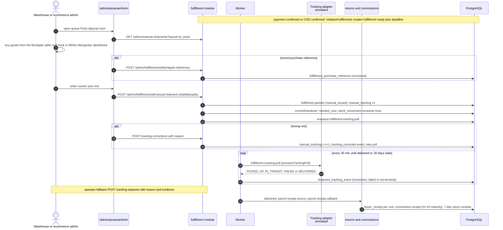

### COD remittance and settlement

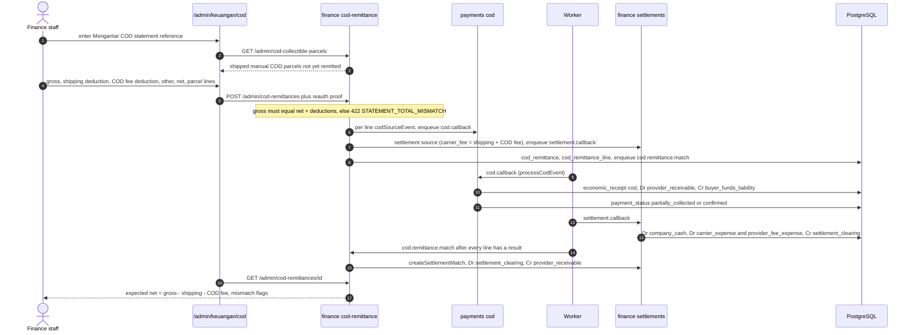

## Catalog pipeline

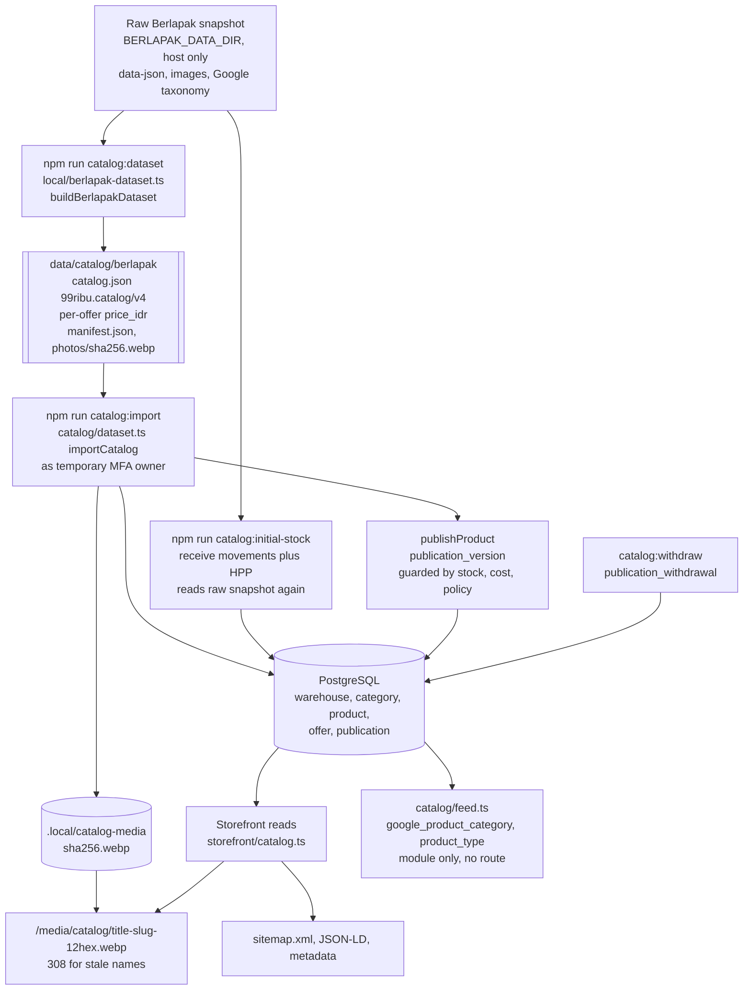

- **Source list (DEC-025)**: the cleaned single-product list `single-max-99k-bersih/01-siap-jual-99ribu-bersih.json` in the raw snapshot is the whole catalog (`SINGLES_FILE`, `src/modules/local/berlapak-singles.ts`); each variant carries its own `selling_price_99ribu` (ladder Rp19.000–Rp99.000) and only variants with gross profit ≥ max(Rp10.000, Rp8.000 + 10% of price) are kept (cleaning report beside the file). Committed stock and origin-warehouse names are reused on regeneration (rows are immutable once imported); a new warehouse in a known kecamatan takes the next free number.
- **Generator** (`src/modules/local/berlapak-dataset.ts`): classifies every product into the 14 DEC-011 departments (`DEPARTMENTS`, ordered `DEPARTMENT_RULES`, `CATEGORY_OVERRIDES`; refuses unclassified products, stale overrides and departments under 8 products), pins Google product categories (taxonomy `2021-09-21`), cleans descriptions (`cleanDetails`, claim terms kept and reported per DEC-013), cuts card titles (for a variant product the words that differ between its option labels, their joiners and a leading "Size"/"Ukuran"/"Warna" are removed first, `withoutVariants`; a cut that stops mid-name drops a dangling last word, `DANGLING`), writes alt text (clean title, `, foto N` after the first) and derives warehouse origin keys (first 32 hex of SHA-256 of `99ribu:berlapak-warehouse:<id>`). Output carries no supplier names, HPP or stock.
- **Import retire rule (DEC-025)**: an active offer of an imported product that the dataset no longer lists is retired in the same revision as the other offer changes.
- **Import** (`src/modules/catalog/dataset.ts:importCatalog`): creates missing origin warehouses (`warehouse.origin_key`, audited `catalog.warehouse.create`), categories, stock items, products/offers bound to their origin warehouse and bundle contents; stores each photo with `src/storage/catalog-media.ts:saveCatalogMedia` (WebP only, ≤ 512 KB, content-addressed, atomic hard link) and records image URLs as `<origin>/media/catalog/<title-slug>-<12 hex>.webp`; then publishes ready products through `publishProduct`. Rerunning is idempotent. Variants (`99ribu.catalog/v4`): one offer per in-stock variant, each its own stock item; an existing product is expanded with `variant_changes` (new revision, nothing retired), an operator-edited product is preserved, and publication stays all-or-nothing per product. A product that was published and then withdrawn stays withdrawn on rerun (only a product with no publication yet, or one already live, is published); `initial-stock` reports variant offers a preserved product did not get as `offers_not_imported` instead of failing.
- **Operator commands** (`scripts/catalog.ts`): `initial-stock` (one `receive` and one cost version per never-stocked item, into its origin warehouse), `rehome` (dry run, or `--apply` moves stock to origin warehouses through audited transfers), `withdraw` (dry run, or `--apply` withdraws current publications outside the committed dataset).
- **Public reads** honour only current, non-withdrawn publications (`not exists publication_withdrawal`). The photo route (`src/app/media/catalog/[file]/route.ts`) resolves the 12-hex prefix to exactly one file, 308-redirects stale or bare-hash names to the canonical name and serves the canonical file with a one-year immutable cache, `nosniff` and `sandbox` CSP.
- **Feed**: `catalogFeed`/`feedXml` build a Google Merchant RSS item list with `google_product_category` (per SKU, else department default from the dataset) and `product_type` (Indonesian category path). It is called only by tests today; no route serves it.

## Category map

The storefront has exactly the 14 DEC-011 departments from `data/catalog/berlapak/catalog.json` (`berlapak-dataset.ts:DEPARTMENTS`, one level, no subcategories). 

Per-department counts change with every dataset import; read them from the dataset itself (`node -e` over `data/catalog/berlapak/catalog.json`, or the admin product list) instead of a snapshot here. On 2026-11-10 the dataset held 571 products.

Where categories show: the header pills and `/kategori` tiles list departments with live products (`storefront/catalog.ts`, `featuredDepartments`); the buyer's favourite-category choice uses the same list; the admin list (`/admin/produk/kategori` over `GET /api/v1/admin/categories`, S104) shows categories used by a product's current draft or live publication, plus ancestors. Tile photos come from `department-photos.ts`; Fashion Wanita, Hewan Peliharaan and Mainan & Hobi have no clean photo and show their tint.

Category rows are immutable (DEC-011: a rename creates a new row) and product revisions keep theirs, so old rows are never deleted. Browser suites create namespaced fixture categories in `99ribu_local` on every run (`local/storefront.ts`, `local/commerce.ts`; tests address them by URL, so they are not shared). Their publications are withdrawn by the suites' teardown and by `npm run catalog:withdraw -- local --apply`, but the rows stay and show in the admin list, and on `/kategori` while a suite runs. On 2026-10-28 the local database had 3,227 category rows (14 live, 32 from two older taxonomies, 3,181 fixtures); it was rebuilt with the owner's approval (README, "Rebuilding the local databases") and now holds the 14 departments plus whatever later suites add. Production has only the dataset's categories.

## Identity, roles and access

Better Auth (`src/modules/access/auth.ts:createLocalAuth`) runs email/password with mandatory email verification and the `twoFactor` plugin (TOTP plus backup codes), cookie sessions of 7 days, mounted at `/api/auth/[...all]` behind `access/handler.ts:handleAuth`, which allowlists twelve endpoints, enforces JSON ≤ 16 KB, strips session tokens from bodies and applies per-account limits (TOTP and backup code 5/min; sign-in since S149 counts only failures: 5 in 60 s need a Cloudflare Turnstile token or a growing delay, 100 consecutive failures start a time-boxed cool-off, `src/modules/access/signin-budget.ts`; production sign-in reset mail is disabled, so `node scripts/staff.ts unlock-signin production` ends a cool-off early). The `/masuk` form (page and modal) posts JSON to it; without JavaScript it posts to `POST /masuk/kirim` (`src/app/(storefront)/masuk/kirim/route.ts`), which re-sends the step through `handleAuth` (same Origin check, budgets and `two_factor` cookie), passes its cookies on and answers 303 to `/masuk` with the next step or the failure kind, never the email or a code.

Buyer sign-up (S123; owner decisions 2026-10-25: name, email and WhatsApp number only, the password is created through the emailed link) uses the same handler. The `/masuk` form and modal switch to "Daftar" (`components/storefront/sign-up-form.tsx`) and post `POST /api/auth/sign-up/email` with `callbackURL` `/masuk/atur-sandi?aktivasi=1&next=…`. The network entry points (`/api/auth/[...all]` and `/masuk/kirim`) call `handleAuth(…, { public: true })`; in-process callers (fixtures, seeds, tests) keep the harness password sign-up and plain verification link. Public sign-up accepts only `name` (1-100), `email`, `phone` and `callbackURL`, and resend only `email` and `callbackURL`; a password, any other field, or another callback (`access/return-to.ts:isActivationCallback`, so a link only carries a validated `next`) is a 400 before any effect, as are an invalid email (`storefront/contact.ts:isValidEmail`), a phone that is not an Indonesian mobile number (`shipping/address.ts:normalizeWhatsApp`, `INVALID_WHATSAPP`) and, in the production profile only, a domain without MX/A records (`access/email-domain.ts`, 1.5 s, fails open on DNS trouble). `handleAuth` then stores a random 64-character password nobody learns. Every email for an unverified account is a set-password link (`auth.ts:sendActivation`, a Better Auth reset token, 30 minutes): the new account's first email, a repeated sign-up of an unverified address and every resend; a verified address gets only the `existing_account` notice; the reply is the same `{status:true}` for all of them. The link lands on `/masuk/atur-sandi?aktivasi=1&next=…&token=…` (`(storefront)/masuk/atur-sandi/page.tsx`: `referrer: no-referrer`, the token dropped from the address bar with JS, the account email and masked WhatsApp number shown); `POST /api/auth/reset-password` stores the password and revokes sessions, `emailAndPassword.onPasswordReset` marks the email verified, and with JS the page signs in with the new password and returns to `next`. The WhatsApp number of the sign-up that created the account is stored once in `buyer_profile.phone` (E.164 `+62…`, `phone_verified_at` null = unverified, not unique); a sign-up for an existing account never changes it; the buyer edits it in `/akun` (`POST /api/v1/me/profile` `phone`). Budgets: sign-up and resend 3/min per address plus one shared 10/day bucket per address for sign-up, resend and reset requests. Sign-in has one uniform rejection (401 `INVALID_CREDENTIALS`, `EMAIL_NOT_VERIFIED` included: an unverified public account has no password anyone knows). `autoSignIn` and `autoSignInAfterVerification` stay off; production still answers 503 `NOTIFICATION_DISABLED` until the email provider exists (S124). `/masuk/verifikasi` stays only for harness verification links. Without JavaScript `/masuk/kirim` also takes `step=signup|resend|reset` with the same Origin, size (4 KB) and content-type checks and answers 303 to `/masuk?langkah=daftar|cek-email` or `/masuk/atur-sandi`. Contact inputs on every storefront form follow `storefront/contact.ts` (digits-only phones shown as `08…`, stored `+62…`; email syntax and typo suggestions) through `components/storefront/ui/contact-fields.tsx`. On a receipt (`orders/receipt.ts:readOrderAccountOffer`), a guest holding the order is offered sign-up with the order's contact email, recipient name and contact phone pre-filled (handed to the form in memory, never in a URL); a signed-in buyer who neither owns nor has linked the order is offered the existing `POST /api/v1/me/guest-order-link-challenges` flow (account email as the one-tap contact, then the 6-digit code), whose unknown-order/contact-mismatch distinction is still open as TASKS S120. Roles live in `app.role_grant.roles` (checked list); warehouse scope lives in `app.warehouse_membership`.

| Role | Scope | Console pages | MFA |
| --- | --- | --- | --- |
| `owner` | Company, all warehouses | All, plus `/admin/obrolan`; only role that grants roles and appends policies | Required; fresh MFA (≤ 5 min) plus reauthentication proof for owner writes |
| `ecommerce_admin` | Assigned warehouses | Catalog (edit), fulfillment (incl. pickup profiles), print center (sidebar entry since the 2026-10-24 owner decision) | Required |
| `marketing` (S177, migration 0050) | Company promotions only | `/admin/pemasaran` hub, `/admin/pemasaran/voucher`, `/admin/promo/ongkir`: creates and edits inactive proposals; cannot activate, stop or edit a running promotion; owner/ecommerce_admin approve or reject (`POST …/decisions`, audited) | Required |
| `warehouse` | Assigned origin warehouses (at least one) | Catalog (stock view), fulfillment, print center | Required |
| `customer_service` | Not warehouse-scoped; replies only on claimed conversations | `/admin/obrolan` | Required |
| `finance` | Company-wide finance; order history needs warehouse scope | Payments, COD settlements (with `finance.reconciliation.read`; confirm/record controls need `finance.reconciliation.write`, otherwise disabled with a reason), catalog costs (with `finance.costs.read`) | Required; reauthentication proof for reconcile/refund/confirm and payout claim/verify actions |
| `buyer` | Own resources (default when no grant row) | — | No |
| `affiliate` | Own profile, balances, payouts | — (`/afiliasi`) | No; beneficiary change needs an `affiliate.beneficiary_change` proof (password reauthentication) |

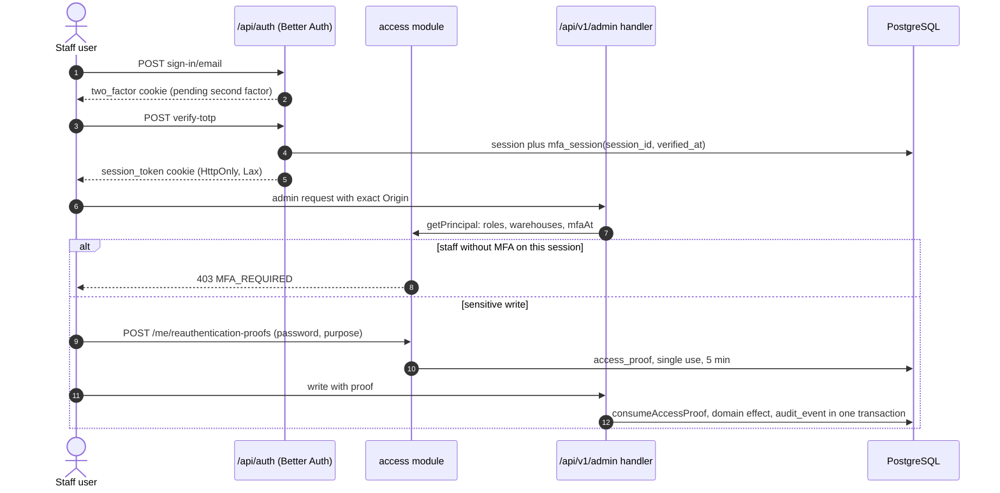

Step-up proofs have one implementation: `access/grants.ts:issueAccessProof` issues and `consumeAccessProof` verifies. A proof is an HMAC (keyed by the auth secret) over session, action, subject and idempotency key. Only its digest is stored, it expires after 5 minutes, and the mutation's transaction consumes it once, scoped to the same session, action and subject. Anything else is refused with 403 `REAUTHENTICATION_REQUIRED`, and a failed mutation rolls the consumption back. Purposes and their issuers:

- **Owner only:** `staff_roles.replace`, the policy, calendar and publication purposes, and `affiliate_rate.version`.
- **Finance with both read and write grants:** `finance.reconcile` uses the reconciliation grants. `finance.refund` and `finance.recovery_refund` use the refund grants.
- **Owner or finance role:** `payout.claim` and `payout.verify`, with the payout UUID as subject.
- **Password only, no MFA:** `affiliate.beneficiary_change` binds the caller's own affiliate account UUID. `support.contact_rebind` binds the caller's own user id.

Staff purposes also require MFA verified within the last 5 minutes. Admin reporting filter and drilldown tokens are signed with `checkout/access.ts:mac(identity, 'reporting-filter', …)`. They are keyed by the running profile's auth secret and have no fallback key. The export endpoints check permissions on the server. `POST /admin/export-selections` needs `exports.read` and `POST /admin/exports` (the CSV download) needs `exports.download`. The owner role holds both through `hasPermission`.

Guest commerce authority (ADR-0007) uses HttpOnly capability cookies, never URL tokens: `commerce_guest` (7 days), `cart_access`, `order_access` (path `/api/v1/orders/<id>`), and the alias `checkout_access` (path `/checkout/order/<id>`); verified guest-order access goes through `guest-order-access/challenges`. Sign-in and sign-out revoke the guest context. The console navigation (`src/app/admin/(console)/staff-roles.ts`) is only a convenience gate; `src/components/admin/console-access.ts:consoleAccess` derives the sidebar entries, finance write controls, CSV export (`exports.download`) and KPI shortcuts from the same roles and grants, and the signed-out preview offers no actions. Every API handler rechecks role, warehouse scope and MFA.

## Storefront architecture

### Storefront page map

All pages live in `src/app/(storefront)/` and render inside `components/storefront/shell.tsx:Shell` (checkout and receipt use `checkout-frame`). Modules are under `src/modules/`.

| Route | Purpose | Main modules | Main components |
| --- | --- | --- | --- |
| `/` | Home: hero, department pills and grid, promo rail, shelves | `storefront/{catalog,banners,promotions,department-photos,seo}` | `sections/{home-hero,category-pills,category-grid,category-switcher,promo-banners}` |
| `/kategori` | All departments as tiles | `storefront/{catalog,department-photos,seo}` | `sections/{category-grid,category-pills}` |
| `/kategori/[slug]` | One department: filters, sort, 24 cards per page | `storefront/{catalog,navigation,seo}` | `sections/catalog-listing`, `json-ld` |
| `/cari` | Search results over the live catalog | `storefront/seo` (+ catalog via the listing) | `sections/catalog-listing` |
| `/produk/[slug]` | Product page: gallery, offer picker, buy box, related shelf | `storefront/{catalog,cart,description,navigation,seo}` | `offer-picker`, `sections/product-gallery`, `cart-forms`, `json-ld` |
| `/promo` | Active automatic shipping promotions as stored (vouchers stay private to their code, S177), plus published mixed bundles (bundles first when no promotion is active) | `storefront/promotions` | `ui/product-card` |
| `/keranjang` | Cart (Dawn structure: line rows, per-line update, summary footer) | `storefront/{cart,catalog}` | `cart-forms` |
| `/checkout`, `/checkout/order/[orderId]` | One-page checkout and the submit/recovery step | `storefront/{checkout,checkout-order}` | `checkout-forms`, `checkout-frame` |
| `/pesanan/[orderId]` | Order receipt for the owner or the guest cookie holder | `orders/receipt`, `storefront/checkout-order` | `order-receipt`, `order-account` |
| `/akun` | Signed out: sign-in actions and guest order lookup; signed in: redirects to `/akun/pesanan` | `accounts/service` | `buyer-account-client` |
| `/akun/pesanan`, `/akun/profil`, `/akun/pengaturan` | Three account tabs (owner 2026-10-28): orders with filters and "Beli lagi"; Data diri summary with "Ubah", addresses and optional details; promo consent, notifications and security. Signed out → `/masuk?next=…` | `accounts/{service,profile-completion,order-summary,reorder}` via `akun/load.ts` (orders read only on Pesanan) | `buyer-account-client` (`view` prop), `account/{navigation,orders}`, `profile-completion` |
| `/afiliasi` | Affiliate workspace: profile, rate, commissions, payouts | `affiliates/{profile,rates}`, `commissions/service`, `payouts/service` | page-only |
| `/masuk`, `/masuk/verifikasi`, `/masuk/atur-sandi`; `POST /masuk/kirim` | Sign in or sign up (modal over the page on client navigation), email verification, set password; no-JS form endpoint | `access/{auth,return-to}` | `sign-in-panel`, `sign-up-form` |
| `/bantuan` | Help page (shopping, returns, order status) | `storefront/seo` | page-only |
| `/tentang`, `/kontak`, `/privasi`, `/syarat` | Placeholder pages (content not written; `/privasi` waits for the owner, STATUS) | — | `placeholder-page` |

- **Routes** (DEC-010): listed in the page map above. All pages are async server components wrapped in `components/storefront/shell.tsx:Shell`; most declare `dynamic = 'force-dynamic'`. The group `layout.tsx` only adds the `@modal` parallel slot (no wrapper element): a client navigation to `/masuk` from a storefront page renders `@modal/(.)masuk` as a modal over the current page (S112), every other route leaves the slot empty (`default.tsx`, `page.tsx`, `[...catchAll]`), and a hard load of `/masuk` renders the page. Product URLs are `/produk/<public_slug>` (below).
- **Product URLs (2026-10-28, migration 0040)**: `/produk/<public_slug>` (e.g. `/produk/paket-barber-grooming-pria`) carries no uuid. `app.product.public_slug` is a stored, unique, immutable column (CHECK `^[a-z0-9]+(-[a-z0-9]+)*$`, 1..64) beside the internal `slug` (`p-<uuid>`, copied into drafts/publications, never a URL). `app.next_public_slug(name)` builds it once at creation (`catalog.ts:createProduct`): lower case, common Latin accents transliterated, other runs of characters one hyphen, at most 60 characters cut at a word, `produk` when nothing is left, then `base`, `base-2`, `base-3` for the first free value under `pg_advisory_xact_lock(hashtext(base))` (concurrent creations of one name get distinct slugs; the unique constraint is the backstop). A BEFORE INSERT trigger gives a direct insert without a slug `produk-<sequence>`, and the product guard rejects any later change, so a rename never moves a URL. The migration backfilled existing products from their latest revision name, oldest first. Read models carry it as `public_slug` (`publicProduct`, therefore the public API, cart view lines, sitemap rows); builders live in `modules/storefront/navigation.ts` (`productPath`, `productHref`), used by cards, the offer picker, the cart, the PDP, canonical/JSON-LD/sitemap (`seo.ts`) and the ad feed (`catalog/feed.ts`). Resolution (`catalog.ts:resolveProductSegment`): an exact `public_slug` wins; otherwise a trailing uuid (legacy `/produk/<title>-<uuid>` or bare uuid) answers one `permanentRedirect` (308) to the current slug keeping the whole query; anything else is the `/404` redirect. `?offer=<uuid>` stays valid; cards, the picker and the PDP permalink omit it when the offer is the one the page selects anyway (`matchingVariant(product)`), so the common URL is just the slug (plus `?from=` from lists). JSON-LD offer urls and feed links are the canonical clean URL for every offer (a per-offer `?offer=<uuid>` would put an id back into them). The `#product-<uuid>` anchor used by `from=` and listing-more is unchanged. Catalog photo file names (`/media/catalog/<slug>-<12hex>.webp`) are asset names and keep their own scheme.
- **Data access**: pages call `src/modules/storefront/*` directly with the app database role; cart and checkout mutations are Server Actions (`keranjang/actions.ts`, `checkout/actions.ts`) that call the API handlers in process. Forms use `useActionState` and keep working without JavaScript.
- **Account orders**: `accounts/order-summary.ts` derives Indonesian stages from the receipt's separate payment, original-parcel and return/refund facts, with thumbnails from frozen product revisions. `accounts/reorder.ts` uses the workspace's signed-in owner/verified-link scope, re-reads current publications and physical availability, and adds through `mutateBrowserCart` with fresh per-line keys, carried cart revisions and the 50-unit cap; `akun/actions.ts` refreshes the layout and redirects to `/keranjang` only when every line was added; a partial result stays on the page with the skipped lines and their reasons (lines after a refused cart change are reported as not processed), and an unknown outcome stops and asks the buyer to inspect the cart. A prepaid order whose latest attempt (or its creation job) is unknown shows "Pembayaran diperiksa", never "Kedaluwarsa" or "Dibatalkan".
- **Components** (`src/components/storefront/`, S111): `ui/` holds the shared primitives (`icon.tsx` outline/filled icon set, `brand.tsx` wordmark and site notice, `media.tsx:CatalogImage`, `product-card.tsx` card grid/shelf, `shelf-arrows.tsx` carousel arrows); `sections/` holds page sections (home hero, category grid/pills/switcher, promo banners, omnibox, filter chips/panel, listing, infinite scroll, catalog listing); the top level keeps the shell and the cart/checkout/receipt/account/sign-in flows. Design tokens live in one `:root` block in `src/app/styles/01-base-tokens.css` (`globals.css` only imports the 15 ordered area files; order is the cascade); `DESIGN.md` documents tokens, components, interaction and accessibility rules, and `docs/spec/design/references/shop-com/visual-context.md` stays the observed visual contract.
- **Client islands** (`"use client"`, small and optional): `search-box` (combobox over a GET form), `category-switcher`, `filter-chips`, `listing-more`, `product-gallery`, `shelf-arrows`, `hero-video`, `navigation` (`ProductLink`, `TaskBack`), `cart-forms`, `checkout-forms`, `checkout-exit`, `order-receipt`, `order-account`, `sign-in-form`, `sign-up-form`, `sign-in-modal`, `sign-out-button`, `buyer-account-client` (the only islands that `fetch` `/api/auth/*` or `/api/v1/me/*`), plus `(storefront)/error.tsx`.
- **Caching**: the header data (departments, pill photos, search suggestions, promo flag) is a module-level in-process promise cache refreshed after 30 s (`shell.tsx:chrome`); the PDP deduplicates its load between `generateMetadata` and the page with React `cache()`. No `unstable_cache`, `"use cache"` or tag revalidation is used; Server Actions call `revalidatePath`.
- **Images**: `next.config.ts` limits the optimizer to `localPatterns` `/media/catalog/**`, quality 60, `imageSizes` 64–384, `deviceSizes` 640–1920; `components/storefront/ui/media.tsx:CatalogImage` emits plain `` pointing at `/_next/image` (no `next/image`).
- **Fonts and SEO**: Inter 4.1 self-hosted from `public/fonts` via `@font-face` (Latin subset preloaded); `modules/storefront/seo.ts` owns route indexability, canonical/OpenGraph metadata, JSON-LD (Organization, WebSite, BreadcrumbList, Product/ProductGroup), `robots.txt` and `sitemap.xml`, switched by `SITE_INDEXING` (`src/config/site.ts`).
- **Listing and home blocks (2026-10-24)**: `/kategori/[slug]` and `/cari` render 24 cards server-side with a `rel="next"` link; `listing-more.tsx` appends later pages on scroll (skeleton rows, manual "Lihat produk lainnya" after three auto loads, no-JS keeps the link). `filter-chips.tsx` is the JS filter UI (popover on desktop, bottom sheet on phones); the GET form stays in `<noscript>` (`filter-panel.tsx`). Home promo rail: `promo-banners.tsx` over `modules/storefront/banners.ts:HOME_BANNERS` (hidden when empty). Curated surfaces (hero, pills, shelves, switcher, banners, department picks) exclude claim-text covers via `department-photos.ts:CLAIM_PHOTOS`/`CLAIM_WORDS` (`homeSafe`); search and category results are not filtered.
- **Not found**: `src/app/not-found.tsx`; PDP and category pages redirect to `/404` instead of calling `notFound()` (Next 16.4 empty-body issue, see appendix S21 note).
- **Admin console isolation** (DEC-004): `src/app/admin/(console)/layout.tsx` alone imports `admin.css` (Tailwind v4 + shadcn `radix-vega`); the storefront never loads it. Because `globals.css` is unlayered, `admin.css` rolls its element rules back with `revert-layer` for console documents (heading sizes, link colour, focus outline, and `font` on button/input/select/textarea so `text-sm` etc. apply). `/admin/obrolan` lives in the console group (`(console)/support/page.tsx`) so the CS inbox keeps the sidebar and session bar. Console pages render client components that call `/api/v1/admin/*`; only print center and support read modules server-side.

## Admin console architecture (S113)

- **Shell** (`components/admin/admin-shell.tsx`): shadcn `Sidebar` (`collapsible="icon"`; icon rail at 768–1023 px, expanded from 1024 px, a Sheet below 768 px that closes on navigation). The rail is already the server's first paint at tablet width: the open state starts undecided (`data-rail="auto"`) and the `sidebar-icon` variant in `admin.css` shows the rail for a collapsed sidebar or for an undecided one at 768–1023 px, so nothing shifts after hydration. Groups and items: the sidebar navigation table above, built from one item list gated by `console-access.ts:consoleAccess`, `catalogAccess` and `canReadOrders` (display only; pages and APIs re-check). An item is active on its screen and detail pages; `aria-current="page"` only on the exact path. "Lihat Toko" sits in the sidebar footer (full document navigation). Menu rows are 44 px on coarse pointers (`pointer-coarse:h-11`, local change in `ui/sidebar.tsx`); screens do not repeat a "back to console" button.
- **Lists** (`components/admin/data-table.tsx:DataTable`): every list and detail table (orders, order items, catalog list, product stock and cost history, manual fulfillment, COD settlements, payments, print queue/templates/history, work queues, CS inbox) renders through it: columns with responsive classes, optional row selection with a bulk bar, an optional mobile card below `md`, optional per-column `hideBelow` (`5xl`/`6xl`/`7xl`, measured on the table frame with a container query, from `md` up only, so a wide table drops low-priority columns instead of scrolling under the pinned action column; used on affiliates, staff, reconciliation and system health), keyset paging ("Muat baris berikutnya") and one status prop. Below `md` a list either renders its own `card` (print queue, work queues, catalog, inbox) or sets `stack` (orders, order items, payments, AutoLaris, manual fulfillment, COD settlements, print templates and history, product stock): the same table and cells become labelled cards through explicit table/row/cell roles, so row and cell locators and accessible names are identical at every width (labels are `aria-hidden`). Tables that scroll pin the first column (and the selection column) on the left and a column with id `actions` on the right, with a 1px line in the 3:1 `--input` tone on the edge that hides columns (an inset shadow, because collapsed table borders do not follow sticky cells) and a right-edge fade when no actions column is pinned; buttons and links in the pinned actions cell never wrap. Selected/active rows outline their status badges in the badge's own text colour (outline badges get the card fill) so they stay distinct from the row highlight. Every header and body cell paints the same opaque background (row hover/selection included), so pinned columns never band. `activeKey` marks the row whose detail is open with `data-state="selected"` (the CS inbox). Loading renders a card skeleton below `md` and a table-shaped one from `md`, in the `--border` tone. Low-value columns hide by breakpoint (print center Gudang from `xl`); between `md` and `xl` lists with a pinned action keep every value clear of it: print queue hides Resi and Label (the action says whether a label exists), manual transfers move the unique code under the amount, AutoLaris hides Kanal and Status and shows both under the order number, the orders list shows the creation time under the number, product stock shows Fisik/Dipesan/Karantina/Lot under the component and print templates the brand under the name, work queues with a row action show the time under the reference, and the CS inbox shows the assignee under the status; product stock stacks below `md` so its numbers stay visible. `use-keyset-list.ts:useKeysetList` is the client side of a `next_cursor` API (reloads from page one when its URL/filters change, drops late responses, appends without duplicates, maps 403 to the denied state); payments and the inbox use it.
- **States** (`components/admin/states.tsx`): `LoadingState` (polite live region + skeletons), `ErrorState` (destructive alert with "Coba lagi"), `DeniedState` (missing grant), `EmptyState` (shadcn `Empty`). DataTable, the dashboard and the ad diagnostics use them; a whole page refused by role uses `access-denied.tsx:AccessDenied`. A 403 from the work-queue API renders the denied state, not the retryable error.
- **Status and references** (`components/admin/status.tsx`): one `StatusBadge` (icon + text, no wrap) on every screen with tones `open` (clock, waiting only), `progress` (work under way, e.g. "Diproses"), `problem` (amber, includes uncertain outcomes such as "Hasil belum pasti"), `done`/`success` (green check), `closed` (terminal without success), `danger` (red, failed or exhausted) and `neutral` (plain label such as a role, no icon), `OverdueBadge` ("Lewat batas", alarm icon) for past-due transfer, packing/handover and print deadlines (`useNow` sets the clock after mount so SSR and hydration agree), and `OrderNumberLink` (order detail by id, else the order search by number; plain text without `orders.history.read`). Order links (this one, the orders list, manual fulfillment, the dashboard queue) are 44 px tall on coarse pointers. Catalog publication states use `StatusBadge` too. Staff never see row ids, parcel or label hashes, or catalog ids: parcels read "Paket 1/2", conversations read "Pesanan <nomor>" or "Percakapan tanpa pesanan", AutoLaris channels "VA BCA".
- **Forms** (`components/admin/form.tsx`): `FormField` (shadcn `Field` + `FieldLabel`, optional hint), `SegmentedControl` (aria-pressed filter toggles; its `segmentedListClass`/`segmentedItemClass` are the one tab look, also used by the manual-fulfillment tablist and the dashboard queue tabs), `FormDialog` (shadcn `Dialog` + form: title, description, refusal alert, Batal/submit with a pending lock) and `nativeSelectClass` (native select styled like `Input`). Payments confirmations and payment terms use them (the transfer confirmation echoes the typed amount in Rupiah, with match/mismatch against the bill, and the typed time as WIB); other screens still have hand-built dialogs (follow-up). Payment terms edit the COD fee as a percent and convert to the stored basis points at the boundary (`format.ts:percentToBps`, tested in `tests/admin-wib.test.ts`).
- **KPI cards** (`components/admin/kpi-card.tsx:KpiCard`/`KpiGrid`): one card for count and money metrics (label, value, unit or basis badge, definition, breakdown). Tone ranks the count grid: non-zero action queues first ("attention": warning edge and icon), then context counts, zero queues last and muted; below `md` zero queues collapse into one "N antrean kosong" disclosure (names listed on open) and descriptions are hidden (from `md` clamped to two lines); full definitions of count and money metrics sit in the "Arti setiap angka" disclosures. Drilldown and action links align across a row (reserved action line), with 44 px targets on coarse pointers. Money values never wrap mid-number (wider money grid from `md`). The owner's ad diagnostics are a collapsed `<details>` section. Every card has a drilldown button (`kpi-drilldown-<key>`, aria-pressed) that opens the dashboard queue with the card's signed filter token, and an action link (`kpi-action-<key>`) to the screen where staff act when `METRIC_ACTION_HREF` names one and the principal can open it (manual booking, payments, COD settlements, support inbox).
- **One data source per KPI** (`modules/reporting/service.ts`): each count card is `select count(*)` over the same FROM/WHERE fragment its drilldown lists: `ordersSource` (orders, payment-method split, transfers near deadline, AutoLaris pending), `fulfillmentsSource` (fulfillments due, manual booking), `lowStockPositions` (stock alerts), and since slice 2 `exceptionsSource`, `returnsSource`, `supportSource`, `reconciliationSource` (terminal states and the first-shipment warehouse scope are in SQL, no application-side filter). `tests/integration/admin-kpi-parity.test.ts` compares every count card with all drilldown pages per lens, role scope and warehouse filter, with seeded open returns and conversations. Money cards come from the ledger (`computeMoneyMetrics`); their drilldown lists the related rows, not a sum.
- **Work queues** (`GET /api/v1/admin/work-queues`): rows staff still act on come first and terminal states last (`isTerminalQueueState`; stable within each group, the cursor follows that order). The orders queue's time column is the neutral "Waktu"; each row names its own time. Order rows carry `due_at_kind = payment_deadline` (due_at = expires_at) only while a prepaid order awaits payment (`payment_status = pending`); paid and COD orders use `created`. Reconciliation rows carry `reference` = matched order number else the settlement mutation reference (never the row id), `order_id` of the first allocated order, `amount_idr` (net settlement, reconciliation rows only) and `settlement_source` (payment/cod); each row links to its order or, unmatched, to Pembayaran / Setoran COD.
- **Finance queues**: `GET /api/v1/admin/manual-transfers` and `/autolaris-payments` are keyset pages (`modules/finance/page-cursor.ts`: opaque `(time, id)` cursor, `pagination.next_cursor`; open transfers by deadline, resolved by confirmation time newest first, AutoLaris newest deadline first).
- **CS inbox** (`components/support/StaffInboxView.tsx`): the queue is a full-width DataTable over the S104 keyset API (20 per page) with filters; rows show the conversation label (`Pesanan <order_number>` from the staff projection, else "Percakapan tanpa pesanan") with its start time, Indonesian status, and the assignee by name ("Belum diklaim" when unclaimed; the dashboard queue and KPI use the same words: "Belum diklaim", "Menunggu pelanggan", "Percakapan belum diklaim"). The thread and the context/tools panes are two columns from `lg`, built on `FormField`, shadcn `Button`/`Input`/`Textarea`/`Alert` and `StatusBadge` (the inbox file is an `@source` of `admin.css`). Handoff picks a staff member by name from `GET /api/v1/admin/support/agents` (owner and customer_service users, `id` + `name` only, same rule as the assignment target check); notes and the claim holder show names. The claim prerequisite is muted helper text; only failures use the destructive alert. Order context titles carry the Indonesian order status.
- **Returns (S101)**: `/admin/pesanan/retur` (stacked DataTable, tabs = the list API's `state` groups, tab in `?tahap=`) and `/admin/pesanan/retur/[returnNo]` (`return-detail-client.tsx`): the case projection carries order number, offer and warehouse names, and on the detail read the `return_event` history, attached evidence (served by `GET /admin/pesanan/retur/{id}/evidence/{evidenceId}` only to whole-case readers), replacement ids and, for the inspecting warehouse, the shipped component allocations. Next actions follow status and role (decide owner/CS, inspect owner/warehouse, refund owner/finance with a `finance.refund` proof, replacement reserve owner/CS, prepare/book/handover owner/warehouse); one idempotency key per dialog session, rotated after a definitive answer. Warehouse calendars sit as an owner-only disclosure beside the pickup profiles (`warehouse-calendar-panel.tsx`, `GET /admin/warehouse-calendars`, bulk `POST …/default-applications` with one `warehouse_calendar.default_apply` proof); values stay TEST-ONLY.
- **Order detail**: history events of a parcel carry `shipment_id` (AdminOrderEvent), shown as "Pengiriman paket 1/2"; the list column is "Total pesanan" (before the COD fee or transfer code) and the detail shows that subtotal above the fee whenever a payment charge exists. History labels pick the vocabulary by event kind (`order-model.ts:historyStatus`: order → order states, payment → payment states), so an order `pending` reads "Menunggu", not "Menunggu pembayaran". `GET /api/v1/admin/orders/{id}` orders history by `occurred_at`, then `recorded_at` (ingestion; `occurred_at` for legacy rows), then id, all descending, and its `history_cursor` carries all three (`modules/finance/history.ts`); the detail shows each subject's status only the first time it entered it (same kind, status and parcel, adjacent or not; the oldest line is kept), e.g. a payment-only order revision that stays "Menunggu" or a parcel re-queued as "Dikemas". The items table hides "Keterangan" when no item has a note. Print center shows the batch "Buat label N paket" button in the list's selection bar once a parcel is selected (a hint in the format card until then).

### Phone pattern catalogue (admin mobile pass, 2026-10-25)

Staff and client operators use the console on phones (< md, 768 px; 44 px targets on coarse pointers via `admin.css`). One block per job; no screen builds its own variant.

| Job | Block | Phone behaviour |
| --- | --- | --- |
| Page frame and title | `page-blocks.tsx:AdminPage` + `PageHeader` (back link, title, badge, description, meta, actions) | 16 px gutters; actions full width under the title |
| Detail sections | `page-blocks.tsx:DetailSection` (order detail, product detail) | cards; key facts first (the order's payment summary leads, right column from `lg`) |
| One primary action / bulk actions | `page-blocks.tsx:StickyActions`; the DataTable selection bar | fixed bottom bar with the safe-area inset; `admin.css` pads the page and sets `scroll-padding-bottom` so it never covers the focused control (product publish, the inbox thread's claim/read, dashboard export, print batch) |
| Collapsible secondary content | `page-blocks.tsx:Disclosure` (dashboard money, ad diagnostics, manual-fulfillment queue rules and pickup profiles) | money collapsed on phones, open from `md`; diagnostics always collapsed |
| Few exclusive filters / tabs | `form.tsx:SegmentedControl`, `segmentedListClass` | one row of chips that scrolls sideways inside itself (no wrapping toolbar) |
| Several filter fields | `form.tsx:FilterSheet` (catalog, inbox, manual fulfillment) | one "Filter" button with the active count opening a bottom `Sheet` (focus trapped, returns to the button; the same icon-only close as dialogs); inline from `md`. Chip rows scroll the active chip into view |
| Lists | `DataTable` with `stack` column roles (`title`, `aside`, `meta`, `status`, `label`, `plain`, column id `actions`) or a `card` built from `CardTitle`/`CardMeta`/`CardStatus`/`CardActions` | one anatomy: identifier link top left, amount top right (the status badge when the row has no amount), meta line, badges, labelled values, actions as a full-width bottom row; card select-all is indeterminate and selected cards are highlighted |
| Forms and confirmations | shadcn `Dialog` (local change in `ui/dialog.tsx`), `FormDialog` | bottom sheet (max 92 dvh, scrolls inside) with Batal + submit in a sticky footer above the safe-area inset; centred dialog from `md` |
| Dashboard | `AdminWorkspacesClient` | attention KPI cards first (the whole card opens its drilldown, a chevron marks it; only the action link takes a line), zero queues in one "Kosong" line, the queue's first 5 rows and "Lihat semua (N)" to `/admin/antrian` (same client with `view="queue"`, all rows with keyset paging; a card's filter is re-read from the dashboard API by metric key, never carried as a token in the URL) |

Rules every list and screen follows (design review round 1, 2026-10-25):

- **List shell**: one bordered, divided list below `md` for `stack` rows, `card` lists and the loading skeleton (no gapped cards). Work lists group rows by deadline with a label row per group ("Lewat batas · 3", "Hari ini", "Berikutnya", "Tanpa batas", "Sudah diserahkan"; `DataTable` `group`, `status.tsx:deadlineGroup`): manual fulfillment (to book) and the print queue (within a group the queue's own order holds). Phones read 20 rows per page there (manual fulfillment asks the API for 20; the print center reveals its loaded rows 20 at a time, then pages the API) with the one paging control, "Muat baris berikutnya". The catalog keeps "Sebelumnya / Berikutnya" because its page lives in the URL (shareable, Back restores it); its API is keyset, not offset.
- **Card order**: title line (identifier link left; top right the amount, or the status badge when the row has no amount), meta line, status badges, labelled values, actions as a full-width bottom row. Stacked rows enforce it with CSS `order` per role; `CardTitle`/`CardMeta`/`CardStatus`/`CardActions` in the same order. An amount top right is always the row's headline amount (order total, transfer amount, parcel COD); other amounts are labelled values (COD settlement "Diterima").
- **Overdue**: one placement. "Lewat batas" (`status.tsx:Deadline`/`OverdueBadge`) follows the deadline it refers to on the same wrapped line, in tables and cards alike (payments, manual fulfillment, print center, dashboard queue time); finished rows never show it.
- **Row action buttons**: primary (filled) only for the task the list exists for (Catat resi, Konfirmasi transfer); every other row action is outline (Buat label, Koreksi resi, Konfirmasi manual, Buka detail, Cetak label). An open row's "Buka detail" uses the secondary (tinted) fill with `aria-pressed`. While rows are selected, row actions are inert and dimmed: the selection bar is the only action surface.
- **Words**: "Prabayar" (never "Non-COD"), said once per row; buttons to another screen read "Buka <screen>" (Buka Kotak Masuk); "Buka detail" opens a row in place.
- **Disclosures** (`Disclosure`) hold intros and settings that are not daily work (queue rules, pickup profiles, money, ad diagnostics); the summary is a button, so its title names the surrounding section instead of being a heading.
- **Safe areas**: the console layout exports `viewport-fit=cover`; the inset pads its sides and bottom by the safe-area insets, and with a sticky bar the bottom padding is `4.5rem + env(safe-area-inset-bottom)`.

## Data domains

Core tables only (30 of 222), names from `src/db/schema.ts`. Event, operation, simulator (`local_*`), returns/replacement, exception, affiliate, support and advertising tables are omitted.

```mermaid
erDiagram
  auth_user ||--o| role_grant : "has roles"
  auth_user ||--o{ warehouse_membership : "scoped to"
  warehouse ||--o{ warehouse_membership : "staffed by"
  warehouse ||--o{ inventory_balance : "holds"
  stock_item ||--o{ inventory_balance : "counted in"
  category ||--o{ category : "parent of"
  product ||--o{ offer : "sells"
  offer ||--o{ offer_component : "contains"
  stock_item ||--o{ offer_component : "used in"
  product ||--o{ publication_version : "published as"
  publication_version ||--o| publication_withdrawal : "withdrawn by"
  cart ||--o{ cart_line : "lines"
  publication_version ||--o{ cart_line : "frozen offer"
  cart ||--o{ checkout_quote : "quotes"
  checkout_quote ||--o| commerce_order : "submitted as"
  commerce_order ||--o{ order_item : "items"
  commerce_order ||--o{ order_shipment : "parcels"
  warehouse ||--o{ order_shipment : "ships from"
  order_item ||--o{ fulfillment_item : "units"
  order_shipment ||--o{ fulfillment_item : "packs"
  commerce_order ||--o{ payment_attempt : "paid by"
  payment_attempt ||--o| manual_bank_confirmation : "confirmed by"
  payment_attempt ||--o| autolaris_payment : "AutoLaris identity"
  order_shipment ||--o{ fulfillment : "fulfilled by"
  fulfillment ||--o{ manual_tracking : "resi versions"
  fulfillment ||--o{ shipment_tracking_event : "tracking"
  order_shipment ||--o{ cod_remittance_line : "remitted in"
  cod_remittance ||--o{ cod_remittance_line : "lines"
  commerce_order ||--o{ finance_transaction : "journals"
  finance_transaction ||--|{ finance_posting : "balanced postings"
  finance_transaction ||--o| economic_receipt : "receipt"
  order_shipment ||--o{ economic_receipt : "per parcel"

  auth_user {
    text id PK
    text email
    boolean two_factor_enabled
  }
  role_grant {
    uuid id PK
    text user_id FK
    text_array roles
    text_array permissions
  }
  warehouse_membership {
    text user_id FK
    uuid warehouse_id FK
  }
  warehouse {
    uuid id PK
    text name
    text city
    text district
    text origin_key
  }
  stock_item {
    uuid id PK
    text sku
  }
  inventory_balance {
    uuid id PK
    uuid warehouse_id FK
    uuid stock_item_id FK
    bigint on_hand
    bigint reserved
  }
  category {
    uuid id PK
    text slug
    uuid parent_id FK
  }
  product {
    uuid id PK
    text slug
    int revision
  }
  offer {
    uuid id PK
    uuid product_id FK
    text sku
  }
  offer_component {
    uuid offer_id FK
    uuid stock_item_id FK
    int quantity
  }
  publication_version {
    uuid id PK
    uuid product_id FK
  }
  publication_withdrawal {
    uuid publication_id FK
    text reason
  }
  cart {
    uuid id PK
    text owner_user_id FK
    uuid owner_guest_id FK
    text state
  }
  cart_line {
    uuid id PK
    uuid cart_id FK
    uuid publication_id FK
    int quantity
  }
  checkout_quote {
    uuid id PK
    uuid cart_id FK
    text payment_channel
    int cod_fee_bps
  }
  commerce_order {
    uuid id PK
    uuid quote_id FK
    text status
    text payment_status
    text payment_channel
    int transfer_code
  }
  order_item {
    uuid id PK
    uuid order_id FK
    uuid publication_id FK
  }
  order_shipment {
    uuid id PK
    uuid order_id FK
    uuid warehouse_id FK
    bigint cod_due
  }
  fulfillment_item {
    uuid id PK
    uuid order_item_id FK
    uuid shipment_id FK
    bigint payment_charge
  }
  payment_attempt {
    uuid id PK
    uuid order_id FK
    text method_id
    text status
  }
  manual_bank_confirmation {
    uuid attempt_id FK
    text bank_reference
  }
  autolaris_payment {
    uuid attempt_id FK
    text reff_id
    text channel_code
  }
  fulfillment {
    uuid id PK
    uuid shipment_id FK
    text status
  }
  manual_tracking {
    uuid id PK
    uuid fulfillment_id FK
    int version
    text tracking_number
  }
  shipment_tracking_event {
    uuid id PK
    uuid fulfillment_id FK
    text status
  }
  cod_remittance {
    uuid id PK
    text reference
    bigint net_amount
  }
  cod_remittance_line {
    uuid remittance_id FK
    uuid shipment_id FK
    bigint amount
  }
  finance_transaction {
    uuid id PK
    text kind
    uuid order_id FK
  }
  finance_posting {
    uuid transaction_id FK
    text account
    text side
    bigint amount
  }
  economic_receipt {
    uuid id PK
    uuid transaction_id FK
    uuid shipment_id FK
    text kind
  }
```

### Hot-path and retention indexes (S104/S105)

Indexes added by `0036_db_hot_paths` / `0037_retention`, each tied to the query it serves (plans and timings in BUILD-LOG 2026-10-24 S104/S105):

| Index | Serves |
| --- | --- |
| `inventory_balance_stock_item_idx (stock_item_id, warehouse_id)` | storefront/cart availability by stock item (`storefront/catalog.ts:publicProduct`, `checkout/carts.ts`) |
| `outbox_kind_due_idx (kind, run_at, created_at, id) WHERE status IN ('pending','unknown')` | leased claim per kind (`jobs/leases.ts:claimJob`) |
| `outbox_lease_idx (lease_until) WHERE status='processing'` | lease expiry (`expireLeases`, every worker poll) |
| `outbox_completed_idx (completed_at) WHERE status='completed'` | `outbox.completed` retention |
| `support_conversation_inbox_idx (coalesce(last_public_message_at, created_at), id)`, `support_conversation_assignee_inbox_idx (assigned_user_id, …)` | staff inbox keyset paging (`support/service.ts:listStaffSupportInbox`, limit+1, cursor = last conversation id) |
| `shipping_label_artifact_shipment_idx (shipment_id, status)`, `order_shipment_warehouse_idx (warehouse_id)` | print queue rank probe, artifact lookup, warehouse-scoped queues |
| `payment_attempt_open_method_idx (method_id, expires_at) WHERE status IN ('preparing','pending','unknown')` | S103 KPIs and finance queues for open attempts |
| `fulfillment_tracking_number_idx WHERE tracking_number IS NOT NULL` | staff order search by resi (`finance/history.ts`, id-set form) |
| `checkout_quote_{contact,address}_phone_suffix_idx` (reversed digits, `text_pattern_ops`) | staff phone-suffix search as a reversed prefix (DEC-014) |
| `commerce_order_transfer_code_recent_idx (expires_at, transfer_code) WHERE payment_channel='manual-bank'` | transfer-code quarantine (`checkout/orders.ts:reservedTransferCodes`, 72 h after the deadline) |
| `access_operation_created_idx`, `auth_session_expires_idx`, `auth_verification_expires_idx`, `visitor_session_expires_idx`, `commerce_event_visitor_idx`, `order_ad_attribution_visitor_idx` | retention candidate scans and the visitor purge's reference probes |

`schema.ts` also declares the two objects hand-written in 0019 (`fulfillment_causal_source_unique`, `shipment_booking_operation_fk`; the FK stays `DEFERRABLE INITIALLY DEFERRED` in the database, which Drizzle cannot express), so `drizzle-kit generate` reports no changes. Admin `/admin/categories` lists only categories used by a product's current draft or live publication plus their ancestors (DEC-011 immutable rows stay in the table).

## State machines and money flow

### Order lifecycle state machines

Carried forward from the 2026-10-21 review and rechecked against migrations `0026`–`0034`: those migrations add tables and event kinds (`manual_issued`, `tracking_corrected`) but no new `commerce_order`, `payment_attempt` or `fulfillment` status values. Manual-bank and AutoLaris attempts use the same prepaid attempt states; the manual path goes `ready → picking → packed → handed_over` in one `shipManually` command. Delivery after handover is tracked separately in `shipment_tracking_event` (`picked_up`, `in_transit`, `failed`, `delivered`).

Payment, COD collection, delivery and printing are separate columns and tables; no single order status combines them. `commerce_order.status` itself only moves `preparing → pending → processing | partially_completed | cancelled` (latest `commerce_order_state_check`, `migrations/0023_commerce_exceptions.sql`); `partially_completed` is set when every surviving original unit has a buyer receipt (`src/modules/returns/receipts.ts`).

Prepaid payment: `payment_attempt.status` and the order's `payment_status`.

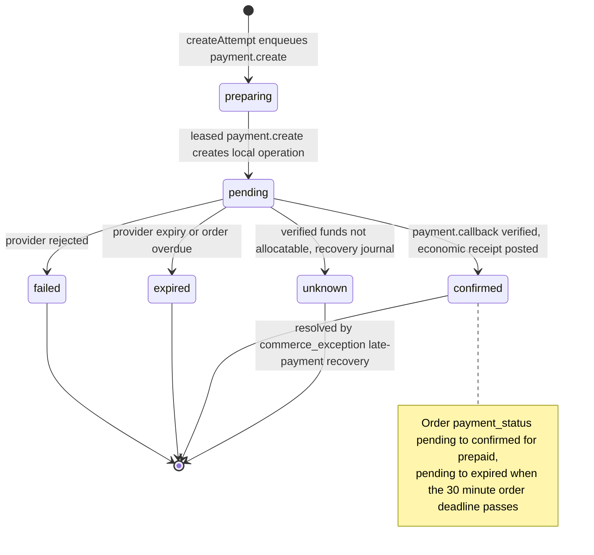

Source: `migrations/0016_prepaid_payments.sql` (`payment_attempt.status`, guard triggers), `migrations/0023_commerce_exceptions.sql` (`commerce_order_state_check`), `src/modules/payments/{attempts,events,worker}.ts`.

COD collection: the order's `payment_status` for `payment_method='cod'`, advanced per parcel by `cod_event_result`.

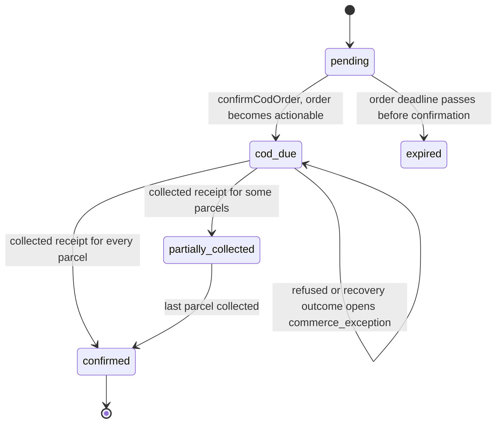

Source: `migrations/0018_cod_collections.sql` (`cod_event_result.outcome`), `migrations/0023_commerce_exceptions.sql` (`commerce_order_state_check`, `cod_collection_payment_status`), `src/modules/payments/cod.ts`.

Delivery: `fulfillment.status` per shipment, with `shipment_booking.status` (`queued → acknowledged → issued | failed`, `issued → cancelled`) carried underneath.

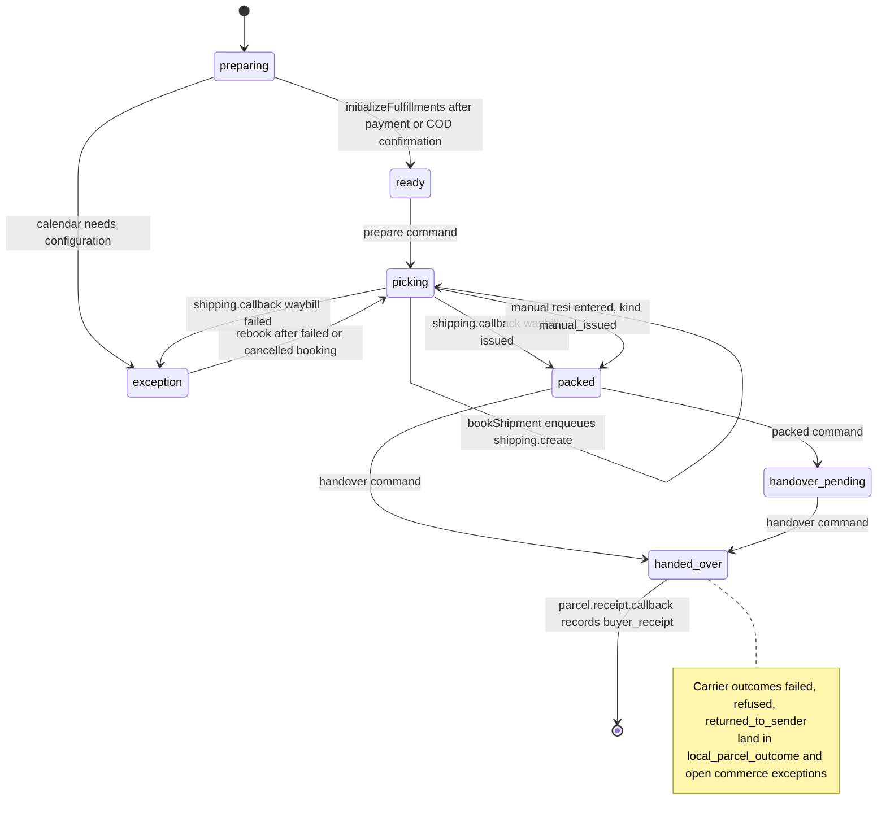

Source: `migrations/0019_fulfillment_deadlines.sql` (`fulfillment_state_check`, `shipment_booking_state_check`, transition triggers), `migrations/0023_commerce_exceptions.sql` (`shipment_booking`, `local_parcel_outcome`), `src/modules/fulfillment/{core,commands,worker}.ts`, `src/modules/returns/receipts.ts`.

Printing: `shipping_label_artifact.status`; print attempts are append-only rows, not a state.

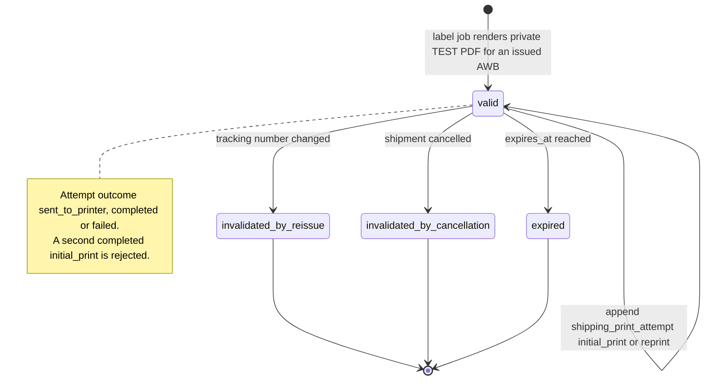

Source: `migrations/0024_remaining_domains.sql` (`shipping_label_*`, `shipping_print_*` tables, no status CHECK), `src/modules/documents/labels.ts` (`ShippingLabelArtifactResponse`, `revalidateShipmentArtifacts`, print attempt types).

### Money flow

Each arrow is one posting pair: it points from the credited account to the debited account. The nine accounts are the full `finance_posting_value_check` list. There is no revenue account; buyer money stays in `buyer_funds_liability`, and realized contribution is computed in reporting. Debit-direction settlement statements flip the settlement sides; dashed arrows are reversals.

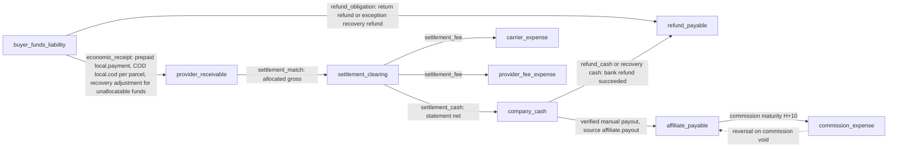

### Price basis (DEC-025, migration 0044)

An offer's price lives on `offer_revision.price` (`offer_price_ceiling_check`: 1..99,000). Triggers `cart_line_unit_price` and `order_item_unit_price` (`app.freeze_offer_unit_price`) copy it into `unit_price`; no writer supplies it. Every derivation uses that frozen unit price: quote and order merchandise (`app.guard_checkout_quote`, `app.seal_commerce_order`, `src/modules/shipping/quotes.ts`), COD fee and transfer-code allocation weights (`checkout/orders.ts`), return and refund and recovery unit amounts (`app.assert_unit_merchandise` on `return_item`, `refund_allocation`, `recovery_refund_allocation`), commissions (`offerCommissionIdr(bps, unitPrice)` = floor((price·bps+5000)/10000), also in `app.assert_attributed_checkout_cost`), prospective and realized contribution (`finance/contribution.ts`, `app.check_publication_sealed`, `finance/realized-contribution.ts`, `catalog/summary.ts`), and Purchase signals (`app.purchase_signal_payload`, `app.purchase_receipt_payload`, `app.assert_commerce_event`, `app.signal_operation_payload`, `advertising/events.ts`). Proof: `--case=price-ceiling`. The IDR 99,000 that remains in code is the ceiling, the default price of a new offer without one, the default payout threshold, or display text.

Source: `migrations/0014_immutable_finance.sql`, `migrations/0025_affiliate_ledger.sql` (`finance_posting_value_check`), `src/modules/finance/{ledger,receipts}.ts`, `src/modules/finance/settlements/core.ts`, `src/modules/payments/{events,cod}.ts`, `src/modules/returns/{refunds,worker}.ts`, `src/modules/checkout/exceptions/{refunds,refund-callback}.ts`, `src/modules/commissions/service.ts`, `src/modules/payouts/service.ts`.

## Known differences between code and decisions

Rows are rechecked against the code when this file is regenerated (last 2026-11-10: rows 5 and 7 updated for production, the resolved row 12 removed). Rows marked Resolved stay while their tests still rely on the note.

| # | Decision says | Code does |
| --- | --- | --- |
| 1 | DEC-011 and slice S56: the feed emits `google_product_category` / `product_type`, served at `/api/v1/catalog/feeds/{channel}` | `src/modules/catalog/feed.ts` builds the feed, but no route, script or page calls it (tests only), and neither `src/app/api/v1` nor `docs/spec/openapi.yaml` has a feeds path. |
| 2 | DEC-007 (2) / DEC-024: live Mengantar estimate (S95) | Implemented and live 2026-10-31: `SHIPPING_ADAPTER=mengantar` (production only, `config/runtime.ts:productionShipping`), `shipping/mengantar.ts` (estimate adapter), `shipping/destinations.ts` (destinations from `app.shipping_area`, fixture locally), warehouse origin `provider_area_id`, quote guard accepts source `mengantar` (migration 0042). Booking (S94) and tracking (S98) are deferred; fulfilment stays manual (S91). |
| 3 | DEC-008 (5): one payment adapter seam (`manual_bank`, `autolaris`, local) | `payments/worker.ts:paymentAdapter` is the seam: it branches only on `autolaris`, and manual bank reuses the local operation (`createLocalOperation`/`settleLocalOperation`) as its settlement carrier. The unused `adapter` field on `PAYMENT_CHANNELS` was removed 2026-11-11. |
| 4 | DEC-008 (4): unique code 1–999 per transfer | Codes are unique only among open manual-bank orders (unique index in `0032`), 99 codes are held in reserve (`MANUAL_BANK_BUSY`), and each actor may hold at most 2 open manual-bank orders (`MANUAL_BANK_OPEN_LIMIT`). These limits are not in the decision text. |
| 5 | DEC-008 (2): AutoLaris API key as a server secret | **Resolved.** The local profile refuses `AUTOLARIS_*`; the production profile accepts exactly `AUTOLARIS_API_KEY`, `AUTOLARIS_ORDER_ORIGIN_ID`, `AUTOLARIS_ORDER_DESTINATION_ID` and only while `payments` is open or draining (`config/runtime.ts`), held in Coolify as runtime-only variables. |
| 6 | DEC-008 (1): AutoLaris methods rendered from runtime `list_payment` | Rendered from `listPayment`, but filtered by a fixed allowlist `AUTOLARIS_CHANNELS` (five VA banks and QRIS). Consistent with the decision's method list; noted because a new channel needs a code change. |
| 7 | DEC-008 (3): store-borne AutoLaris admin fee recorded as a payment cost when deducted from settlement | **Matters now (VA live since 2026-11-10).** Only the host-only simulator `simulateAutolarisSettlement` produces a settlement, and `settlements/local.ts:settlementSourceEvent` refuses `production`: a paid production VA order leaves `provider_receivable` open and its fee unbooked until a production settlement entry (finance records AutoLaris's payout) is built. |
| 8 | DEC-007 (7): a statement whose gross ≠ net + deductions is flagged `SETTLEMENT_TOTAL_MISMATCH` | `recordCodRemittance` refuses it with 422 `STATEMENT_TOTAL_MISMATCH` and stores nothing, so the projection flag of the same name cannot fire. |
| 9 | DEC-009 (2): COD fee base is merchandise after merchandise reductions | The base is gross parcel merchandise plus net shipping. Equal today because promotions only subsidise shipping. |
| 10 | Access contract: `finance.recovery_refund` proof purpose | Resolved on branch `security-step-up-proofs`: `issueAccessProof` issues it to owner or finance holding `finance.refunds.read` + `.write`. Existing recovery-refund tests still insert proof rows directly; they could now use the issuance route. |
| 11 | Affiliate enrollment (`/api/v1/me/affiliate`) | Enrollment requires the `affiliate` role to exist already; no API grants it (only local seed code does). |
| 13 | Support contact replacement requires "original-identity reauthentication" (openapi `SupportContactBindingInput`) | Guest: no password session and no reviewed reauthentication method, so contact replacement (`expected_version ≥ 1`) is refused with 403 `REAUTHENTICATION_REQUIRED`. Verification writes only a first binding (`contact_verified_at is null`), so a second challenge staged at version 0 returns 409 `VERSION_CONFLICT` and cannot overwrite a contact verified meanwhile. Initial binding is unchanged; a guest old-contact challenge needs an IAM/product decision. Signed-in user: a `support.contact_rebind` proof gates only challenge issuance. Verifying a user challenge writes no user-side binding, and the version is read from `buyer_profile.phone_verified_at`, which this flow never sets. So for users the flow creates and verifies a challenge but stores no recovery contact. |
| 14 | `docs/spec/16-OBSERVABILITY-RATE-LIMITING.md`: rate-limit keys combine reviewed actor scope with coarse network abuse signals, and limit responses do not expose account existence | **Resolved in code 2026-11-02 (S149, option D)** with caveats. The sign-in budget no longer refuses at 5 per minute per email: only failed attempts count; at 5 failures in 60 s the next attempt needs a Turnstile token (`CHALLENGE_REQUIRED`, growing `Retry-After`); 100 consecutive failures start a cool-off of 15 minutes doubling to 24 hours (`SIGN_IN_LOCKED`, 423); success, a completed reset or the operator unlock clear the state. Without Turnstile keys the account gets only a bounded delay of at most 60 s and no cool-off. Open: users without JavaScript cannot solve the challenge; with reset mail disabled in production the operator command is the only early exit from a cool-off; reset and sign-up requests keep their flat limits. Review: independent R4 review found two high issues, both fixed. |
| 15 | DEC-029 (3): the policy version that priced a buyer fee is frozen with the attempt | No version id column: the attempt's business time identifies the immutable version (`autolaris_buyer_fee` resolves it again); equivalent while versions stay immutable. |
| 16 | DEC-028: provider-mode payment proof against the stand-in | The AdsBookCMS stand-in serves no `create_payment` (S171 closed by the owner), so the payment wire is proven only against 99ribu's in-test fakes; the real stand-in proves rates, `list_payment` and the gap. |
