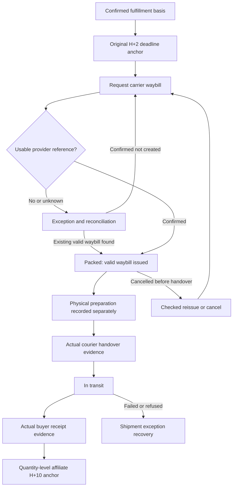

# Technical Design

Status: Draft — planning only; no application or runtime verification.

Owner: Paduka Ongki. Updated: 2026-10-15.

### TD-1 — Application structure proposal
- Status: Accepted
- Owner: Engineering owner
- Source: CTX-9
- Statement: Use one TypeScript application with Next.js App Router, PostgreSQL/Drizzle and Better Auth; a separately running worker shares domain modules and the database.
- Acceptance: Implementation preserves delegated stack selection, records pinned compatible versions and verifies local and deployed runtime separately.
- Constraints: None
- Evidence: None; execution pending.
- Changed at: 2026-10-15
- Change history: Initial planning declaration from owner discussion.

## Domain modules and side effects
Catalog, inventory, checkout, fulfillment, returns, affiliates and finance have clear module boundaries within one repository. No separate network service for each module. Server Components render read-heavy pages; small Client Components own necessary interactivity. Server Actions/Route Handlers call the same server-only domain operations; authorization and validation are never delegated to the UI.

Checkout sequence: validate cart and address -> retrieve provider quotes -> allocate stock -> calculate subsidy -> display proposal -> atomically reserve inventory/promo budget and persist snapshots -> create payment attempt or COD confirmation -> produce fulfillment work through an outbox. External calls happen outside database locks. A provider timeout leaves an identifiable attempt for status reconciliation, not a blind second creation.

Inventory allocation must minimize total supported shipping cost across feasible assignments, including consolidation and physical package constraints. Tie-break proposal: fewer packages, then default warehouse. Exact candidate comparison is the baseline; if measured catalog scale requires search limits, expose and approve the optimization ceiling rather than claiming global cheapest. Do not split quantity of one variant across warehouses without buyer-visible quoting. Keep bundles warehouse-complete.

## Provider adapters — no invented API routes
| Provider | Required issued contract | Failure handling |
|---|---|---|
| Virgo | Merchant methods, sandbox, authentication, payment creation/status, callback verification, expiry/refund/reports | Pending attempt; verified status check; refund remains pending until provider confirms |
| Mengantar | Origins, destinations, actual/volumetric quoting, COD reachability, per-shipment collect amount, create/status, delivered proof, pickup and return | Keep fulfillment exception; do not claim booked without provider reference |
| Future payout provider / Virgo candidate | Issued merchant disbursement rights, destination verification, transfer create/status, idempotency and ambiguous-result recovery | No automated outbound integration initially; T-19 verifies capability before enabling it |

Use the reviewed local Mengantar reference described below; it takes precedence over stale private-skill observations. Provider endpoints and authentication must still match the current merchant-issued contract before implementation.

## Durable asynchronous work
Use a transactional outbox and persisted job state. Recommended initial queue: PostgreSQL-backed jobs; verify an established library and runtime fit before choosing one. Do not add Redis solely for an unmeasured need. Workers claim short leases, deduplicate effects, use bounded backoff and expose manual recovery. Expired leases can resume safely.

Receipt processing stores provider event time separately from ingestion time; late events do not arbitrarily postpone maturity. Replacement receipt replaces the eligibility anchor of affected items only. An unresolved replacement or return suppresses maturity. Duplicate and stale events cannot reverse a later valid state without explicit correction handling.

Payout evaluation locks matured eligible entries for one affiliate, checks the inclusive IDR 99,000 threshold, destination and active holds, then atomically creates one queued payout with unique entry allocations and a destination/policy snapshot. Initial mode is manual: finance exclusively claims the payout before transferring externally, then records verified transaction evidence, amount, destination match and reference. No worker sends money. Ambiguous results remain processing/unknown and block release/retransfer until reconciled. Cash shortages create a visible funding hold. Evaluation cadence is a setting, not a promised bank-completion SLA or new payout calendar.

## API compatibility
API-1 is activated by the owner request for future independent Android/iOS clients. First-party HTTP schemas are owned by openapi.yaml; issued provider callback fixtures remain a separate pre-implementation gate. A proposed first-party endpoint is not an upstream provider endpoint. SDK generation/publication follows contract acceptance, not this planning draft.

## Advertising measurement decision — PR-23
Decision: use a typed first-party commerce event contract, shared server domain modules, PostgreSQL transactional outbox and the existing separate worker. Shopify Customer Events are workflow inspiration, not an SDK dependency or permission to copy hosted-checkout scripts. One Next.js application owns the buyer journey. No additional tracking VPS, sGTM service or campaign-management API is required initially.

### Funnel and dispatch contract
| First-party occurrence | Meta | Google browser analytics / Ads | TikTok | Canonical trigger |
|---|---|---|---|---|
| Page / actual selected offer view | PageView / ViewContent | page_view / view_item, analytics if enabled | PageView / ViewContent, current supported names verified before implementation | Visible route/actual offer; never invent a selected first variant |
| Successful cart mutation | AddToCart | add_to_cart; secondary measurement only | AddToCart | Committed mutation identity; two genuine additions of the same offer are two events |
| Actionable checkout entry | InitiateCheckout | begin_checkout; secondary measurement only | InitiateCheckout | Logical checkout visit; rerender is not a new start |
| Accepted contact/address/shipping/method milestone | First-party analytics unless verified standard mapping applies | Semantic analytics; add_shipping_info/add_payment_info only on accepted corresponding state | First-party analytics unless current mapping applies | Explicit accepted versioned state, no typed input or sensitive address in payload |
| Persisted order / COD accepted | Internal order_confirmed | Internal order_confirmed; not Primary revenue | Internal order_confirmed | Idempotent backend creation; do not relabel as Purchase or another checkout start |
| Verified prepaid receipt or COD collection | Purchase through CAPI | Server conversion ingestion; see compatibility gate below | Purchase through Events API | Canonical verified money posting and allocated merchandise value |
| Thank-you/status viewed, help opened, payment failed | Consent-eligible analytics only | Consent-eligible analytics only | Consent-eligible analytics only | Authorized view/error category; never Purchase or automatic Lead |
| Refund / return / replacement | Internal adjustment ledger; adapter capability gate | Explicit supported adjustment of known original conversion only | Internal adjustment ledger; adapter capability gate | Not a negative Purchase or fresh sale; no duplicate sale on free replacement |

Decision: Purchase is server-only initially on all three platforms. Browser Pixels/Google tag measure eligible funnel activity. This avoids reliance on a returning customer, browser storage or an old thank-you revisit to deliver revenue. Optional Meta/TikTok paired browser Purchase is a later proven adapter mode: backend-authorized event envelope, identical event name/source/event_id/value, still eligible consent and verified vendor pairing window; suppress historic revisits. Google browser Purchase remains disabled unless a separately reviewed same-action supplemental-source contract is proven. No GA4 imported purchase becomes a second Primary action for the same revenue.

### Money, identity and time
A purchase instance references a verified payment/collection posting, not a browser view, payment attempt or courier status. Prepaid produces one purchase instance for the confirmed order payment; repeated provider receipts reconcile the same posting. COD produces an instance for each distinct verified collection posting, with disjoint quantity/amount allocations. Two collected parcels containing one Rp99.000 offer each generate Rp99.000 + Rp99.000, never Rp198.000 per parcel. A later bank remittance, delivery, affiliate H+10 maturity or free replacement creates no extra Purchase. A new actual additional payment requires its own approved commercial policy.

Decision: ad value is net paid merchandise after any valid merchandise adjustment, excluding shipping, COD/admin/payment fees and shipping subsidy; initial fixed-price units remain Rp99.000. Two offers yield Rp198.000 ad value even when the buyer pays an additional shipping charge. HPP, margin, affiliate commission and provider fees remain internal. BILL-1 owns reconciliation and allocation rounding. Use integer IDR internally, numeric value/currency IDR outbound, real occurrence time retained in UTC, and immutable opaque business-event UUIDs (Google transaction identifiers at most 64 characters). Dashboard labels distinguish purchase instances, distinct paid orders and collected parcels. Platform conversion counts cannot be described as order counts for split COD.

Catalog IDs equal immutable sellable offer identities across page/feed/adapter; bundle components are contents, not separately charged offers or duplicate conversion entries. The backend creates and validates event identity; browser occurrence IDs for funnel mutations are validated/deduped within scope. Retry preserves original identity, event time and payload version. Do not modify time to make an expired event admissible.

### Consent, matching and attribution
PRIV-1 owns purpose/legal review and retention. Initial engineering mode blocks optional advertising until the applicable recorded choice permits it (Basic mode); actual locale policy and notice still require approval before launch. Checkout and guest recovery remain functional when denied. Apply eligibility at capture and dispatch, cancel unsent withdrawn events, and never backfill earlier unconsented behavior after later acceptance. Server CAPI/API is not a consent bypass. Google defaults precede tag config/events and reflect ad_storage, analytics_storage, ad_user_data and ad_personalization; Advanced/cookieless mode requires a separately reviewed policy and implementation.

Keep genuine fbclid-derived _fbc, _fbp, gclid/gbraid/wbraid, ttclid/_ttp and bounded UTM references only as allowed by purpose and expiry. Never fabricate click IDs, equate attribution windows with retention, or overwrite first-eligible-seven-day affiliate attribution. Capture original allowed browser context, not a provider webhook server's IP/user-agent. Proxy trust is explicit. Strip sensitive query parameters/capabilities from source URLs and referrers. Match using actual customer data only; omit unknown email rather than synthesizing one. Stable advertiser-issued visitor/customer identity is distinct from order/click IDs. Normalize/hash real identity using each vendor's verified rules; raw cookie/click IDs are not email hashes. Hashing does not anonymize customer data.

### Adapters and current evidence boundary
Meta: Pixel plus server CAPI, same event_name/event_id if paired; official SDK confirms actual UTC seconds and event identity. SDK main/release v26.0.2 was observed in earlier research, but developer changelog/parameter/dedupe pages returned HTTP429 on 2026-10-16. Pin and reverify supported Graph version, event age, current fields, source classification for delayed COD and test-event behavior before activation; SDK default alone is not proof of the latest API.

Google: one owner per conversion action, initially direct Google tag for eligible funnel activity and a server conversion adapter. New offline ingestion targets Data Manager API v1 rather than assuming eligibility for legacy UploadClickConversions. Decision: use a Data Manager offline-import UPLOAD_CLICKS action (Website / Import from clicks) with eventSource WEB, owned by its operatingAccount, for prepaid and COD. Offline-import names the transport rather than an offline checkout. Reverify exact schema/account compatibility before implementation. Do not select WEBSITE multi-source while omitting its underlying Google-tag Purchase: that route supplements tag conversions. Require a valid documented identifier category, not merely transaction UUID; missing/expired attribution remains an explained gap. Data Manager consent fields adUserData/adPersonalization use CONSENT_GRANTED/CONSENT_DENIED/CONSENT_STATUS_UNSPECIFIED and are not browser Consent Mode syntax. Use a single approved Primary revenue action per intended goal without duplicate GA4 imports; validate count setting against posting-grain purchase instances. Enhanced conversions require actual consent, enabled account settings and accepted terms. Data Manager restatement keeps conversion count; it does not support retraction. An unmatched adjustment may be a new conversion: never send until the original action/transaction match is verified. Unsupported retraction remains a disclosed reporting difference, not a fake negative sale.

TikTok: use current Purchase, not new legacy CompletePayment integration. Events API 2.0 product name and Marketing API endpoint version are separate. Current standard-event and migration pages conflict on Lead/SubmitForm naming; lead mapping is disabled until verified, and merely opening support never qualifies. Same source/event/event_id is required for optional overlap. The official dedupe page states a 48-hour window and has ambiguous cross-channel five-minute wording; do not promise enrichment timing or rely on that window for local idempotency. Verify exact schema, user.phone field, hashing, action-source/context and maximum event age in the current rendered developer reference before coding.

### Durable processing and thank-you boundary
Commit money posting, unique purchase instance and required platform outbox intents atomically. Uniqueness is platform + configured source/action + business event + mapped name. Worker uses claimed leases, bounded retries/backoff/jitter for transient network/429/5xx, respects Retry-After, and quarantines permanent rejection/expired event/invalid destination. Timeout is unknown receipt: resend the same event identity, never create another financial event. Internal processing is idempotent; external delivery is at least once subject to vendor dedupe/acceptance. Per-platform pause/circuit failure cannot block checkout or order receipt. Replay needs reason, permission and original identity/consent/time validity; no arbitrary historical resend.

Thank-you rendering reads authorized backend state with private/no-store caching. Provider return is navigation only, never payment proof. Pending reconciles through bounded polling or the existing verified event channel; background/hidden tabs pause polling and resume with a fresh read. Closing the page does not prevent worker delivery. Optional browser echo contains only the safe eligible envelope, never credentials or customer details. Do not infer delivery from HTTP200: retain per-event accepted/processed/rejected/unknown diagnostics, then reconcile eligible business totals and platform reporting separately from attribution. Account configuration, real test events and campaign spend require their own authorization; none occurs in this Markdown revision.

## Desktop/mobile rendering and first-party API seam
PR-17 introduces separate desktop and mobile shopping presentation using shared domain operations and identities. Use distinct layout/screen modules under one application initially; responsive behavior still handles size/orientation/zoom inside each mode. Exact URL/mode selection and hydration strategy are Proposal, not automatically a separate hostname or duplicate Next.js application.

PR-18 activates API-1. Route Handlers expose versioned JSON for independent consumers; web server components can call shared domain functions directly rather than make unnecessary internal HTTP round-trips. API and server-rendered flows enforce the same validation/transactions. Design app/native lifecycle separately when selected; WebView does not imply PWA, offline checkout or a ready native bridge.

Define product URLs once logically and map them to each client presentation. Validate allowed post-auth/payment returns; server persists attempts and reconciles return/resume, which is never payment proof. Browser/WebView cookies are separate contexts; no credential is passed in arbitrary query strings to fake continuity. Native authentication and link associations are future gates.

## Listing contents, stock and operational recovery
Product is the listing; Variant is its selectable sellable offer with a permanent catalog ID and price IDR 99,000. Every offer resolves to explicit physical StockItem quantities, including quantity-two multipacks and mixed bundles. Never charge its components separately or recursively nest bundles. Inventory-only components need not be individually sellable. Reserve all required component stock atomically in one warehouse; compute offer availability from components, not an independent duplicate bundle stock counter. Freeze the selected option and contents at checkout; later catalog edits cannot change an order.

Waybill issuance is the PR-6 packing milestone only after the provider confirms a usable carrier/tracking reference. A local draft label, failed creation attempt or arbitrary staff timestamp cannot satisfy it. Record issued_at separately from physical preparation and handover evidence. Reconciliation recovers timeouts using the same operation identity; replacing a cancelled waybill does not reset the original deadline or mark handed_over.

PR-21 owns recovery: no silent substitutions after stock discrepancies; a late prepaid success must be reconciled and stock reacquired atomically or refunded; failed/refused COD keeps receivable/stock/commission states distinct; partially delivered orders resolve affected shipments/quantities independently. Replacement stock failure presents a supported alternative only with buyer consent, otherwise the approved refund path. Reissue or cancel tracking only after checking handover state.


## Diagram TD-D1 — Checkout reservation and provider effects
Owner: Engineering owner. Status: Proposal; transaction and retry contract to be implemented and tested.
Trace: [PR-1 through PR-5, PR-11, PR-16, PR-20, PR-21](02-PRD.md), [DATA-1](05-DATA-MODEL.md#data-1--transactional-invariants), [BILL-1](11-BILLING-PAYMENTS.md#bill-1--money-lifecycle).

```mermaid
sequenceDiagram
    actor Buyer
    participant Web as Trusted checkout
    participant Provider as Provider adapters
    participant DB as PostgreSQL
    participant Worker as Durable worker
    Buyer->>Web: Request cart and destination quote
    Web->>Provider: Retrieve supported shipping and payment options
    Provider-->>Web: Quotes and capability results
    Web-->>Buyer: Offer totals and warehouse shipment proposal
    Buyer->>Web: Confirm quote with idempotency key
    Web->>DB: Begin transaction and revalidate quote and stock
    Note over Web,DB: Reserve complete offer components per warehouse; reserve subsidy budget
    Web->>DB: Persist order, policy snapshots, attempt and outbox
    Web->>DB: Commit transaction
    Web-->>Buyer: Persisted order and pending payment or COD status
    Worker->>DB: Claim committed job with short lease
    Worker->>Provider: Execute payment or fulfillment operation
    Note over Worker,Provider: Outside DB locks; stable operation identity
    alt Provider outcome known
        Provider-->>Worker: Verified reference and status
        Worker->>DB: Deduplicate effect and persist guarded transition
    else Timeout or ambiguous outcome
        Worker->>DB: Persist pending reconciliation; do not recreate blindly
        Worker->>Provider: Reconcile through issued status contract
    end
    Provider->>Web: Callback with provider event identity
    Web->>DB: Verify, deduplicate and apply guarded event
    Note over Web,DB: Fulfillment starts only after prepaid confirmation or valid COD acceptance
```

A quote is not a stock guarantee. The confirmation transaction atomically checks warehouse-local composition and reservations; failures return a new buyer-visible proposal. Payment and shipment operations use issued provider contracts, not invented routes. Expired reservations plus late prepaid success follow PR-21: reacquire stock atomically or issue a reconciled refund; never silently oversell. Job completion and provider callbacks converge on the same idempotent business effect.

## Diagram TD-D2 — Waybill and actual delivery lifecycle
Owner: Engineering owner. Fulfillment owner contributes business milestone review. Status: Owner business milestones accepted; detailed guarded transitions proposed.
Trace: [PR-6, PR-7, PR-9, PR-21](02-PRD.md), [Shipment state ownership](05-DATA-MODEL.md#state-ownership).



Packed means a provider-confirmed usable waybill issued within the original PR-6 H+2 window; neither a local label draft nor handover alone changes that definition. Physical preparation, courier handover and actual buyer receipt have separate evidence and timestamps. Reissued tracking retains the original deadline. Receipt stores event time and ingestion time separately; late callbacks do not restart a known valid clock. Approved replacements establish a new receipt anchor for affected quantities only. Fulfillment confirmation and deadline origins follow PR-6's prepaid/COD rules, not an invented timestamp in this diagram.

## Architecture decision trace links
The sole decision index is [DECISIONS.md](../../DECISIONS.md). This table declares the same IDs for suite traceability only; decision content/status is owned by each full ADR and indexed once. Proposed architecture is not implied owner approval or implementation.

| ID | Owner | Status | Canonical record | Confirmation trace |
|---|---|---|---|---|
| ADR-0001 | Engineering owner | Accepted | [Full record](../adr/ADR-0001-modular-application-boundary.md) | See record confirmation; all runtime checks remain prospective |
| ADR-0002 | Engineering owner | Accepted | [Full record](../adr/ADR-0002-sellable-offers-physical-inventory.md) | See record confirmation; all runtime checks remain prospective |
| ADR-0003 | Engineering owner | Accepted | [Full record](../adr/ADR-0003-immutable-financial-postings.md) | See record confirmation; all runtime checks remain prospective |
| ADR-0004 | Engineering owner | Accepted | [Full record](../adr/ADR-0004-typescript-next-postgres-stack.md) | See record confirmation; all runtime checks remain prospective |
| ADR-0005 | Engineering owner | Accepted | [Full record](../adr/ADR-0005-vultr-coolify-cloudflare-hosting.md) | See record confirmation; all runtime checks remain prospective |
| ADR-0006 | Engineering owner | Accepted | [Full record](../adr/ADR-0006-versioned-client-api-boundary.md) | See record confirmation; all runtime checks remain prospective |

## Selected operational boundaries — 2026-10-15
Public storefront and checkout accept orders continuously; business calendars only affect warehouse processing promises. Web and worker share PostgreSQL domain transactions and durable outbox records. A worker outage leaves committed work recoverable and visible; unavailable payment/quote providers yield truthful pending/unavailable responses rather than fake acceptance. Health/restart/alert and restore checks are owned by DEL-1 and OBS-1.

Admin order history, inventory, cost review, finance and settings share one application and canonical order/ledger identities. Server-side read services enforce role and warehouse scope, use bounded cursor pagination and distinguish aggregates as-of time from transaction detail. Historical order views link shipments, payments, refunds, commissions and payout references without granting ordinary staff access to protected banking evidence. Cost/settings writes and inventory movements are version checked, audited and idempotent.

## Local provider handoff — 2026-10-15
Observed: local Mengantar reference exists at /home/ongki/Projects/mengantar-documentation/ (SRC-MENGANTAR-LOCAL). Read docs/01-api-reference.md, docs/02-couriers-and-rules.md and docs/10-verification-checklist.md before writing the adapter. The repository reports a 2026-09-25 read-only courier-estimate check; no fresh 99ribu merchant verification was performed here. Reuse its address/origin identity, quoting, batch/create, tracking, label and webhook contracts; confirm current account scope, COD amount mapping, wallet funding and provider-specific courier names. An unpaid shipment without a usable waybill does not satisfy PR-6. Partial batch outcomes retain references; unknown creates are reconciled before retry. Local webhook documentation is not proof of active sandbox callbacks or verified actual receipt.

Unknown: no Virgo-named merchant API document was found in the bounded Projects/Documents documentation filename search. Public sources in sources.json are discovery/context only. Obtain the owner-provided merchant API contract for methods, auth, callbacks, status/expiry, refunds, settlement and sandbox before implementing Virgo. Do not invent routes or use consumer-wallet transfer documentation for disbursement. Do not read credentials just to complete this planning handoff.

Warehouse operators use scoped fulfillment/shipment history rather than whole-order history endpoints; whole-order totals remain available only to an authorized whole-order role. Payment expiry and unpaid-stock reservation TTL are not extended automatically by shipping holidays. Closure days affect processing deadlines, not the authenticity or timestamp of payment/delivery evidence.

## Native website chat — selected initial architecture
PR-22 uses the same server domain, PostgreSQL persistence and transactional outbox as commerce. Send/create/claim/state transitions use authenticated HTTP mutations with actor-scoped idempotency and object authorization. Recommend SSE for server-to-browser committed public-message/unread updates, with bounded cursor-based history/polling fallback. No separate WebSocket fleet or Redis is justified for the initial 8 GB host; reevaluate after measured connection/load limits. This is transport design, not a tested connection-count guarantee.

Keep message commit independent of the stream connection. A lost acknowledgement retries the same client_message_id; duplicate stream delivery deduplicates by message/sequence. Cursor resume rechecks current participant scope, has bounded replay and falls back to paged resync for stale cursors. CS staff-note events are separate private channels, never entries filtered out of a public stream. Authorization is checked on connection and periodically/reconnect; session revocation/claim changes terminate unauthorized access. A stream disconnect is not a read receipt.

Prefer same-origin browser API ingress for each storefront/admin host, with explicit backend/session routing and CSRF/origin checks; shared business modules do not imply broadly shared cookies or permissive credentialed CORS. Select the exact guest session issuance/recovery and cross-host auth transport at implementation. For SSE, prove proxy buffering/timeouts/heartbeat and multi-tab limits against the actual Coolify/Next setup, then test cursor recovery and instance restart. MDN SSE and Next.js self-hosting guidance inspected 2026-10-15: https://developer.mozilla.org/en-US/docs/Web/API/Server-sent_events/Using_server-sent_events and https://nextjs.org/docs/app/guides/self-hosting.

Do not publish raw message bodies, bank details or guest capabilities to telemetry/ad attribution. Uploads are private conversation-scoped assets, validated and scanned before message association. Agent inbox assignment/status is durable; queued delivery and off-hours messaging remain visible even if no agent is online.

## Chat completeness handoff — Markdown scope
The expanded PR-22 adds typed context cards, reply references, scoped message search, participant preferences/in-app notifications and staff templates/internal classification. Keep these within the support module; PostgreSQL-backed bounded search is the initial recommendation, not a new search cluster. Search/quote/card projections reauthorize and apply redaction at retrieval. Public message events, private staff metadata and per-participant preferences have independent projections/cursors. Outbox notifications deduplicate per recipient/message; notification seen is not read. Core event replay remains durable; optional typing/presence is ephemeral and expires on missing heartbeat.

The existing OAS core is unchanged by this Markdown-only task. T-24 expands the API contract and negative/schema checks before corresponding handlers, and T-25 implements only the aligned contract. Do not let an optimistic UI invent unsupported message fields or notification endpoints. Guest bootstrap/recovery, supervisor template governance and cross-host session ingress must be implemented and verified before exposing those flows.

## Parcel label generation and99ribu identity — PR-25
Decision: prefer a provider-supported 99ribu sender/brand configuration or explicitly approved branded template. Persist original carrier AWB and provider label identity; each parcel has its own artifact and COD collection allocation. Provider credential URLs never reach clients. Do not add an invented masking flag, replace the carrier AWB with an internal order number, or assume registering a dropshipper grants permission to remove provider branding.

Evidence boundary: local Mengantar docs01 section10 describes single-order thermal tokens, while docs03/07/09 use A6/A4 shorthand and the curl heading mentions single/multiple; docs04 describes single-order asynchronous flow. The notes disagree on format/response vocabulary. Local verification notes reference public docs; current docs endpoint could not be read through web tooling on 2026-10-16. Whitelisting, quota, endpoint/field/status names, link expiry and branded/masked options require the current issued99ribu contract. No local example is copied as a verified wire integration.

Flow: scoped eligible parcel → verify issued non-void AWB/current snapshot and available template/format → persist idempotent generation job → provider request or approved local rendering → reconcile asynchronous result → validate PDF/page count/parcel mapping → private preview/download → explicit print dialog → operator physical check → separate pickup/handover evidence. A readable AWB does not prove PDF readiness; PDF ready/print dialog open does not prove paper printed. Provider booking, label rendering, print attempts and physical preparation are separate transitions; preserve the existing PR-6 waybill milestone without making printing its new anchor.

For batch printing freeze selected explicit parcel IDs, warehouse, current shipment revisions and stable page ordering. Default one parcel per thermal page, with parent order reference and parcel position within the order; do not confuse batch page position with package position. Exclude void/cancelled/superseded AWBs and nonready jobs, list reasons, and require review before continuing eligible subset. Poll/read retry never creates another booking. Retry generation uses its stable identity and reconciles unknown outcomes; reprint normally reuses the same validated artifact/AWB. If artifact link expires, regenerate/retrieve through the verified safe method, not another paid shipment. A changed address/service/amount invalidates old artifact; any rebooking requires its separate domain authorization and cancellation reconciliation.

If approved full masking is unavailable, present99ribu identity through an original carrier label plus separate non-obstructing99ribu sticker/packing slip. The UI must identify this fallback and keep full masking unresolved, not silently declare the requested template active. No PDF crop/overlay obscures required fields. A later fully custom render needs issued barcode symbology/data/routing requirements and carrier acceptance before release. Preserve genuine sender/warehouse/return details;99ribu brand is not a fake address or fictitious courier.

Downloads proxy private artifacts through an authorized bounded server route with no-store behavior; validate upstream host, redirects, MIME, file signature/size/page limits and safe template assets. Do not accept arbitrary fetch URLs. Store no customer PDF in public buckets, analytics or ordinary logs. Stale scope/session checks apply on every generation/read/download. A physical print/scanner test is mandatory; browser screenshot or PDF existence is insufficient proof of usable shipping labels.


Evidence update 2026-10-16: official Mengantar help publicly describes recipient-data privacy masking (name/phone; a separate update also mentions address except city/province). That is not evidence of 99ribu logo replacement or a brand-template API. Model recipient privacy mode separately from commercial brand mode, and enable it only through a verified carrier/provider-supported workflow; never locally censor required delivery fields based on the word masking alone. JNE published section4.4 requires complete/correct sender and recipient data; confirm approved provider exceptions for enabled services. Public return-address guidance also has geographic/carrier restrictions; do not assume all warehouses may redirect RTS to any address.

## Localhost execution profile — CTX-18
Decision: local mode exercises the same server domain modules, PostgreSQL constraints/transactions, actual auth sessions/authorization, worker/outbox and buyer/operator UI intended for release. Replace only external effects with deterministic owned payment/shipping/label/advertising/notification adapters. No mock role header, trusted buyer_id or disabled permission check may substitute for real auth; no in-memory inventory/money repository may substitute for PostgreSQL. Actual Better Auth sign-in protocol is selected/pinned and validated during T-23; synthetic fixture role declarations are seed intent, not bearer credentials.

A local simulation advances explicit scenario/clock state: payment pending/success/failure/expiry/unknown and callback duplication/order; shipping quote/no route/COD unsupported, funding unpaid, AWB pending, delivery/return versus actual collection; label job pending/failure/expired/reprint; ads receipt/rejection/retry/consent; service notification attempted/sent/failed. These are first-party domain test events, not guessed Virgo/Mengantar wire payloads or production signatures. Use a local test inbox for real auth verification logic if supported, never SMS/WhatsApp/email to real recipients. Keep test controls in a local-only CLI/test harness, disabled in non-local builds; do not expose a public mark-paid/simulate endpoint.

Configuration must positively identify APP_ENV=local and every external adapter as simulated; reject mixed live destinations/credentials rather than silently falling back. Outbound provider/money/shipment/ads/notification dispatch is disabled by default and guarded independently in worker/senders. Allow only local adapter services for this profile; external browser pixels/scripts are not loaded to satisfy local analytics. Browser funnel events write to a local diagnostic sink with the real consent and event-grain rules. Test logs distinguish captured/suppressed/queued/simulated accepted; they never claim actual attribution.

Simulation uses dependency-injected clock/event delivery, stable IDs and deterministic scenarios, not wall-clock sleeps or arbitrary client state overrides. Test money/stock race/replay against the real DB, and stop/restart the real worker to prove catch-up. Free replacements, failed COD, refunds and later settlement remain distinct even in mock mode. A test advance-clock does not change host/system time or overwrite historical receipt anchors.

Every generated local label is conspicuously marked TEST — NOT FOR SHIPPING and uses synthetic AWB/test barcode data. Its preview/reprint/scope behavior can be accepted locally; real barcode/courier/brand-template approval and actual hardware output remain separate later gates. Do not present a mock99ribu template as provider-approved masking. Preserve immutable original PDF/snapshot references and local access controls.
