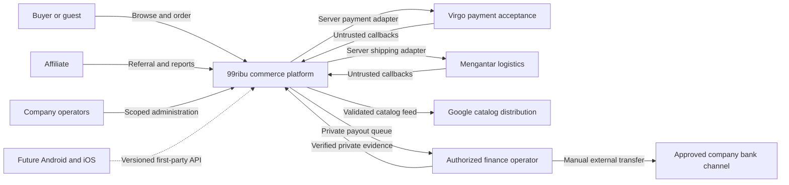
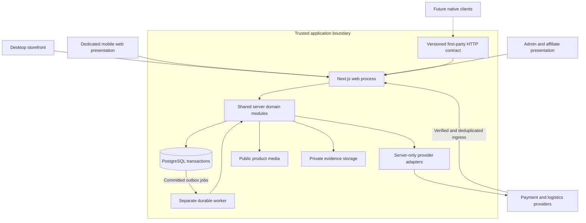
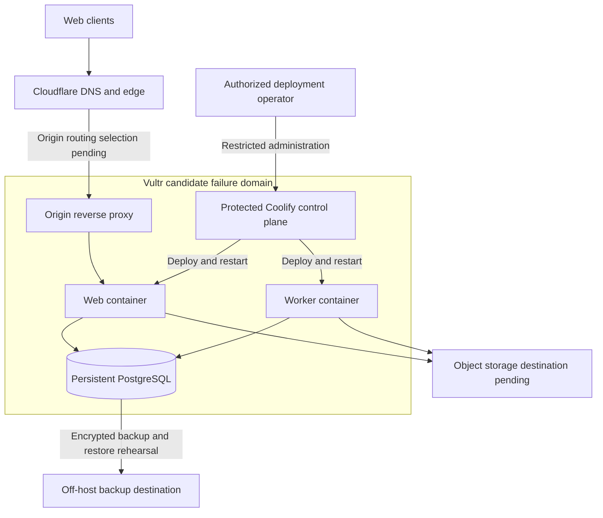

# System Architecture

Status: Draft — planning only; no application or runtime verification.

Owner: Paduka Ongki. Updated: 2026-10-15.

### ARCH-1 — Trust and runtime boundaries
- Review owner: Engineering owner; independent document review performed 2026-10-15, runtime/diagram approval not claimed.
- Status: Proposal
- Owner: Engineering owner
- Source: CTX-3
- Statement: Keep commerce mutation authority in trusted server/worker processes backed by one transactional database; browsers and provider callbacks are untrusted inputs.
- Acceptance: Direct unauthenticated mutations fail, provider calls remain server-only and worker restart cannot lose committed work.
- Constraints: None
- Evidence: None; execution pending.
- Changed at: 2026-10-15
- Change history: Initial planning declaration from owner discussion.

## Selected deployment shape
99ribu.com -> Cloudflare DNS/edge -> reverse proxy -> Next.js web process. A separate worker process uses the same PostgreSQL database and server domain modules. Object storage holds public product assets and separately protected return evidence. Providers communicate only through authenticated server integrations.

Accepted starting host: Vultr managed through Coolify (ADR-0005), with web and worker processes; PostgreSQL hosting and backup details remain to be specified. Cloudflare hosting of the application itself is not implied by existing Cloudflare DNS. The earlier Vercel shortlist is no longer the selected hosting direction. Never cache authenticated checkout, admin, affiliate or guest-order responses publicly.

## Framework rationale and limits
Next.js unifies SEO-oriented catalog rendering and interactive operator surfaces. PostgreSQL supports transactional stock and money constraints. Drizzle provides typed SQL access; Better Auth supplies authentication primitives; business authorization remains application policy. Tailwind is selected for styling, shadcn/ui for React-capable admin/affiliate controls. Storefront composition remains product-focused rather than adopting an admin template.

Astro plus a separate admin/backend is viable but adds application boundaries before a measured need. No dedicated NestJS service, search cluster, Redis cluster or microservice fleet is required initially. Revisit separation only for demonstrated load, independent teams or isolation needs. Pin versions and verify security/runtime compatibility at initialization; docs retrieved today do not pin future releases.

## Pending architecture decisions
Provider processing locations, image storage, outbound notifications, durable queue library, backup location, monitoring and a future automated payout provider need explicit selection. Initial affiliate transfers use the authorized manual finance workflow; only eligibility and queue creation are automatic. Formal ADRs now document accepted invariants and proposed technical choices; the stack and modular/API boundary ADRs are accepted under owner delegation; ADR-0005 records the accepted Vultr/Coolify hosting choice, with detailed topology and provisioning gates remaining. See [DECISIONS.md](../../DECISIONS.md).

## Accepted hosting — owner confirmation 2026-10-15
Decision: Vultr compute + Coolify deployment management, confirmed by the owner. Cloudflare DNS/edge remains the proposed integration direction. Singapore (sgp) is owner-selected for the primary compute region. The initial Vultr plan is selected below; provisioning, database hosting details and network route remain unexecuted/open. Web and worker are separate resources/processes. PostgreSQL uses persistent storage with off-host backups and a restore rehearsal; one-host deployment is a single failure domain. Public app and deployment-control access have different security policies. Decide DNS proxy versus Tunnel, TLS termination and origin protection before live setup. Cloudflare public caching excludes authenticated/admin/checkout/affiliate/guest-order responses.

SRC-VULTR-COOLIFY and SRC-COOLIFY-CLOUDFLARE support product compatibility guidance; they do not establish readiness of the owner's infrastructure. The accepted Vultr/Coolify choice supersedes the generic hosting shortlist; purchase, provisioning and deployment remain separate actions.

## Client boundary update
Desktop storefront and dedicated mobile web-app/WebView are separate presentations over one trusted commerce backend. They share catalog, stock, orders, affiliate and finance policies. First-party API-1 is now activated for future independent Android/iOS clients; no separate service/microservice fleet is implied. Native app development, link association files and app-store publication remain future work.

Public API versioning adds a real compatibility boundary: clients cannot be assumed to update on every server deploy. Freeze approved OAS, auth and return-link contracts before client generation; prevent domain/schema drift with parity tests. No public production API hostname has been created.

## Diagram ARCH-D1 — System context
Owner: Engineering owner. Status: Proposal; logical boundary view, not a deployed system.
Trace: [ARCH-1](#arch-1--trust-and-runtime-boundaries), [PR-4, PR-8, PR-13, PR-18](02-PRD.md), [API-1](09-API-SPECIFICATION.md).

Callback arrows represent inputs requiring authentication, replay protection and reconciliation; they are not authority to mark payments or delivery without validation. Outbound merchant payout API is intentionally absent until T-19 proves an issued contract. Public catalog synchronization does not expose buyer, banking or finance evidence.

## Diagram ARCH-D2 — Application containers and trust boundary
Owner: Engineering owner. Status: Proposal; proposed modular monolith with a separate worker process.
Trace: [TD-1](03-TECHNICAL-DESIGN.md#td-1--application-structure-proposal), [PR-2, PR-13, PR-16, PR-17, PR-18](02-PRD.md), [DATA-1](05-DATA-MODEL.md#data-1--transactional-invariants).

Containers are process/data boundaries, not a microservice requirement. Domain modules execute inside the web or worker process; both enforce the same business invariants. The HTTP contract is a compatibility seam, not a separately mandated API server. Private evidence access requires authorization and must never inherit public product-media caching.

## Diagram ARCH-D3 — Preferred deployment candidate
Owner: Engineering owner. Operations owner contributes deployment review. Status: Proposal; no infrastructure purchase, provisioning or readiness is asserted.
Trace: [Hosting candidate](#hosting-candidate--owner-steering-2026-10-15), [PR-16](02-PRD.md), [DEL-1](15-DEVOPS-CICD-MIGRATIONS.md).

Vultr, Coolify, Singapore and Next.js are selected. Exact PostgreSQL placement, TLS termination, proxied DNS versus Tunnel, origin protection, secrets delivery, storage vendor and backup destination remain setup decisions. Coolify access is separate from public storefront traffic. Backup arrows denote required design behavior, not proof that backups or restores exist. The currently published static coming-soon Worker is a separate release and does not establish this commerce runtime.

## Proposed source and responsibility boundaries
Status: Proposal, conditional on ADR-0001, ADR-0004 and ADR-0006 acceptance. These are intended repository paths, not folders or application code created by this planning task.

| Boundary | Intended path / owner | Rule |
|---|---|---|
| Rendering and HTTP adapters | src/app/ | Desktop/mobile presentation modules and versioned handler adapters; no duplicated money/stock policy |
| Business operations | src/modules/catalog/, inventory/, checkout/, payments/, fulfillment/, returns/, affiliates/, commissions/, payouts/, finance/, promotions/, access/, settings/ | Server-only domain modules; transaction and permission enforcement at every mutation |
| Persistence and durable execution | src/db/, migrations/, src/jobs/ | Reviewed schema, transactional outbox and worker entrypoint; selected library and migration conventions verified at setup |
| Evidence and checks | tests/unit/, tests/integration/, tests/browser/ | Owned synthetic fixtures, disposable real PostgreSQL for races, public-handler/browser evidence for journeys |
| Canonical product contracts | docs/spec/, docs/adr/, root TASKS.md and DECISIONS.md | Promote staged owners once; no competing PRD/task queue or editable diagram copies |

Code may call another module through explicit domain operations; clients never import database/provider adapters. The boundary proposal does not require interfaces/factories for every module, duplicate repositories, a separate API server or internal HTTP between server modules. Extract services only after measured isolation/scaling/team requirements justify a new ADR.

## Accepted initial compute size — 2026-10-15
Decision: primary Vultr compute region is Singapore (sgp), explicitly confirmed by Paduka Ongki. This does not select backup/support locations or establish a data-transfer review conclusion.

Decision: the owner accepted the recommendation to start with High Performance AMD plan `vhp-4c-8gb-amd`: 4 shared vCPU, 8 GB RAM, 180 GB local NVMe, USD 48/month base compute price. The public Vultr plans API retrieved on 2026-10-15 lists this plan in sgp; allocation availability must be checked when provisioning. Price excludes tax, backup, object storage and other optional services. Sources: https://api.vultr.com/v2/plans and https://api.vultr.com/v2/regions.

Sizing rationale: one initial VPS hosts Coolify, the selected web application, worker and PostgreSQL. Prefer externally built container images to reduce build-time competition with live requests/database memory. Keep database backups off-host and test restore. Coolify's documented minimum is 2 cores/2 GB RAM for its own operation, not a sizing guarantee for the commerce workload (https://coolify.io/docs/start-with-self-hosted).

This is an accepted initial plan selection, not measured throughput, purchase or provisioning authorization. Load tests and observed CPU, memory pressure, disk growth, database latency and job delay determine resize or database separation. The 8 vCPU/16 GB AMD alternative is USD 96/month base at the same retrieval date; it is not selected preemptively.

## Stack implementation recommendation — selected under owner delegation
Use one TypeScript Next.js App Router application, React and Tailwind, PostgreSQL with Drizzle migrations and Better Auth identity; use shadcn/ui for operator/affiliate controls. Keep storefront server-rendered with small interactive leaves and a distinct mobile composition. Run web and background worker as separate Docker processes managed through Coolify. Start with PostgreSQL-backed durable work; no Redis, search cluster, separate backend framework or microservice fleet until measured requirements justify one.

Pin stable mutually compatible versions in the repository lockfile at initialization; selecting a stack does not imply blindly installing latest releases. Build container images in CI where possible, use protected reverse proxy ingress, keep database private and exclude authenticated/checkout/order-capability responses from public caches. Current official self-hosting guidance was inspected 2026-10-15 (https://nextjs.org/docs/app/guides/self-hosting); Better Auth installation and Drizzle overview were also inspected. No application was installed or executed.

The selected single-VPS starting topology supports continuous order intake as an operating policy, not uninterrupted availability. Track outages and recover committed work; zero-downtime or numeric SLA claims require separately accepted targets and evidence.

## Native support-chat placement
PR-22 chat is a module within the selected commerce application, using existing PostgreSQL/outbox and private object storage; it adds no mandatory messaging SaaS, WhatsApp provider, standalone chat subdomain or WebSocket cluster. Storefront customer chat and the staff CS inbox are separate authorized presentations over the same server domain. Suggested host mapping remains 99ribu.com for storefront and app.99ribu.com for internal administration; role-specific Super Admin/CS dashboards do not require per-role hosts. Actual DNS/session ingress remains setup work, not a claimed deployment.

Initially recommend HTTP sends plus SSE events (SRC-MDN-SSE) with bounded replay/poll fallback. Measure connection resources, proxy streaming and authorization on the initial Vultr 4 vCPU/8 GB host before any realtime capacity promise. Persisted messages and assignment state survive web/worker restarts; stream delivery does not own the only copy of a message.
