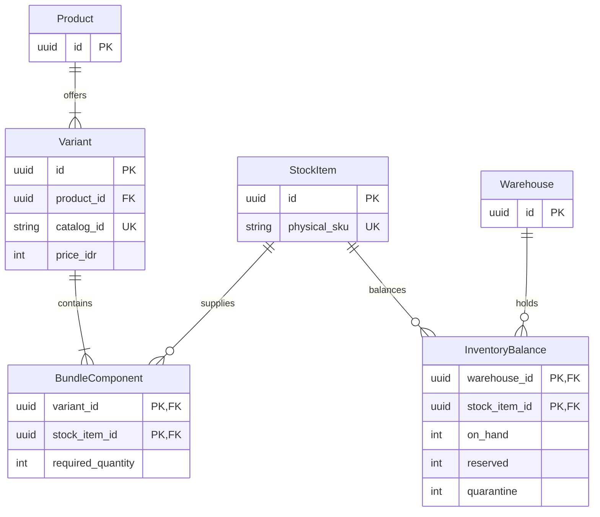
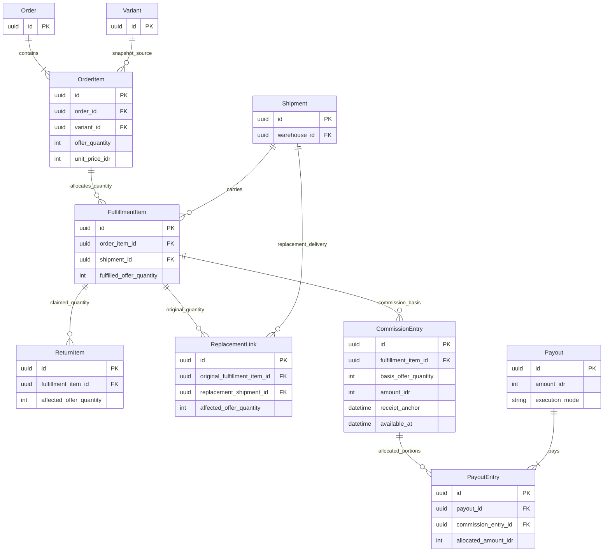

# Data Model

Status: Draft — planning only; no application or runtime verification.

Owner: Paduka Ongki. Updated: 2026-10-15.

### DATA-1 — Transactional invariants
- Status: Proposal
- Owner: Engineering owner
- Source: CTX-3
- Statement: Persist stock and finance effects with exact money, immutable snapshots, uniqueness and concurrency-safe allocation.
- Acceptance: Race tests cannot oversell; replay tests cannot duplicate event, payout allocation, refund or commission effects.
- Constraints: None
- Evidence: None; execution pending.
- Changed at: 2026-10-15
- Change history: Initial planning declaration from owner discussion.

## Entity inventory
| Entities | Relationships and essential fields |
|---|---|
| User, RoleGrant, WarehouseMembership | Auth identity; explicit roles; warehouse-scoped staff grants |
| Product, Variant, StockItem, BundleComponent, ProductMedia | Product=listing; Variant=selectable IDR 99,000 offer; physical StockItem SKU; component quantities/media/identifiers; permanent sellable catalog ID; actual packaged weight/dimensions |
| Category, CategoryAttributeDefinition, VariantAttributeValue, GoogleCategoryMapping, CatalogSyncAttempt | Department/category/subcategory internal tree, typed category-specific attributes, separately versioned external mapping, permanent item identity and sync validation |
| Warehouse, WarehouseCalendar | Address/origin mapping, active status, default selection priority, operations calendar |
| InventoryLot, InventoryBalance, StockMovement | Warehouse/physical StockItem/lot, on-hand/reserved/quarantine; batch/expiry; optional relevant serial tracking |
| StockReservation, WarehouseTransfer | Expiry and source order; transfer dispatched/received quantities; no stock counted twice |
| Cart, CheckoutQuote, Order, OrderItem | Guest access reference, quote expiry, item quantity/HPP/price/tax/attribution snapshots |
| FulfillmentGroup, Shipment, ShipmentItem, ShipmentEvent | Warehouse scope, actual parcel, allocated item quantities, quote, collect amount, valid waybill issued_at, physical preparation/handover and receipt evidence; event and ingestion timestamps |
| PaymentAttempt, ProviderEvent, Settlement, ReconciliationItem | Provider reference, currency/status, raw sensitive payload excluded from ordinary logs, match/exception state |
| Promotion, PromotionReservation, PromotionAllocation | Version, rules, budget reservation, per-order/per-shipment subsidy |
| ReturnCase, ReturnItem, ReturnEvidence, ReplacementLink, Refund, RefundAllocation | Original item lineage, requested quantity, reason, protected evidence, replacement shipment, refunded amounts and state |
| Affiliate, AffiliateRate, ReferralTouch, OrderAttribution | Effective-dated rate, validated referral identity, first-touch start/expiry, frozen order attribution |
| CommissionEntry, CommissionAdjustment, Payout, PayoutEntry, Beneficiary, ManualTransferEvidence | Quantity basis, receipt anchor, available_at, immutable allocations, execution_mode, exclusive finance claim, destination snapshot, amount/reference/transferred_at, restricted evidence and verifier/audit |
| FinanceTransaction, FinancePosting, AuditEvent, OutboxJob, NotificationAttempt | Balanced postings, immutable corrections, actor/reason, effect identity, lease/retry state and delivery outcomes |

## Constraints
- Unique catalog ID globally across sellable entities; it is a string, separate from PK, SKU, GTIN and slug. Do not recycle IDs. Variant ID is used in feed/events/order snapshots; parent ID groups variants.
- All currency amounts are integer IDR in this market. Rates use exact basis points; per-item rounding is deterministic and recorded. Default basis is buyer-paid merchandise only; no shipping commission. Subsidy does not reduce merchandise commission.
- Quantity and available stock cannot become negative. Reserve under row locks or equivalent conditional writes. Transfer receipt and quarantine release require explicit movements.
- Unique provider/environment/event ID and external operation identity; unique commission basis per original sellable quantity; unique payout ownership for every eligible entry portion.
- Refund allocations cannot exceed original paid components; partial returns conserve aggregate value. A replacement preserves original sale/commission lineage rather than creating another paid sale.
- Payout creation at the inclusive IDR 99,000 threshold and eligible-entry allocation are one transaction. Initial execution_mode is manual. Success requires authorized finance verification of external transfer evidence matching the immutable amount and destination; eligibility never means paid. Corrections append reversing entries instead of deleting history.
- Financial posting debits and credits balance per transaction. Gross revenue, cash, provider receivables and commission liabilities are separate accounts.

## Partial quantity lineage
Receipt, return, replacement, hold and maturity anchors belong to fulfilled quantities, not just a whole order line. If two units share a line and only one is exchanged, split commission basis/quantity allocations so the unaffected unit keeps its original eligibility date. Returned quantity cannot exceed delivered unreturned quantity. Replacement lineage links exactly the affected quantity and creates no second revenue/commission basis. Include fractional-line race/replay scenarios.

## State ownership
Payment: pending/confirmed/expired/failed/refunding/refunded; split refunds use allocations. Shipment: unbooked/booked/packed/handed_over/in_transit/delivered/failed/returned/cancelled, with guarded transitions. In this business packed means provider-confirmed valid waybill issued; record physical preparation separately and never derive handed_over from packed.  Return: requested/reviewing/approved/rejected/awaiting_goods/inspecting/refunding/replacing/resolved. Commission: pending/held/eligible/allocated/paid/void. Payout: queued/processing/unknown/succeeded/failed/funding_hold.
Order summaries are derived from child states, not manually used to overwrite them. Detailed transition tables must be implemented and tested before relevant mutations are exposed.

## Data lifecycle
See PRIV-1 for retention and deletion selection. Do not physically erase financial records through ordinary account deletion. Remove/anonymize unnecessary personal fields under approved retention rules. Backup retention must follow the same inventory. No real customer or banking values belong in planning fixtures.

## Advertising attribution extension proposal
Add AdTouch/OrderAdAttribution for validated channel, campaign/creative reference, click-reference fields, consent state, captured time and approved expiry. Keep it separate from ReferralTouch/OrderAttribution, which owns affiliate credit. Ad conversion outbox entries reference canonical business event and order/quantity where appropriate. Payout metadata and buyer PII never enter creative IDs or URL parameters. Retention is an unresolved PRIV-1 policy, not the affiliate cookie lifetime.

## First-party API resource additions
API-1 names stable FulfillmentItem/quantity-occurrence identity linking original OrderItem, physical ShipmentLine and ReplacementLink; ReturnItem targets a delivered occurrence, not only an ambiguous order line. Commission quantity shares refer to the same lineage. Quote payment method discovery uses only currently issued merchant methods. Destination lookup identity maps provider area codes server-side. GuestAccessChallenge stores hashed single-use proof, expiry, rate state and verified order linkage; tokens are credentials, not analytics fields. Evidence upload grants bind case/type/size/expiry and require validation after upload. These contracts introduce no real data into this pack.

## Offer stock, costs and policy versions
One selected Variant quantity one costs IDR 99,000 regardless of physical component count; quantity two of the offer costs IDR 198,000. Each BundleComponent resolves to a physical StockItem and positive required quantity; include unit and same-SKU multipack offers in this composition model. Warehouse-local availability is the minimum integer floor of available component stock divided by its required quantity; aggregate repeated components before testing availability. No cycles, zero quantities, separate charges or duplicate stock pools. Freeze versioned contents and HPP for order, fulfillment and return lineage. A component is not automatically another buyer order item or affiliate commission.

CostSnapshot/MarginReview records offer composition, cost source/as-of, HPP, packaging, payment/COD/affiliate costs, bounded subsidy and return-cost assumptions; actual FinancePosting costs stay separate from estimates. Missing costs produce unknown margin, never zero cost. ConfigurationVersion/PolicyAssignment records key, scope, value, effective time, actor, reason and before/after; Order/Commission/Payout store applicable snapshots, never recompute settled history from current settings.

## Diagram DATA-D1 — Listing composition and warehouse stock
Owner: Engineering owner and catalog owner. Status: Proposal; logical ERD, not a migration or finalized column contract.
Trace: [PR-1, PR-2, PR-3, PR-15](02-PRD.md), [Offer stock and policy versions](#offer-stock-costs-and-policy-versions).

Variant is the selectable offer, including a one-item option, multipack or mixed bundle; every selected offer quantity costs IDR 99,000. Component quantity never creates another charge or commission. Required quantities for repeated components are aggregated. All components for one complete offer must be available in the same warehouse; derived availability has no competing bundle stock pool. Lot/expiry, transfer, reservation and movement details remain in the entity inventory; this compact ERD does not remove them. Key names illustrate identity constraints rather than committing SQL names or storage granularity.

## Diagram DATA-D2 — Fulfilled quantities and financial lineage
Owner: Engineering owner. Finance owner contributes lineage review. Status: Proposal; logical lineage view to be protected by transactional constraints.
Trace: [PR-7, PR-9, PR-10, PR-12, PR-21](02-PRD.md), [Partial quantity lineage](#partial-quantity-lineage), [BILL-1](11-BILLING-PAYMENTS.md#bill-1--money-lifecycle).

The ERD omits ancillary entities for legibility, not ownership. FulfillmentItem denotes the stable fulfilled offer-quantity identity from API-1; physical contents and their snapshots remain linked to that identity. A return or replacement targets only the affected quantity. ReplacementLink preserves the original sale and never creates a second paid order or commission basis. Enforce quantity conservation, unique basis and exclusive eligible-entry ownership beyond ERD cardinalities. Commission adjustments append corrections; paid history is immutable. Finance proof and beneficiary data are private entities outside this public-facing lineage view.

## Operational calendar and admin provenance
WarehouseCalendar carries IANA timezone, recurring operational weekdays, dated holiday/major-closure exceptions, source/year, approval and effective version. Shipment snapshots actionable purchase time, calendar version, packing_due_at and handover_due_at. A reschedule appends previous/new due dates, reason/actor and notification state; it does not replace original event time or erase an overdue observation. Holiday configuration is not reused to extend return/referral/receipt-maturity windows.

Versioned component cost records identify StockItem, source/validity, cost in integer IDR or explicit unknown, actor/reason, effective time and prior version. Actual dispatched InventoryLot cost links fulfilled quantities to finance postings; quotes/order snapshots carry the estimated cost basis, while later observed cost evidence records a variance/adjustment rather than silently changing original estimates. Missing lot cost produces an incomplete actual-margin result. A bundle's HPP is the sum of its frozen component quantities/costs.

Finance expense records and allocation lineage identify date/period, category, amount, evidence reference, authorized actor, draft/posted/reversed state and links preventing double-counting. Buying stock is not automatically the same expense as recognizing cost of sold stock. Financial summaries are derived views over order, allocation and ledger records with as-of time and completeness flags; no writable profit balance is stored. Order history reuses Order/OrderItem and append-only AuditEvent/ShipmentEvent/FinancePosting rather than duplicating the order in a Super Admin database.

## Native support-chat entities and invariants
SupportConversation has one customer principal (buyer or opaque GuestSupportIdentity), optional validated product/order context, open/waiting_customer/resolved state, assigned CS user, optimistic version and lifecycle timestamps. Guest identity stores a hash/reference for an expiring server-issued capability; never a raw credential in ordinary tables/logs. Account linking/recovery is a verified audited transition, not a number lookup or automatic merge.

SupportMessage records conversation, sender identity/role, client_message_id, server-created timestamp, monotonically increasing public sequence, bounded plain text and validated attachment references. Enforce unique(conversation, sender, client_message_id), unique(conversation, public_sequence), and atomic message/outbox commit. Retry returns the original matching message; reuse of the identity with a different body conflicts. Resolve/send/reopen races serialize on conversation version. Message deletion is not ordinary staff editing; approved redaction preserves required audit/tombstone metadata under retention policy.

SupportAttachment binds upload to conversation/participant, actual detected type/bytes, pending/ready/rejected scan state and authorized private retrieval. Reject cross-thread references, unready images and remote URLs; up to three JPEG/PNG/WebP images, each at most 5 MiB, per message. SupportReadPosition is participant-scoped, monotonic and bounded by that participant's visible committed public sequence.

SupportAssignmentEvent records claim/handoff/release, old/new assignee, actor/reason and version. SupportInternalNote is a separate staff-only entity with independent identifiers/events; never reuse a customer-visible message sequence or payload for it. SupportAvailability records staffed hours/timezone/away text under versioned settings; it does not stop 24/7 customer submissions or promise response times. Message/public event history supports bounded cursor replay after restart/disconnect; transient connection state is not delivery/read evidence.

Chat read projections: retain a marker for each actual participant. Public read events explicitly identify reader_side as customer or staff, without exposing guest capability or internal agent identifiers. The customer's read-by-CS position is the maximum explicitly acknowledged public-message sequence of authorized CS readers, not an own/customer marker or connection heartbeat. Staff inbox unread uses the current agent's personal marker rather than the aggregate staff marker; another agent reading cannot clear this agent's unread state. Sending a message alone does not mark prior messages read. Internal notes do not advance public sequence, public updated_at, message/unread counts or customer event cursors.

## Expanded chat objects and projections — PR-22 Markdown baseline
SupportMessage adds optional reply_to_message_id referencing a visible committed public message in the same conversation, never SupportInternalNote. Resolve quoted text/image/card through current authorized visibility; redaction/expiry removes sensitive quote snapshots from history/search and leaves only a neutral tombstone. Do not store an ungoverned copied quote indefinitely.

SupportContextCard is a typed public product/offer or verified-order projection attached only on explicit send. Store safe sent-time facts and source identity; current product availability is separately resolved. Never duplicate order capabilities, buyer addresses, bank evidence, HPP or private stock in cards. Binding and opening an order require current authorization; context association does not change ownership or reserve goods.

SupportParticipantPreference stores per-principal/per-conversation archive and mute, independently of shared conversation status/assignment. New public messages unarchive only the affected recipient's personal thread; muting suppresses attention alerts but not unread/storage or recipient visibility. SupportInAppNotification uses unique(recipient,business-event) and seen/opened metadata; notification seen is not a conversation read receipt. Private preferences and per-agent read markers do not advance public conversation metadata.

SupportSavedReply stores template/version, approved language/content, permitted placeholders, enabled state and author/audit. Insertion renders against only the active authorized conversation and produces an editable unsent draft; unresolved placeholders block sending. SupportTag/ConversationTag and internal priority are versioned staff-only metadata with independent audit/updated time; neither creates a customer-visible event or public-message count. Search indexes public messages separately from notes; visibility/retention/redaction applies both to results and excerpts. Bounded cursor results carry safe message identity, never arbitrary private payloads.

Drafts are not committed SupportMessages. Default tab/session-scoped draft state is namespaced by principal+authenticated/guest session+conversation+composer mode; preserve through shopping Back/rotation within that session, expire at session end and clear on logout/principal change. Do not persist attachment blobs, raw capabilities, verified order tokens or staff-note drafts in shared browser storage. Unknown sends retain the original client_message_id for reconciliation; edits after an uncertain commit become a deliberate new message only after outcome recovery. Cross-device drafts are not implied.

Context continuity: the thread principal remains stable while primary context is versioned; each sent context card keeps its own safe snapshot/resource reference. Current context changes never relink old cards to another order or rewrite messages. Concurrent start/reopen for the same principal and intended context uses transactional deduplication; matching a product/order identifier without current participant proof cannot select an existing thread.

Participant archive/mute preferences carry their own optimistic version and confirmed state for stale-write/retry recovery; they never advance the conversation public version/activity used to expose new message events. Notification seen/dismiss metadata is likewise participant-private and never substitutes for the actor-bound chat read marker.

## Advertising signal schema refinement — PR-23
Decision: refine the earlier attribution proposal with AdTouch/OrderAdAttribution, ConsentReceipt, CommerceEvent, PurchaseAllocation, AdEventOutbox, AdDeliveryAttempt and versioned AdDestinationConfig. These are proposed implementation entities under DATA-1, not existing migrations. Consent receipts contain principal scope, purpose/vendor choices, policy version, effective/withdrawn time and expiry. Attribution captures only allowed genuine identifiers, source and expiry; affiliate records remain separate.

CommerceEvent contains immutable event UUID, semantic name/schema version, real occurrence time, principal/order references and safe value snapshot. Unique economic payment/collection reference prevents duplicate purchases; double-entry rows, item allocations, reconciliation records and later settlement of one receipt are not separate purchase events. PurchaseAllocation links each event to original order-item quantity/merchandise amount; cumulative allocations cannot exceed verified collected merchandise and cannot overlap. Corrections are explicit linked adjustments, never edits to a dispatched purchase. Browser view/delivery and free replacement have no new money posting.

AdEventOutbox is unique by platform/source-or-action/business-event/mapped-name and stores destination version, eligibility/consent reference, encrypted bounded matching payload or short-lived reference, original time, status, attempt/lease/next retry, expiry and safe diagnostics. States distinguish suppressed, queued, leased, accepted, processed where available, rejected, unknown, quarantined and cancelled. Attempts contain correlation ID, redacted provider result and classification, never raw matching data or access tokens. Consent withdrawal stops unsent delivery. Expired sensitive payload is purged on the PRIV-1 schedule; safe immutable money references survive separately. Configuration contains public identifiers and secret-manager references only. IAM-1 governs mutations.

Thank-you is a projection of existing Order, PaymentAttempt, verified collection, Shipment and refund lineage, not another authoritative status entity. Projection includes state version/as-of timestamp and authorized next actions. Sensitive buyer details are scoped to authenticated/verified guest access and never publicly cached.

## Buyer account and shipping-document entities — CTX-17
DATA-1 decision: add BuyerProfile (principal, display name, verified identity references, version), BuyerAddress (owner, label, recipient name/phone, street, canonical province/city/district/subdistrict/postcode, optional RT/RW/landmark, default/version/deletion), ContactChangeChallenge and GuestOrderLinkChallenge (hashed single-use proof, old/new identity scopes, expiry, attempts and audit), and purpose-specific NotificationPreference where not already modeled. No account wallet, KTP or saved payment instrument is introduced. Address edits/deletion change future selection only; immutable order/ship-to snapshots remain. Exactly one default among an owner's active addresses, updated atomically; deleting the default requires explicit replacement/none, not another user's address. Recovery/linking never grants old orders based only on matching phone text.

Add ShippingLabelTemplateVersion (carrier/service/account permission evidence, brand mode, exact physical format, renderer/assets version, active/approval state), ShippingLabelJob (parcel, issued AWB/revision, operation identity, template version, format, state, safe upstream correlation), ShippingLabelArtifact (private object/hash, snapshot/page metadata, valid/superseded/expiry), ShippingPrintBatch/BatchItem (actor/warehouse/frozen selection/order/item outcome) and ShippingPrintAttempt (artifact, actor/time, reason/reprint and operator-reported result). These are schema contracts, not existing migrations. Unique generation scope prevents duplicate create on retry; original economic shipment is referenced, never created by print. Print attempts may be unknown because browser cannot confirm hardware success.

Use a separate DeliveryExceptionCase only where existing ReturnCase/SupportConversation cannot represent the workflow: original parcel/provider status/reason, normalized category, assigned operator, next action/due, customer contact attempt and resolved evidence. Preserve provider raw category/context behind authorized views; unknown categories do not become delivered or cash collected. Reuse existing audit/outbox/job entities rather than a second infrastructure layer.

## Executable synthetic fixture contract for localhost
Owned fixture: fixtures/localhost-commerce.json; validator: scripts/check-localhost-fixtures.py. These are planning/test input artifacts, not migrations, a customer dump, complete seed implementation or provider payloads. They contain 8 synthetic principals covering all 7 roles,2 test warehouses, physical shared components,4 Rp99.000 offers (single/multipack/mixed), null HPP,3 money/order examples, explicit purchase/refund allocations and 14 simulation scenario contracts. Contacts use reserved example.test; no passwords, sessions, keys, real recipient addresses or provider IDs are included. Unresolvable fixture phone/area references, if added during seed implementation, must remain local and must never escape to a provider.

Fixture arithmetic verifies fixed offer pricing, complete warehouse component references, nonnegative availability, purchased-offer totals, buyer shipping/subsidy totals, split COD due/collection conservation, unique verified economic receipts, nonoverlapping purchase quantities, refund retained value and balanced example postings. Deliberate bad mutations must be rejected. This proves input invariants only: no database locks, auth, callbacks, UI or real provider behavior are exercised by the validator. Seed jobs will translate these semantic fixtures to actual schema identities without assuming they are OpenAPI payloads/status enums.

T-38 implements reproducible synthetic seed/scenario translation after T-23. Seed is local-only, explicit and idempotent for its own namespaced dataset; verify target database/environment before mutation. Never wipe an existing DB, delete user rows or reset migrations through a convenience script. Destructive reset remains a separately approved command; prefer a fresh isolated disposable test database and report its actual name. Parallel tests isolate IDs/schema/database rather than sharing mutable seed state. Include real domain tests for denied scope, simultaneous stock/payout claims, stale address, missing cost, private notes, guest linking and clock boundaries.

Fixture refinement: the partial-order refund example purchases two complete Rp99.000 offer units and refunds one unit at Rp99.000, retaining Rp99.000; no arbitrary partial-value exception is implied. Integer-IDR checks reject float/bool/negative monetary data, permit only explicit null HPP, and bind ad merchandise allocations to actual verified monetary coverage. Twelve deliberate bad-data mutations are rejected. Inventory examples validate nonnegative current availability and historical order stock references; they do not prove stock reservation feasibility or transactional behavior. The actual local seed/domain tests must evaluate current available stock and execute races against PostgreSQL.

Address-book concurrency refinement: maintain an owner-scoped book version separately from each address version. Setting a default and deleting an address with default replacement compare the expected book version atomically; deletion also compares that address version. A concurrent default switch cannot be overwritten merely because the deleted address row did not change. Commit the new default/active-set state and increment book version in the same transaction; conflict returns current safe versions for review.

## Catalog edit and receipt snapshot handoff — 2026-10-16
Implementation preserves the order-time offer label/kind/component quantities and ship-to snapshot independently of later catalog/address-book changes. Component quantities on an order item describe one offer unit; purchased offer quantity multiplies physical demand, never the IDR99,000 unit price. A private receipt may project its own frozen address with masked phone, while ordinary order summaries and warehouse projections retain their narrower field boundaries.

Catalog draft changes are explicit create/update/retire operations under an optimistic product version. Existing external catalog IDs remain stable; removal is never inferred from an omitted array entry. Retiring a choice stops future sale while retaining referenced stock/reservation/order lineage. Replacing component composition or shipping facts requires the existing publication/cost policy to run again; current reservations and historical purchased contents cannot be rewritten by editing the current catalog. The wire shape is owned by openapi.yaml; T-1/S14 and T-20/S16 prove these invariants through the real database and handlers.
