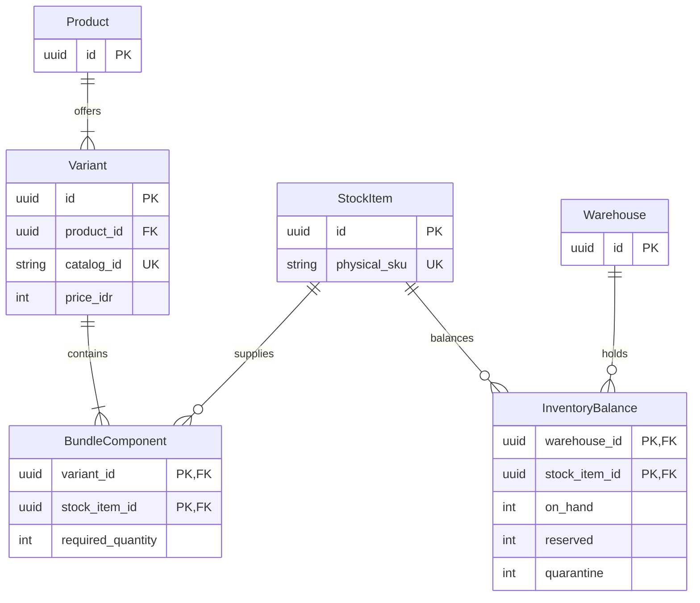
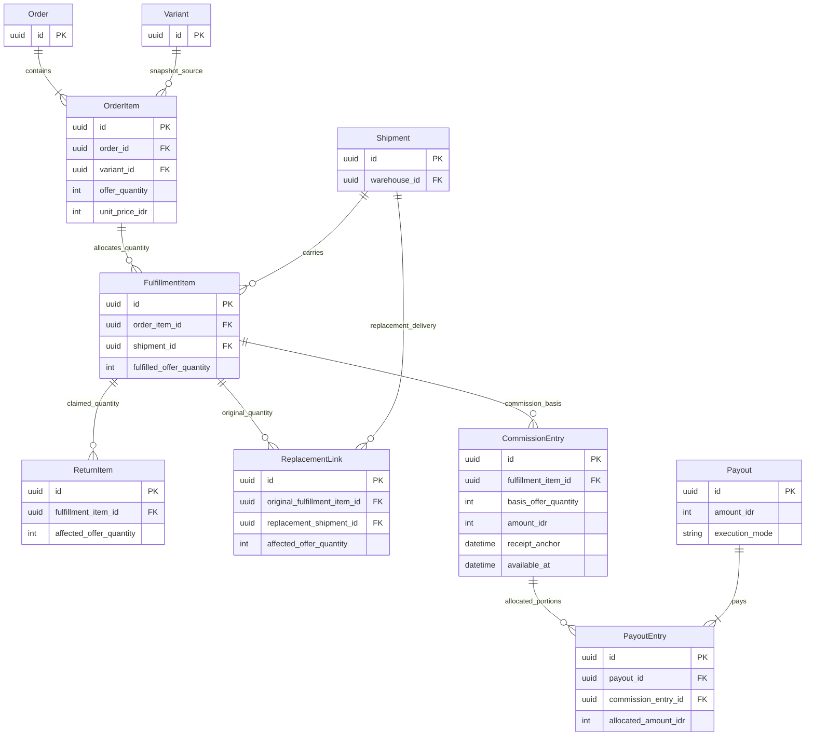

# Data Model

Status: Accepted contract — implementation and acceptance state is owned by root [STATUS.md](../../STATUS.md); external gates remain open.

Owner: Paduka Ongki. Updated: 2026-10-21.

### DATA-1 — Transactional invariants
- Status: Accepted
- Owner: Engineering owner
- Source: CTX-3
- Statement: Persist stock and finance effects with exact money, immutable snapshots, uniqueness and concurrency-safe allocation.
- Acceptance: Race tests cannot oversell; replay tests cannot duplicate event, payout allocation, refund or commission effects.
- Constraints: None
- Evidence: Implementation and local acceptance evidence is tracked in root [STATUS.md](../../STATUS.md); external gates remain open.
- Changed at: 2026-10-15
- Change history: Initial planning declaration from owner discussion.

## Entity inventory
| Entities | Relationships and essential fields |
|---|---|
| User, RoleGrant, WarehouseMembership | Auth identity; explicit roles; warehouse-scoped staff grants |
| Product, Variant, StockItem, BundleComponent, ProductMedia | Product=listing; Variant=selectable IDR 99,000 offer; physical StockItem SKU; component quantities/media/identifiers; permanent sellable catalog ID; actual packaged weight/dimensions |
| Category, CategoryAttributeDefinition, VariantAttributeValue, GoogleCategoryMapping, CatalogSyncAttempt | Department/category/subcategory internal tree, typed category-specific attributes, separately versioned external mapping, permanent item identity and sync validation |
| Warehouse, WarehouseCalendar | Address/origin mapping, active status, default selection priority, operations calendar |
| InventoryLot, InventoryBalance, StockMovement | Warehouse/physical StockItem/lot, on-hand/reserved/quarantine; batch/expiry; optional relevant serial tracking |
| StockReservation, WarehouseTransfer | Expiry and source order; transfer dispatched/received quantities; no stock counted twice |
| Cart, CheckoutQuote, Order, OrderItem | Guest access reference, quote expiry, item quantity/HPP/price/tax/attribution snapshots |
| FulfillmentGroup, Shipment, ShipmentItem, ShipmentEvent | Warehouse scope, actual parcel, allocated item quantities, quote, collect amount, valid waybill issued_at, physical preparation/handover and receipt evidence; event and ingestion timestamps |
| PaymentAttempt, ProviderEvent, Settlement, ReconciliationItem | Provider reference, currency/status, raw sensitive payload excluded from ordinary logs, match/exception state |
| Promotion, PromotionReservation, PromotionAllocation | Version, rules, budget reservation, per-order/per-shipment subsidy |
| ReturnCase, ReturnItem, ReturnEvidence, ReplacementLink, Refund, RefundAllocation | Original item lineage, requested quantity, reason, protected evidence, replacement shipment, refunded amounts and state |
| Affiliate, AffiliateRate, ReferralTouch, OrderAttribution | Effective-dated rate, validated referral identity, first-touch start/expiry, frozen order attribution |
| CommissionEntry, CommissionAdjustment, Payout, PayoutEntry, Beneficiary, ManualTransferEvidence | Quantity basis, receipt anchor, available_at, immutable allocations, execution_mode, exclusive finance claim, destination snapshot, amount/reference/transferred_at, restricted evidence and verifier/audit |
| FinanceTransaction, FinancePosting, AuditEvent, OutboxJob, NotificationAttempt | Balanced postings, immutable corrections, actor/reason, effect identity, lease/retry state and delivery outcomes |

## Constraints
- Unique catalog ID globally across sellable entities; it is a string, separate from PK, SKU, GTIN and slug. Do not recycle IDs. Variant ID is used in feed/events/order snapshots; parent ID groups variants.
- All currency amounts are integer IDR in this market. Rates use exact basis points; per-item rounding is deterministic and recorded. Default basis is buyer-paid merchandise only; no shipping commission. Subsidy does not reduce merchandise commission.
- Quantity and available stock cannot become negative. Reserve under row locks or equivalent conditional writes. Transfer receipt and quarantine release require explicit movements.
- Unique provider/environment/event ID and external operation identity; unique commission basis per original sellable quantity; unique payout ownership for every eligible entry portion.
- Refund allocations cannot exceed original paid components; partial returns conserve aggregate value. A replacement preserves original sale/commission lineage rather than creating another paid sale.
- Payout creation at the inclusive IDR 99,000 threshold and eligible-entry allocation are one transaction. Initial execution_mode is manual. Success requires authorized finance verification of external transfer evidence matching the immutable amount and destination; eligibility never means paid. Corrections append reversing entries instead of deleting history.
- Financial posting debits and credits balance per transaction. Gross revenue, cash, provider receivables and commission liabilities are separate accounts.

## Partial quantity lineage
Receipt, return, replacement, hold and maturity anchors belong to fulfilled quantities, not just a whole order line. If two units share a line and only one is exchanged, split commission basis/quantity allocations so the unaffected unit keeps its original eligibility date. Returned quantity cannot exceed delivered unreturned quantity. Replacement lineage links exactly the affected quantity and creates no second revenue/commission basis. Include fractional-line race/replay scenarios.

## State ownership
Payment: pending/confirmed/expired/failed/refunding/refunded; split refunds use allocations. Shipment: unbooked/booked/packed/handed_over/in_transit/delivered/failed/returned/cancelled, with guarded transitions. In this business packed means provider-confirmed valid waybill issued; record physical preparation separately and never derive handed_over from packed.  Return: requested/reviewing/approved/rejected/awaiting_goods/inspecting/refunding/replacing/resolved. Commission: pending/held/eligible/allocated/paid/void. Payout: queued/processing/unknown/succeeded/failed/funding_hold.
Order summaries are derived from child states, not manually used to overwrite them. Detailed transition tables must be implemented and tested before relevant mutations are exposed.

## Data lifecycle
See PRIV-1 for retention and deletion selection. Do not physically erase financial records through ordinary account deletion. Remove/anonymize unnecessary personal fields under approved retention rules. Backup retention must follow the same inventory. No real customer or banking values belong in planning fixtures.

## Advertising attribution extension proposal
Add AdTouch/OrderAdAttribution for validated channel, campaign/creative reference, click-reference fields, consent state, captured time and approved expiry. Keep it separate from ReferralTouch/OrderAttribution, which owns affiliate credit. Ad conversion outbox entries reference canonical business event and order/quantity where appropriate. Payout metadata and buyer PII never enter creative IDs or URL parameters. Retention is an unresolved PRIV-1 policy, not the affiliate cookie lifetime.

## First-party API resource additions
API-1 names stable FulfillmentItem/quantity-occurrence identity linking original OrderItem, physical ShipmentLine and ReplacementLink; ReturnItem targets a delivered occurrence, not only an ambiguous order line. Commission quantity shares refer to the same lineage. Quote payment method discovery uses only currently issued merchant methods. Destination lookup identity maps provider area codes server-side. GuestAccessChallenge stores hashed single-use proof, expiry, rate state and verified order linkage; tokens are credentials, not analytics fields. Evidence upload grants bind case/type/size/expiry and require validation after upload. These contracts introduce no real data into this pack.

## Offer stock, costs and policy versions
One selected Variant quantity one costs IDR 99,000 regardless of physical component count; quantity two of the offer costs IDR 198,000. Each BundleComponent resolves to a physical StockItem and positive required quantity; include unit and same-SKU multipack offers in this composition model. Warehouse-local availability is the minimum integer floor of available component stock divided by its required quantity; aggregate repeated components before testing availability. No cycles, zero quantities, separate charges or duplicate stock pools. Freeze versioned contents and HPP for order, fulfillment and return lineage. A component is not automatically another buyer order item or affiliate commission.

CostSnapshot/MarginReview records offer composition, cost source/as-of, HPP, packaging, payment/COD/affiliate costs, bounded subsidy and return-cost assumptions; actual FinancePosting costs stay separate from estimates. Missing costs produce unknown margin, never zero cost. ConfigurationVersion/PolicyAssignment records key, scope, value, effective time, actor, reason and before/after; Order/Commission/Payout store applicable snapshots, never recompute settled history from current settings.

## Diagram DATA-D1 — Listing composition and warehouse stock
Owner: Engineering owner and catalog owner. Status: Proposal; logical ERD, not a migration or finalized column contract.
Trace: [PR-1, PR-2, PR-3, PR-15](02-PRD.md), [Offer stock and policy versions](#offer-stock-costs-and-policy-versions).

Variant is the selectable offer, including a one-item option, multipack or mixed bundle; every selected offer quantity costs IDR 99,000. Component quantity never creates another charge or commission. Required quantities for repeated components are aggregated. All components for one complete offer must be available in the same warehouse; derived availability has no competing bundle stock pool. Lot/expiry, transfer, reservation and movement details remain in the entity inventory; this compact ERD does not remove them. Key names illustrate identity constraints rather than committing SQL names or storage granularity.

## Diagram DATA-D2 — Fulfilled quantities and financial lineage
Owner: Engineering owner. Finance owner contributes lineage review. Status: Proposal; logical lineage view to be protected by transactional constraints.
Trace: [PR-7, PR-9, PR-10, PR-12, PR-21](02-PRD.md), [Partial quantity lineage](#partial-quantity-lineage), [BILL-1](11-BILLING-PAYMENTS.md#bill-1--money-lifecycle).

The ERD omits ancillary entities for legibility, not ownership. FulfillmentItem denotes the stable fulfilled offer-quantity identity from API-1; physical contents and their snapshots remain linked to that identity. A return or replacement targets only the affected quantity. ReplacementLink preserves the original sale and never creates a second paid order or commission basis. Enforce quantity conservation, unique basis and exclusive eligible-entry ownership beyond ERD cardinalities. Commission adjustments append corrections; paid history is immutable. Finance proof and beneficiary data are private entities outside this public-facing lineage view.

## Operational calendar and admin provenance
WarehouseCalendar carries IANA timezone, recurring operational weekdays, dated holiday/major-closure exceptions, source/year, approval and effective version. Shipment snapshots actionable purchase time, calendar version, packing_due_at and handover_due_at. A reschedule appends previous/new due dates, reason/actor and notification state; it does not replace original event time or erase an overdue observation. Holiday configuration is not reused to extend return/referral/receipt-maturity windows.

Versioned component cost records identify StockItem, source/validity, cost in integer IDR or explicit unknown, actor/reason, effective time and prior version. Actual dispatched InventoryLot cost links fulfilled quantities to finance postings; quotes/order snapshots carry the estimated cost basis, while later observed cost evidence records a variance/adjustment rather than silently changing original estimates. Missing lot cost produces an incomplete actual-margin result. A bundle's HPP is the sum of its frozen component quantities/costs.

Finance expense records and allocation lineage identify date/period, category, amount, evidence reference, authorized actor, draft/posted/reversed state and links preventing double-counting. Buying stock is not automatically the same expense as recognizing cost of sold stock. Financial summaries are derived views over order, allocation and ledger records with as-of time and completeness flags; no writable profit balance is stored. Order history reuses Order/OrderItem and append-only AuditEvent/ShipmentEvent/FinancePosting rather than duplicating the order in a Super Admin database.

## Native support-chat entities and invariants
SupportConversation has one customer principal (buyer or opaque GuestSupportIdentity), optional validated product/order context, open/waiting_customer/resolved state, assigned CS user, optimistic version and lifecycle timestamps. Guest identity stores a hash/reference for an expiring server-issued capability; never a raw credential in ordinary tables/logs. Account linking/recovery is a verified audited transition, not a number lookup or automatic merge.

SupportMessage records conversation, sender identity/role, client_message_id, server-created timestamp, monotonically increasing public sequence, bounded plain text and validated attachment references. Enforce unique(conversation, sender, client_message_id), unique(conversation, public_sequence), and atomic message/outbox commit. Retry returns the original matching message; reuse of the identity with a different body conflicts. Resolve/send/reopen races serialize on conversation version. Message deletion is not ordinary staff editing; approved redaction preserves required audit/tombstone metadata under retention policy.

SupportAttachment binds upload to conversation/participant, actual detected type/bytes, pending/ready/rejected scan state and authorized private retrieval. Reject cross-thread references, unready images and remote URLs; up to three JPEG/PNG/WebP images, each at most 5 MiB, per message. SupportReadPosition is participant-scoped, monotonic and bounded by that participant's visible committed public sequence.

SupportAssignmentEvent records claim/handoff/release, old/new assignee, actor/reason and version. SupportInternalNote is a separate staff-only entity with independent identifiers/events; never reuse a customer-visible message sequence or payload for it. SupportAvailability records staffed hours/timezone/away text under versioned settings; it does not stop 24/7 customer submissions or promise response times. Message/public event history supports bounded cursor replay after restart/disconnect; transient connection state is not delivery/read evidence.

Chat read projections: retain a marker for each actual participant. Public read events explicitly identify reader_side as customer or staff, without exposing guest capability or internal agent identifiers. The customer's read-by-CS position is the maximum explicitly acknowledged public-message sequence of authorized CS readers, not an own/customer marker or connection heartbeat. Staff inbox unread uses the current agent's personal marker rather than the aggregate staff marker; another agent reading cannot clear this agent's unread state. Sending a message alone does not mark prior messages read. Internal notes do not advance public sequence, public updated_at, message/unread counts or customer event cursors.

## Expanded chat objects and projections — PR-22 Markdown baseline
SupportMessage adds optional reply_to_message_id referencing a visible committed public message in the same conversation, never SupportInternalNote. Resolve quoted text/image/card through current authorized visibility; redaction/expiry removes sensitive quote snapshots from history/search and leaves only a neutral tombstone. Do not store an ungoverned copied quote indefinitely.

SupportContextCard is a typed public product/offer or verified-order projection attached only on explicit send. Store safe sent-time facts and source identity; current product availability is separately resolved. Never duplicate order capabilities, buyer addresses, bank evidence, HPP or private stock in cards. Binding and opening an order require current authorization; context association does not change ownership or reserve goods.

SupportParticipantPreference stores per-principal/per-conversation archive and mute, independently of shared conversation status/assignment. New public messages unarchive only the affected recipient's personal thread; muting suppresses attention alerts but not unread/storage or recipient visibility. SupportInAppNotification uses unique(recipient,business-event) and seen/opened metadata; notification seen is not a conversation read receipt. Private preferences and per-agent read markers do not advance public conversation metadata.

SupportSavedReply stores template/version, approved language/content, permitted placeholders, enabled state and author/audit. Insertion renders against only the active authorized conversation and produces an editable unsent draft; unresolved placeholders block sending. SupportTag/ConversationTag and internal priority are versioned staff-only metadata with independent audit/updated time; neither creates a customer-visible event or public-message count. Search indexes public messages separately from notes; visibility/retention/redaction applies both to results and excerpts. Bounded cursor results carry safe message identity, never arbitrary private payloads.

Drafts are not committed SupportMessages. Default tab/session-scoped draft state is namespaced by principal+authenticated/guest session+conversation+composer mode; preserve through shopping Back/rotation within that session, expire at session end and clear on logout/principal change. Do not persist attachment blobs, raw capabilities, verified order tokens or staff-note drafts in shared browser storage. Unknown sends retain the original client_message_id for reconciliation; edits after an uncertain commit become a deliberate new message only after outcome recovery. Cross-device drafts are not implied.

Context continuity: the thread principal remains stable while primary context is versioned; each sent context card keeps its own safe snapshot/resource reference. Current context changes never relink old cards to another order or rewrite messages. Concurrent start/reopen for the same principal and intended context uses transactional deduplication; matching a product/order identifier without current participant proof cannot select an existing thread.

Participant archive/mute preferences carry their own optimistic version and confirmed state for stale-write/retry recovery; they never advance the conversation public version/activity used to expose new message events. Notification seen/dismiss metadata is likewise participant-private and never substitutes for the actor-bound chat read marker.

## Advertising signal schema refinement — PR-23
Decision: refine the earlier attribution proposal with AdTouch/OrderAdAttribution, ConsentReceipt, CommerceEvent, PurchaseAllocation, AdEventOutbox, AdDeliveryAttempt and versioned AdDestinationConfig. These are proposed implementation entities under DATA-1, not existing migrations. Consent receipts contain principal scope, purpose/vendor choices, policy version, effective/withdrawn time and expiry. Attribution captures only allowed genuine identifiers, source and expiry; affiliate records remain separate.

CommerceEvent contains immutable event UUID, semantic name/schema version, real occurrence time, principal/order references and safe value snapshot. Unique economic payment/collection reference prevents duplicate purchases; double-entry rows, item allocations, reconciliation records and later settlement of one receipt are not separate purchase events. PurchaseAllocation links each event to original order-item quantity/merchandise amount; cumulative allocations cannot exceed verified collected merchandise and cannot overlap. Corrections are explicit linked adjustments, never edits to a dispatched purchase. Browser view/delivery and free replacement have no new money posting.

AdEventOutbox is unique by platform/source-or-action/business-event/mapped-name and stores destination version, eligibility/consent reference, encrypted bounded matching payload or short-lived reference, original time, status, attempt/lease/next retry, expiry and safe diagnostics. States distinguish suppressed, queued, leased, accepted, processed where available, rejected, unknown, quarantined and cancelled. Attempts contain correlation ID, redacted provider result and classification, never raw matching data or access tokens. Consent withdrawal stops unsent delivery. Expired sensitive payload is purged on the PRIV-1 schedule; safe immutable money references survive separately. Configuration contains public identifiers and secret-manager references only. IAM-1 governs mutations.

Thank-you is a projection of existing Order, PaymentAttempt, verified collection, Shipment and refund lineage, not another authoritative status entity. Projection includes state version/as-of timestamp and authorized next actions. Sensitive buyer details are scoped to authenticated/verified guest access and never publicly cached.

## Buyer account and shipping-document entities — CTX-17
DATA-1 decision: add BuyerProfile (principal, display name, verified identity references, version), BuyerAddress (owner, label, recipient name/phone, street, canonical province/city/district/subdistrict/postcode, optional RT/RW/landmark, default/version/deletion), ContactChangeChallenge and GuestOrderLinkChallenge (hashed single-use proof, old/new identity scopes, expiry, attempts and audit), and purpose-specific NotificationPreference where not already modeled. No account wallet, KTP or saved payment instrument is introduced. Address edits/deletion change future selection only; immutable order/ship-to snapshots remain. Exactly one default among an owner's active addresses, updated atomically; deleting the default requires explicit replacement/none, not another user's address. Recovery/linking never grants old orders based only on matching phone text.

Add ShippingLabelTemplateVersion (carrier/service/account permission evidence, brand mode, exact physical format, renderer/assets version, active/approval state), ShippingLabelJob (parcel, issued AWB/revision, operation identity, template version, format, state, safe upstream correlation), ShippingLabelArtifact (private object/hash, snapshot/page metadata, valid/superseded/expiry), ShippingPrintBatch/BatchItem (actor/warehouse/frozen selection/order/item outcome) and ShippingPrintAttempt (artifact, actor/time, reason/reprint and operator-reported result). These are schema contracts, not existing migrations. Unique generation scope prevents duplicate create on retry; original economic shipment is referenced, never created by print. Print attempts may be unknown because browser cannot confirm hardware success.

Use a separate DeliveryExceptionCase only where existing ReturnCase/SupportConversation cannot represent the workflow: original parcel/provider status/reason, normalized category, assigned operator, next action/due, customer contact attempt and resolved evidence. Preserve provider raw category/context behind authorized views; unknown categories do not become delivered or cash collected. Reuse existing audit/outbox/job entities rather than a second infrastructure layer.

## Executable synthetic fixture contract for localhost
Owned fixture: fixtures/localhost-commerce.json; validator: scripts/check-localhost-fixtures.py. These are planning/test input artifacts, not migrations, a customer dump, complete seed implementation or provider payloads. They contain 8 synthetic principals covering all 7 roles,2 test warehouses, physical shared components,4 Rp99.000 offers (single/multipack/mixed), null HPP,3 money/order examples, explicit purchase/refund allocations and 14 simulation scenario contracts. Contacts use reserved example.test; no passwords, sessions, keys, real recipient addresses or provider IDs are included. Unresolvable fixture phone/area references, if added during seed implementation, must remain local and must never escape to a provider.

Fixture arithmetic verifies fixed offer pricing, complete warehouse component references, nonnegative availability, purchased-offer totals, buyer shipping/subsidy totals, split COD due/collection conservation, unique verified economic receipts, nonoverlapping purchase quantities, refund retained value and balanced example postings. Deliberate bad mutations must be rejected. This proves input invariants only: no database locks, auth, callbacks, UI or real provider behavior are exercised by the validator. Seed jobs will translate these semantic fixtures to actual schema identities without assuming they are OpenAPI payloads/status enums.

T-38 implements reproducible synthetic seed/scenario translation after T-23. Seed is local-only, explicit and idempotent for its own namespaced dataset; verify target database/environment before mutation. Never wipe an existing DB, delete user rows or reset migrations through a convenience script. Destructive reset remains a separately approved command; prefer a fresh isolated disposable test database and report its actual name. Parallel tests isolate IDs/schema/database rather than sharing mutable seed state. Include real domain tests for denied scope, simultaneous stock/payout claims, stale address, missing cost, private notes, guest linking and clock boundaries.

Fixture refinement: the partial-order refund example purchases two complete Rp99.000 offer units and refunds one unit at Rp99.000, retaining Rp99.000; no arbitrary partial-value exception is implied. Integer-IDR checks reject float/bool/negative monetary data, permit only explicit null HPP, and bind ad merchandise allocations to actual verified monetary coverage. Twelve deliberate bad-data mutations are rejected. Inventory examples validate nonnegative current availability and historical order stock references; they do not prove stock reservation feasibility or transactional behavior. The actual local seed/domain tests must evaluate current available stock and execute races against PostgreSQL.

Address-book concurrency refinement: maintain an owner-scoped book version separately from each address version. Setting a default and deleting an address with default replacement compare the expected book version atomically; deletion also compares that address version. A concurrent default switch cannot be overwritten merely because the deleted address row did not change. Commit the new default/active-set state and increment book version in the same transaction; conflict returns current safe versions for review.

## Catalog edit and receipt snapshot handoff — 2026-10-16
Implementation preserves the order-time offer label/kind/component quantities and ship-to snapshot independently of later catalog/address-book changes. Component quantities on an order item describe one offer unit; purchased offer quantity multiplies physical demand, never the IDR99,000 unit price. A private receipt may project its own frozen address with masked phone, while ordinary order summaries and warehouse projections retain their narrower field boundaries.

Catalog draft changes are explicit create/update/retire operations under an optimistic product version. Existing external catalog IDs remain stable; removal is never inferred from an omitted array entry. Retiring a choice stops future sale while retaining referenced stock/reservation/order lineage. Replacing component composition or shipping facts requires the existing publication/cost policy to run again; current reservations and historical purchased contents cannot be rewritten by editing the current catalog. The wire shape is owned by openapi.yaml; T-1/S14 and T-20/S16 prove these invariants through the real database and handlers.

## S09 physical access persistence — 2026-10-16

Migration0005 is additive. app.role_grant stores one versioned grant per identity with closed role names and a database constraint requiring finance/owner for financial capabilities. app.warehouse_membership references actual active warehouse records; current membership is read on every request. app.auth_two_factor stores vendor-encrypted factor/recovery data; app.mfa_session references the exact authenticated session with cascading revocation. app.access_proof stores only a purpose-derived proof digest, session/action/subject binding, fixed expiry and consumption time. app.access_operation stores unique actor/action/key, canonical intent hash and safe replay result. app.audit_event has an application-enforced allowlist plus a database trigger rejecting UPDATE/DELETE; the application role has no TRUNCATE privilege. Audit identities are historical identifiers, not cascading user FKs.

Grant replacement locks actor/subject in stable order and atomically checks current owner/session/MFA, expected revision, active warehouse IDs and single-use proof before updating grant/memberships, revoking subject sessions and appending audit/replay state. Mutable synthetic test rows are cleaned by exact IDs; append-only synthetic audit events remain. These access records do not implement financial ledger, inventory or fulfillment entities.

## S11 local fixture namespace contract

Add local-only fixture namespace (name, persisted business clock and revision), principal mapping and warehouse mapping. Each mapped identity/warehouse belongs to one fixture namespace and retains its real schema ID. Rerun never resets passwords, factors, role grants, warehouse edits, advanced clock or unrelated rows; missing/corrupt mapped identities fail instead of recreating authority. Namespace serializes initial creation. These namespaces isolate test setup and harness reads; they introduce no merchant tenancy or exception to owner company scope.

Translate only existing eight synthetic principals/two warehouses in S11. Initial random credential hashes use installed Better Auth crypto, verified reserved contacts and canonical grants/memberships; plaintext is discarded. Staff still requires actual MFA. Password recovery goes through the real auth/outbox/local inbox flow. No seeded password, session, TOTP secret or private inbox URL is printed. The trusted local harness checks namespace/principal ownership before returning an unexpired delivered message in memory; CLI reports metadata only.

The namespace clock advances through bounded optimistic updates without changing host time. Authentication/session/MFA expiry always uses real time. Future scenario/domain consumers must explicitly use the trusted namespace clock rather than accept a client clock or namespace as authority. Catalog/stock/cost translation and external simulator scenarios remain S18 and their domain slices.

## S12 durable outbox recovery contract

Extend the existing OutboxJob rather than adding a rival queue. Database-local notifications retain their single transaction for effect/completion. Effects outside that transaction use a short token-fenced lease, dispatch marker, finite attempts, bounded retry time and terminal failed/dead-letter row. Mark dispatch durably before invoking an adapter. Expired unstarted claims can retry; expired or thrown/uncertain started effects become unknown and require a reconciliation lookup. A stale lease cannot mutate a newer claim. Renew only an unexpired owned lease.

Reconciliation uses the original durable job/effect identity and a separate claim, never blind resend. Only a trusted adapter's verified success, definitive rejection or authoritative no-effect result can settle/requeue it. Unknown remains unknown; exhausted safe retries become failed while an uncertain economic result never becomes failed merely because attempts ran out. Persist safe codes and bounded receipt metadata, never raw exception bodies. Enqueue intent and outbox in the caller's transaction; same key/kind/body recovers the job, changed intent conflicts.

S12 proves primitives with controlled local adapters and real PostgreSQL/process races; no vendor request or money/shipment truth is fabricated. Domain adapters must validate their own receipts and authorization and register the shared worker handler when implemented. Proposed public operation recovery remains its later domain/API acceptance gate.

## S13 selected policy-version checkpoint

Introduce policy heads (one company commercial scope or one calendar per warehouse) and append-only policy versions with immutable ID, revision, prospective effective instant, actor, reason and validated values. Heads serialize optimistic append; unique scope and stream/revision constraints prevent duplicate configuration. Existing versions remain available by ID and effective time, with database mutation rejection. Actual order/commission/payout consumers must freeze version IDs/values when implemented; S13 does not invent placeholder commerce rows.

Commercial input exposes default_commission_bps and minimum_payout_idr only. Baseline is1000 basis points and IDR99000. Fixed offer price99000, IDR currency, manual payout execution and accepted return/referral/maturity/processing windows remain invariants, never editable price/transfer switches. Warehouse calendar input carries matching IANA timezone, recurring weekdays, local cutoff, explicit closure dates and bounded coverage; local approval/source are TEST-ONLY. No production Sunday/cutoff or government-holiday approval is inferred. Shipping-only calendars never extend return, referral or commission-maturity windows.

Owner cookie/MFA authorizes policy history and append. Sensitive append also consumes a fresh single-use proof bound to session, action and company/warehouse subject; current owner/session/factor rows are locked and rechecked in the transaction. Actor/action/key binds normalized intent, expected revision and reason; exact committed retry returns the original immutable version. Failed validation/version/proof leaves no new policy/audit success and does not consume the proof. Append/version/audit/committed retry result are one transaction. New applicable work resolves effective policy; prior versions are never rewritten.

S13 scheduling bound: prospective activation uses database wall time and rejects dates more than 366 days ahead with 400 POLICY_SCHEDULE_TOO_DISTANT. Earlier-than-last scheduled appends return 409 SCHEDULE_CONFLICT; failures roll back proof consumption. This bounded append-only schedule has no cancellation endpoint. Shipping consumers must independently verify calendar-year coverage for every calculated business day; S13 does not calculate shipping deadlines. Scenario setup must append its own explicit policy inputs rather than relying on policies left by earlier tests.

## S14 applied inactive catalog checkpoint

Migration0009 adds Category, StockItem, Product, ProductRevision, Offer, OfferRevision and OfferComponent in app schema. Product/offer catalog IDs are separate from UUID primary keys, physical and sellable SKUs and permanent listing slug. Revision/head and composite foreign keys preserve exact component identity, positive integer quantities and fixed integer IDR99000 across edits. Database triggers prohibit identity/history UPDATE/DELETE and insertion into sealed revisions. The next head revision requires matching immutable definitions and unit/multipack/bundle cardinality. This is additive; applied migrations0000–0008 remain unchanged.

All writes remain inactive drafts. Explicit create/update/retire operations preserve omitted active offers, reject cross-product targets and never recycle retired IDs or SKUs. An explicit retirement retains its old revision and may be omitted from subsequent current definitions; original published/reservation/order consumers must retain their own chosen version. S14 proves immutable historical catalog definitions, not yet real order/published snapshots. S15 owns warehouse stock and reservation races; S16 owns publication/cost guard. Test data is synthetic and history remains stored; test-owned warehouses are archived rather than deleting referenced catalog history.

## S15 accepted inventory transaction checkpoint

Physical positions identify warehouse, StockItem and nullable InventoryLot. The nullable lot is explicit untracked/unknown metadata, never a second bundle stock pool; NULLS NOT DISTINCT keeps one untracked position per warehouse/SKU. Lots preserve batch code/expiry and source warehouse; transferred stock retains the same lot identity. Available units derive from physical on_hand minus reserved/quarantined and exclude expired batches using warehouse-local date. Category-specific publication must still enforce required batch/expiry facts; unknown metadata is not fabricated.

A new position starts at zero/revision0. Every change appends a positive-quantity immutable StockMovement with exact signed on_hand/reserved/quarantine deltas and source identity; its balance advances one revision in the same transaction. Checks prevent negative physical/free quantities and duplicate effect identities. Deferred constraints reject a movement committed without its balance. No balance overwrite or destructive history correction endpoint exists.

A reservation binds its exact immutable offer definitions/quantities and warehouse/lot allocations. Preparing is an internal transaction state and cannot commit. Activation checks complete physical contents, exact reserve movements, warehouse clock context and nonexpired lots; immutable parts then seal. Checkout holds have deadlines; internal transfer holds resolve through dispatch or pre-dispatch cancellation. Payment-confirmed retention and per-shipment partial checkout consumption belong to S27–S30 and must extend/reverify this boundary before use; the S15 transfer consume path moves its whole dispatched source hold.

Transfers reserve source units, remove source on_hand/reserved at dispatch and add destination units only on explicit lot-scoped receipts. Partial/zero receipts remain exception work until all units are accounted for. Quarantine is a subset of physically received units. Immutable receipt allocations cannot exceed their dispatched source positions; receipt/head/destination movements commit together. No simultaneous source/destination available stock or inferred receipt is allowed.

Normal application operations use database wall time even for fixture-mapped warehouses. Only a trusted server-side scenario caller may explicitly opt into a fixture clock_namespace; its warehouse mappings must match that namespace. HTTP never accepts clock context. A reservation records the chosen immutable context, and the expiry worker must honor it. Mixed explicit scenario contexts are rejected. Authentication/MFA/rate limits continue on real time. The expiry worker must observe namespace advancement as well as ordinary wall-time due jobs. Namespace is a harness context, not merchant tenancy or authorization.

S15 transfer manifest bound: one transfer has at most100 source positions. Each receipt explicitly allocates at most100 source_balance_id entries, with positive received quantities and quarantine no greater than received; an empty receipt records a zero-arrival exception. Known expired arrivals are fully quarantined server-side. Cumulative receipt allocations cannot exceed the immutable dispatched lot quantities. Terminal received means every dispatched unit physically arrived, including quarantined units; outstanding quantities stay in transit/exception and never become destination availability.

## S16 prospective cost/publication implementation contract

Applied immutable0011 introduces six tables: ComponentCostVersion, OfferCostAssumptionVersion, PublicationHead, PublicationVersion, PublicationOffer and PublicationComponentCost. Its immutable-history, arithmetic, temporal, owner-exception and rollback guards passed the real SQL probe before isolated local/test apply. Cost streams serialize on their existing immutable StockItem/Offer rows; no second head table is needed. Revision starts1, expected_version0 means empty history, corrections append, prospective effective times are monotonic and bounded366 days. Null effective input selects server acceptance time; null unit/assumption costs remain unknown, explicit zero remains known zero. No posted actual ledger or lot acquisition cost is claimed; those are S34/T-12.

Offer assumptions explicitly version packaging_idr, provider_fee_idr, subsidy_idr and returns_reserve_idr, each nullable integer IDR, plus source/reason. These are conservative estimated variable costs per sellable offer, not issued provider tariffs. Commission uses the active immutable commercial policy. Commercial values may optionally set minimum_contribution_idr in0..99000; historical versions without it select the documented initial floor0 without changing stored JSON. Fixed sale price remains99000.

PublicationVersion freezes product revision, commercial policy ID/bps/floor, server evaluated_at, actor/reason and optional owner exception reason. PublicationOffer binds the immutable offer definition and selected assumption version, estimated HPP/contribution and completeness. PublicationComponentCost captures every exact component quantity and nullable selected cost-version FK. Unknown acquisition/assumptions produce null contribution, never zero substitution. Native BigInt arithmetic must reject amounts beyond the safe JSON integer ceiling; stored bigint values remain bounded to9007199254740991. Complete contribution is99000 minus composition HPP, explicit assumptions and half-up commission.

Publication writer locks current actor, product, component StockItems sorted, Offers sorted and the commercial policy head; snapshot evaluated_at is database time after those locks, preserving microseconds for source selection. Append guards/immutable history, exact active-offer/component sealing and independently checked stored financial arithmetic must commit with PublicationHead revision advance. Late snapshot inserts and incomplete publication commits are rejected. New cost/policy versions never rewrite an old publication. A trusted sale guard must compare current effective financial source versions to the frozen review before new quotes/orders; changed inputs require fresh review. Existing published content remains distinct from later editable draft revisions.

Publication requires valid category/inherited required facts and value types, nonempty media, complete nonretired fixed-price composition, positive dimensions/weight, active warehouses and actual sellable component stock. Financial unknown/negative/below-floor work blocks automatic publication. Only owner may consume a fresh purpose/session/product-bound catalog_publication.exception proof and record an explicit exception; it never overrides missing catalog, shipping, scope or physical facts. Ecommerce publication responses expose validation reasons/IDs and publication version, not financial costs. S20 must reuse this guard, not a draft or client approval flag.

## S17 shipping-promotion implementation contract

Implement Promotion identity with separate configuration/budget revisions and nonnegative reserved/committed budget counters; immutable PromotionVersion; per-customer PromotionBuyerUsage; PromotionReservation; immutable reservation items and shipping-fee snapshots; per-promotion/per-shipment allocations; and exact immutable PromotionMovement. Expected nine additive tables, verified before apply. Config edits never reset money or quota counters. New budget cannot fall below existing reserved+committed funds. A smaller per-buyer limit is prospective: it blocks new claims without undoing earlier consumed/held usage. A new campaign identity is the deliberate budget/quota reset boundary. Committed budget is a campaign commitment, not posted expense/cash.

Every selected offer quantity remains99000; internal reservation recomputes merchandise from actual immutable offer references/quantities and seals those references. Shipping fees/services/destination regions/origin warehouses come from the trusted quote adapter, never a buyer-supplied total. Rule kind percentage uses integer basis points0..10000; fixed uses integer IDR. Apply higher server priority first, then stable promotion UUID. Any exclusive rule forbids combining selected rules. Allowed stacking applies to remaining eligible shipping only. Each rule's amount is capped by value, per-order cap and remaining eligible shipping; deterministic largest-remainder shipment allocation uses remaining shipping weights and stable shipment ID. No shipment or parent subsidy can exceed shipping, and no merchandise reduction is introduced.

Reserve all selected promotion money/quota and immutable item/fee/allocation snapshots atomically, or fail the complete combination. A changed retry intent conflicts; exact retry never extends expiry. New claims use current active version/window/method/region/service/minimum spend; held terms remain frozen through their issued short deadline even after later config/period changes. Release/expiry restores only the reservation's own money/held usage; consume moves those funds/uses to committed exactly once. No consumed-budget credit or actual refund is invented by this primitive. Paid-order retention/booking consumption and verified cancellation reversals must be extended/reverified by S20/S27/S30/S31 before use.

Take explicit scenario clock share first, then all involved promotion identities sorted, customer counters sorted and reservation headers. Multi-rule replacement consumers lock the union of old/new rules before release/reserve in one transaction. Normal HTTP always uses wall time. Only trusted scenario consumers opt into S11 time and must match every origin warehouse mapping; auth/MFA remain real. The real database-local expiry worker commits budget/quota release with job completion, observes scenario deadlines without bypassing retry backoff and preserves finite retries/dead letters. Preparing snapshots and unapplied movements cannot commit; sealed parts/history cannot be rewritten.

No buyer quote/order API is faked in S17. S19/S20 own real cart/order authorization, stable server-derived customer quota keys (not credentials), contact/risk handling, canonical geo/services, shipment/item lineage and publication/financial eligibility. PR-19 also applies to actual promotional quote cost: evaluate current sources with actual allocated subsidy. A below-floor/unknown promotion cannot silently inherit an unrelated blanket exception; an existing owner product approval only covers its frozen inputs/bounded approved subsidy scenario. S19/S20 must enforce that before exposing automatic benefits and preserve explicit quote review on changes.

## S18 synthetic commerce seed contract

The host-only local harness translates canonical StockItems,99000 complete offers, physical balances and nullable HPP through existing real domain transactions. Namespace/fixture natural keys identify seed objects; concurrent/rerun calls serialize per namespace and preserve all existing domain edits, movement history, costs, published versions, actor credentials and clock. New positions start zero and receive/quarantine through StockMovement. Illustrative reserved units require an actual stock reservation, never a counter overwrite.

Real current owner/session/MFA guards still apply; publication uses the existing guarded writer without exceptions. Known valid items may publish only under an existing current commercial policy; unknown HPP stays null and blocks publication. Seed never creates a fake financial approval, backdates costs/policy, resets an expired hold, forces active warehouses or imports illustrative historical orders/provider events. Local synthetic SVG media is explicitly marked as fixture material. Initial quantity/cost snapshots are bootstrap inputs, never reset targets.

S18 reviewed refinements: namespace serialization uses a dedicated transaction lock connection outside the domain pool, avoiding starvation under six simultaneous callers. Seed CLI preserves actual shared auth limits and scoped cleanup after rejected authentication; SIGINT/SIGTERM abort and remove its temporary real MFA operator. Its sessions retain normal refreshable Better Auth7-day expiry; SIGKILL can leave an active session until normal expiry or explicit scoped revocation, and S63 owns orphan inspection. Entry/bootstrap/inventory/reservation/final seed gates require current owner; existing catalog/cost/publication writers keep their canonical current-role checks. TEST-ONLY per-offer assumptions are packaging1000/provider fee1000/subsidy5000/returns reserve1000 IDR, used only for empty histories and never reported as real tariffs.

## S19 trusted shipping contract

S19 introduces no fake cart/quote tables. Trusted lines bind actual product/offer/publication IDs and complete quantities; a current sale guard resolves immutable offer/cost/policy sources. Warehouse capacities aggregate eligible physical units minus reservations/quarantine/expired lots. Every assigned unit carries every component at one warehouse; multiple complete units may occupy different parcels/warehouses. Parcel/item conservation and integer shipping totals are mandatory. S20 persists the final private quote/sources with its real cart ownership.

Address normalization resolves a canonical destination from an explicitly versioned TEST-ONLY simulated reference dataset, derives its hierarchy/postcode, and validates Indonesian recipient phone/street without accepting client fees/regions. Simulated rates remain source-labeled first-party adapter results, not issued carrier prices. Quote deadlines use server business clock; fixture clock requires explicit trusted matching origin mappings. Financial source selection uses actual current database acceptance time to remain consistent with prospective S16 costs.

Actual promotional subsidy is allocated from shipment to its included offer quantities by exact largest remainder/stable line ID. Complete current contribution must satisfy the floor; unknown/below-floor benefit only fits an existing current-source owner publication exception within its explicit known per-offer subsidy allowance. Unknown allowance or excess benefit requires review. No blanket exception, quantity/merchandise discount, budget reservation or financial posting is inferred by a shipping preview.

## S20 cart, immutable quote and pending order contract

Twelve additive tables own guest contexts, actor-scoped operations, carts/lines, immutable private quotes, orders/items/original shipments, unit fulfillment occurrences/physical lot allocations, order events and order access capabilities. A quote uses a bounded immutable JSON document for alternative plans, selected rates, normalized address/contact, selected promotion versions and private financial sources; order quantities/fees/physical occurrences remain relational and constrained. Historical quote lines do not reference deletable current cart lines. No quote reserves inventory or promotion budget.

Every cart has exactly one verified account or server-issued guest owner. Cart version conflicts, stale publication/composition, superseded/expired quotes and changed current finance/promotion terms require explicit review. Every complete purchased offer unit costs99000 IDR. Buyer contact phone is distinct from delivery recipient phone; email is optional, and neither unverified field authenticates or links orders. Normal HTTP uses real time; only the host harness supplies a matching fixture namespace. Capabilities/auth always use real time.

Confirm persists one order per cart and quote with immutable purchased offer/publication/address/contact, original parcel/rate/allocation and unit-level component/lot lineage. Reserve selected promotion budget/quota before stock balances under one transaction; any failed guard/hold rolls back the entire order. Shipping is separate from merchandise. Allocate subsidy and buyer net shipping separately by integer largest remainder, then derive gross as their sum; every parcel/order conserves money and quantity. FIFO reserved lots are partitioned to each original complete unit, never pooled between warehouses. Preparing orders and unapplied events cannot commit. Order pending expiry is30 business minutes in this initial local contract.

Only initial pending and unfunded-expiry cancellation transitions are implemented by S20. No client status/payment flag creates economic receipt, confirmation or paid retention. S23/S24/S27/S28/S30 must extend and reverify those transitions/partial consumption before enabling payment/booking flows. Replacement occurrences and returns must extend original-lineage seals without new purchased quantity/revenue (S31/S32).

## S21 public projection

No table or applied migration changes. StorefrontProduct is a closed, request-fresh projection of current immutable published product/offer/content records with publication_id and version. Contents expose name/quantity only; public catalog identities remain stable. Actual whole-offer availability is computed separately for each warehouse without exposing its identity or reserving stock. Category navigation represents structurally published departments/ancestors and can become empty after financial invalidation. Drafts and financial evaluations are never public projections.

## S23 additive financial model — implementation in progress

FinanceTransaction carries immutable source/environment/effect identity, request hash, order linkage, occurred/recorded times and optional unique full reversal linkage. FinancePosting carries transaction/ordinal, allowlisted account, debit/credit and positive safe-integer IDR. Server-set creating transaction identity prevents later additions to historical journals. Deferred validation requires at least two balanced postings; receipt journals additionally require their exact EconomicReceipt and the receivable/liability pair. EconomicReceipt separately deduplicates source/environment/event and economic effect, with one original prepaid allocation per order or COD collection allocation per original shipment. It freezes merchandise and buyer-paid shipping from the actual order/parcel and accepts only the exact collect amount. Different repeated payment effects need durable provider exception recovery in S24, never a second allocation/Purchase. Partial refunds/revenue recognition are later domain allocations, not edits to these records. Immutable0014 was inspected and passed rollback-only PostgreSQL probes before isolated local/test application; applied0000–0013 remain unchanged.

S23 timestamp refinement: additive0015 adds nullable OrderEvent.recorded_at for legacy unknown ingestion and a server-set clock_timestamp for every new event. Adding the column without a default first preserves existing rows as null; setting the default/insert guard afterward does not invent historical times. Keyset indexes cover order created_at/id and event order/created_at/id. No historical event or applied0014 is rewritten.

## S24 additive payment model — applied, acceptance in progress

Immutable0016 adds PaymentAttempt, immutable PaymentAttemptEvent, LocalPaymentOperation, immutable LocalPaymentEvent, verified PaymentProviderEvent and immutable PaymentEventResult. Attempts retain owned order/method/key, fixed amount/deadline and creation-job identity; one active attempt per order. Request and callback event IDs remain distinct from the provider operation/economic effect. Callback results link the same receipt/journal across duplicate notifications and record durable recovery for late or mismatched funds. Simulator operation/event tables model only the external boundary; real order/stock/finance transactions are reused. Nullable collected amount explicitly requires nonnull for a confirmed source state; SQL CHECK unknown/null must not accept a fake confirmed amount.

The migration extends order state only to funded-pending prepaid at revision2 and adds nullable actionable_at. Original deadline/price/composition stay immutable; actual verified payment event time is the actionable anchor. Application guards and deferred state/cause/finance/job closure are implemented, with simulator signature verification and actual callback processing. Rollback relational proof preceded application; isolated test/local each have72 app tables and17 source-matching migrations. Applied0000–0015 remain unchanged. Native16 and built-browser1 have passed; final S24 review and acceptance remain pending. No live-provider compatibility follows from local simulation.

## S25 canonical signal model

Applied immutable migration0017 defines actual purpose-bound visitor/bootstrap authority, immutable versioned consent receipts, immutable canonical commerce events and original-item merchandise allocations, optional owned order attribution, and durable per-platform event eligibility/delivery evidence. Reuse the existing outbox/lease/audit infrastructure rather than introducing another queue. Consent and optional attribution are separate from order access. Economic receipt ID is the Purchase uniqueness source; immutable order quantity/merchandise bounds constrain allocations. An accepted funding result, not receipt existence alone, is the prepaid eligibility source. Both isolated databases applied0017 after independent pre-application approval; runtime acceptance is separate.

S25 applied0017 defines ten actual tables: VisitorSession, VisitorBootstrapRequest, ConsentReceipt, OrderAdAttribution, CommerceEvent, PurchaseAllocation, AdEventOutbox, AdDeliveryAttempt, LocalAdSink and FunnelIntake. The generated snapshot has82 tables; Drizzle regeneration reports no change. VisitorBootstrapRequest persists every active bootstrap key/body under the verified principal scope, with immutable initial activation and no lifetime extension. SQL deferrable seals bind one confirmed funding result to one full merchandise Purchase, its original order-item allocations and all three platform decisions. Browser intake never carries money or matching PII; denied intake keeps only retry identity/hash and the consent reference. Canonical database-local sink mapping is not a vendor API schema. Both databases now have82 app tables and18 applied migrations; all prior0000–0016 sources remain unchanged. S25 native12/browser1 and final whole-surface independent approval/ledger PASS are recorded in STATUS. COD collection and disjoint parcel Purchase allocation remain S28.

## S28 COD model

Add CodConfirmation (unique order/creating operation, immutable accepted/recorded time), LocalCodOperation (original parcel/reference, profile, immutable collected/refused outcome and frozen requested amount), LocalCodEvent (signed immutable source/delivery identity and original occurrence), CodProviderEvent (verified source registration and unique callback job), and CodEventResult (immutable outcome and original receipt/journal link). Foreign keys, unique economic receipt per original parcel and deferred original order/event/Purchase seals enforce complete acceptance.

Extend existing order/event state checks for cod_due and partially_collected; confirmed COD requires every original parcel's qualified collected result. Confirmation preserves initial created_at as actionable_at; collection never redates it. Prepaid branch and legacy unconfirmed COD remain valid. A COD Purchase allocates exactly the original fulfillment occurrences of its own receipt shipment, grouped by original order item, with cumulative quantity caps. No new settlement, delivery or refund truth is created. Applied0000–0017 are immutable; additive0018 must preserve their existing rows and journal prefix. Business policy is11; exact transport is OpenAPI.

S29 initial calendar proof resolves actual PolicyVersion IDs and returns original actionable_at, validated frozen calendar values and packing_due_at/local date. Computation uses PostgreSQL date/timezone arithmetic with explicit year coverage. Four native scenarios prove holiday/weekend exclusion, exact local-midnight changes, unchanged old snapshots after a new real owner/MFA policy version and missing coverage denial. Shipment persistence and causal/deadline seals now exist in the reviewed0019 implementation;0000–0018 remain unchanged.

S29 selected model adds Fulfillment head/events, append-only deadline snapshots, retained ShipmentBooking history with a partial unique non-failed booking per original fulfillment, independent signed local waybill operation/events, registered callback/result and private durable notices. Fulfillment heads are sealed to their exact events; staff events reference their committed scoped AccessOperation, provider events their original verified source and completed callback. Original parcel handover events conserve stock movements; promotion consumption is once per parent benefit. Parent processing has one causal preparation event, independent of later COD cash revisions. No buyer receipt or live provider protocol is inferred.

S29 applied model contains96 tables including nine new fulfillment/source/notice tables, with20 journal entries.Approved0019 is applied locally and immutable. Deadline snapshots keep packing calendar_coverage and separate handover_calendar_coverage with every actual yearly version ID/value, allowing explicit covered year boundaries. Local waybill terminal_at records issuance or rejection resolution without falsely labeling a rejection as issuance. Reschedule events retain a separately bounded public_explanation while reason remains private. Native candidates execute the actual COD and prepaid checkout/payment/worker/fulfillment domains under one rollback-only owner transaction; independent commits, app-role and built-browser runtime are now separately proved by native PR-6 and its browser selector.

Replacement booking is permitted only after the previous original booking has an authenticated terminal failed callback/result. Fulfillment keeps its current booking pointer; all historical staff operations and provider events are sealed against their respective historical booking, rather than that current pointer. Failed bookings are never deleted or mutated into successful attempts. A later reschedule revision can supersede an earlier deadline before its due time; the creating reschedule cannot suppress its own overdue notice.

## S30 implemented settlement model (accepted local checkpoint)

Use LocalSettlementOperation for immutable monetary identity; LocalSettlementStatement for append-only known/unknown statement versions; LocalSettlementEvent for signed deliveries of a particular statement; SettlementProviderEvent for exact registration/callback identity; ProviderSettlement for cash identity, applied fee-statement/journal and current/last matching head; SettlementEvent for immutable head transitions; SettlementMatch for original matching journal and explicit linked correction/reversal; SettlementAllocation for original receivable, exact gross/net/carrier/provider fee and optional original allocation reopening; SettlementEventResult for callback outcome. ReconciliationItem is the authorized view of ProviderSettlement, not a rival queue or second ledger. Reuse the existing native OutboxJob.

Source delivery duplicates retain original money occurrence and statement identity. First accepted authenticated delivery posts cash at most once, even if a later statement arrives before an older delivery. Older statement deliveries never regress current reconciliation truth. Unknown gross/fees/references persist a recoverable item. Current statement revision, match and business head must seal together with original source or scoped operation/audit; callback result and its own job completion remain one real transaction.

Each callback result retains the exact observed reconciliation head revision. Duplicate/older outcomes compare against that immutable transition, so later statement corrections do not invalidate historical callback truth. A prior manual unmatch keeps its classification released until an explicit guarded finance match; source retries and later statements cannot silently restore it.

Match allocations preserve original receipt/recovery journal identity and integer conservation. Residual gross/net/fees remain explicit; zero remaining net alone does not mean fully matched. Only one match is active per bank observation. Replacing a match retains a unique mirrored full reversal and correction lineage; opening a receivable after a bank reversal references and caps its original credited allocations. Monetary observations, original collection receipts, Purchase allocations and applied0000–0020 remain immutable. Reviewed0020 is applied to isolated test/local after the approved three-file rollback/integrity gate;105 tables/21 migrations/42 relevant app TRUNCATE denials are verified. S30 is accepted in RUN-20261016T194052Z-6dfa4b01 after the actual complete56-file combined review and exact boundary closure; STATUS retains the proof and limits.

S30 cash, fee and matching journals have distinct kinds. Cash posts bank net against settlement clearing once; validated fee facts post actual carrier/provider expense against clearing even when references are unknown. Matching moves gross clearing against original receivables and stores its exact order attribution. Fee/source corrections preserve linked reversals; unmatch does not undo real cash or silently erase verified charges. Zero-net observations create no cash journal but may create actual fee and receivable matching journals. Parent fee/match corrections reject unresolved dependent reversals rather than rewriting their basis.

## S31 selected return/refund execution contract

Status: active S31 acceptance. Independently reviewed0021 is applied to both isolated targets. Actual app-role signed receipt/claim/inspection/refund, recovery, contention, native seals and native/built wire proof exist; root STATUS and the ledger own current freshness and remaining acceptance gates. Trace: PR-7, DATA-1, IAM-1, BILL-1; S29/S30 accepted predecessors.

Reuse original immutable FulfillmentItem UUID/unit_index, OrderItem price99000, buyer_shipping and component/lot allocations frozen by checkout. Each return input names exactly one delivered original complete-offer occurrence with quantity1; multiple units require multiple entries, at most100 distinct units. No component price or arbitrary buyer amount is accepted. Refund entitlement is99000 plus that original unit's buyer-paid shipping. Current checkout has no buyer-paid admin surcharge; company subsidy and provider expense never become buyer credit.

Physical buyer receipt is a separate source from economic money receipt, waybill issuance and handover. Add an explicitly owned signed local parcel receipt source, exact registered callback/job and per-unit BuyerReceipt. Bind original booking/shipment/unit set, environment, original clock and occurrence time. Require actual original handover before receipt, and prohibit resetting a unit's original receipt. Per-unit return deadline is receipt+7 elapsed24-hour days, inclusive at the exact millisecond; holidays do not extend it. Reject pre-receipt or late submission. A timely submitted claim keeps its original eligibility while review/inspection proceeds. Never accept client receipt times.

ReturnCase/ReturnItem retain immutable request/window/reason/original unit identity and a versioned append-only event history. Only one unreleased claim may hold a unit; rejected claims can release it without changing its original deadline. Approved refund/replacement consumes only affected complete units. Current authoritative actor/session and warehouse scope must be rechecked after waits and for cached responses; actor/key retry binds normalized intent. Staff decisions, inspection and finance money authority remain distinct.

Inspection records actual returned components independently of approval. Identified original SKU/lot quantities may enter their original inventory position as equally increased on_hand and quarantined, so sellable stock does not increase. Wrong/unidentified goods stay as explicitly unidentified private quarantine records, never credited to the expected original SKU. Missing originally undelivered contents are not required for the full related faulty-offer refund. Return freight/company expense is separate. Every received quantity/movement is source-bound and cumulative intake cannot mint original components.

Refund head/allocation/history retain one immutable obligation per approved case and exact original qualified economic receipt/unit entitlement. Reserve the obligation once; actual outgoing confirmation alone changes company cash. COD remains awaiting_destination until original buyer/order authority accepts separately authenticated buyer-bound synthetic destination evidence; no inference from a COD order, typed bank number or uploaded screenshot. Prepaid uses its original verified local rail. Owned local request/effect/callback/result persistence must survive independent source commit, lost acknowledgement, exhaustion and fresh-host reconciliation without a second refund. Known-not-sent and unknown outcomes remain distinct.

Successful confirmation atomically records original-unit refund allocations, balanced postings, case/refund transitions and immutable receipt-linked adjustment intent with its original Purchase link when one exists with remaining merchandise. Original Purchase/time/quantity snapshots are never deleted, rewritten or emitted again. Real advertising dispatch/mappings remain S57–S60; quantity commission effects remain S36. Replacement stock/receipt lineage remains S32. Validated private image uploads and buyer evidence recovery are implemented with the S47 surface, reusing S42's private validation where appropriate; S31 accepts no fabricated evidence IDs.

Additive0021 extended applied0000–0020 after its actual separate rollback/application gates. Both isolated targets now have124 tables/22 source-matching migrations. All44 applied SQL/snapshots and the22-entry journal prefix are immutable; the historical S31-candidate cannot run on either installed target.

Applied0021 has19 new S31 relations: local_parcel_receipt, parcel_receipt_provider_event, buyer_receipt, parcel_receipt_result; return_operation, return_case, return_item, return_event, return_item_event, return_goods; refund, refund_allocation, refund_event; local_refund_destination, local_refund_operation, local_refund_event, refund_provider_event, refund_event_result, refund_adjustment_intent. Snapshot124/journal22 match both installed targets. ReturnItemEvent uses same-case composite references and immutable per-unit state history, not an untraceable mutable inspection flag. Ephemeral authentication proofs/session cleanup do not become FKs from immutable operations; retain digest/session identity and validate current consumed proof atomically at creation instead. Guest create operations may have no auth actor; native event linkage must verify their original guest operation/order authority.

Implemented S31 native creation seals stamp ReturnCase.created_at from the original order's actual current reservation clock after the order lock (millisecond UTC precision), then validate every original receipt deadline against that returned database stamp. Native writers cannot backdate a claim with a supplied created_at. The application rechecks the returned stamp and uses it for the first immutable case event. Later operator-event timestamps are current domain facts; refund callbacks retain the authenticated original outgoing time even if delivered late. Financial journals must bind to the actual persisted operation/event time rather than an earlier pre-lock read. No such native claim/money guard is represented as executed yet.

Verified S31 legacy basis: isolated test has345 authenticated qualified collection receipts,15 without a canonical Purchase from before S25. Refund entitlement must not depend on tracking. RefundAllocation always binds the real original economic receipt; purchase_event_id is nullable only when no original Purchase exists. RefundAdjustmentIntent always binds receipt_id and a sequence/retained-merchandise allocation per original receipt, plus the exact original Purchase when present. Missing original Purchase records immutable original_purchase_missing and suppresses platform dispatch; known Purchase records pending_adapter for later consent-aware mapping. Never generate/backfill Purchase to unlock a cash refund. Missing current consent or advertiser credentials cannot block money owed to the buyer.

The subsequent S31 source-clock refinement adds original order_id and occurred_at to ReturnOperation. Its native insert guard owns current domain time after the order lock; writers consume the returned value for staff case events, refund obligation/journal creation, destination acceptance and finance recovery. Claim submission retains separately stamped actual ReturnCase time. Actual app-role lifecycle/native tests exercise those applied creation and immutable journal/event seals.

The executed existing-host basis audit classified97 missing-Purchase economic receipts:15 with accepted original provider collection results passed full original signature/journal/unit qualification;82 were internal primitive receipts without qualifying collection. An inspected primitive was rejected.15 original complete units passed with zero new Purchase/receipt/journal rows. The initial unclassified audit failed on a primitive and remains in the ledger. Never infer qualified collected money from the economic_receipt table alone. This audit does not establish a full legacy refund or a reproducible fresh upgrade fixture.

## S32 replacement and effective-rate model

Applied0022 adds16 tables: affiliate_account, affiliate_rate_version; replacement_operation, replacement_shipment, replacement_link, replacement_component_allocation, replacement_event, replacement_booking; local_replacement_operation, local_replacement_event, replacement_provider_event, replacement_event_result; local_replacement_receipt, replacement_receipt_provider_event, replacement_buyer_receipt, replacement_receipt_result. Its reviewed SQL and snapshot140 are installed on both isolated targets at23 matching migrations. All46 applied SQL/snapshot files and prefix23 are immutable. Source/runtime evidence and final acceptance are recorded in STATUS/the ledger; generated types alone never establish those outcomes.

Keep order_shipment and fulfillment_item as the immutable original financial parcel/unit set. ReplacementShipment is a zero-buyer-charge/zero-COD physical parcel. ReplacementLink is the new delivered occurrence UUID, bound to exactly one approved ReturnItem, immutable original FulfillmentItem and optional preceding ReplacementLink. A positive generation and unique original-unit/generation prevent a branching or cyclic chain. ShipmentLine uses the current occurrence UUID and immediate predecessor; the original financial unit never changes. Multiple original quantities retain distinct chains.

ReturnItem keeps its original fulfillment_item_id, buyer_receipt_id, IDR99000 and original buyer-paid shipping as its financial root. New nullable replacement_link_id identifies a replacement occurrence; NULL means the original occurrence, preserving old rows without rewriting them. Active-claim uniqueness uses coalesce(replacement_link_id,fulfillment_item_id). The replacement source's first immutable buyer receipt, rather than the old receipt timestamp, supplies that occurrence's fresh inclusive168-hour claim window and future S36 H+10 anchor. Duplicate/older receipts cannot reset either anchor. Original/unaffected quantities retain their own receipt/time history.

Before apply, extend every native and domain consumer of those identities: current buyer/staff scope; claim creation/eligibility/DTOs; case/unit history; inspection's physical warehouse, component/lot allocation and cumulative intake per occurrence; refund financial qualification and original-unit caps. Sum every outstanding/succeeded refund obligation across all occurrences of the same original unit, including failed/unknown obligations, against the one original entitlement. Per-ReturnItem uniqueness or aggregate order/receipt capacity alone is insufficient after physical occurrences can differ. No replacement itself posts another receipt, sale, Purchase or commission basis.

Reuse existing stock_reservation with an explicit replacement kind, no checkout expiry, exact frozen complete-offer components and the chosen active warehouse/clock. Do not reuse transfer semantics. Stock unavailable must retain a recoverable replacement intent while savepoint rollback leaves no partial stock movements/hold. Retry targets that same shipment/link identity. Physical preparation, signed usable waybill issuance, handover/stock consumption and actual buyer receipt remain separate facts. Native consumption must accept a causally sealed replacement handover without weakening the original0019 handover branch. Unknown booking creation/issuance retains the original job/provider identity; only authenticated terminal failure permits another booking.

AffiliateAccount supplies the stable rate-subject UUID; its identity alone grants no enrollment/referral/payout authority. S35 owns program enrollment and verified first-touch attribution. AffiliateRateVersion appends owner-only prospective immutable basis points with expected revision, effective time, actor/session/proof digest and audit/operation identity; no past order is recomputed. S32 quote/order consumers must use actual current trusted affiliate context and freeze the selected override/default version privately. Public JSON receives no HPP or financial source internals. S35 must bind that context to its actual valid referral source; a buyer-supplied affiliate UUID is never authority.

The existing publication default-commission review remains the baseline. Evaluate actual effective affiliate commission even when shipping subsidy is zero: the older subsidy-only loop cannot detect a higher override taking an otherwise published offer below its floor. An owner publication exception covers its frozen cost/policy assumptions, bounded subsidy and commission allowance; a higher affiliate commission cannot silently inherit that exception. Scheduled or newly appended effective rate changes require fresh quote/order financial comparison. Unchanged historical orders/Purchases/replacement chains retain their original snapshots. Required native/integration/race/built evidence remains open in root STATUS.

The existing queueRefund and native guard_refund_allocation reject any earlier allocation with the same original fulfillment_item_id, independent of current ReturnItem occurrence or refund status. This original whole-unit cap remains unchanged. Physical intake totals scope to both the financial root and nullable replacement occurrence; they do not reuse that financial cap to suppress legitimate intake of a later physical unit. Applied0022 extends native case/event/head/stock seals for these occurrences. Real app-role COD/prepaid flows exercise fresh receipt-based claims, quarantine intake and original-source refunds; STATUS owns their current executed evidence and acceptance.

Applied0022 seals replacement terminal provider results with their exact physical event and callback result; booking attempts retain contiguous identity and historical failure evidence. New job guards freeze identity/completed results, bound attempts, and permit recovery of the original creation only after a job UPDATE fence and audited source absence. Recovery job seals use plain domain reads to avoid reversing the creator's physical-head-before-job-SHARE lock order. Pending/failed callback recovery cannot acquire a physical head merely to register or retry work. Actual callback effects and completion remain one transaction.

The attributed-cost guard resolves affiliate eligibility, commercial policy, prospective override, publication and component/assumption versions after current locks at real PostgreSQL time. It independently conserves parcel integer subsidy shares and bounds each unit's effective contribution by the frozen owner review; a higher rate cannot borrow an older exception. It checks a new quote and initial order commit only; later rate versions cannot rewrite historical quote/order or replay results. Original un-attributed paths retain their existing shape. The native guards are applied after exact independent candidate/application gates. All46 applied files/prefix23 remain immutable; historical rollback candidates must never run on these installed targets.

Historical candidate failures, corrected rollback evidence and the separate exact application/upgrade approvals are preserved in BUILD-LOG and the ledger. Current installed state and runtime/closure freshness belong to STATUS; those earlier124-table/22-migration frames are historical.

## S33 selected exception and compensation model — stopped draft, not applied

CommerceException is a durable operational case tied to an existing order and authenticated source, with finite kind, original parcel/unit scope, version, state and immutable event/operation history. The minimum supported kinds are late/unallocated collection, original stock discrepancy, failed/refused original parcel and unavailable replacement stock. A source can be registered repeatedly but cannot create a second equivalent active case or monetary entitlement. Queue filters and age are derived views; a generic configurable workflow engine is outside scope.

ExceptionUnit references the existing original fulfillment_item_id financial root. Checkout already persists those complete order-item/unit-index identities before physical fulfillment activation, including later expired orders; derive order item/ordinal/financial parcel from that row rather than inventing another unit identity. It may also identify an existing physical replacement occurrence. Neither record inserts purchased quantity, changes a fixed IDR99000 price or replaces original financial parcel IDs. Unit selection, actual physical components and money allocation are separate. An already delivered unaffected unit retains its original buyer receipt and later commission history. Multiple related observations must converge on the same affected lineage rather than allocating its money twice.

ExceptionOperation binds current actor/capability, action, idempotency key, normalized request hash, expected version and saved closed response. ExceptionEvent records the actual cause, actor/source, occurrence/recording time, prior/new version and reason. Current authority and scope are rechecked after relevant waits; a saved response never bypasses current access. Buyer consent is a separately authenticated owned-order operation bound to the exact proposed units/action/version; a staff checkbox or free-text claim is not buyer authority.

RecoveryRefund owns an obligation against one authenticated original collection basis. Preserve original event/operation/environment, immutable economic receipt or unallocated original journal, exact refundable amount, finance authorization/proof, current attempt/job and immutable history. States distinguish awaiting verified destination, queued, processing, unknown, known failed and authenticated succeeded. A queued/unknown refund is an outstanding obligation, not transferred cash. Original-source allocations and normal return allocations jointly enforce the same original money/unit capacity, including pending obligations. Source locks/native constraints must enforce that cross-path capacity under concurrency; application prechecks alone are insufficient.

An unallocated amount-mismatch/conflicting collection is refundable buyer money without invented merchandise, Purchase or return-unit history. Refund only its authenticated amount, once. A collected original offer refund uses frozen merchandise and buyer-paid shipping shares; it never borrows another parcel's funds. Preserve the original economic receipt and postings, create balanced obligation/cash postings only at their actual corresponding transitions, and retain an immutable linked adjustment intent when an original Purchase exists. Missing original Purchase is an explicit no-backfill reason. Real ad mappings/dispatch and quantity commission adjustment retain their later task owners.

Physical outcome/source and intake records retain the exact original booking/parcel/units, verified observation, first occurrence anchors, actual identified component quantities, stock positions and immutable movement references. Failed delivery/refusal alone creates no inventory. Actual return-to-sender intake enters quarantine, remains bounded per physical occurrence and requires separate approved inspection before sellable stock. Duplicate sources/intakes produce no additional goods. Unknown/wrong components remain explicitly unidentified instead of increasing a known SKU. Original financial data and unrelated delivered receipts stay immutable.

The concrete tables/constraints and closed wire schemas now have a generated0023/snapshot165 draft. Its first statement deliberately stops execution while native guards and exact independent candidate/application gates remain incomplete. All46 applied SQL/snapshots and prefix23 are protected. STATUS/the ledger own observed evidence and acceptance.

### S33 concrete draft model and cross-path seals

The Drizzle source now drafts25 relations: commerce_exception, exception_operation, exception_unit, exception_event, exception_stock_observation, exception_cancellation; local_parcel_outcome, parcel_outcome_provider_event, parcel_outcome_result; exception_goods_intake, exception_goods_line; recovery_refund, recovery_refund_allocation, recovery_refund_event, local_recovery_destination, local_recovery_operation, local_recovery_event, recovery_provider_event, recovery_event_result, recovery_adjustment_intent; shipment_cancellation, local_waybill_cancellation, local_waybill_cancellation_event, waybill_cancellation_provider_event and waybill_cancellation_result. Generation, native compilation/application and runtime acceptance remain separate; STATUS owns the observed stage.

Proposals and authenticated buyer choices use immutable ExceptionEvent identities with a same-case cause FK and a single choice per proposal; no parallel generic workflow store is introduced. ExceptionUnit stores the original financial fulfillment-item root and optional physical replacement link, with one active case per kind/occurrence. Kind-qualified original/replacement scope is cross-keyed to the case; closed physical/monetary source checks and deferred native seals still have to validate every writer. Financial-unit rows do not assert handover or buyer receipt.

Stock reports include every selected original component balance, including zero-missing observations, current expected balance revisions and actual missing quantities. Each observation aggregates all selected complete units at that balance; missing quantity is bounded0..2147483647, captured on-hand and the original selected components. The server captures its own on-hand/reserved/quarantined snapshot. A new case requires a positive discrepancy. Reinspection names the exact existing case ID/version alongside the original fulfillment/balance versions and preserves its complete original unit scope; a new report cannot implicitly overwrite an active case.

Reports change neither on-hand nor holds. Reinspection invalidates an unanswered proposal. An actually accepted cancellation/refund retains its exact proposal and awaiting_source through positive or zero counts; warehouse facts cannot rescind the saved remedy or reopen dispatch. Without an accepted remedy, a positive count returns to awaiting_stock and a fresh all-zero count resolves only the investigation. A later on-hand-changing movement requires fresh reinspection before cancellation; reservation-only changes do not themselves change the observed physical count. Cancellation releases only the selected original holds and records only the authenticated missing amount as loss, preserving the other complete components. Never release missing goods as sellable stock or turn a report into invented goods.

One finance authorization can queue multiple RecoveryRefund rows against different original sources, needed when one physical replacement covers several original COD parcels. Keep each source's amount/receipt, obligation, attempt/job and result separate; one exception operation returns a RecoveryRefundBatch. Buyer detail returns refunds[], and the case cannot report resolved until all required obligations are authenticated succeeded. A null-unit allocation is restricted to genuinely unallocated original money; a purchased-unit allocation retains its original fulfillment-item/receipt/Purchase and frozen shipping. Ordinary and recovery refunds jointly enforce original unit/collection capacity, cumulative retained merchandise and the one global adjustment sequence per receipt. Apply those joint seals to both old and new writers.

New native recovery_obligation/recovery_cash journal kinds separate these obligations from the existing return workflow while retaining the same balanced accounts. They require their own exact source/result/job seals and reversal prohibition; adding the type alone grants no right to post money. Existing order/replacement/return transition checks expand only for the explicit recovery causes; native guards must still prove buyer consent, zero ambiguous external effects, complete affected quantity and exact stock/money transitions before this draft can execute.

The draft receipt/basis check requires an economic receipt exactly for purchased-unit compensation; genuinely unallocated money retains its original source transaction without inventing that receipt. Operation input is bounded128KiB, contains only normalized permitted references/facts and cannot persist password, proof, arbitrary bank account or signature fields. A case/proposal covers at most100 complete units. Physical component reports/intakes can carry128KiB; stock observations are typed rows rather than oversized event snapshots. Complete native business guards remain pending behind the draft stop; the earlier160-relation definitions passed the bounded owned-cluster rollback preflight described below; C4 changes have not compiled or executed.

The staged physical intake basis combines ordinary ReturnGoods and ExceptionGoodsLine by original fulfillment-item plus optional replacement occurrence. Known component quantities share one original cap; records of unidentified goods never credit SKU stock. Ordinary inspection and its native case proof must recognize that shared physical history. Current exception RTS intake is restricted to the original parcel; an unavailable replacement is not evidence that any replacement parcel came back.

Original receipt custody is evaluated by occurrence time against the same booking/parcel/units, environment and clock. A retained RTS source pending its callback defers a new later buyer receipt until source reconciliation. A processed conflicting source records a zero-new-receipt exception. Earlier receipt evidence may establish the historical first anchor even when ingested after RTS; existing anchors never move or disappear. Equal-time contradictory custody requires reconciliation. A contradictory signed receipt batch preserves its source and existing anchors but creates no partial new anchors. Later discovered contradictory sources must remain explicit recovery facts rather than retroactively rewriting immutable delivery or money history. These branches/native seals remain unexecuted until the complete0023 gate.

The current stopped native draft seals contiguous exception revisions and a complete current unit snapshot. New recovery collection results must retain a same-transaction case and the exact completed original callback; historical original source reconciliation can open its case without inventing money. Exact-receipt cases retain all original financial units; unallocated cases have no units or economic receipt. New operation authority is rechecked at commit against actual session/MFA, owning buyer/guest access, affected physical origins and the purpose-bound finance proof/audit. This authority subset does not seal the action's actual cancellation, intake or outgoing-money effect; those closures remain incomplete and no new native SQL has executed.

Proposal/choice operations now have staged closed input, exact expected revision/event, non-execution and closed response seals. Their saved response and read projection use the same internal native facts; staff and buyer audiences have distinct closed fields. A selected physical occurrence is quarantined only with complete known intake for every original component. Partial/unidentified intake does not create a complete-unit quarantine fact. Replacement state never falls back to the original parcel's handover or receipt. Later processed original RTS takes precedence over an earlier buyer receipt in the current custody projection while the first receipt remains immutable.

The qualified recovery-receipt helper accepts genuine original confirmed/collected or late recovery receipts with their original balanced unreversed journal. It neither requires nor backfills Purchase. Refund proposals and their acceptance check unallocated/full-unit capacity against both ordinary and recovery obligations, but reserve none. Original order precedes case/unit/journal locks; financial evidence rejects a fixed Repeatable Read snapshot. This is uncompiled draft source, not concurrency or runtime acceptance.

S33 C2 adds nullable local_cod_operation.unit_ids without another relation or a historical backfill. NULL is a legacy marker for that source's complete original financial parcel forever. Newly inserted sources receive the server-derived, sorted, unique current original unit IDs under the original order lock. Later original cancellations affect only new source snapshots; replacement retirement does not remove original monetary entitlement. An empty current scope has zero requested amount and cannot create a zero-valued economic receipt. Actual unexpected positive money remains an original unallocated recovery liability.

Economic receipt membership follows its original COD operation snapshot; prepaid membership remains the original order. Receipt amounts equal the frozen funded units' original prices and allocated buyer-paid shipping. Ordinary/recovery allocations must select a unit from that exact receipt, and a late qualified case contains the complete funded unit set rather than every original parcel unit. NULL legacy rows, source signatures and immutable order/parcel prices remain unchanged. New source/receipt/refund/Purchase helpers and seals remain staged behind S33_STOP. The draft retains20 new relations/160 total and now extends eight existing checks, including COD scope/recovery and confirmed cancellation states; corresponding parent/action/native closures remain incomplete.

S33 C3 adds nullable promotion_movement.exception_operation_id referencing the exact exception operation. Historical rows remain NULL; no backfill occurs. The original unique full-effect identity becomes a partial unique index for NULL metadata; a distinct reservation/campaign/exception-operation unique key permits repeated independent scoped cancellations while forbidding a duplicate effect for one operation. A closed cause check requires metadata exactly for cancel_reserved/cancel_committed. The ninth existing check expansion extends promotion movement deltas: partial reserved release changes buyer held-use count only when that campaign's remaining hold reaches zero; committed cancellation reduces only unused committed budget and never restores spent buyer quota. No new relation or historical budget/source mutation is introduced.

The stopped native draft derives original campaign/unit interval shares independently, checks current operation/order/actor/reason and exact cancellation scope, bounds remaining reserved/committed capacity, and seals complete per-operation campaign release plus budget/quota consistency. The existing activation/intent/time controls remain; terminal reservation checks account for earlier partial cancellation movements. Complete staff application/cancellation/stock/action/native closure remains pending. The apply action is still unissued and rejected by the current closed operation contract; the current definitions have now passed one exactly reviewed owned-cluster rollback preflight; no installed application or business execution follows.

Historical C3 definition-only validation proves that the then-current160-relation/53-function draft can be defined with check_function_bodies on in a fresh owned prefix23 cluster and then fully rolled back. Source STOP, all46/prefix23 and both installed140/23 targets remain unchanged. This supersedes earlier uncompiled stage descriptions only; deferred/native business paths, full lifecycle/authority/capacity/race acceptance and installed0023 application remain pending. Exact source/run evidence lives in root STATUS/the delivery ledger.

C4 stages a separate original-booking cancellation protocol. A current explicit CS apply intent may queue/reuse one cancellation per original booking; a saved proposal or buyer acceptance alone creates none. The cancellation source records acknowledgement without claiming original-source absence. Only its terminal result freezes the observed original operation/status/tracking or fenced absence. Hold the original creation-job row before the parent order so absence cannot race an old creator. A confirmed source cancellation forbids later creation/issuance before callback consumption; authentic older source facts remain retained.

Cancellation consumption waits for the original first issuance callback when that SLA anchor is absent. It defers on its own exact job and registers only the authentic original callback; it never completes another callback inline. Confirmed cancellation changes carrier state only, without unit retirement, stock release, refund or cash. Pending cancellation fences packing/handover; reissue replaces an actually cancelled booking while preserving first issuance/deadline. New original waybill sources freeze surviving original unit IDs and remaining COD due; legacy NULL request_basis retains the original complete request forever.

ExceptionCancellation distinguishes released holds, consumed original goods with actual physical source, and an eligible unreserved replacement intent. Current stock/observation/capacity checks govern release; refusal or label state never restores consumed goods. Non-null application snapshots retain the exact current proposal, saved buyer-acceptance event and unique sorted original cancellation IDs. These are staged model/source contracts. Carrier/action/effect/append-only/ACL/job/native and transactional/browser acceptance remains pending behind S33_STOP; the historical definition executor cannot validate this changed draft.

Before enabling C4 business execution, every original physical receipt/RTS and handover/consumption seal must use that booking's frozen waybill request membership (legacy NULL means its original whole parcel). A later commercial cancellation of already consumed goods must not shrink the historical handover component proof. Current labels/tracking and parcel projections must distinguish that retained first issuance from a currently usable issued booking; retained old tracking is not an active label during cancellation/reissue. These consumer/native closures remain pending with the explicit application workflow.

C4 now stages original source/job/booking/fulfillment replacements and frozen-label membership checks in the owned stopped0023. New original source rows freeze exact surviving complete units and original COD due. Historical NULL request membership stays the complete original parcel. First issuance remains immutable across reissue; current tracking follows the latest accepted source. Physical receipt and original handover consumption use frozen booking membership, preserving the existing replacement-consumption branch. Current carrier result inserts stamp their recorded time and seal with exact original callback completion. These definitions have not been compiled or executed; application/effect/other-source/refund/ACL closure remains incomplete.

Explicit local original-source reconciliation preserves attempts, payload, identity and creation time. After fencing creators on the exact creation-job row, actual absence permits a failed original request to gain one additional attempt, capped at ten. An unknown exhausted absence first becomes failed without an extension; a committed source stays under original-identity reconciliation. The current transaction audit records prior attempts/budget, next budget and verified absence. Completed carrier jobs remain immutable. The shared TypeScript retry policy is used by original creation and cancellation creation; only the existing original-waybill branch has current real PostgreSQL execution evidence.

C4 adds internal ShipmentCancellation.status=not_created to the stopped model. The active-request unique index excludes failed and not_created; provider observations remain acknowledged/cancelled/failed. Retirement preserves the original request, exact failed ten-attempt job and an immutable scoped CS escalation event, without inventing a provider operation/event. Retired jobs reject later mutation and late creators reject the retired head. A new request has the next monotonic attempt identity and requires verified historical zero-effect proof.

The internal apply writer now records exact ExceptionCancellation rows per accepted original/replacement occurrence. Original released holds require the latest warehouse observation and confirmed carrier cancellation when booked; consumed original goods require a real processed physical outcome. Eligible unbooked replacement occurrences release their own hold or record not_reserved. New staged native guards derive exact per-reservation release and observed-loss movements and the finalized case/consent/response. SQL remains stopped/uncompiled/unexecuted; parent/hold/dispatch and other source/finance/ACL closure remain pending. Applied0000–0022/all46 and the journal prefix23 remain immutable.

C4 stages original_order_status and retired_reservation_state from immutable purchased unit/allocation rows, actual handover consumption, exact accepted retirement release and actual buyer receipts. The original stock hold stays active while any unhanded component remains; once fully resolved it is consumed when any component was actually handed over, otherwise released. Payment-expired legacy holds remain expired. Preserve all original reservation component/item rows and frozen offer/money partitions. A resolved hold retains the actual last physical/release cause time. Consumed shipping subsidy remains consumed with committed buyer use; a fully unused released benefit remains released. Original parent/COD/fulfillment revision seals count exact preparation, collection, original retirement and later surviving-receipt completion causes. Native definitions are source only behind S33_STOP; no applied migration is edited or executed.

Current C4 definition evidence: exact r21 PASS1 created165 relations/88 distinct functions from SQL546145... inside a fresh owned rollback transaction; no business path was invoked. The owned project is stopped/data retained, both installed140/23 targets and protected migration prefix remain unchanged, and the one invocation permission is consumed. STATUS and BUILD-LOG retain exact source/executor/result bindings; business/native completeness and full S33 acceptance remain pending.

The replacement survivor delta adds no table or mutable membership column. replacement_active_unit_ids derives retained active identities; replacement_request_unit_ids binds them to the immutable accepted book event. A native before-booking-only cancellation invariant freezes that set. Preserve original components: each held balance partitions actual remaining, consumed and released quantities. A parcel cancellation event retains a canonical exception-unit source identity, allowing one exact apply across multiple parcels without rewriting source-unique history. Current source is staged after the historical r21 definition checkpoint; corrected r23 source review and new native/business/transport acceptance remain pending.

A replacement_stock case uses source_kind=replacement/source_id=immutable replacement shipment, while its first open event references the actual stock_wait event. Native source/case seals retain complete original link identities, source command transaction and finalized response. Repeated waits do not create a new case. A resolved stock wait references the exact current complete reserve; the authorized source event is not independent proof of an earlier rolled-back failed query. Actual r24 approves bounded source only at SQL66cc0...; new native/business/transport/full acceptance remains pending.

Replacement cancellation changes selected original return_item.claim_state from replacing to held through one exact per-parcel replacement_cancelled event. The event references the immutable physical cancellation source; native source/operation/membership/history seals retain the original accepted unfinished CS application. Inspection, original receipt/allocation and active-claim uniqueness remain unchanged. No released/refunded/replaced outcome or new capacity is inferred. Actual r25b approves bounded partial source only at SQL9be368...; full native/business/transport acceptance remains pending.
