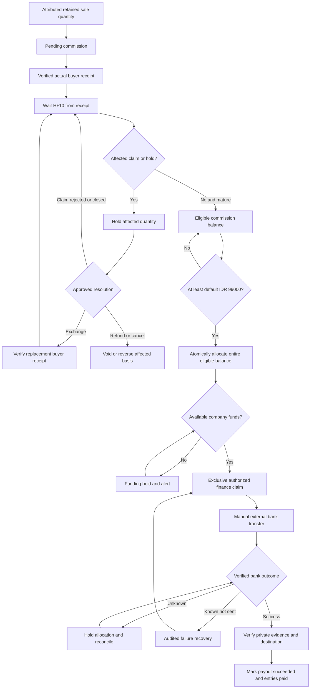

# Money, Refunds and Affiliate Payouts

Status: Accepted contract — implementation and acceptance state is owned by root [STATUS.md](../../STATUS.md); external gates remain open.

Owner: Paduka Ongki. Updated: 2026-10-21.

### BILL-1 — Money lifecycle
- Status: Accepted
- Owner: Finance owner
- Source: CTX-3
- Statement: Track buyer charges, provider receivables/cash, refund and affiliate obligations independently with immutable postings.
- Acceptance: Split-payment totals, subsidy totals, partial refunds and eligible payout balances conserve value across retries and reversals.
- Constraints: None
- Evidence: Implementation and local acceptance evidence is tracked in root [STATUS.md](../../STATUS.md); external gates remain open.
- Changed at: 2026-10-15
- Change history: Initial planning declaration from owner discussion.

## Canonical financial policy
| Policy | Value and provenance |
|---|---|
| Merchandise unit price | PR-1 |
| Shipping subsidy and budget | PR-11 |
| Refund eligibility and buyer reimbursement | PR-7 |
| Affiliate attribution | PR-8 |
| Rate and ten-day maturity | PR-9 |
| Threshold, eligibility queue and manual transfer | PR-10 |
| Cash and settlement recording | PR-12 |

Buyer total = merchandise + quoted shipping - shipping subsidy + permitted disclosed charges. Recommendation accepted by owner: company bears payment surcharge/transfer cost; do not add a payment surcharge merely because refund policy mentions admin charges. Tax inclusion/invoicing is unresolved before launch.

## Commission calculation and snapshots
Commission basis is attributed retained merchandise value; shipping and payment fees are excluded. Affiliate-specific rate overrides platform default. Store rate version, basis, amount, original item and eligibility anchor at sale. Calculate IDR deterministically per sale quantity with exact basis-point arithmetic; owner-delegated default rounding is half-up, recorded per quantity; examples must be verified before financial implementation. Cancellation/full refund voids affected commission; partial refund reverses the affected quantity/value only.

A sale's rate change is never retroactive. An exchange creates no second commission; active exchange holds original commission, verified replacement receipt restarts maturity. Late correction after payment creates a visible adjustment and finance exception rather than deleting payout history. Routine legitimate returns remain governed by the seven-day policy; fraud/exception corrections need review.

## Owner-delegated allocation default
Use quantity-level merchandise entitlements; allocate buyer-paid shipment charges across its item values proportionally and order-wide fees across merchandise values, with integer largest-remainder allocation and stable item-ID tie-break. Freeze those entitlements at checkout; partial return consumes its quantity share once. A final full return pays any residual so cumulative refund equals original buyer payment. Company-paid return/replacement freight is additional company expense, not a deduction from buyer refund. This algorithm is adopted under the owner-delegated recommendation. Verify quantity-level examples and conservation before financial implementation; document acceptance is not runtime proof.

Maturity and holds apply to affected fulfilled quantity. Exchanging one of two units does not delay the other unit or create duplicate commission. Scope adjustments and payout allocations by the same lineage.

## Payout execution and liquidity
Threshold applies to eligible balance, excluding pending, held and already allocated entries. Pay the entire eligible allocated amount, not merely the minimum. The default minimum is IDR 99,000 inclusive (future changes require authorized versioned policy under PR-20): ten matured default IDR 9,900 commissions qualify exactly; nine total IDR 89,100 and do not qualify; eleven total IDR 108,900 and the whole eligible allocated balance is payable. No calendar day 5/20 or monthly cycle applies.

The payout date is independent of Virgo/Mengantar settlement. Company funding covers timing differences; insufficient available cash causes an explained funding hold and alert, not a false success. Automatic eligibility and finance queue creation are distinct from manual external bank completion. Initial execution is manual: finance claims a queued payout exclusively before sending it through an approved company transfer channel, then records amount, verified destination snapshot, transaction reference, transfer time, private evidence and verifier. A receipt upload alone is not paid proof until verified. Show queued/processing/unknown/paid states accurately. Destination must be verified. Transfer charges are company expense and do not reduce the stated affiliate balance. A compatible issued payout contract is a gate only for future automatic transfers, not a blocker for the initial manual workflow. No personal consumer-wallet feature establishes company API payout rights. Unknown outcomes require reconciliation before funds are unallocated or retransferred.

## Split COD and subsidy allocation
Allocate merchandise, buyer-paid shipping and subsidy to each physical shipment once. Sum of collect amounts equals parent checkout total. A carrier collects only its shipment amount. Supported COD reachability is checked for every selected shipment. Proposed initial fallback: all-prepaid or separate order if any shipment cannot support COD; mixed prepaid/COD inside one order is excluded initially.

Refund allocations store merchandise, buyer-paid shipping and any actual permitted buyer-paid fees. Total return of an order refunds all original buyer payment; partial refunds refund related components without duplication. Internal subsidies are company cost, not money owed to the buyer. If provider fees are not refunded, company absorbs them under the full-refund promise. Replacement/return freight for approved company-fault claims is company expense.

## Sources and contract limits
SRC-VIRGO-TERMS prohibits merchant payment surcharge in its published scope and specifies provider procedures for refunds. Confirm the account's issued online-payment contract. SRC-MENGANTAR-BALANCE distinguishes delivered pending COD from reconciled available balance. Do not treat delivered COD as received bank cash.

## Listing and bundle money examples
A listing with Red and Blue options offers each for IDR 99,000; selecting Red quantity one costs IDR 99,000 and both colors as two cart lines cost IDR 198,000. An option containing Product A x1 plus Product B x1 costs IDR 99,000 total, not IDR 198,000. Buying two of that complete option costs IDR 198,000. At default 10 percent, one retained paid offer earns IDR 9,900, whether it contains one, two or more physical units. Inventory-only component costs are HPP, not additional buyer charges or affiliate commissions.

Default return/refund entitlement is the selected offer quantity. For a bundle, refund the complete IDR 99,000 offer and its allocated buyer-paid charges under PR-7, returning available received contents without requiring an originally missing component. Alternatively replace the defective/missing component under the original offer lineage without another sale or commission. Hold only the affected offer quantity until its claim is resolved; component replacement restarts that offer's H+10 from verified replacement receipt. Other offer quantities remain independent. Partial component-only cash refund is not enabled initially; it needs a separately approved allocation contract rather than invented component selling prices.

Allocation example: two IDR 99,000 offers with IDR 15,001 buyer-paid shipping receive IDR 7,501 and IDR 7,500 shipping entitlements by stable-ID largest remainder. Returning the first refunds IDR 106,501; returning the second later refunds IDR 106,500. Total refunds equal the original IDR 213,001; subsidy and company-paid replacement freight never become buyer refund credit.

## Contribution-margin review — PR-19
Estimate retained merchandise contribution as IDR 99,000 minus component HPP, packaging, expected provider/COD fees, attributed commission, allocated company-funded subsidy and an explicit returns/failed-delivery cost allowance. Label assumptions/as-of and keep actual realized margin separate. At default affiliate rate, IDR 89,100 remains before the other costs; this is not profit. Missing HPP/fee assumptions block automatic margin approval. If margin is negative or below the owner-configured floor, require an audited owner exception before publication/promotion; do not invent a numeric acceptable margin. Tax inclusion and applicable obligations remain qualified-review gates.

## Initial transfer operations and future Virgo verification
Manual transfer has no promised immediate bank completion or fixed monthly calendar. Finance works the generated queue, verifies beneficiary, claims one payout, transfers once, checks actual bank outcome and records protected evidence. A failed known-not-sent transfer can be released/retried through the audited recovery path; an uncertain or possibly sent transfer remains held. Claimed payouts cannot silently switch destination. Finance may reconcile an evidence-backed payment without an affiliate withdrawal request; affiliates cannot assert transfer success. Company bears transfer charges.

Public research 2026-10-15: SRC-VIRGO-RECEIVING documents payment acceptance/API integration; SRC-VIRGO-TRANSFER-HELP documents consumer-app bank transfers. Neither establishes merchant disbursement API availability for this account. T-19 requires issued partner documentation/rights, eligible beneficiary rails, fees/limits/funding, authentication, idempotency, status/reconciliation/webhooks and failed/ambiguous sandbox cases before a separately authorized automation change. No Virgo outgoing endpoint is asserted.

Illustrative margin calculation only (not actual HPP or provider fees): IDR 99,000 sale minus IDR 50,000 component HPP, 2,000 packaging, 1,000 provider/COD assumption, 9,900 commission, 5,000 company subsidy and 3,000 return/failed-delivery allowance gives IDR 28,100 estimated contribution. Organic sales use zero affiliate cost only when no affiliate attribution applies. Replace every assumption with actual versioned costs; do not call this example realized profit or a launch margin target.

## Diagram BILL-D1 — Receipt maturity, holds and manual payout
Owner: Finance owner. Engineering owner contributes execution review. Status: Business policy accepted; execution guards proposed for implementation.
Trace: [PR-7, PR-8, PR-9, PR-10, PR-12, PR-20, PR-21](02-PRD.md), [Partial quantity lineage](05-DATA-MODEL.md#partial-quantity-lineage), [Initial transfer operations](#initial-transfer-operations-and-future-virgo-verification).

Automatic behavior ends at eligibility evaluation and finance queue creation; the bank transfer is manual. Finance evidence must match the immutable payout amount, beneficiary and bank reference, and only an authorized verifier can mark success. Claims becoming known after allocation require a guarded finance hold/reconciliation before transfer; they do not bypass the diagram through a direct paid transition. If money already moved, append adjustments and an explicit recovery exception instead of rewriting history.

Late provider callbacks retain actual event time; they do not delay an unaffected valid receipt anchor. Replacement receipt restarts H+10 only for the affected offer quantity; reopening a rejected claim does not silently reset the original anchor. Eligible balance excludes pending, held and allocated entries. The IDR 99,000 inclusive default is versioned under PR-20; it is not a new merchandise price setting. No calendar payout dates or automatic Virgo disbursement are implied.

## Admin costs, contribution and finance reporting
Owner (UI: Super Admin) governs company-wide finance and may grant finance operators explicit cost/expense permissions. Operational screens share the canonical order/ledger history. Configuration controls future inputs; posted transaction history is corrected through linked adjustment/reversal entries. Finance access is never inferred from ordinary catalog-admin access.

Use these distinct report labels, with period, recognition basis, as-of time and missing-cost flags:
- Net merchandise revenue: recognized merchandise after relevant cancellations/refunds; buyer shipping collections are separate.
- Gross merchandise profit: net merchandise revenue minus recognized component HPP.
- Contribution: gross merchandise profit less applicable packaging, provider/COD costs, affiliate cost, company shipping subsidy and other attributed variable costs, without double-counting allocated components. Estimated contribution uses identified assumptions; actual contribution uses observed cost/ledger evidence.
- Operating result: contribution less explicitly recorded operating expenses, including allocated hosting/other overhead. Do not label this final net profit while tax, missing costs or required adjustments are unresolved.
- Cash/receivables/liabilities: actual bank/provider settlement and amounts owed remain separate from revenue and profit. A delivered COD order is not cash received until settlement evidence exists.

Recommended costing baseline: record component acquisition cost per inventory lot; snapshot estimated composition HPP at order and actual lot HPP against fulfilled quantities. Unknown acquisition cost blocks automatic margin approval; the owner may record an explicit bounded exception, never substitute zero silently. Price remains IDR 99,000. New purchase costs update future versions and do not mutate prior orders. Buying inventory and recognizing sold-stock HPP must not both deduct the same amount from contribution. A stock count correction requires quantity/evidence movement and any valuation effect is an explicitly linked financial adjustment.

Admin workflow: draft cost/expense -> validate required facts and scope -> preview affected future offers/estimates -> authorize/save version or post entry -> show audit history. Stale version returns conflict with current data; failed submission preserves inputs; posted corrections create a new linked record. An expense receipt attachment is evidence, not automatic posting approval. Tax treatments and actual HPP/margin floor remain owner/qualified-finance launch data, not values invented by engineering.

Planning arithmetic fixtures (synthetic IDR, not accounting/provider execution):
| Scenario | Expected result |
|---|---|
| One offer, HPP 50,000, packaging 2,000, provider 1,000, affiliate 9,900, subsidy 5,000, returns allowance 3,000 | Estimated contribution 28,100 |
| Historical order HPP 50,000; current component HPP revised to 55,000 | Historical estimate remains 28,100; equivalent future estimate is 23,100 |
| Two-component bundle: A x2 at 15,000 plus B x1 at 20,000 | Bundle HPP 50,000, one offer price 99,000, default commission 9,900 |
| Three equal merchandise entitlements sharing 1,000 shipping | Stable largest-remainder shares 334,333,333; sum 1,000 and full refund conserves original paid total |
| Missing HPP | Estimated/actual contribution incomplete; cannot report a zero-HPP profit |

These fixtures require implementation tests in T-12/T-20/T-21; arithmetic review is planning evidence only.

## Advertising revenue projection — PR-23
Decision: Purchase value follows verified paid/collected merchandise allocations after applicable merchandise reductions; shipping, COD/admin/payment fees and shipping subsidies are excluded. A buyer total is not automatically the ad value. Preserve the original money evidence and currency; use deterministic integer-IDR allocation with any remainder assigned once under a documented rule. Cross-parcel purchase allocations sum to eligible merchandise, never duplicate a parent order total.

Prepaid receipt and COD cash collection are separate from provider remittance, shipment delivery and affiliate maturity. An authentic event proving collection is required; delivered alone is insufficient. Returned/refused uncollected COD has zero purchase value. Refunds/reversals adjust internal net revenue and link original conversion; vendor adjustment support must be proven separately. Never send negative Purchase or claim Data Manager value restatement removes conversion count. Reports show gross eligible purchase value, refunds/net value, suppressed/unmatched delivery and distinct paid orders separately from purchase instances.

## S16 prospective cost checkpoint boundary

Implement acquisition-cost versions per physical SKU and explicit versioned offer assumptions before publication. Unknown values stay null; finance.costs.read/write are required for finance operators, while owner has company authority. Ecommerce/warehouse roles cannot read costs. Publication cost snapshots preserve immutable source IDs/quantities, the commercial commission version and owner-controlled margin floor (initial0 when absent from historical commercial values). Estimated HPP/contribution remain distinct from actual recognized costs/cash. Existing owner reauthentication is extended only with catalog_publication.exception bound to the exact product and session; no general exemption flag or cross-purpose proof is accepted. Missing/low reasons must remain visible without leaking financial amounts to ordinary catalog staff.

## S17 subsidy budget boundary

Shipping subsidy is one parent-order benefit, allocated once across actual eligible parcels. Percentage values use exact basis points and deterministic integer rounding. Stacking cannot discount the same shipping rupiah twice; priority/UUID order and remaining-charge weighting are explicit. Campaign funds reserve/commit and per-customer held/used counts are immutable-movement backed; config editing cannot erase encumbrances. Expiry/release cannot credit another reservation or a previously consumed commitment. These budget counters do not recognize expense/cash; actual shipping/provider postings and verified reversals remain their later domains.

Quote pricing must re-evaluate promotional cost against the S16 financial review and current immutable source references; customer-visible promotion eligibility must not silently approve unknown/negative contribution. Caller-controlled identity/amounts or a leaked lease ID never grant budget authority. Real quote/order ownership and promotional margin enforcement are S19/S20 integration requirements; pending/confirmed purchase retention is S27, and booking/actual-cost/reversal evidence is S30/S31.

## S17 implemented boundary

S17 campaign commitment is separate from financial ledger/cash. Configuration budget cannot fall below reserved+committed; quota reductions affect new claims. Complete combinations reserve atomically or fail, and release/expiry restores only their own allocation. Consume moves reserved to committed exactly once, without inventing actual carrier expense or refund. Paid-order retention/booking/cancellation recovery must extend/reverify S20/S27/S30/S31. S19/S20 must evaluate actual allocated promotional subsidy with current PR-19 cost/publication sources and bounded owner approval before exposing benefits.

## S19 trusted shipping contract

S19 current promotional-contribution guard replaces the per-offer estimated subsidy with actual allocated shipment subsidy, preserving native BigInt integer IDR and source references. Known complete above-floor quotes may proceed; unknown/below-floor benefits require a current publication owner exception plus a known bounded subsidy allowance. Changed sources or excess/unknown allowance require renewed review. Quote preview does not reserve campaign funds, consume stock, book shipment or post cash/expense; S20/S27/S30 own those atomic transitions.

S19 unit-level refinement: check the worst integer per-unit share within each shipment/line allocation, not only the aggregate cart/line margin. A profitable unit in another parcel cannot extend a frozen per-unit owner subsidy allowance or hide a below-floor unit. Exact largest-remainder totals remain conserved.

S19 uses the current commercial default commission in the initial path. S32 must extend/reverify quote and order contribution with actual effective affiliate override versions before enabling them. Higher commission cannot silently inherit a frozen default-rate owner exception; capture the actual source and preserve per-unit financial approval bounds.

## S20 pending-order economic boundary

A pending local order reserves physical components and selected shipping subsidy/quota atomically for30 business minutes. Quotes alone reserve nothing. Merchandise remains quantity×99000; gross shipping=subsidy+buyer shipping, buyer total=merchandise+buyer shipping. COD parcel due is each parcel's merchandise+net shipping; it does not mark collection/payment/delivery. Original parcel/unit allocations conserve integers and never discount merchandise.

Current prospective financial sources and publication approval are rechecked at actual database wall time after relevant locks, even in a synthetic business-clock scenario. Selected promotion versions/amounts must still match; budget/quota failure rolls back stock/order creation. A normalized buyer-contact HMAC is a quota heuristic, not verified identity or authorization. No financial posting/Purchase/paid state is inferred by submit. Verified receipt/paid retention/COD confirmation and partial shipping consumption remain S23/S24/S27/S28/S30 gates.

Expiry takes business clock then order row before promotion roots/counters/reservation and stock reservation/balances. Legacy stock/promotion expiry jobs delegate to the owning order before taking reservation locks. Only the currently claimed job completes; another claimed job may be waiting for that order. Unfunded expiry releases both holds and appends exactly one cancellation event in the same transaction as job completion. Confirmed/paid retention requires the later reviewed transition, never silent release or reuse of transfer consumption.

## S23 collection and journal boundary — implementation in progress

Collection and settlement remain distinct: verified prepaid/COD evidence records a provider receivable and equal buyer-funds liability. No bank cash, delivery, commission maturity, finalized revenue, recognized HPP or profit follows from this primitive. Receipt breakdown uses the frozen order/parcel merchandise and net buyer shipping; internal subsidy is excluded from collected money. Duplicate event/economic references replay one immutable receipt/journal; different effects cannot claim the same order/parcel allocation. A balanced full reversal links the original transaction and cannot rewrite its receipt. Caller-owned transactions roll back the receipt and every posting together on failure. S24/S28 own verified event adapters and late/duplicate-payment exceptions, S30 settlement, S34 recognized reporting.

## S24 prepaid attempts and recovery — implementation contract

Separate provider intent creation, actual collection, company settlement and order fulfillment. Authenticate and persist individual local simulator events before processing; unique event delivery is not economic identity. Callback duplicates/late delivery/out-of-order notifications cannot create another receipt or downgrade verified paid truth. A provider commit followed by lost acknowledgement stays unknown until the original operation is reconciled. Retrying the same first-party request returns its same attempt after current ownership is rechecked.

Use S23 provider-receivable/buyer-funds-liability postings for actual verified collection, in the same caller transaction as accepted funding/result evidence. Late or conflicting funds retain durable recovery rather than silently reacquiring released stock or inventing bank cash. Original buyer price, shipping/subsidy and deadline snapshots remain unchanged; payment surcharges stay company cost. No provider credentials, live transfer, settlement, recognized profit or Purchase follows from a pending attempt.

The deadline is exclusive: collection exactly at expiry is late. An actual prepaid receipt on an expired order records received funds, never permission to fulfill. S25 must decide Purchase eligibility from accepted funding outcome, not receipt existence alone; recovery and unallocated-liability adjustments are ineligible. A mismatched collection remains an explicit recovery case and blocks another automatic attempt while allocation is unresolved. No automatic refund or replacement charge is inferred.

Local host commands may reconcile the exact existing attempt and retry a failed callback without replaying a charge. Append-only operational audit preserves the original job identity, previous status, previous retry count and safe previous error code when a new retry batch begins. These are developer-host commands behind the fixed local profile, not public HTTP or merchant-provider operations. Native and built-browser proof remain mandatory before S24 acceptance.

## S28 COD acceptance and collection contract

A valid final COD checkout is confirmed automatically by the server in the same order transaction, after current authority, complete stock, chosen package rates, COD reachability, subsidy and frozen totals pass. This is the buyer's final order confirmation, not a collected payment. Preserve the original initial order event, then append one COD confirmation event with immutable actionable_at equal to the accepted checkout's original created_at. Original checkout expiry remains historical; an accepted COD hold is protected until fulfillment/cancellation owns it. Unaccepted legacy COD orders retain their original expiry behavior and are never silently backfilled.

Order payment states add cod_due after acceptance and partially_collected when fewer than all original parcels have an accepted collection receipt; confirmed means every original COD parcel has an accepted receipt. The actionable timestamp never changes on collection. Per-parcel refusal/reconciliation remains separate from order payment state, delivery and provider/company settlement. New local source operations and signed events commit independently of callback processing; original source identity survives acknowledgement loss. A known original collection reference cannot change status, amount or occurrence. A distinct authentic extra collection records a recovery receivable/liability and never reallocates already purchased units. Refusal is zero money and zero Purchase.

Each accepted collected parcel atomically commits its original economic receipt, exact balanced receivable/liability postings, immutable result, order payment event/head and canonical Purchase/full original parcel-unit allocation plus three platform decisions in the existing database job transaction. Shipping and subsidy are excluded from Purchase. Same-item quantities split across warehouses allocate only their own original fulfillment occurrences; cumulative allocations cannot exceed purchased quantity. Prepaid behavior remains unchanged. Browser status, delivery and settlement flags are never collection proof. Authenticated local provider simulation is not a Mengantar API compatibility claim.

The private GET /orders/{orderId}/cod-collections projection uses the existing account or single-order capability and narrow order cookie; visitor/cart context never authorizes it. It exposes frozen parcel dues, accepted collected totals, original receipt/time and bounded due/collected/refused/reconciliation state, never source signatures, contact, HPP or settlement claims. Host-only collect/refuse/reconcile commands operate on original shipment IDs without live credentials or network. Mapping real provider messages, shipment lifecycle/waybill and settlement remain their separate task owners.

S29 selected shipment consumption: physical handover consumes only its original parcel component quantities and does not create collection, revenue, Purchase or settlement. Complete original stock consumption closes the parent checkout hold. Shipping-promotion budget/quota represents one parent benefit: first physical handover consumes that benefit once, while frozen per-parcel discount allocations remain unchanged for financial reporting and later recovery. This operational commitment is not a carrier expense or cash movement. Retained actionable orders may consume their holds after checkout expiry; original deadlines never extend.

## S30 selected local settlement contract

Implementation boundary: S30 source, reviewed applied schema, allocation and private endpoints have executed local app-role/browser proof; actual final combined review and exact boundary closure passed in RUN-20261016T194052Z-6dfa4b01. Reuse original qualified collection receipts and authenticated late/extra recovery receivable journals. A remittance settles verified provider receivables; it never creates collection, delivery or another merchandise Purchase. Revenue, actual HPP and final contribution reporting remain their own S34 sources.

An authenticated local bank observation records company cash once, against settlement clearing, before matching references. The original provider/reference, environment, direction, net money and money-occurrence time are immutable. Signed statement versions may subsequently provide complete gross/fee/allocation facts without another cash effect. Unknown fees/gross remain explicit null and prevent matching, rather than becoming zero. Malformed signatures/foreign profiles are rejected; a valid bank observation with unresolved references preserves actual cash and a recoverable reconciliation item. This is an owned TEST-ONLY simulator protocol, not a Virgo/Mengantar message format.

A known statement requires integer IDR gross = net + observed carrier fees + observed provider fees. Partial matching is explicit. Allocate net to original gross portions by stable-ID largest remainder, then allocate carrier fees within the resulting fee portions; provider fees are the residual. This two-stage calculation conserves every row and each statement fee category without independent rounding making a small row negative. Include a separate unmatched gross remainder for arithmetic only, never a fabricated receipt. Zero-net statements can still carry real receivable/fee reconciliation; matched status depends on all gross portions, not only remaining cash.

Known authenticated statement fees post once against settlement clearing, independently of whether order references are matched. This preserves actual company expense for a zero-net deduction. Unknown or inconsistent fee facts remain unresolved, never zero. Each active match links exact original verified receivable journals and balanced gross clearing/receivable postings, retaining the exact net/carrier/provider attribution per original portion. Total active credited gross minus authenticated reopening cannot exceed original receivable money. A remittance reversal is a separate authenticated cash-debit source referencing original credited allocations; reopening gross and returned fees cannot exceed those original allocations. Unsupported or over-claimed reversal facts preserve actual observed cash as an unresolved clearing item, never fabricated negative sales or a new Purchase.

Manual match/correction requires current owner or explicitly granted finance authority, version, original verified statement reference, reason and purpose-bound fresh reauthentication. A correction explicitly names the current match and appends its full linked journal reversal plus a new match atomically; any changed applied statement-fee journal is also reversed/replaced with explicit lineage. Guarded unmatch reverses only the matching classification and restores clearing while preserving actual cash and authenticated fee history. Cash/source/receipt history is never edited. Reverse dependent reopening matches first when they prevent a safe parent correction. Escalation records an unresolved exception and explanation; it cannot relabel unverified bank movement as success. No raw ledger-posting or transfer-success input is accepted from clients.

S30 dependent fee policy: unmatching a debit child reverses matching only; its authenticated fee return remains recorded. Once a credited statement is used as an applied debit-fee basis, parent fee-category corrections remain blocked even when that child is unmatched or escalated. Store the newer signed statement and keep the difference as an explicit finance exception with both statement and recorded-fee references. Do not infer that unmatching undoes a real expense return, invent a bank transfer, or erase the original fees. Resolving such a historical expense discrepancy requires the separately specified linked actual-cost adjustment under S34 and its own evidence; S30 does not silently rewrite it. Ordinary parent matching can be corrected after active dependent matches are reversed when fee amounts remain unchanged.

Finance decisions finalize their response once in the same transaction as the exact immutable transition and audit. A committed finance decision cannot be edited, deleted, retargeted or given a different replay response. Older scoped access-operation purposes retain their existing behavior.

## S31 obligation and outgoing-refund boundary

Executed in actual app-role localhost lifecycle/recovery/native tests; full S31 acceptance remains pending in root STATUS. A normal partial-order refund consumes whole purchased FulfillmentItem units:99000 plus each frozen buyer-paid shipping share, with no invented component value, internal subsidy credit or provider-fee deduction. Eligibility requires actual buyer receipt and timely initial claim; refund qualification additionally requires the original authenticated collected-payment receipt. Delivery never implies collection.

An authorized approved/inspected case may create one immutable refund obligation and allocation. Queueing that obligation debits buyer_funds_liability and credits refund_payable; it does not move cash. A verified successful original outgoing effect debits refund_payable and credits company_cash exactly once, in the same transaction as unit confirmation and linked retained-merchandise adjustment intent. Known failed/no-effect attempts keep the real obligation available for guarded retry; an unknown outcome stays held until original-source reconciliation. No client success flag or attachment pays a refund.

Current finance.refunds.read/write authority, fresh subject/session-bound finance.refund proof and version/intent checks protect finance actions. Every historical allocation and original Purchase stays immutable. Unaffected units and their refund/commission basis remain independent. S34 recognizes later realized revenue/HPP/expense reporting; S36 consumes quantity adjustment/hold lineage. This implementation does not invent either later report.

COD must display awaiting_destination until separately verified original-buyer-bound synthetic destination evidence is accepted under the owned localhost protocol. No real Virgo/Mengantar beneficiary or outgoing API is asserted. Prepaid refund follows the actual original local payment operation. Issued merchant rails, bank verification and live acceptance remain separate gates.

Refund money qualification is independent of advertising capture. The actual local audit found15 historical qualified collections without Purchase. Retain a receipt-linked adjustment intent and explicit missing-original-Purchase reason, with no platform dispatch/backfill. For a known original Purchase, preserve its link/time and consent rules; refund confirmation never emits a new Purchase. Cash/refund allocation proceeds from authentic original collected-payment evidence, not an ad event or Pixel setup.

S31 signed bank confirmation produces a receipt-linked adjustment intent per successful refund/receipt. merchandise_refunded is the current refund's merchandise increment; retained_merchandise is original receipt merchandise less all successfully refunded original units including this refund. Allocation identifies only this refund's exact original units, while sequence orders committed adjustments for the original receipt. Preserve signed original bank confirmed_at even when callbacks arrive late. A missing original Purchase keeps original_purchase_missing, with no dispatch/backfill or new Purchase. No platform adapter mapping is accepted in S31.

The executed existing-host classification audit additionally rejected an unqualified primitive: of97 missing-Purchase economic receipts,15 actual original collected receipts passed signature/journal/unit verification and82 internal primitives did not qualify as original collection. Accounting balance or a table row is insufficient proof of money received. No new receipt/journal/Purchase was created by the audit; it does not prove complete legacy cash refund execution.

S32 replacement parcels stay outside the original COD/receivable parcel set and charge the buyer zero. A later faulty replacement claim still points to the original unit's collected entitlement; all its outstanding/succeeded obligations share that one cap. Physical intake caps belong to each actual delivery occurrence instead. Effective affiliate override costs are evaluated for zero-subsidy and promotional sales, using half-up rounding per original IDR99000 quantity. Higher commission cannot inherit a default-rate publication exception. Only current prospective owner-authorized rate versions enter a new quote/order; older sale/commission/Purchase snapshots remain immutable. Applied0022 enforces this local model after separate exact native/application gates. Quantity commission accrual/maturity remains S36; current runtime acceptance belongs to STATUS.

Applied0022 independently derives attributed checkout cost from the current verified affiliate stream, real-time commercial/cost versions and exact parcel integer subsidy shares. It checks a new quote and initial order commit, including zero subsidy; no client commission or as-of timestamp is authoritative. Committed order replay precedes new affiliate eligibility/cost evaluation, so a prospective rate change cannot rewrite the sale. Replacement source jobs carry zero COD due and stay outside every original economic/Purchase allocation. Actual app-role COD/prepaid physical and replacement-refund flows preserve original receipts, frozen per-unit shipping and balanced cash allocation; current evidence and acceptance are recorded in STATUS/the ledger.

Historical candidate failures, corrected rollback proof and separate exact application/upgrade gates remain in BUILD-LOG/the ledger. Both installed targets now retain140 tables/23 matching migrations; all46 applied SQL/snapshots and prefix23 are immutable. The isolated legacy proof preserves original collection and refund capacity without Purchase/ad backfill. It grants no additional executor invocation, DDL or live financial action.

## S33 selected recovery money contract — implementation pending

Late payment after expiry and amount-mismatch/conflicting collection remain original authenticated buyer-funds liabilities, with no revived stock, fulfillment or second Purchase. Finance compensation must identify the original signed operation/event and immutable receipt/journal. Total pending plus successful compensation and ordinary return allocations cannot exceed the same original collected capacity or duplicate a purchased unit's frozen entitlement. Source/unit locks and deferred native guards enforce this across both paths; a new case ID is never a new refund allowance.

Queueing compensation creates one balanced obligation and exact creation job, with no outgoing-cash assertion. Prepaid compensation follows the authenticated original rail. COD money, if actually collected, requires independent verified destination authority belonging to the original buyer. A signed zero-money refusal creates neither refund payable nor cash; actual returned goods and incurred carrier costs are separate evidence. Cash postings require the authenticated bank-result callback and completion of its exact job in the same transaction. Unknown/lost acknowledgements preserve the same attempt/source/obligation; a new attempt is allowed only after a proved zero-money failure with new current finance authorization.

An expired exact collection may have an original economic receipt but no Purchase. Preserve that receipt and no-backfill reason when compensating it. Unallocated mismatched money has no invented merchandise/Purchase allocation. For a genuine purchased-offer cancellation/refund, preserve original99,000 pricing and frozen buyer-paid shipping allocation, reference the original Purchase when present and create its linked adjustment obligation without rewriting the original event. Unaffected delivered quantities, receipts and financial parcels remain unchanged. Tax/actual cost recognition and provider ad adjustment mappings retain their existing owners.

A physical failed/refused parcel is not evidence of money or restored stock. Returned components enter quarantine only after actual scoped intake; inspect before any sellable release. No status shortcut can offset missing funds with imaginary stock or vice versa. The selected contract requires new implementation and exact native review; no S33 money action, DDL or external transfer is authorized by this document alone.

S33 concrete model requires one atomic finance authorization/response batch but a distinct immutable refund obligation and original rail per original collection source. A single physical replacement is not permission to merge its original COD parcels into one fictitious source. Keep independent pending/failed/unknown/succeeded states; expose every safe buyer refund and aggregate completion only after all actual outcomes are known. New recovery_obligation/recovery_cash kinds use existing balanced liability/payable/cash accounts and require dedicated source/job/result/reversal guards. Ordinary-return and recovery adjustment writers must share cumulative merchandise and one receipt sequence, with the original receipt transaction locked through the check/commit. Draft types/schema checks alone establish none of those native guarantees.

Refund proposal and acceptance now have internal original-source qualification/capacity checks. They record no obligation, cash, allocation, job or stock effect and reserve no refund allowance. The later finance action must qualify/reserve current capacity again under the same original journal/unit locks. A qualified original late receipt is valid without Purchase; an unallocated source remains refundable money without invented units or an economic receipt. CS/buyer consent is not finance authorization or a bank outcome. New native helpers and these writers remain unexecuted behind S33_STOP.

S33 C2 COD example: two original units cost99,000 each with10,000 allocated buyer shipping each, so the original order/parcel snapshot is218,000. If one unit is explicitly retired before a new COD collection source is created, that source freezes only the remaining unit and109,000. Its qualified receipt contains99,000 merchandise plus10,000 shipping; Purchase merchandise value is99,000. The cancelled unpaid unit gains no refund entitlement from that receipt. If an earlier source already collected218,000 for both units, its original scope and receipt remain218,000; an authorized refund can compensate the actually funded cancelled unit and its frozen shipping. Never rewrite the old source, borrow another unit's collection or invent a second Purchase.

A valid original source that becomes late/unfulfillable still records its exact original qualified receipt and a late_collection recovery, with no Purchase or physical intent revival. An empty new source scope cannot qualify purchased goods; any actual positive amount is an unallocated liability. Pending compensation and ordinary/recovery capacity continue to share the same original journal. The local source unit list is database-owned metadata reached through the original signed operation identity; it is not an issued external provider field. These branches remain unexecuted until full native/source/worker gates pass.

S33 C3 subsidy example: an original parcel has two unit subsidy shares51 and50 and two campaign allocations61 and40. Stable original interval partition assigns unit1:51 from campaign1, unit2:10 from campaign1 plus40 from campaign2. Cancelling either unit releases exactly its original subsidy and preserves the surviving unit's original buyer-paid shipping; there is no current campaign re-evaluation. Across any cancellation subset, both original campaign budgets and original unit subsidies conserve every rupiah. This is campaign-budget accounting, separate from buyer refunds and carrier expense.

A partial reserved release retains that campaign's held buyer use; releasing its last reserved benefit removes that one held use. First physical handover commits only the remaining reserved benefit once. Subsequent cancellation of an undispatched original unit releases its unused committed subsidy while retaining the committed buyer use, including a parcel that had no subsidy of its own. An already dispatched unit cannot use this cancellation path; replacement cancellation cannot release original shipping subsidy. The shared primitive/native draft remains source-only until complete final staff action and exact candidate/application/runtime gates.

The current subsidy/native definitions passed one exactly reviewed owned-cluster definition-only rollback test. No buyer money, refund obligation, stock cancellation, cash or advertising business path was executed by that test; original source amounts and both installed140/23 schemas remained unchanged. Full source/capacity/authority/concurrency and final staff/finance application gates remain pending.

Internal CS apply now requalifies actual funded original units against frozen receipt membership, existing ordinary/recovery quantity allocations and the shared original collection capacity. A partially funded COD case exposes finance follow-up only for its funded original quantities; unpaid retired units acquire no refund from surviving-unit receipts. Retiring a zero-charge replacement does not add a purchased entitlement. An explicitly accepted refund_original_entitlement alternative can still reference that replacement's original purchased unit and the same one original cap. Source qualification is repeated by the later finance writer; apply reserves no allowance and creates no refund obligation, cash, bank instruction or new Purchase.

Unused original shipping subsidy releases only for original stock_disposition=released cancellations. Already handed/consumed original goods and replacement cancellations release no original shipping benefit or committed buyer use. Actual goods intake, buyer refunds and incurred carrier costs remain separate facts. The application and native definitions remain source-only; complete money/source/job/cash/adjustment/ACL and transactional gates remain pending.

C4 parent completion and stock resolution do not change the original merchandise, shipping, subsidy or buyer-total snapshot. Current original/replacement cancellation markers remain separate from actual buyer receipt and successful outgoing money. The buyer Order projection now stages combined ordinary/recovery obligation totals and distinct original refunded-unit counts; unallocated compensation adds no merchandise allocation. An original cancellation cannot make a replacement chargeable, restore stock or imply successful refund. Native hold/promotion/parent state follows actual original component and ledger history, preserving consumed goods and committed buyer usage. New combined branches remain unexecuted; finance/source/cash/adjustment closure remains pending.

Current C4 definition evidence: exact r21 PASS1 created165 relations/88 distinct functions from SQL546145... inside a fresh owned rollback transaction; no business path was invoked. The owned project is stopped/data retained, both installed140/23 targets and protected migration prefix remain unchanged, and the one invocation permission is consumed. STATUS and BUILD-LOG retain exact source/executor/result bindings; business/native completeness and full S33 acceptance remain pending.

Replacement retirement releases only its own unused physical reservation and creates no second purchased entitlement or new charge. Surviving handover consumes only accepted booking quantities; together with actual retired releases these must conserve every immutable original held component. Cancelling a replacement does not mark the original return claim received or financially resolved. Its original-source refund/claim continuation remains separately gated and incomplete. Current source is staged after the historical r21 definition checkpoint; corrected r23 source review and new native/business/transport acceptance remain pending.

Opening or resolving a replacement stock wait posts no receipt, refund obligation, cash, additional purchased quantity or Purchase. Recovery is excluded once retirement or an original-source recovery obligation exists. Pending return-claim finance continuation and the shared original unit/source capacity remain separate unfinished owners. Actual r24 approves bounded source only at SQL66cc0...; new native/business/transport/full acceptance remains pending.

An accepted replacement retirement keeps the original claim held for its separate authorized remedy. It cannot mark the original received, released, refunded or financially resolved. Physical cancellation adds no obligation, transfer, allowance or purchased unit. Original-source recovery queue/cash and successful mixed replaced/refunded claim completion remain unfinished. Actual r25b approves bounded partial source only at SQL9be368...; full native/business/transport acceptance remains pending.
