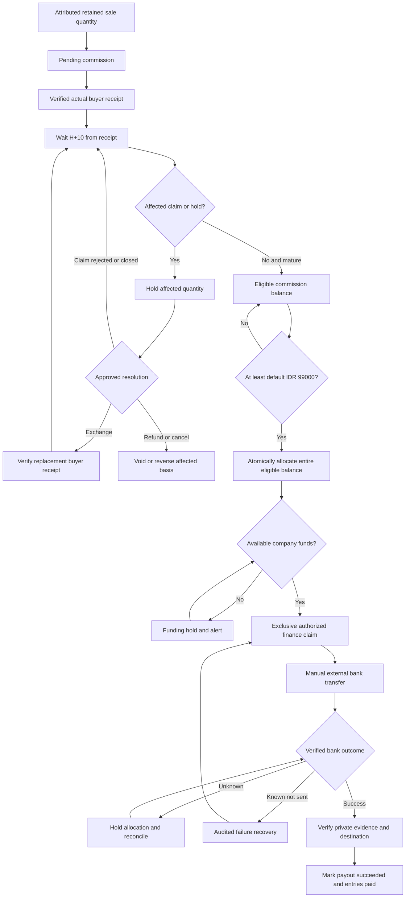

# Money, Refunds and Affiliate Payouts

Status: Draft — planning only; no application or runtime verification.

Owner: Paduka Ongki. Updated: 2026-10-15.

### BILL-1 — Money lifecycle
- Status: Proposal
- Owner: Finance owner
- Source: CTX-3
- Statement: Track buyer charges, provider receivables/cash, refund and affiliate obligations independently with immutable postings.
- Acceptance: Split-payment totals, subsidy totals, partial refunds and eligible payout balances conserve value across retries and reversals.
- Constraints: None
- Evidence: None; execution pending.
- Changed at: 2026-10-15
- Change history: Initial planning declaration from owner discussion.

## Canonical financial policy
| Policy | Value and provenance |
|---|---|
| Merchandise unit price | PR-1 |
| Shipping subsidy and budget | PR-11 |
| Refund eligibility and buyer reimbursement | PR-7 |
| Affiliate attribution | PR-8 |
| Rate and ten-day maturity | PR-9 |
| Threshold, eligibility queue and manual transfer | PR-10 |
| Cash and settlement recording | PR-12 |

Buyer total = merchandise + quoted shipping - shipping subsidy + permitted disclosed charges. Recommendation accepted by owner: company bears payment surcharge/transfer cost; do not add a payment surcharge merely because refund policy mentions admin charges. Tax inclusion/invoicing is unresolved before launch.

## Commission calculation and snapshots
Commission basis is attributed retained merchandise value; shipping and payment fees are excluded. Affiliate-specific rate overrides platform default. Store rate version, basis, amount, original item and eligibility anchor at sale. Calculate IDR deterministically per sale quantity with exact basis-point arithmetic; owner-delegated default rounding is half-up, recorded per quantity; examples must be verified before financial implementation. Cancellation/full refund voids affected commission; partial refund reverses the affected quantity/value only.

A sale's rate change is never retroactive. An exchange creates no second commission; active exchange holds original commission, verified replacement receipt restarts maturity. Late correction after payment creates a visible adjustment and finance exception rather than deleting payout history. Routine legitimate returns remain governed by the seven-day policy; fraud/exception corrections need review.

## Owner-delegated allocation default
Use quantity-level merchandise entitlements; allocate buyer-paid shipment charges across its item values proportionally and order-wide fees across merchandise values, with integer largest-remainder allocation and stable item-ID tie-break. Freeze those entitlements at checkout; partial return consumes its quantity share once. A final full return pays any residual so cumulative refund equals original buyer payment. Company-paid return/replacement freight is additional company expense, not a deduction from buyer refund. This algorithm is adopted under the owner-delegated recommendation. Verify quantity-level examples and conservation before financial implementation; document acceptance is not runtime proof.

Maturity and holds apply to affected fulfilled quantity. Exchanging one of two units does not delay the other unit or create duplicate commission. Scope adjustments and payout allocations by the same lineage.

## Payout execution and liquidity
Threshold applies to eligible balance, excluding pending, held and already allocated entries. Pay the entire eligible allocated amount, not merely the minimum. The default minimum is IDR 99,000 inclusive (future changes require authorized versioned policy under PR-20): ten matured default IDR 9,900 commissions qualify exactly; nine total IDR 89,100 and do not qualify; eleven total IDR 108,900 and the whole eligible allocated balance is payable. No calendar day 5/20 or monthly cycle applies.

The payout date is independent of Virgo/Mengantar settlement. Company funding covers timing differences; insufficient available cash causes an explained funding hold and alert, not a false success. Automatic eligibility and finance queue creation are distinct from manual external bank completion. Initial execution is manual: finance claims a queued payout exclusively before sending it through an approved company transfer channel, then records amount, verified destination snapshot, transaction reference, transfer time, private evidence and verifier. A receipt upload alone is not paid proof until verified. Show queued/processing/unknown/paid states accurately. Destination must be verified. Transfer charges are company expense and do not reduce the stated affiliate balance. A compatible issued payout contract is a gate only for future automatic transfers, not a blocker for the initial manual workflow. No personal consumer-wallet feature establishes company API payout rights. Unknown outcomes require reconciliation before funds are unallocated or retransferred.

## Split COD and subsidy allocation
Allocate merchandise, buyer-paid shipping and subsidy to each physical shipment once. Sum of collect amounts equals parent checkout total. A carrier collects only its shipment amount. Supported COD reachability is checked for every selected shipment. Proposed initial fallback: all-prepaid or separate order if any shipment cannot support COD; mixed prepaid/COD inside one order is excluded initially.

Refund allocations store merchandise, buyer-paid shipping and any actual permitted buyer-paid fees. Total return of an order refunds all original buyer payment; partial refunds refund related components without duplication. Internal subsidies are company cost, not money owed to the buyer. If provider fees are not refunded, company absorbs them under the full-refund promise. Replacement/return freight for approved company-fault claims is company expense.

## Sources and contract limits
SRC-VIRGO-TERMS prohibits merchant payment surcharge in its published scope and specifies provider procedures for refunds. Confirm the account's issued online-payment contract. SRC-MENGANTAR-BALANCE distinguishes delivered pending COD from reconciled available balance. Do not treat delivered COD as received bank cash.

## Listing and bundle money examples
A listing with Red and Blue options offers each for IDR 99,000; selecting Red quantity one costs IDR 99,000 and both colors as two cart lines cost IDR 198,000. An option containing Product A x1 plus Product B x1 costs IDR 99,000 total, not IDR 198,000. Buying two of that complete option costs IDR 198,000. At default 10 percent, one retained paid offer earns IDR 9,900, whether it contains one, two or more physical units. Inventory-only component costs are HPP, not additional buyer charges or affiliate commissions.

Default return/refund entitlement is the selected offer quantity. For a bundle, refund the complete IDR 99,000 offer and its allocated buyer-paid charges under PR-7, returning available received contents without requiring an originally missing component. Alternatively replace the defective/missing component under the original offer lineage without another sale or commission. Hold only the affected offer quantity until its claim is resolved; component replacement restarts that offer's H+10 from verified replacement receipt. Other offer quantities remain independent. Partial component-only cash refund is not enabled initially; it needs a separately approved allocation contract rather than invented component selling prices.

Allocation example: two IDR 99,000 offers with IDR 15,001 buyer-paid shipping receive IDR 7,501 and IDR 7,500 shipping entitlements by stable-ID largest remainder. Returning the first refunds IDR 106,501; returning the second later refunds IDR 106,500. Total refunds equal the original IDR 213,001; subsidy and company-paid replacement freight never become buyer refund credit.

## Contribution-margin review — PR-19
Estimate retained merchandise contribution as IDR 99,000 minus component HPP, packaging, expected provider/COD fees, attributed commission, allocated company-funded subsidy and an explicit returns/failed-delivery cost allowance. Label assumptions/as-of and keep actual realized margin separate. At default affiliate rate, IDR 89,100 remains before the other costs; this is not profit. Missing HPP/fee assumptions block automatic margin approval. If margin is negative or below the owner-configured floor, require an audited owner exception before publication/promotion; do not invent a numeric acceptable margin. Tax inclusion and applicable obligations remain qualified-review gates.

## Initial transfer operations and future Virgo verification
Manual transfer has no promised immediate bank completion or fixed monthly calendar. Finance works the generated queue, verifies beneficiary, claims one payout, transfers once, checks actual bank outcome and records protected evidence. A failed known-not-sent transfer can be released/retried through the audited recovery path; an uncertain or possibly sent transfer remains held. Claimed payouts cannot silently switch destination. Finance may reconcile an evidence-backed payment without an affiliate withdrawal request; affiliates cannot assert transfer success. Company bears transfer charges.

Public research 2026-10-15: SRC-VIRGO-RECEIVING documents payment acceptance/API integration; SRC-VIRGO-TRANSFER-HELP documents consumer-app bank transfers. Neither establishes merchant disbursement API availability for this account. T-19 requires issued partner documentation/rights, eligible beneficiary rails, fees/limits/funding, authentication, idempotency, status/reconciliation/webhooks and failed/ambiguous sandbox cases before a separately authorized automation change. No Virgo outgoing endpoint is asserted.

Illustrative margin calculation only (not actual HPP or provider fees): IDR 99,000 sale minus IDR 50,000 component HPP, 2,000 packaging, 1,000 provider/COD assumption, 9,900 commission, 5,000 company subsidy and 3,000 return/failed-delivery allowance gives IDR 28,100 estimated contribution. Organic sales use zero affiliate cost only when no affiliate attribution applies. Replace every assumption with actual versioned costs; do not call this example realized profit or a launch margin target.

## Diagram BILL-D1 — Receipt maturity, holds and manual payout
Owner: Finance owner. Engineering owner contributes execution review. Status: Business policy accepted; execution guards proposed for implementation.
Trace: [PR-7, PR-8, PR-9, PR-10, PR-12, PR-20, PR-21](02-PRD.md), [Partial quantity lineage](05-DATA-MODEL.md#partial-quantity-lineage), [Initial transfer operations](#initial-transfer-operations-and-future-virgo-verification).

Automatic behavior ends at eligibility evaluation and finance queue creation; the bank transfer is manual. Finance evidence must match the immutable payout amount, beneficiary and bank reference, and only an authorized verifier can mark success. Claims becoming known after allocation require a guarded finance hold/reconciliation before transfer; they do not bypass the diagram through a direct paid transition. If money already moved, append adjustments and an explicit recovery exception instead of rewriting history.

Late provider callbacks retain actual event time; they do not delay an unaffected valid receipt anchor. Replacement receipt restarts H+10 only for the affected offer quantity; reopening a rejected claim does not silently reset the original anchor. Eligible balance excludes pending, held and allocated entries. The IDR 99,000 inclusive default is versioned under PR-20; it is not a new merchandise price setting. No calendar payout dates or automatic Virgo disbursement are implied.

## Admin costs, contribution and finance reporting
Owner (UI: Super Admin) governs company-wide finance and may grant finance operators explicit cost/expense permissions. Operational screens share the canonical order/ledger history. Configuration controls future inputs; posted transaction history is corrected through linked adjustment/reversal entries. Finance access is never inferred from ordinary catalog-admin access.

Use these distinct report labels, with period, recognition basis, as-of time and missing-cost flags:
- Net merchandise revenue: recognized merchandise after relevant cancellations/refunds; buyer shipping collections are separate.
- Gross merchandise profit: net merchandise revenue minus recognized component HPP.
- Contribution: gross merchandise profit less applicable packaging, provider/COD costs, affiliate cost, company shipping subsidy and other attributed variable costs, without double-counting allocated components. Estimated contribution uses identified assumptions; actual contribution uses observed cost/ledger evidence.
- Operating result: contribution less explicitly recorded operating expenses, including allocated hosting/other overhead. Do not label this final net profit while tax, missing costs or required adjustments are unresolved.
- Cash/receivables/liabilities: actual bank/provider settlement and amounts owed remain separate from revenue and profit. A delivered COD order is not cash received until settlement evidence exists.

Recommended costing baseline: record component acquisition cost per inventory lot; snapshot estimated composition HPP at order and actual lot HPP against fulfilled quantities. Unknown acquisition cost blocks automatic margin approval; the owner may record an explicit bounded exception, never substitute zero silently. Price remains IDR 99,000. New purchase costs update future versions and do not mutate prior orders. Buying inventory and recognizing sold-stock HPP must not both deduct the same amount from contribution. A stock count correction requires quantity/evidence movement and any valuation effect is an explicitly linked financial adjustment.

Admin workflow: draft cost/expense -> validate required facts and scope -> preview affected future offers/estimates -> authorize/save version or post entry -> show audit history. Stale version returns conflict with current data; failed submission preserves inputs; posted corrections create a new linked record. An expense receipt attachment is evidence, not automatic posting approval. Tax treatments and actual HPP/margin floor remain owner/qualified-finance launch data, not values invented by engineering.

Planning arithmetic fixtures (synthetic IDR, not accounting/provider execution):
| Scenario | Expected result |
|---|---|
| One offer, HPP 50,000, packaging 2,000, provider 1,000, affiliate 9,900, subsidy 5,000, returns allowance 3,000 | Estimated contribution 28,100 |
| Historical order HPP 50,000; current component HPP revised to 55,000 | Historical estimate remains 28,100; equivalent future estimate is 23,100 |
| Two-component bundle: A x2 at 15,000 plus B x1 at 20,000 | Bundle HPP 50,000, one offer price 99,000, default commission 9,900 |
| Three equal merchandise entitlements sharing 1,000 shipping | Stable largest-remainder shares 334,333,333; sum 1,000 and full refund conserves original paid total |
| Missing HPP | Estimated/actual contribution incomplete; cannot report a zero-HPP profit |

These fixtures require implementation tests in T-12/T-20/T-21; arithmetic review is planning evidence only.

## Advertising revenue projection — PR-23
Decision: Purchase value follows verified paid/collected merchandise allocations after applicable merchandise reductions; shipping, COD/admin/payment fees and shipping subsidies are excluded. A buyer total is not automatically the ad value. Preserve the original money evidence and currency; use deterministic integer-IDR allocation with any remainder assigned once under a documented rule. Cross-parcel purchase allocations sum to eligible merchandise, never duplicate a parent order total.

Prepaid receipt and COD cash collection are separate from provider remittance, shipment delivery and affiliate maturity. An authentic event proving collection is required; delivered alone is insufficient. Returned/refused uncollected COD has zero purchase value. Refunds/reversals adjust internal net revenue and link original conversion; vendor adjustment support must be proven separately. Never send negative Purchase or claim Data Manager value restatement removes conversion count. Reports show gross eligible purchase value, refunds/net value, suppressed/unmatched delivery and distinct paid orders separately from purchase instances.
