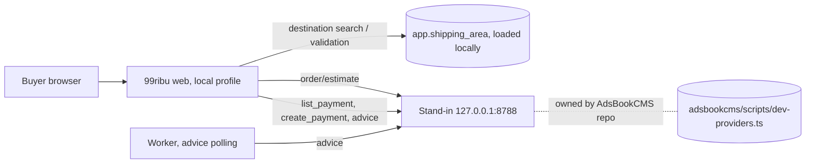

# Local provider mode — Mengantar and AutoLaris stand-in (S162–S171)

Status: DEC-028 accepted 2026-11-04 (amended: AdsBookCMS is a reference only). S162–S169 implemented locally (not committed); S170 deferred; S171 closed (review kept in its brief); follow-ups S172 (DEC-029 fee bearer), S173 (lint), S174 (flake), S175 (local dummy data), S176 (account catalogue search, province/courier promotions) done. Current state lives in `STATUS.md`, results in `BUILD-LOG.md` 2026-11-04, the implemented system in `ARCHITECTURE.md` ("Local provider mode").

This folder is not a backlog. `TASKS.md` rows S162–S171 own scope, order and gates, `DECISIONS.md` DEC-028 owns the decision, and `STATUS.md` owns state and the next action. Each brief below holds what a developer needs before touching code: the research, the recommendation and why, the files, the tests, the risks and what "done" proves. A brief never overrides its `TASKS.md` row. When they disagree, fix the brief.

## Goal

Make the local checkout exercise the **real wire protocols** of Mengantar (area data, rate estimate) and AutoLaris (payment instruction, advice) against the AdsBookCMS local stand-in (`~/Projects/adsbookcms/scripts/dev-providers.ts`, `127.0.0.1:8788`), with no credential, no live call and no change to production behaviour. Province exclusion is deferred (S170).

## What the research found (2026-11-03, read-only)

Line numbers come from the research pass and may drift; verify before relying on them.

1. **Shipping is almost free.** The S95 live adapter `mengantarRateAdapter` (`src/modules/shipping/mengantar.ts:56`) already parses the real Mengantar wire. It gets its config from `productionShipping(process.env)` (`:44`) and calls `${baseUrl}/api/public/${apiKey}/order/estimate` (`:49`). The stand-in serves the same path. Only the config source needs a local, loopback-only variant.
2. **The destination model differs.** AdsBookCMS resolves a *kecamatan* to a Mengantar area id and needs no postal code. 99ribu works at *kelurahan* level with a postal code and 24-hex ids from `app.shipping_area` (migration 0042, 79,391 rows in `data/shipping/mengantar-areas.json.gz`). The stand-in's `/address/search` returns `_id: "dev-area-N"`, `SUBDISTRICT_NAME` equal to the district and `ZIP_CODE: ""`, so it cannot feed 99ribu's address and postcode checks.
3. **AutoLaris endpoints differ.** 99ribu's live client calls `POST /api/h2h/create_payment` (payment instruction without shipment, answer `trx_id`). AdsBookCMS uses `POST /api/h2h/submit` (Create Order). The official guide says never to call both for one checkout. The stand-in serves `submit` only, so **S166 cannot run against it until the stand-in gains `create_payment`** (S171).
4. **Settlement was unproven (superseded).** **Updated 2026-11-09 (S97 step B):** the real advice was observed on one live QRIS payment: `{rc:'00',ket:'PAID',data:{awb:''}}` after payment and `{rc:'02',ket:'PENDING',data:{awb:''}}` before. `classifyAdvice` now settles exactly `rc 00` + `ket PAID` (`AUTOLARIS_SETTLEMENT`) and bills the create_payment total verified at creation; the earlier `SIMULATED_SETTLEMENT` placeholder and the stand-in "invented" shape described below are superseded. Still unobserved: VA, the callback payload, the `expired` timezone. Original text:  `classifyAdvice` (`src/modules/payments/autolaris.ts:28`) settles only on `rc 00` + `data.status === "PAID"` + a positive integer `data.amount`, a placeholder (`SIMULATED_SETTLEMENT`) until S97. The stand-in answers `ket: "PAID"` with `data: {awb: ""}`. Matching either shape proves nothing about the real provider, which has no published settled example.
5. **A config hole exists.** The local `providerKey` regex (`src/config/local.ts:60`) lacks `AUTOLARIS`, while `README.md` (line ~244) says local refuses it. It also forbids any `MENGANTAR_*` name, so a stand-in URL needs a different variable name.
6. **The stand-in is a thin fake.** No delays, failures, expiry, key check or `reff_id` dedupe; fixed courier keys that differ from the real ones (`J&T`, `IDexpress`, `Anteraja` against `JT`, `iDexpress`, `anteraja`); state in memory. It is wire-shaped, not behaviour-faithful.

## Recommended architecture

Destinations stay on 99ribu's own catalogue (production parity); rates and payments go to the stand-in over HTTP.

## Decisions to accept (DEC-028, Proposed)

| # | Recommendation | Why | Alternative rejected |
|---|---|---|---|
| D1 | One env variable `LOCAL_PROVIDER_ORIGIN=http://127.0.0.1:<port>`, unset by default, port ≥ 1024 and not 3099; accepted only by the local reader; production refuses it | Avoids the forbidden `MENGANTAR_*` prefix; one origin serves both providers, as in `dev-local.ts`; unset keeps today's behaviour exactly | Reuse `MENGANTAR_BASE_URL` / `AUTOLARIS_BASE_URL`: forbidden prefix, and invites real keys |
| D2 | Shipping reuses the S95 adapter and the `app.shipping_area` path; only the config source is injected; the `Rate.version` carries a `+stand-in` suffix | Least code and the highest fidelity; no migration (the quote guard admits only `TEST-ONLY` and `mengantar`) | New `local-provider` source: needs a migration for a marker `version` already gives. Stand-in `/address/search`: no zip, no kelurahan |
| D3 | Payments reuse the `AutolarisClient` seam and the existing `liveAutolaris` client behind a loopback-only config reader | The seam already exists (`autolarisClientFor`); exercises code that is otherwise untested over HTTP | Rewrite the client for `/submit`: wrong product (99ribu ships through Mengantar) |
| D4 | Fidelity gaps are fixed in the AdsBookCMS stand-in (S171, gated: another repository) | One owner, one drift test (`dev-providers.test.ts`), useful to AdsBookCMS too | A second 99ribu-owned stand-in: two copies drift apart |
| D5 | No secrets: the Mengantar path key and the AutoLaris bearer are the literal `local` | The stand-in ignores them; a real key cannot leak by mistake | Dummy "realistic" keys: look real in logs |
| D6 | Add `AUTOLARIS` to the local `providerKey` regex | Makes the code match the README; the stand-in needs no key | Leave the hole: a real key could reach a local run |
| D7 | Province exclusion is data-driven from the structured destination (S170), not a keyword scan of typed text | 99ribu knows the province from the area id; AdsBookCMS scans text only because IP geolocation is unreliable | Port `excluded-area.ts` keywords |

## Slice map

| Slice | Brief | Parent | Risk | Gate | After |
|---|---|---|---|---|---|
| S162 | [S162](S162.md) contract comparison | T-3 | R1 | DOC, read only | S68 |
| S163 | [S163](S163.md) local-provider config | T-23 | R3 | CODE, needs DEC-028 | S162 |
| S164 | [S164](S164.md) shipping in local-provider mode | T-3 | R3 | CODE, local data load | S163 |
| S165 | [S165](S165.md) rate estimate behaviour | T-3 | R3 | CODE | S164, S171 for courier keys and faults |
| S166 | [S166](S166.md) AutoLaris payment | T-5 | R4 | CODE | S163, S171 |
| S167 | [S167](S167.md) stand-in start and check | T-16 | R1 | CODE | S163 |
| S168 | [S168](S168.md) checkout states and copy | T-4 | R2 | CODE, visible | S164, S165, S166 |
| S169 | [S169](S169.md) acceptance case | T-16 | R2 | CODE | S164–S168, S171 |
| S170 | [S170](S170.md) province exclusion | T-3 | R3 | DEFERRED | S164, S165 |
| S172 | [S172](S172.md) who bears payment fees (DEC-029) | T-5 | R4 | DONE locally | S166 |
| S171 | [S171](S171.md) stand-in fidelity (AdsBookCMS repo) | T-16 | R2 | CLOSED by the owner (reference only) | S162 |

Order: S162 → S163 → S164 and S167 and S171 in parallel → S165 and S166 → S168 → S169. S170 waits for the owner's list.

## Local data prerequisites

Provider mode needs the 79,391-area catalogue and the warehouse mappings in the **local** database (`app.shipping_area`, `app.warehouse.provider_area_id`); today the local database uses the fixture. This is a one-time, reversible data load by dataset version (S164) and needs the owner's go-ahead because it writes to `99ribu_local`. It never touches production.

## Safety invariants for every slice

- No credential read, no secret file, no live provider call. The only reachable origin is `127.0.0.1:<port>`.
- Default behaviour with the variable unset is byte-for-byte the same as today; `--case=PR-3`, `PR-4`, `T-31` and `T-23` must still pass.
- Production refuses the variable, loopback URLs and any non-official provider origin, as today.
- Money stays whole rupiah and frozen into cart, quote and order (DEC-025). A timeout is an unknown outcome, never a failure that frees a retry with a new reference.
- Stand-in prices and settlement shapes are **fakes**: no test may present them as evidence of the real contract. S97 stays the only way to close the AutoLaris contract questions.
- Every R3/R4 slice: `delivery-ledger start` with exact globs, `check-boundary` on the final surface and a real separate-agent review bound to that surface (R4 for S166).

## Sources

- Local Mengantar reference: `~/Projects/mengantar-documentation/docs/` (`01-api-reference.md`, `02-couriers`, `08-error-catalog.md`); cited by `docs/spec/03-TECHNICAL-DESIGN.md` as SRC-MENGANTAR-LOCAL.
- AutoLaris: skill `autolaris-h2h` (`references/docs/guides/payment-gateway.md`, `reference/h2h-api.md`, `guides/integration.md`).
- Stand-in and clients: `~/Projects/adsbookcms/scripts/dev-providers.ts`, `scripts/dev-local.ts`, `src/lib/dev-providers.test.ts`, `src/lib/mengantar-client.ts`, `src/lib/autolaris-client.ts`, `src/lib/excluded-area.ts`.
- 99ribu: `src/modules/shipping/{destinations,rates,quotes,mengantar,address}.ts`, `src/modules/payments/{autolaris,autolaris-live,worker}.ts`, `src/config/{local,runtime}.ts`, `scripts/check-tests.ts`, migration `0042_mengantar_areas.sql`.
- Existing evidence: `STATUS.md` (S95, S97), `docs/spec/03-TECHNICAL-DESIGN.md` (provider sections), `RELEASE.md` (live-adapter safety checklist, S156).
